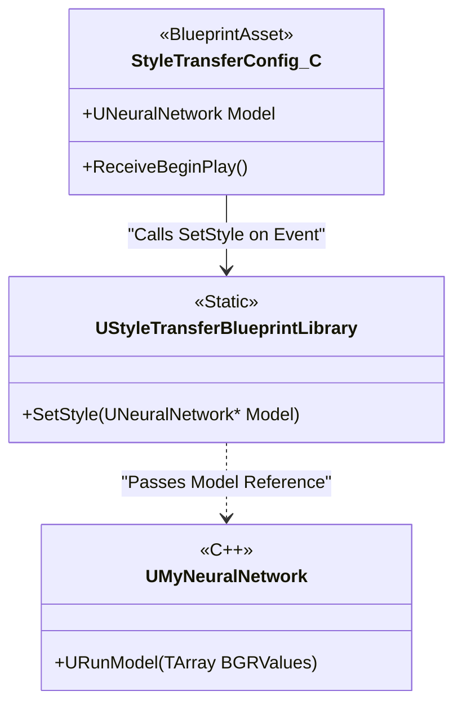

<!-- source: DeepWiki mcp.deepwiki.com · repo microsoft/OnnxRuntime-UnrealEngine · page 2.3 Blueprint API & StyleTransferConfig · fetched 2026-10-26 -->

# Blueprint API & StyleTransferConfig

<details>
<summary>Relevant source files</summary>

The following files were used as context for generating this wiki page:

- [FPStyleTransfer/Content/FirstPerson/Blueprints/StyleTransferConfig.uasset](FPStyleTransfer/Content/FirstPerson/Blueprints/StyleTransferConfig.uasset)
- [FPStyleTransfer/Content/Models/candy-9.uasset](FPStyleTransfer/Content/Models/candy-9.uasset)
- [FPStyleTransfer/Content/Models/mosaic-9.uasset](FPStyleTransfer/Content/Models/mosaic-9.uasset)

</details>


This section documents the Blueprint-accessible interface of the FPStyleTransfer system, focusing on the `UStyleTransferBlueprintLibrary` for runtime control and the `StyleTransferConfig` asset for data-driven configuration.

## Overview

The system provides a bridge between high-level game logic (Blueprints) and the low-level C++ rendering and inference engine. Designers can switch between different ONNX models at runtime using simple Blueprint nodes without modifying the underlying C++ implementation or the `FRealtimeStyleTransferViewExtension` logic.

### Data Flow: Blueprint to Inference

The following diagram illustrates how a style change request flows from a Blueprint asset through the API to the inference engine.

**Title: Style Configuration Data Flow**
```mermaid
graph TD
    subgraph "Asset Space"
        [StyleTransferConfig] -- "References" --> [candy-9]
        [StyleTransferConfig] -- "References" --> [mosaic-9]
    end

    subgraph "Blueprint Space"
        [BP_Logic] -- "Calls" --> [UStyleTransferBlueprintLibrary::SetStyle]
    end

    subgraph "Code Entity Space (C++)"
        [UStyleTransferBlueprintLibrary::SetStyle] -- "Updates" --> [FRealtimeStyleTransferViewExtension::StyleModel]
        [FRealtimeStyleTransferViewExtension::PrePostProcessPass_RenderThread] -- "Reads" --> [FRealtimeStyleTransferViewExtension::StyleModel]
        [FRealtimeStyleTransferViewExtension::PrePostProcessPass_RenderThread] -- "Executes" --> [UMyNeuralNetwork::URunModel]
    end

    [candy-9] --> [BP_Logic]
    [mosaic-9] --> [BP_Logic]
```
**Sources:**
- `FPStyleTransfer/Content/FirstPerson/Blueprints/StyleTransferConfig.uasset` [1-14]()
- `FPStyleTransfer/Source/FPStyleTransfer/Public/StyleTransferBlueprintLibrary.h` (Implicitly defined via `SetStyle`)
- `FPStyleTransfer/Source/FPStyleTransfer/Private/RealtimeStyleTransferViewExtension.cpp` (Rendering hook logic)

---

## UStyleTransferBlueprintLibrary

The `UStyleTransferBlueprintLibrary` is a static class that exposes the core style transfer controls to the Unreal Engine Blueprint system.

### SetStyle Function
The primary function used by designers is `SetStyle`.

*   **Function Name:** `SetStyle` [StyleTransferConfig.uasset:10]()
*   **Target:** `StyleTransferBlueprintLibrary` [StyleTransferConfig.uasset:13]()
*   **Parameters:**
    *   `Model`: A pointer to a `UNeuralNetwork` object (specifically an instance of `UMyNeuralNetwork`).
*   **Behavior:** This function updates the active model used by the `FRealtimeStyleTransferViewExtension`. When called, the rendering thread will swap the current ONNX model for the new one during the next `PrePostProcessPass`.

**Sources:**
- `FPStyleTransfer/Content/FirstPerson/Blueprints/StyleTransferConfig.uasset` [10-13]()

---

## StyleTransferConfig Asset

`StyleTransferConfig` is a Blueprint asset located in `Content/FirstPerson/Blueprints/`. It acts as a container and manager for the various neural network models available in the project.

### Configuration Properties
The asset tracks several key properties and relationships:

| Property | Type | Description |
| :--- | :--- | :--- |
| `Model` | `ObjectProperty` | A reference to the active `UNeuralNetwork` asset [StyleTransferConfig.uasset:8](). |
| `NeuralNetwork` | `Class` | The base class for the inference models [StyleTransferConfig.uasset:9](). |
| `mosaic-9` | `Object` | Default referenced model asset in the config [StyleTransferConfig.uasset:12](). |

### Available Model Assets
The project includes five pre-configured ONNX models that can be assigned to the `StyleTransferConfig`:
1.  **Candy**: `Content/Models/candy-9.uasset` [candy-9.uasset:2]()
2.  **Mosaic**: `Content/Models/mosaic-9.uasset` [mosaic-9.uasset:2]()
3.  **Pointilism**: (Referenced in system documentation)
4.  **Rain-Princess**: (Referenced in system documentation)
5.  **Udnie**: (Referenced in system documentation)

**Sources:**
- `FPStyleTransfer/Content/FirstPerson/Blueprints/StyleTransferConfig.uasset` [4-14]()
- `FPStyleTransfer/Content/Models/candy-9.uasset` [1-10]()
- `FPStyleTransfer/Content/Models/mosaic-9.uasset` [1-10]()

---

## Implementation Details

### Linking Assets to Code
The `StyleTransferConfig` asset is linked to the `StyleTransferBlueprintLibrary` through the Kismet compiler (Blueprint VM).

**Title: Blueprint API Interaction**


### Model Asset Structure
Each model asset (e.g., `candy-9.uasset`) contains:
*   **ModelFullFilePath**: The absolute path to the original `.onnx` file used during import [candy-9.uasset:2]().
*   **ModelReadFromFileInBytes**: The raw binary data of the ONNX model stored within the Unreal asset [candy-9.uasset:2]().
*   **NeuralNetwork**: The class association for the `NeuralNetworkInference` (NNI) plugin [candy-9.uasset:3]().

**Sources:**
- `FPStyleTransfer/Content/Models/candy-9.uasset` [2-9]()
- `FPStyleTransfer/Content/Models/mosaic-9.uasset` [2-10]()
- `FPStyleTransfer/Content/FirstPerson/Blueprints/StyleTransferConfig.uasset` [10-13]()

---

