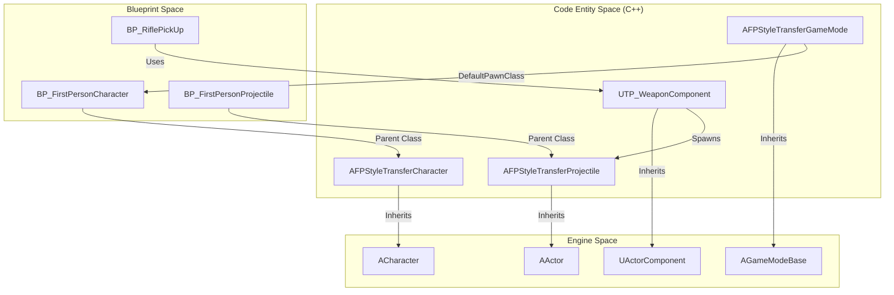
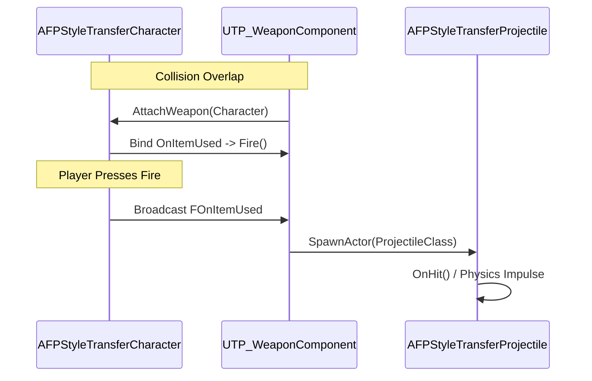

<!-- source: DeepWiki mcp.deepwiki.com · repo microsoft/OnnxRuntime-UnrealEngine · page 3 First-Person Gameplay Framework · fetched 2026-10-26 -->

# First-Person Gameplay Framework

Relevant source files

The following files were used as context for generating this wiki page:

- [FPStyleTransfer/Config/DefaultEngine.ini](FPStyleTransfer/Config/DefaultEngine.ini)
- [FPStyleTransfer/Content/FirstPerson/Blueprints/BP_FirstPersonCharacter.uasset](FPStyleTransfer/Content/FirstPerson/Blueprints/BP_FirstPersonCharacter.uasset)
- [FPStyleTransfer/Content/FirstPerson/Blueprints/BP_FirstPersonProjectile.uasset](FPStyleTransfer/Content/FirstPerson/Blueprints/BP_FirstPersonProjectile.uasset)
- [FPStyleTransfer/Content/FirstPerson/Blueprints/BP_RiflePickUp.uasset](FPStyleTransfer/Content/FirstPerson/Blueprints/BP_RiflePickUp.uasset)

The First-Person Gameplay Framework provides the foundational logic for player interaction, movement, and combat within the style-transferred environment. Built upon the Unreal Engine First Person template, it defines how the player character perceives the world, handles input, and interacts with weapons.

This framework is comprised of three primary pillars:
1.  **Game Mode**: Defines the default classes for the session.
2.  **Character & Input**: Manages the player's physical presence and controls.
3.  **Weapon & Projectiles**: Handles the mechanics of picking up equipment and firing projectiles.

### Gameplay Architecture Overview

The following diagram illustrates the relationship between the core gameplay C++ classes and their Blueprint derivatives.

**Diagram: Gameplay Class Hierarchy**

**Sources:** [FPStyleTransfer/Config/DefaultEngine.ini:16-16](), [FPStyleTransfer/Content/FirstPerson/Blueprints/BP_FirstPersonCharacter.uasset:3-3](), [FPStyleTransfer/Content/FirstPerson/Blueprints/BP_RiflePickUp.uasset:12-12]()

---

### Game Mode & Initialization
The `AFPStyleTransferGameMode` serves as the entry point for defining the game's rules and default actors. In this project, it primarily points the engine to use the specialized character class for the style transfer experience.

*   **Default Pawn**: Configured via `DefaultEngine.ini` to use the `FPStyleTransferCharacter` [FPStyleTransfer/Config/DefaultEngine.ini:43-44]().
*   **Map Defaults**: The project defaults to the `FirstPersonMap` upon startup [FPStyleTransfer/Config/DefaultEngine.ini:7-7]().

---

### Character & Input System
The `AFPStyleTransferCharacter` class manages the player's viewport and movement logic. It utilizes a `CameraComponent` for the first-person view and a `Mesh1P` (skeletal mesh) for the visible arms.

*   **Input Handling**: Movement and look axes are mapped to standard WASD and Mouse inputs.
*   **Weapon Interaction**: The character includes a delegate system (`FOnItemUsed`) that allows the weapon component to trigger firing logic when the "PrimaryAction" is pressed.

For a deep dive into movement bindings, touch support, and the camera setup, see **[Character & Input System](#3.1)**.

---

### Weapon & Projectile System
The combat system is modular, centering around a pickup-based weapon component and a physics-driven projectile.

**Diagram: Weapon Attachment and Firing Flow**

**Sources:** [FPStyleTransfer/Content/FirstPerson/Blueprints/BP_RiflePickUp.uasset:10-12](), [FPStyleTransfer/Content/FirstPerson/Blueprints/BP_FirstPersonProjectile.uasset:8-12]()

*   **Weapon Component (`UTP_WeaponComponent`)**: A sphere-collision component that detects the player, attaches the rifle mesh to the character's arms, and handles the `Fire` method [FPStyleTransfer/Content/FirstPerson/Blueprints/BP_RiflePickUp.uasset:12-12]().
*   **Projectile (`AFPStyleTransferProjectile`)**: A fast-moving actor with a `ProjectileMovementComponent`. It uses a specific "Projectile" collision profile to interact with the environment [FPStyleTransfer/Config/DefaultEngine.ini:2-4]().

For details on projectile collision settings, weapon audio, and the pickup mechanics, see **[Weapon & Projectile System](#3.2)**.

---

### Summary Table: Core Gameplay Classes

| Class | Type | Responsibility |
| :--- | :--- | :--- |
| `AFPStyleTransferGameMode` | C++ | Defines `DefaultPawnClass` and session rules [FPStyleTransfer/Config/DefaultEngine.ini:16-16](). |
| `AFPStyleTransferCharacter` | C++ | Handles input, camera, and arm mesh (`Mesh1P`) [FPStyleTransfer/Config/DefaultEngine.ini:44-44](). |
| `UTP_WeaponComponent` | C++ | Manages weapon firing logic and skeletal mesh attachment [FPStyleTransfer/Content/FirstPerson/Blueprints/BP_RiflePickUp.uasset:12-12](). |
| `AFPStyleTransferProjectile` | C++ | Handles physical impact and movement logic for fired shots [FPStyleTransfer/Config/DefaultEngine.ini:42-42](). |

**Sources:** [FPStyleTransfer/Config/DefaultEngine.ini:1-45](), [FPStyleTransfer/Content/FirstPerson/Blueprints/BP_FirstPersonCharacter.uasset:1-12](), [FPStyleTransfer/Content/FirstPerson/Blueprints/BP_RiflePickUp.uasset:1-12]()

---

