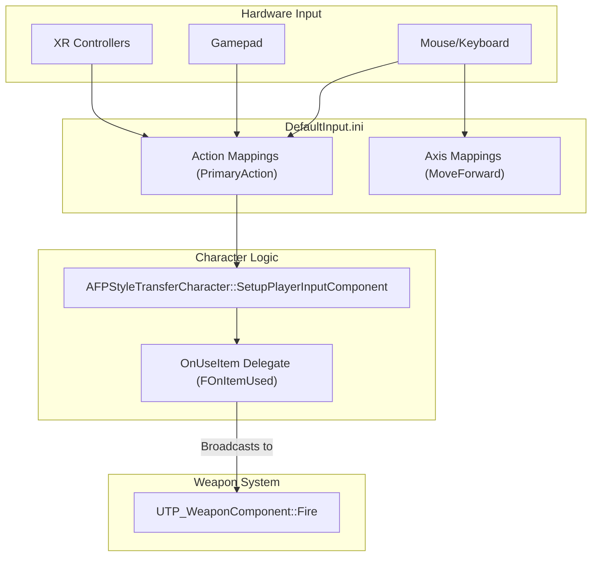
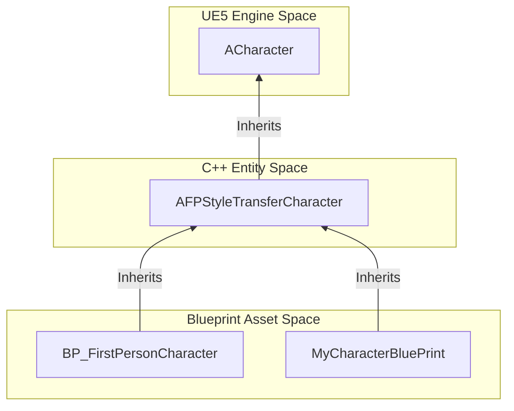

<!-- source: DeepWiki mcp.deepwiki.com · repo microsoft/OnnxRuntime-UnrealEngine · page 3.1 Character & Input System · fetched 2026-10-26 -->

# Character & Input System

Relevant source files

The following files were used as context for generating this wiki page:

- [FPStyleTransfer/Config/DefaultInput.ini](FPStyleTransfer/Config/DefaultInput.ini)
- [FPStyleTransfer/Content/FirstPerson/Blueprints/BP_FirstPersonCharacter.uasset](FPStyleTransfer/Content/FirstPerson/Blueprints/BP_FirstPersonCharacter.uasset)
- [FPStyleTransfer/Content/MyCharacterBluePrint.uasset](FPStyleTransfer/Content/MyCharacterBluePrint.uasset)

The **Character & Input System** in FPStyleTransfer defines the player's physical representation, camera perspective, and the interface between hardware input and gameplay actions. It extends the standard Unreal Engine First Person template to support the style transfer workflow, specifically managing the interaction between the character and the weapon system via delegates.

## AFPStyleTransferCharacter

The `AFPStyleTransferCharacter` class is the central C++ entity for the player. It manages the skeletal meshes for first-person visualization and the camera component used by the style transfer system to capture the scene.

### Component Hierarchy
The character utilizes a split-mesh approach to ensure the player's arms are only visible to the local camera, avoiding clipping and perspective issues.

*   **CapsuleComponent**: The root collision proxy for the character.
*   **Mesh1P (SkeletalMeshComponent)**: The "Arms" mesh, visible only to the primary player. It is parented to the camera to follow its orientation.
*   **FirstPersonCameraComponent**: Positioned at eye level, this component serves as the source for the `FSceneViewExtension` used in the style transfer pipeline.

### FOnItemUsed Delegate
A critical architectural feature is the `FOnItemUsed` delegate. This allows the character to remain decoupled from the specific weapon implementation. When the "PrimaryAction" is triggered, the character broadcasts this delegate, which is consumed by the `UTP_WeaponComponent` to execute firing logic.

| Entity | Role |
| :--- | :--- |
| `AFPStyleTransferCharacter` | Defines the `OnUseItem` delegate instance. |
| `FOnItemUsed` | A multicast delegate signature with no parameters. |
| `SetupPlayerInputComponent` | Binds the `PrimaryAction` input to the character's internal firing trigger. |

**Sources:** `[FPStyleTransfer/Content/FirstPerson/Blueprints/BP_FirstPersonCharacter.uasset:1-12]()`, `[FPStyleTransfer/Content/MyCharacterBluePrint.uasset:1-10]()`

## Input Mappings

The project defines a comprehensive set of input actions and axes in `DefaultInput.ini` to support Desktop (Mouse/Keyboard), Gamepads, and various XR/VR controllers (Vive, Oculus Touch, Valve Index, Windows Mixed Reality).

### Action Mappings
Action mappings represent discrete events (pressed/released).

| Action | Mapping | Purpose |
| :--- | :--- | :--- |
| **Jump** | `Space Bar`, `Gamepad Face Button Bottom` | Triggers the character jump movement. |
| **PrimaryAction** | `Left Mouse Button`, `Gamepad Right Trigger` | Triggers the `OnUseItem` delegate for weapon firing. |

### Axis Mappings
Axis mappings represent continuous input values (range -1.0 to 1.0).

| Axis | Mapping | Sensitivity/Deadzone |
| :--- | :--- | :--- |
| **Move Forward / Backward** | `W`, `S`, `Gamepad Left Thumbstick Y` | Deadzone: 0.25 |
| **Move Right / Left** | `A`, `D`, `Gamepad Left Thumbstick X` | Deadzone: 0.25 |
| **Turn Right / Left (Mouse)** | `Mouse X` | Sensitivity: 0.07 |
| **Look Up / Down (Mouse)** | `Mouse Y` | Sensitivity: 0.07 |

### Input Flow Diagram
The following diagram illustrates how raw hardware input is translated into gameplay logic through the character class.

**Input Translation Architecture**

**Sources:** `[FPStyleTransfer/Config/DefaultInput.ini:1-60]()`

## Game Mode & Blueprints

### AFPStyleTransferGameMode
The `AFPStyleTransferGameMode` defines the rules of the session and specifies the default classes to be spawned.
*   **Default Pawn Class**: Set to `BP_FirstPersonCharacter` (the Blueprint derivative of `AFPStyleTransferCharacter`).
*   **HUD Class**: Manages the crosshair and UI overlays.

### MyCharacterBluePrint & BP_FirstPersonCharacter
The project utilizes two primary character assets:
1.  **BP_FirstPersonCharacter**: The main playable character blueprint. It inherits from the C++ `AFPStyleTransferCharacter` and configures the skeletal mesh for `SK_Mannequin_Arms` and the animation blueprint `FirstPerson_AnimBP`.
2.  **MyCharacterBluePrint**: A specialized variant used for functional testing and automated screenshots. It contains logic for `TakeAutomationScreenshotAtCamera` to validate style transfer output during automated builds.

**Character Blueprint Hierarchy**

**Sources:** `[FPStyleTransfer/Content/FirstPerson/Blueprints/BP_FirstPersonCharacter.uasset:3-12]()`, `[FPStyleTransfer/Content/MyCharacterBluePrint.uasset:3-10]()`

## Touch & Mobile Support
The system includes native support for touch interfaces, primarily targeting mobile platforms where the style transfer model might run via the ONNX Runtime mobile backends.
*   **Touch Input**: Handled via `InputTouch` events in the `SetupPlayerInputComponent`.
*   **Virtual Joysticks**: Configured to map to the `MoveForward` and `Turn` axes when a touch interface is detected.

**Sources:** `[FPStyleTransfer/Config/DefaultInput.ini:60-100]()`

---

