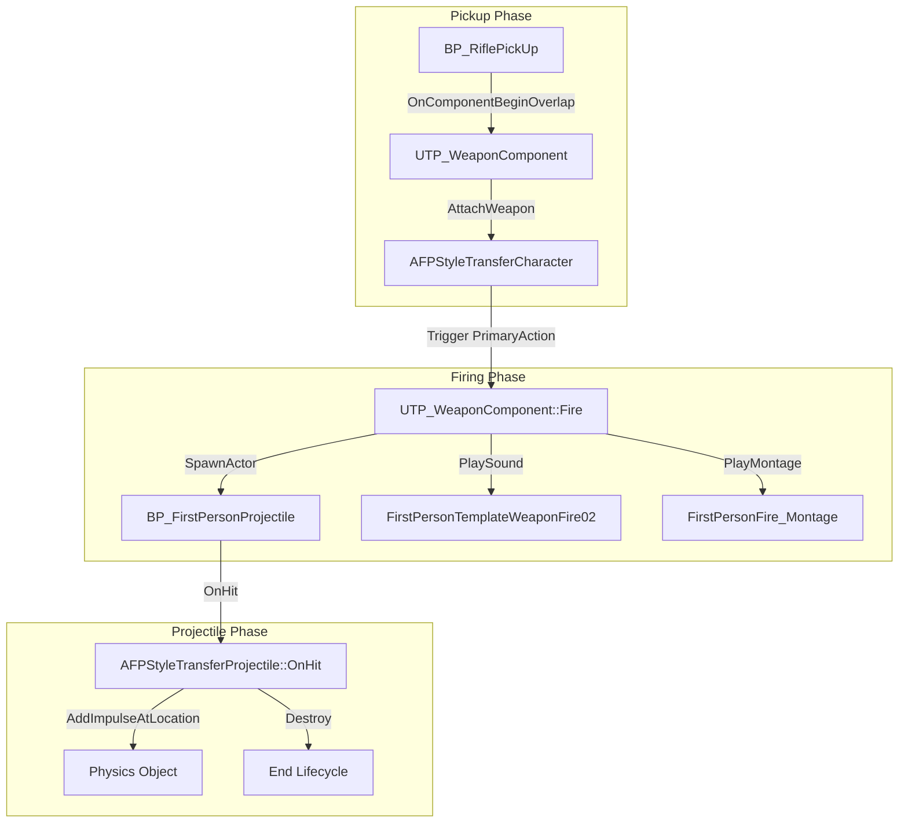
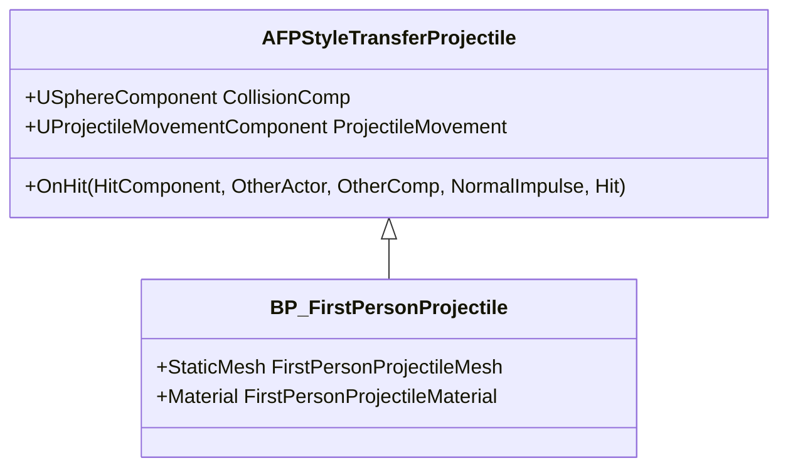

<!-- source: DeepWiki mcp.deepwiki.com · repo microsoft/OnnxRuntime-UnrealEngine · page 3.2 Weapon & Projectile System · fetched 2026-10-26 -->

# Weapon & Projectile System

Relevant source files

The following files were used as context for generating this wiki page:

- [FPStyleTransfer/Content/FPWeapon/Audio/FirstPersonTemplateWeaponFire02.uasset](FPStyleTransfer/Content/FPWeapon/Audio/FirstPersonTemplateWeaponFire02.uasset)
- [FPStyleTransfer/Content/FPWeapon/Mesh/FirstPersonProjectileMesh.uasset](FPStyleTransfer/Content/FPWeapon/Mesh/FirstPersonProjectileMesh.uasset)
- [FPStyleTransfer/Content/FPWeapon/Mesh/SK_FPGun.uasset](FPStyleTransfer/Content/FPWeapon/Mesh/SK_FPGun.uasset)
- [FPStyleTransfer/Content/FPWeapon/Mesh/SK_FPGun_Physics.uasset](FPStyleTransfer/Content/FPWeapon/Mesh/SK_FPGun_Physics.uasset)
- [FPStyleTransfer/Content/FPWeapon/Mesh/SK_FPGun_PhysicsAsset.uasset](FPStyleTransfer/Content/FPWeapon/Mesh/SK_FPGun_PhysicsAsset.uasset)
- [FPStyleTransfer/Content/FPWeapon/Mesh/SK_FPGun_Skeleton.uasset](FPStyleTransfer/Content/FPWeapon/Mesh/SK_FPGun_Skeleton.uasset)
- [FPStyleTransfer/Content/FirstPerson/Blueprints/BP_FirstPersonProjectile.uasset](FPStyleTransfer/Content/FirstPerson/Blueprints/BP_FirstPersonProjectile.uasset)
- [FPStyleTransfer/Content/FirstPerson/Blueprints/BP_RiflePickUp.uasset](FPStyleTransfer/Content/FirstPerson/Blueprints/BP_RiflePickUp.uasset)

The Weapon & Projectile System provides the core combat mechanics for the FPStyleTransfer project. It handles weapon interaction via a component-based architecture, physics-driven projectile simulation, and the integration of visual/audio feedback during firing events.

## System Architecture Overview

The system is divided into two primary C++ classes and their corresponding Blueprint extensions. `UTP_WeaponComponent` acts as the controller for firing logic and pickup interaction, while `AFPStyleTransferProjectile` handles the movement and collision of fired rounds.

### Component Interaction Flow

The following diagram illustrates the lifecycle from a weapon being picked up to a projectile impacting a target.

**Weapon Lifecycle and Firing Flow**

Sources: [FPStyleTransfer/Source/FPStyleTransfer/TP_WeaponComponent.h:12-65](), [FPStyleTransfer/Source/FPStyleTransfer/FPStyleTransferProjectile.h:12-40](), [FPStyleTransfer/Content/FirstPerson/Blueprints/BP_RiflePickUp.uasset:1-12]()

---

## UTP_WeaponComponent

The `UTP_WeaponComponent` is a `USkeletalMeshComponent` subclass that manages the weapon's state and its attachment to the player character. It utilizes a sphere collision component to detect when a player is within range to "pick up" the weapon.

### Key Implementation Details
- **Attachment Logic**: It binds to the `AFPStyleTransferCharacter` and attaches itself to the `GripPoint` socket defined in the character's skeletal mesh [FPStyleTransfer/Source/FPStyleTransfer/TP_WeaponComponent.cpp:68-85]().
- **Firing Mechanism**: The `Fire()` method calculates the projectile's spawn location using the `Muzzle` socket and initiates the spawn via `GetWorld()->SpawnActor<AFPStyleTransferProjectile>` [FPStyleTransfer/Source/FPStyleTransfer/TP_WeaponComponent.cpp:45-66]().
- **Configuration**: Exposed properties allow designers to set the `ProjectileClass`, `FireSound`, and `FireAnimation` (Montage) within Blueprints like `BP_RiflePickUp` [FPStyleTransfer/Source/FPStyleTransfer/TP_WeaponComponent.h:32-45]().

Sources: [FPStyleTransfer/Source/FPStyleTransfer/TP_WeaponComponent.h:12-65](), [FPStyleTransfer/Source/FPStyleTransfer/TP_WeaponComponent.cpp:1-90]()

---

## Projectile System

The projectile system uses a specialized actor, `AFPStyleTransferProjectile`, which encapsulates a `USphereComponent` for collision and a `UProjectileMovementComponent` for ballistic simulation.

### AFPStyleTransferProjectile Class
This class defines the physical behavior of the projectile upon impact.
- **Collision Handling**: The `OnHit` function is registered to the `OnComponentHit` delegate of the `CollisionComponent` [FPStyleTransfer/Source/FPStyleTransfer/FPStyleTransferProjectile.cpp:15-25]().
- **Impulse Transfer**: If the projectile hits a component simulating physics, it applies a linear impulse: `OtherComp->AddImpulseAtLocation(GetVelocity() * 100.0f, GetActorLocation())` [FPStyleTransfer/Source/FPStyleTransfer/FPStyleTransferProjectile.cpp:32-36]().

### BP_FirstPersonProjectile
The Blueprint implementation `BP_FirstPersonProjectile` extends the C++ class to include visual assets:
- **Mesh**: Uses `FirstPersonProjectileMesh.uasset` [FPStyleTransfer/Content/FirstPerson/Blueprints/BP_FirstPersonProjectile.uasset:11-12]().
- **Material**: Applied `FirstPersonProjectileMaterial` to the static mesh [FPStyleTransfer/Content/FPWeapon/Mesh/FirstPersonProjectileMesh.uasset:5-6]().

**Projectile Code-to-Asset Mapping**

Sources: [FPStyleTransfer/Source/FPStyleTransfer/FPStyleTransferProjectile.h:12-40](), [FPStyleTransfer/Content/FirstPerson/Blueprints/BP_FirstPersonProjectile.uasset:1-13]()

---

## Weapon Assets and Configuration

The weapon system relies on a specific set of skeletal and audio assets located in `/Content/FPWeapon/`.

### Skeletal Mesh: SK_FPGun
The `SK_FPGun` asset contains the hierarchy required for weapon animations and attachment points.
- **Sockets**: Includes `Muzzle` for projectile spawning and `GripPoint` for hand alignment [FPStyleTransfer/Content/FPWeapon/Mesh/SK_FPGun_Skeleton.uasset:5-6]().
- **Physics**: Associated with `SK_FPGun_Physics.uasset`, defining collision bodies for the `Grip_Bone` and `Root_Bone` [FPStyleTransfer/Content/FPWeapon/Mesh/SK_FPGun_Physics.uasset:2-3]().

### Audio and Visual Feedback
- **Fire Sound**: `FirstPersonTemplateWeaponFire02.uasset` is a 44.1kHz SoundWave triggered during the `Fire()` event [FPStyleTransfer/Content/FPWeapon/Audio/FirstPersonTemplateWeaponFire02.uasset:19-22]().
- **Animations**: The system utilizes `FirstPersonFire_Montage` to play the recoil animation on the character's arms when the weapon is discharged [FPStyleTransfer/Content/FirstPerson/Blueprints/BP_RiflePickUp.uasset:10-11]().

| Asset Name | Type | Purpose |
| :--- | :--- | :--- |
| `SK_FPGun` | Skeletal Mesh | Main weapon model |
| `BP_RiflePickUp` | Blueprint Actor | World-placed item for weapon acquisition |
| `FirstPersonProjectileMesh` | Static Mesh | Visual representation of the bullet |
| `FirstPersonTemplateWeaponFire02` | SoundWave | Audio for the firing event |

Sources: [FPStyleTransfer/Content/FPWeapon/Mesh/SK_FPGun.uasset:1-8](), [FPStyleTransfer/Content/FPWeapon/Audio/FirstPersonTemplateWeaponFire02.uasset:1-22](), [FPStyleTransfer/Content/FirstPerson/Blueprints/BP_RiflePickUp.uasset:1-12]()

---

