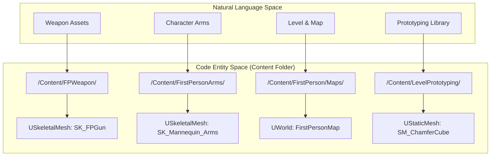
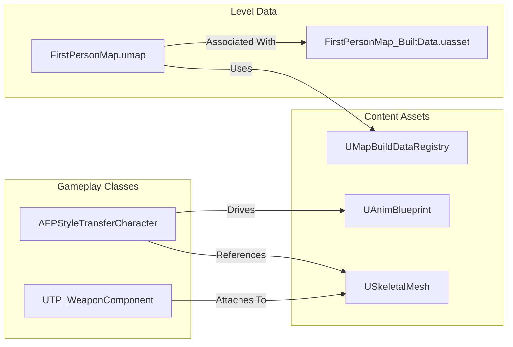

<!-- source: DeepWiki mcp.deepwiki.com · repo microsoft/OnnxRuntime-UnrealEngine · page 4 Content & Assets · fetched 2026-10-26 -->

# Content & Assets

Relevant source files

The following files were used as context for generating this wiki page:

- [FPStyleTransfer/Content/FPWeapon/Materials/BaseMaterial.uasset](FPStyleTransfer/Content/FPWeapon/Materials/BaseMaterial.uasset)
- [FPStyleTransfer/Content/FirstPerson/Maps/FirstPersonMap.umap](FPStyleTransfer/Content/FirstPerson/Maps/FirstPersonMap.umap)
- [FPStyleTransfer/Content/FirstPerson/Maps/FirstPersonMap_BuiltData.uasset](FPStyleTransfer/Content/FirstPerson/Maps/FirstPersonMap_BuiltData.uasset)

This page provides a high-level overview of the Unreal Engine content assets used in the FPStyleTransfer project. The assets are categorized into weapon-related content, character arm meshes and animations, and the level environment including prototyping libraries.

The project leverages a mix of standard Unreal Engine First Person template assets and custom configurations to support the real-time neural style transfer pipeline.

## Asset Organization

The project assets are primarily organized within the `Content` directory, separating gameplay-specific meshes from environmental prototyping tools.

### Natural Language to Code Entity Mapping: Content
The following diagram maps high-level asset categories to their corresponding paths and internal class types used within the engine.

Sources: [/Game/FPWeapon/Materials/BaseMaterial:1-4](), [/Game/FirstPerson/Maps/FirstPersonMap:1-24]()

## Asset Categories

### 4.1 FPWeapon Assets
The weapon system utilizes a collection of skeletal meshes and complex material layers. This category includes the `SK_FPGun` skeletal mesh, which serves as the primary view-model for the player's weapon. The materials are built using a layered approach, utilizing `BaseMaterial` and various material layers like `ML_GlossyBlack_Latex` and `ML_SoftMetal` to achieve high-fidelity visuals before the style transfer pass is applied.

For details, see [FPWeapon Assets](#4.1) (Child Page).

### 4.2 FirstPersonArms Character Assets
The character's visual representation is handled through the `SK_Mannequin_Arms` skeletal mesh. This includes a full animation suite (Idle, Run, Fire, Jump) and the `FirstPerson_AnimBP` Animation Blueprint which drives the arm movements in sync with gameplay states. The materials for the arms share the same layering logic as the weapon assets to ensure visual consistency.

For details, see [FirstPersonArms Character Assets](#4.2) (Child Page).

### 4.3 Level Map & Prototyping Assets
The primary testing environment is defined in `FirstPersonMap.umap`. This level is constructed using the `LevelPrototyping` library, which contains various geometric primitives (`SM_Cube`, `SM_Cylinder`, `SM_Ramp`) and grid-based materials (`M_PrototypeGrid`). These assets are designed for rapid environment iteration and provide the high-contrast geometry necessary to test the edge-detection and texture-application capabilities of the ONNX style transfer models.

For details, see [Level Map & Prototyping Assets](#4.3) (Child Page).

## Asset Integration Diagram

This diagram illustrates how various asset types are referenced by the core gameplay and rendering classes.

Sources: [/Game/FirstPerson/Maps/FirstPersonMap:14-24](), [/Game/FirstPerson/Maps/FirstPersonMap_BuiltData:2-5]()

## Summary Table of Key Assets

| Category | Primary Asset | Path | Description |
| :--- | :--- | :--- | :--- |
| **Weapon** | `SK_FPGun` | `/Content/FPWeapon/Mesh/` | The skeletal mesh for the first-person rifle. |
| **Character** | `SK_Mannequin_Arms` | `/Content/FirstPersonArms/Character/` | The rigged arms used for the player view-model. |
| **Environment** | `FirstPersonMap` | `/Content/FirstPerson/Maps/` | The main level map containing the test arena. [FirstPersonMap:1-5]() |
| **Lighting** | `BuiltData` | `/Content/FirstPerson/Maps/` | Precomputed lighting and reflection data. [FirstPersonMap_BuiltData:2-5]() |
| **Materials** | `BaseMaterial` | `/Content/FPWeapon/Materials/` | Parent material for weapon and arm surfaces. [BaseMaterial:3-4]() |

Sources: [/Game/FPWeapon/Materials/BaseMaterial:1-4](), [/Game/FirstPerson/Maps/FirstPersonMap:1-24](), [/Game/FirstPerson/Maps/FirstPersonMap_BuiltData:1-6]()

---

