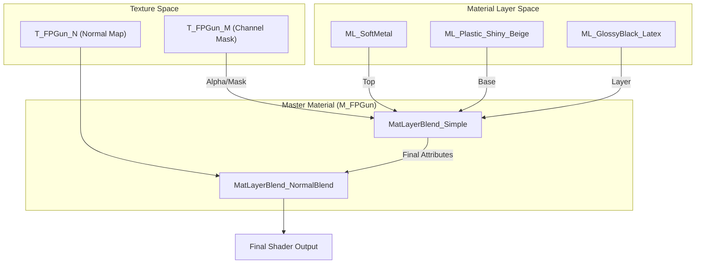
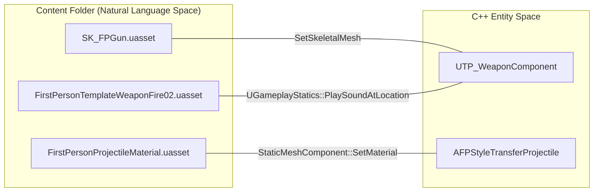

<!-- source: DeepWiki mcp.deepwiki.com · repo microsoft/OnnxRuntime-UnrealEngine · page 4.1 FPWeapon Assets · fetched 2026-10-26 -->

# FPWeapon Assets

Relevant source files

The following files were used as context for generating this wiki page:

- [FPStyleTransfer/Content/FPWeapon/Audio/FirstPersonTemplateWeaponFire02.uasset](FPStyleTransfer/Content/FPWeapon/Audio/FirstPersonTemplateWeaponFire02.uasset)
- [FPStyleTransfer/Content/FPWeapon/Materials/BaseMaterial.uasset](FPStyleTransfer/Content/FPWeapon/Materials/BaseMaterial.uasset)
- [FPStyleTransfer/Content/FPWeapon/Materials/FirstPersonProjectileMaterial.uasset](FPStyleTransfer/Content/FPWeapon/Materials/FirstPersonProjectileMaterial.uasset)
- [FPStyleTransfer/Content/FPWeapon/Materials/M_FPGun.uasset](FPStyleTransfer/Content/FPWeapon/Materials/M_FPGun.uasset)
- [FPStyleTransfer/Content/FPWeapon/Materials/MaterialLayers/ML_GlossyBlack_Latex_UE4.uasset](FPStyleTransfer/Content/FPWeapon/Materials/MaterialLayers/ML_GlossyBlack_Latex_UE4.uasset)
- [FPStyleTransfer/Content/FPWeapon/Materials/MaterialLayers/ML_Plastic_Shiny_Beige.uasset](FPStyleTransfer/Content/FPWeapon/Materials/MaterialLayers/ML_Plastic_Shiny_Beige.uasset)
- [FPStyleTransfer/Content/FPWeapon/Materials/MaterialLayers/ML_Screen.uasset](FPStyleTransfer/Content/FPWeapon/Materials/MaterialLayers/ML_Screen.uasset)
- [FPStyleTransfer/Content/FPWeapon/Materials/MaterialLayers/ML_SoftMetal_UE4.uasset](FPStyleTransfer/Content/FPWeapon/Materials/MaterialLayers/ML_SoftMetal_UE4.uasset)
- [FPStyleTransfer/Content/FPWeapon/Materials/MaterialLayers/T_ML_Aluminum01.uasset](FPStyleTransfer/Content/FPWeapon/Materials/MaterialLayers/T_ML_Aluminum01.uasset)
- [FPStyleTransfer/Content/FPWeapon/Materials/MaterialLayers/T_ML_Aluminum01_N.uasset](FPStyleTransfer/Content/FPWeapon/Materials/MaterialLayers/T_ML_Aluminum01_N.uasset)
- [FPStyleTransfer/Content/FPWeapon/Materials/MaterialLayers/T_ML_FineRubber.uasset](FPStyleTransfer/Content/FPWeapon/Materials/MaterialLayers/T_ML_FineRubber.uasset)
- [FPStyleTransfer/Content/FPWeapon/Materials/MaterialLayers/T_ML_Rubber_Blue_01_D.uasset](FPStyleTransfer/Content/FPWeapon/Materials/MaterialLayers/T_ML_Rubber_Blue_01_D.uasset)
- [FPStyleTransfer/Content/FPWeapon/Materials/MaterialLayers/T_ML_Rubber_Blue_01_N.uasset](FPStyleTransfer/Content/FPWeapon/Materials/MaterialLayers/T_ML_Rubber_Blue_01_N.uasset)
- [FPStyleTransfer/Content/FPWeapon/Textures/T_FPGun_M.uasset](FPStyleTransfer/Content/FPWeapon/Textures/T_FPGun_M.uasset)
- [FPStyleTransfer/Content/FPWeapon/Textures/T_FPGun_N.uasset](FPStyleTransfer/Content/FPWeapon/Textures/T_FPGun_N.uasset)

This page catalogs the visual and auditory assets located under `Content/FPWeapon`. These assets define the appearance, physical behavior, and sound effects of the first-person weapon used by the `AFPStyleTransferCharacter`.

## Skeletal Mesh and Physics
The core of the weapon system is the `SK_FPGun` skeletal mesh. It is associated with a specific skeleton and physics asset to handle animations and collision detection within the game world.

| Asset Name | Type | Description |
| :--- | :--- | :--- |
| `SK_FPGun` | Skeletal Mesh | The primary 3D model for the first-person rifle. |
| `SK_FPGun_Skeleton` | Skeleton | Defines the bone hierarchy for weapon animations (e.g., muzzle flash socket). |
| `SK_FPGun_PhysicsAsset` | Physics Asset | Contains the collision primitive data used for physics interactions. |

**Sources:** [Content/FPWeapon/Mesh/SK_FPGun.uasset](), [Content/FPWeapon/Mesh/SK_FPGun_Skeleton.uasset]()

## Materials and Shaders
The weapon uses a modular material system based on **Material Layers**. This allows for complex surface detail (metal, plastic, rubber) to be blended onto a single mesh using mask textures.

### Base and Master Materials
*   **`BaseMaterial`**: A parent material that provides standard inputs for Base Color, Metallic, Specular, and Roughness [Content/FPWeapon/Materials/BaseMaterial.uasset:3-4]().
*   **`M_FPGun`**: The master material applied to the weapon mesh. It utilizes `bUseMaterialAttributes` and blends multiple material layers using `MatLayerBlend_Simple` and `MatLayerBlend_NormalBlend` [Content/FPWeapon/Materials/M_FPGun.uasset:3-7]().
*   **`FirstPersonProjectileMaterial`**: An instance of the base material specifically configured for the `AFPStyleTransferProjectile` [Content/FPWeapon/Materials/FirstPersonProjectileMaterial.uasset:2-4]().

### Material Layers (ML)
These assets represent specific surface types that are sampled by `M_FPGun`.

| Layer Asset | Surface Type | Key Properties |
| :--- | :--- | :--- |
| `ML_GlossyBlack_Latex` | Rubber/Latex | Uses `T_ML_Rubber_Blue_01_D` and `T_ML_Rubber_Blue_01_N` [Content/FPWeapon/Materials/MaterialLayers/ML_GlossyBlack_Latex_UE4.uasset:3-8](). |
| `ML_Plastic_Shiny_Beige` | Hard Plastic | Defines a beige base color and high roughness for the rifle body [Content/FPWeapon/Materials/MaterialLayers/ML_Plastic_Shiny_Beige.uasset:1-3](). |
| `ML_SoftMetal` | Aluminum | Uses `T_ML_Aluminum01` for metallic sheen and normal detail [Content/FPWeapon/Materials/MaterialLayers/ML_SoftMetal_UE4.uasset:2-7](). |
| `ML_Screen` | Emissive Glass | Configured for the optical scope or readout displays on the weapon [Content/FPWeapon/Materials/MaterialLayers/ML_Screen.uasset:1-4](). |

**Sources:** [Content/FPWeapon/Materials/M_FPGun.uasset](), [Content/FPWeapon/Materials/MaterialLayers/ML_GlossyBlack_Latex_UE4.uasset](), [Content/FPWeapon/Materials/MaterialLayers/ML_SoftMetal_UE4.uasset]()

## Textures
The weapon's detail is driven by a set of high-resolution textures, including channel-packed masks and normal maps.

*   **`T_FPGun_M`**: A channel-packed mask texture. The different color channels (R, G, B, A) define where specific material layers (like `ML_SoftMetal` vs `ML_Plastic`) are applied to the mesh [Content/FPWeapon/Materials/M_FPGun.uasset:3-14]().
*   **`T_FPGun_N`**: The primary tangent-space normal map for the rifle, providing high-frequency surface detail [Content/FPWeapon/Materials/M_FPGun.uasset:3-13]().
*   **`T_ML_*` Series**: Tiling textures used within material layers, such as `T_ML_Aluminum01` (Base Color) and `T_ML_Aluminum01_N` (Normal) [Content/FPWeapon/Materials/MaterialLayers/T_ML_Aluminum01.uasset:1-4]().

**Sources:** [Content/FPWeapon/Materials/M_FPGun.uasset](), [Content/FPWeapon/Materials/MaterialLayers/T_ML_Aluminum01.uasset](), [Content/FPWeapon/Materials/MaterialLayers/T_ML_Aluminum01_N.uasset]()

## Audio
The weapon includes a high-quality fire sound effect triggered by the `UTP_WeaponComponent`.

*   **`FirstPersonTemplateWeaponFire02`**: A `SoundWave` asset.
    *   **Sample Rate**: 44100 Hz [Content/FPWeapon/Audio/FirstPersonTemplateWeaponFire02.uasset:19]().
    *   **Channels**: 2 (Stereo) [Content/FPWeapon/Audio/FirstPersonTemplateWeaponFire02.uasset:19]().
    *   **Duration**: ~1.70 seconds [Content/FPWeapon/Audio/FirstPersonTemplateWeaponFire02.uasset:19]().
    *   **Compression**: Quality level 80 [Content/FPWeapon/Audio/FirstPersonTemplateWeaponFire02.uasset:19]().

**Sources:** [Content/FPWeapon/Audio/FirstPersonTemplateWeaponFire02.uasset]()

## Data Flow and Implementation Diagrams

### Weapon Material Pipeline
This diagram illustrates how textures and material layers flow into the final `M_FPGun` shader.

**Sources:** [Content/FPWeapon/Materials/M_FPGun.uasset:3-11](), [Content/FPWeapon/Materials/MaterialLayers/ML_SoftMetal_UE4.uasset:5-6]()

### Asset-to-Code Mapping
This diagram bridges the visual assets in the `Content` folder to the C++ classes that utilize them.

**Sources:** [Content/FPWeapon/Audio/FirstPersonTemplateWeaponFire02.uasset:18-19](), [Content/FPWeapon/Materials/FirstPersonProjectileMaterial.uasset:4-5]()

---

