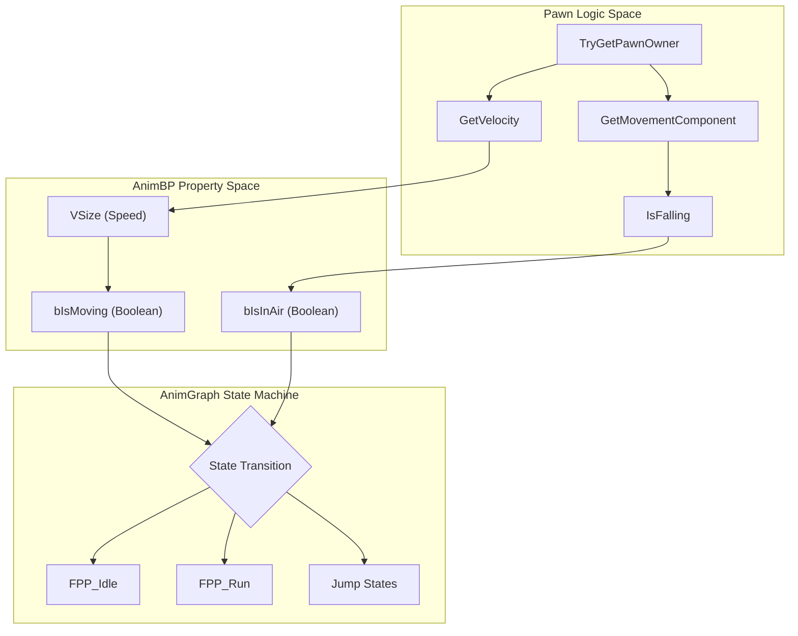
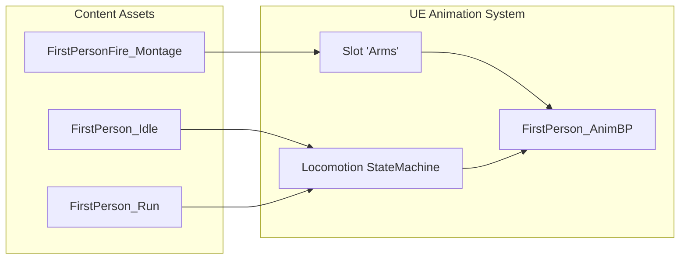

<!-- source: DeepWiki mcp.deepwiki.com · repo microsoft/OnnxRuntime-UnrealEngine · page 4.2 FirstPersonArms Character Assets · fetched 2026-10-26 -->

# FirstPersonArms Character Assets

Relevant source files

The following files were used as context for generating this wiki page:

- [FPStyleTransfer/Content/FirstPersonArms/Animations/FirstPersonFire_Montage.uasset](FPStyleTransfer/Content/FirstPersonArms/Animations/FirstPersonFire_Montage.uasset)
- [FPStyleTransfer/Content/FirstPersonArms/Animations/FirstPerson_AnimBP.uasset](FPStyleTransfer/Content/FirstPersonArms/Animations/FirstPerson_AnimBP.uasset)
- [FPStyleTransfer/Content/FirstPersonArms/Animations/FirstPerson_Fire.uasset](FPStyleTransfer/Content/FirstPersonArms/Animations/FirstPerson_Fire.uasset)
- [FPStyleTransfer/Content/FirstPersonArms/Animations/FirstPerson_Idle.uasset](FPStyleTransfer/Content/FirstPersonArms/Animations/FirstPerson_Idle.uasset)
- [FPStyleTransfer/Content/FirstPersonArms/Animations/FirstPerson_JumpEnd.uasset](FPStyleTransfer/Content/FirstPersonArms/Animations/FirstPerson_JumpEnd.uasset)
- [FPStyleTransfer/Content/FirstPersonArms/Animations/FirstPerson_JumpLoop.uasset](FPStyleTransfer/Content/FirstPersonArms/Animations/FirstPerson_JumpLoop.uasset)
- [FPStyleTransfer/Content/FirstPersonArms/Animations/FirstPerson_JumpStart.uasset](FPStyleTransfer/Content/FirstPersonArms/Animations/FirstPerson_JumpStart.uasset)
- [FPStyleTransfer/Content/FirstPersonArms/Animations/FirstPerson_Run.uasset](FPStyleTransfer/Content/FirstPersonArms/Animations/FirstPerson_Run.uasset)
- [FPStyleTransfer/Content/FirstPersonArms/Character/Materials/M_UE4Man_Body.uasset](FPStyleTransfer/Content/FirstPersonArms/Character/Materials/M_UE4Man_Body.uasset)
- [FPStyleTransfer/Content/FirstPersonArms/Character/Materials/MaterialLayers/ML_GlossyBlack_Latex_UE4.uasset](FPStyleTransfer/Content/FirstPersonArms/Character/Materials/MaterialLayers/ML_GlossyBlack_Latex_UE4.uasset)
- [FPStyleTransfer/Content/FirstPersonArms/Character/Materials/MaterialLayers/ML_Plastic_Shiny_Beige.uasset](FPStyleTransfer/Content/FirstPersonArms/Character/Materials/MaterialLayers/ML_Plastic_Shiny_Beige.uasset)
- [FPStyleTransfer/Content/FirstPersonArms/Character/Materials/MaterialLayers/ML_Plastic_Shiny_Beige_LOGO.uasset](FPStyleTransfer/Content/FirstPersonArms/Character/Materials/MaterialLayers/ML_Plastic_Shiny_Beige_LOGO.uasset)
- [FPStyleTransfer/Content/FirstPersonArms/Character/Materials/MaterialLayers/ML_SoftMetal_UE4.uasset](FPStyleTransfer/Content/FirstPersonArms/Character/Materials/MaterialLayers/ML_SoftMetal_UE4.uasset)
- [FPStyleTransfer/Content/FirstPersonArms/Character/Mesh/SK_Mannequin_Arms.uasset](FPStyleTransfer/Content/FirstPersonArms/Character/Mesh/SK_Mannequin_Arms.uasset)
- [FPStyleTransfer/Content/FirstPersonArms/Character/Mesh/SK_Mannequin_Arms_PhysicsAsset.uasset](FPStyleTransfer/Content/FirstPersonArms/Character/Mesh/SK_Mannequin_Arms_PhysicsAsset.uasset)
- [FPStyleTransfer/Content/FirstPersonArms/Character/Mesh/SK_Mannequin_Arms_Skeleton.uasset](FPStyleTransfer/Content/FirstPersonArms/Character/Mesh/SK_Mannequin_Arms_Skeleton.uasset)
- [FPStyleTransfer/Content/FirstPersonArms/Character/Textures/UE4_LOGO_CARD.uasset](FPStyleTransfer/Content/FirstPersonArms/Character/Textures/UE4_LOGO_CARD.uasset)
- [FPStyleTransfer/Content/FirstPersonArms/Character/Textures/UE4_Mannequin_MAT_MASKA.uasset](FPStyleTransfer/Content/FirstPersonArms/Character/Textures/UE4_Mannequin_MAT_MASKA.uasset)
- [FPStyleTransfer/Content/FirstPersonArms/Character/Textures/UE4_Mannequin__normals.uasset](FPStyleTransfer/Content/FirstPersonArms/Character/Textures/UE4_Mannequin__normals.uasset)

This page details the skeletal mesh, material systems, and animation assets for the first-person character arms used in the FPStyleTransfer project. These assets provide the visual representation of the player in the viewport and are integrated with the weapon system to handle firing and movement feedback.

## Skeletal Mesh and Rigging

The character's visual presence is defined by the `SK_Mannequin_Arms` skeletal mesh. This mesh uses a standard UE4 mannequin arm hierarchy, optimized for first-person perspectives where only the arms and hands are visible to the player camera.

### Core Mesh Assets
| Asset Name | Type | Description |
| :--- | :--- | :--- |
| `SK_Mannequin_Arms` | Skeletal Mesh | The primary 3D geometry for the player's arms. |
| `SK_Mannequin_Arms_Skeleton` | Skeleton | Defines the bone hierarchy and rig structure. [FPStyleTransfer/Content/FirstPersonArms/Animations/FirstPersonFire_Montage.uasset:13-13]() |
| `SK_Mannequin_Arms_PhysicsAsset` | Physics Asset | Contains collision bodies and constraints for physical interactions/ragdolls. |

### Bone Hierarchy (Key Nodes)
The rig includes standard hand and finger bones used for weapon gripping and animation blending:
*   **Arm Segments:** `upperarm_l/r`, `lowerarm_l/r`. [FPStyleTransfer/Content/FirstPerson_Fire.uasset:8-8]()
*   **Hand/Fingers:** `hand_l/r`, `index_01_l/r` through `pinky_03_l/r`. [FPStyleTransfer/Content/FirstPerson_Fire.uasset:8-10]()
*   **IK Nodes:** `ik_hand_root`, `ik_hand_gun`, `ik_hand_l/r`. [FPStyleTransfer/Content/FirstPerson_Fire.uasset:6-8]()

**Sources:**
* `FPStyleTransfer/Content/FirstPersonArms/Character/Mesh/SK_Mannequin_Arms.uasset`
* `FPStyleTransfer/Content/FirstPersonArms/Character/Mesh/SK_Mannequin_Arms_Skeleton.uasset`
* `FPStyleTransfer/Content/FirstPersonArms/Animations/FirstPerson_Fire.uasset`

---

## Material System

The character uses a layered material approach via `M_UE4Man_Body`. This material utilizes **Material Layers** to combine different surface types (latex, plastic, metal) based on texture masks.

### Primary Material: M_UE4Man_Body
This material is configured with `bUseMaterialAttributes` enabled, allowing it to blend complex surface properties from separate layer assets. [FPStyleTransfer/Content/FirstPersonArms/Character/Materials/M_UE4Man_Body.uasset:2-2]()

#### Material Layers (ML)
The visual look is composed of the following layers:
*   **ML_GlossyBlack_Latex_UE4:** Provides a high-gloss, dark rubberized finish. Uses `T_ML_Rubber_Blue_01_D` and `T_ML_Rubber_Blue_01_N` for surface detail. [FPStyleTransfer/Content/FirstPersonArms/Character/Materials/MaterialLayers/ML_GlossyBlack_Latex_UE4.uasset:8-8]()
*   **ML_Plastic_Shiny_Beige:** A smooth plastic finish used for the main arm housing. [FPStyleTransfer/Content/FirstPersonArms/Character/Materials/MaterialLayers/ML_Plastic_Shiny_Beige.uasset:5-5]()
*   **ML_Plastic_Shiny_Beige_LOGO:** A specialized version of the plastic layer that incorporates the `UE4_LOGO_CARD` texture for branding. [FPStyleTransfer/Content/FirstPersonArms/Character/Materials/MaterialLayers/ML_Plastic_Shiny_Beige_LOGO.uasset:9-11]()
*   **ML_SoftMetal_UE4:** Provides metallic accents on the joints and mechanical parts of the arms.

### Textures and Masking
The blending of these layers is controlled by a multi-channel mask:
*   **UE4_Mannequin_MAT_MASKA:** A channel-packed texture where different RGB channels define which material layer appears on which part of the mesh. [FPStyleTransfer/Content/FirstPersonArms/Character/Materials/M_UE4Man_Body.uasset:8-8]()
*   **UE4_Mannequin__normals:** The global normal map for the arms, providing high-frequency surface detail like panel lines and bolts. [FPStyleTransfer/Content/FirstPersonArms/Character/Materials/M_UE4Man_Body.uasset:8-8]()

**Sources:**
* `FPStyleTransfer/Content/FirstPersonArms/Character/Materials/M_UE4Man_Body.uasset`
* `FPStyleTransfer/Content/FirstPersonArms/Character/Materials/MaterialLayers/ML_GlossyBlack_Latex_UE4.uasset`
* `FPStyleTransfer/Content/FirstPersonArms/Character/Materials/MaterialLayers/ML_Plastic_Shiny_Beige_LOGO.uasset`

---

## Animation System

The animation system handles the transition between states (Idle, Run, Jump) and manages the playback of weapon-related actions.

### Animation Blueprint: FirstPerson_AnimBP
The `FirstPerson_AnimBP` is the core logic hub for arm movement. It contains an **AnimGraph** that uses a State Machine to blend between locomotion sequences based on character variables like `IsFalling` and `IsMoving`. [FPStyleTransfer/Content/FirstPersonArms/Animations/FirstPerson_AnimBP.uasset:5-5]()

#### State Machine Logic
The State Machine contains the following states:
*   **Idle:** Plays `FirstPerson_Idle`. [FPStyleTransfer/Content/FirstPersonArms/Animations/FirstPerson_AnimBP.uasset:17-17]()
*   **Run:** Plays `FirstPerson_Run`. [FPStyleTransfer/Content/FirstPersonArms/Animations/FirstPerson_AnimBP.uasset:17-17]()
*   **Jump:** Divided into `FPP_JumpStart`, `FPP_JumpLoop`, and `FPP_JumpEnd`. [FPStyleTransfer/Content/FirstPersonArms/Animations/FirstPerson_AnimBP.uasset:17-17]()

#### Data Flow: Locomotion State
The diagram below shows how pawn data flows into the Animation Blueprint to drive state transitions.

**Animation Data Flow Diagram**

*Sources:* [FPStyleTransfer/Content/FirstPersonArms/Animations/FirstPerson_AnimBP.uasset:9-27]()

### Animation Sequences and Montages
Individual animations are stored as sequences, while complex actions like firing are handled via montages.

*   **FirstPersonFire_Montage:** A montage that wraps the `FirstPerson_Fire` sequence. It allows the firing animation to override the upper body bones while the legs (if visible) continue locomotion. [FPStyleTransfer/Content/FirstPersonArms/Animations/FirstPersonFire_Montage.uasset:12-13]()
*   **Locomotion Sequences:**
    *   `FirstPerson_Idle`: Loopable breathing/sway animation. [FPStyleTransfer/Content/FirstPersonArms/Animations/FirstPerson_Idle.uasset:18-18]()
    *   `FirstPerson_Run`: Rhythmic arm swing for movement. [FPStyleTransfer/Content/FirstPersonArms/Animations/FirstPerson_Run.uasset:18-18]()
    *   `FirstPerson_JumpStart/Loop/End`: A three-part jump sequence for realistic vertical movement. [FPStyleTransfer/Content/FirstPersonArms/Animations/FirstPerson_JumpEnd.uasset:18-18]()

### Animation Slots
The AnimBP utilizes an **Animation Slot** (typically named "DefaultSlot" or "Arms") to allow the `FirstPersonFire_Montage` to play on top of the base locomotion. [FPStyleTransfer/Content/FirstPersonArms/Animations/FirstPersonFire_Montage.uasset:4-10]()

**Animation Asset to Code Entity Mapping**

*Sources:* [FPStyleTransfer/Content/FirstPersonArms/Animations/FirstPersonFire_Montage.uasset:4-10](), [FPStyleTransfer/Content/FirstPersonArms/Animations/FirstPerson_AnimBP.uasset:5-5]()

**Sources:**
* `FPStyleTransfer/Content/FirstPersonArms/Animations/FirstPerson_AnimBP.uasset`
* `FPStyleTransfer/Content/FirstPersonArms/Animations/FirstPersonFire_Montage.uasset`
* `FPStyleTransfer/Content/FirstPersonArms/Animations/FirstPerson_Fire.uasset`
* `FPStyleTransfer/Content/FirstPersonArms/Animations/FirstPerson_Idle.uasset`
* `FPStyleTransfer/Content/FirstPersonArms/Animations/FirstPerson_Run.uasset`

---

