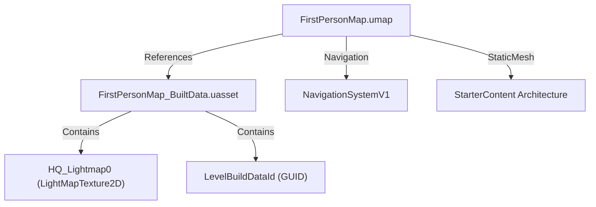
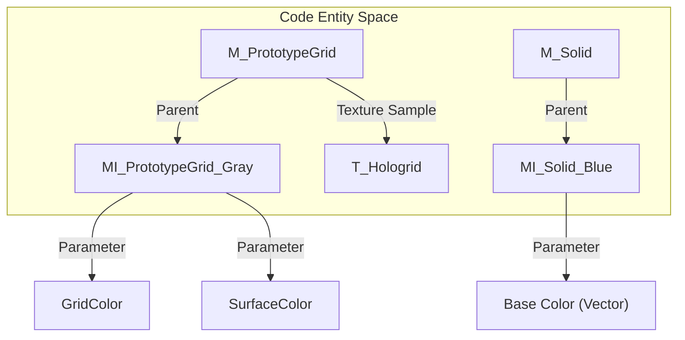

<!-- source: DeepWiki mcp.deepwiki.com · repo microsoft/OnnxRuntime-UnrealEngine · page 4.3 Level Map & Prototyping Assets · fetched 2026-10-26 -->

# Level Map & Prototyping Assets

Relevant source files

The following files were used as context for generating this wiki page:

- [FPStyleTransfer/Content/FirstPerson/Maps/FirstPersonMap.umap](FPStyleTransfer/Content/FirstPerson/Maps/FirstPersonMap.umap)
- [FPStyleTransfer/Content/FirstPerson/Maps/FirstPersonMap_BuiltData.uasset](FPStyleTransfer/Content/FirstPerson/Maps/FirstPersonMap_BuiltData.uasset)
- [FPStyleTransfer/Content/LevelPrototyping/Materials/MI_PrototypeGrid_Gray.uasset](FPStyleTransfer/Content/LevelPrototyping/Materials/MI_PrototypeGrid_Gray.uasset)
- [FPStyleTransfer/Content/LevelPrototyping/Materials/MI_PrototypeGrid_TopDark.uasset](FPStyleTransfer/Content/LevelPrototyping/Materials/MI_PrototypeGrid_TopDark.uasset)
- [FPStyleTransfer/Content/LevelPrototyping/Materials/MI_Solid_Blue.uasset](FPStyleTransfer/Content/LevelPrototyping/Materials/MI_Solid_Blue.uasset)
- [FPStyleTransfer/Content/LevelPrototyping/Materials/M_PrototypeGrid.uasset](FPStyleTransfer/Content/LevelPrototyping/Materials/M_PrototypeGrid.uasset)
- [FPStyleTransfer/Content/LevelPrototyping/Materials/M_Solid.uasset](FPStyleTransfer/Content/LevelPrototyping/Materials/M_Solid.uasset)
- [FPStyleTransfer/Content/LevelPrototyping/Meshes/SM_ChamferCube.uasset](FPStyleTransfer/Content/LevelPrototyping/Meshes/SM_ChamferCube.uasset)
- [FPStyleTransfer/Content/LevelPrototyping/Meshes/SM_Cube.uasset](FPStyleTransfer/Content/LevelPrototyping/Meshes/SM_Cube.uasset)
- [FPStyleTransfer/Content/LevelPrototyping/Meshes/SM_Cylinder.uasset](FPStyleTransfer/Content/LevelPrototyping/Meshes/SM_Cylinder.uasset)
- [FPStyleTransfer/Content/LevelPrototyping/Meshes/SM_QuarterCylinder.uasset](FPStyleTransfer/Content/LevelPrototyping/Meshes/SM_QuarterCylinder.uasset)
- [FPStyleTransfer/Content/LevelPrototyping/Meshes/SM_Ramp.uasset](FPStyleTransfer/Content/LevelPrototyping/Meshes/SM_Ramp.uasset)
- [FPStyleTransfer/Content/LevelPrototyping/Textures/T_Hologrid.uasset](FPStyleTransfer/Content/LevelPrototyping/Textures/T_Hologrid.uasset)
- [FPStyleTransfer/Content/StarterContent/Architecture/Floor_400x400.uasset](FPStyleTransfer/Content/StarterContent/Architecture/Floor_400x400.uasset)
- [FPStyleTransfer/Content/StarterContent/Architecture/Wall_400x400.uasset](FPStyleTransfer/Content/StarterContent/Architecture/Wall_400x400.uasset)
- [FPStyleTransfer/Content/StarterContent/Audio/Collapse01.uasset](FPStyleTransfer/Content/StarterContent/Audio/Collapse01.uasset)
- [FPStyleTransfer/Content/StarterContent/Audio/Explosion01.uasset](FPStyleTransfer/Content/StarterContent/Audio/Explosion01.uasset)
- [FPStyleTransfer/Content/StarterContent/Audio/Fire01.uasset](FPStyleTransfer/Content/StarterContent/Audio/Fire01.uasset)

This section details the environmental assets and level construction data used in the FPStyleTransfer project. The environment serves as a technical demonstration area for real-time style transfer, utilizing a combination of the Unreal Engine 5 Level Prototyping set and standard Starter Content architecture.

## FirstPersonMap & Level Data

The primary testing environment is the `FirstPersonMap`, which contains the geometry, lighting, and actor placement for the style transfer demonstration.

### Level Structure
The map is defined in `FirstPersonMap.umap` [FPStyleTransfer/Content/FirstPerson/Maps/FirstPersonMap.umap:1-24](). It includes several key architectural components:
*   **Static Geometry**: Constructed using `Floor_400x400` and `Wall_400x400` assets from the Starter Content [FPStyleTransfer/Content/FirstPerson/Maps/FirstPersonMap.umap:5-15]().
*   **Navigation**: Contains a `NavigationSystemV1` and `AreaClass` definitions to support AI pathing or player movement constraints [FPStyleTransfer/Content/FirstPerson/Maps/FirstPersonMap.umap:5-7]().
*   **Lighting Data**: The level uses precomputed lighting stored in the associated `BuiltData` asset.

### BuiltData Registry
The `FirstPersonMap_BuiltData.uasset` stores the results of the lighting build, including lightmaps and shadow maps.
*   **Lightmaps**: Stores high-quality (`HQ_Lightmap0`) and low-quality (`LQ_Lightmap_0`) textures in `TSF_BGRA8` format [FPStyleTransfer/Content/FirstPerson/Maps/FirstPersonMap_BuiltData.uasset:3-6]().
*   **Quality Levels**: Defines settings for `Quality_Preview` through production levels [FPStyleTransfer/Content/FirstPerson/Maps/FirstPersonMap_BuiltData.uasset:4]().

### Map Asset Relationship
The following diagram illustrates how the Map file references its lighting and navigation data.

**Map Data Flow**

Sources: [FPStyleTransfer/Content/FirstPerson/Maps/FirstPersonMap.umap:5-24](), [FPStyleTransfer/Content/FirstPerson/Maps/FirstPersonMap_BuiltData.uasset:1-6]()

---

## Level Prototyping Content

The project utilizes the `LevelPrototyping` set for structural testing. These assets provide clean, gridded surfaces that are ideal for evaluating how neural style transfer handles geometric edges and repetitive patterns.

### Prototyping Meshes
The project includes several standard primitive shapes used to build the "Playground" area:
*   **SM_Cube**: A standard 1m box [FPStyleTransfer/Content/LevelPrototyping/Meshes/SM_Cube.uasset:1-7]().
*   **SM_ChamferCube**: A box with beveled edges to test specular highlights under stylization [FPStyleTransfer/Content/LevelPrototyping/Meshes/SM_ChamferCube.uasset:1-9]().
*   **SM_Cylinder & SM_QuarterCylinder**: Curved surfaces used to test gradient reconstruction in the style transfer pass [FPStyleTransfer/Content/LevelPrototyping/Meshes/SM_Cylinder.uasset:1-8](), [FPStyleTransfer/Content/LevelPrototyping/Meshes/SM_QuarterCylinder.uasset:1-7]().
*   **SM_Ramp**: Inclined geometry for testing verticality [FPStyleTransfer/Content/LevelPrototyping/Meshes/SM_Ramp.uasset:1-8]().

### Prototyping Materials
The prototyping materials are designed to be highly legible and modular.

| Material Asset | Base Material | Purpose |
| :--- | :--- | :--- |
| `M_PrototypeGrid` | N/A | Parent material using `T_Hologrid` for world-aligned textures [FPStyleTransfer/Content/LevelPrototyping/Materials/M_PrototypeGrid.uasset:2-11](). |
| `MI_PrototypeGrid_Gray` | `M_PrototypeGrid` | Standard neutral grid for floors and walls [FPStyleTransfer/Content/LevelPrototyping/Materials/MI_PrototypeGrid_Gray.uasset:2-7](). |
| `MI_PrototypeGrid_TopDark` | `M_PrototypeGrid` | High-contrast grid for better depth perception [FPStyleTransfer/Content/LevelPrototyping/Materials/MI_PrototypeGrid_TopDark.uasset:2-8](). |
| `M_Solid` | N/A | Simple parameter-driven solid color material [FPStyleTransfer/Content/LevelPrototyping/Materials/M_Solid.uasset:2-31](). |
| `MI_Solid_Blue` | `M_Solid` | Instance used for "Simulated Cubes" and interactive elements [FPStyleTransfer/Content/LevelPrototyping/Materials/MI_Solid_Blue.uasset:2-27](). |

**Material Hierarchy and Parameters**

Sources: [FPStyleTransfer/Content/LevelPrototyping/Materials/M_PrototypeGrid.uasset:2-11](), [FPStyleTransfer/Content/LevelPrototyping/Materials/MI_PrototypeGrid_Gray.uasset:2-7](), [FPStyleTransfer/Content/LevelPrototyping/Materials/M_Solid.uasset:2-31](), [FPStyleTransfer/Content/LevelPrototyping/Materials/MI_Solid_Blue.uasset:2-27]()

---

## Starter Content Integration

The project includes specific architectural and audio assets from the Unreal Starter Content to provide a more complex visual environment than simple primitives.

### Architecture
The level layout uses the following meshes for boundary and floor definition:
*   **Floor_400x400**: Large tiling floor sections.
*   **Wall_400x400**: Modular wall sections used to enclose the testing area.

### Audio Assets
The following sound waves are used for environmental feedback or projectile interactions:
*   **Explosion01**: Triggered on projectile impact.
*   **Collapse01**: Used for physics-based environmental changes.
*   **Fire01**: Used for weapon firing sounds in conjunction with the First Person Weapon component.

Sources: [FPStyleTransfer/Content/FirstPerson/Maps/FirstPersonMap.umap:5-24](), [FPStyleTransfer/Content/StarterContent/Architecture/Floor_400x400.uasset](), [FPStyleTransfer/Content/StarterContent/Audio/Explosion01.uasset]()

---

