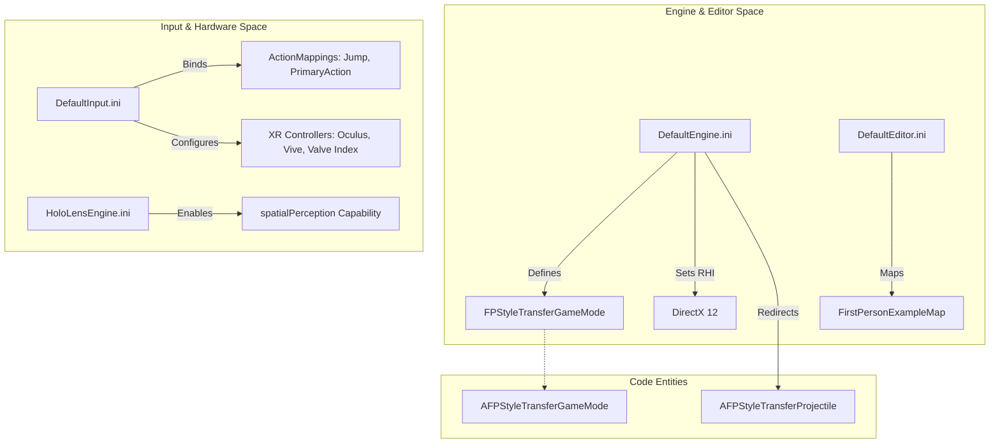
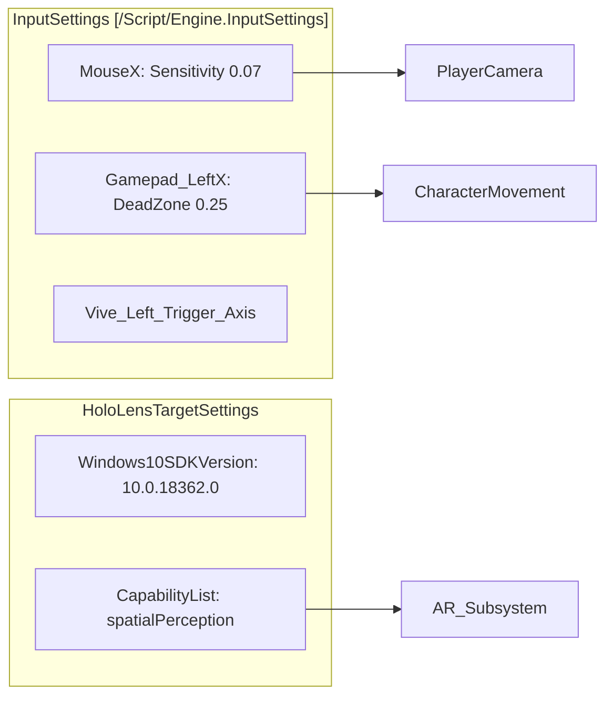

<!-- source: DeepWiki mcp.deepwiki.com · repo microsoft/OnnxRuntime-UnrealEngine · page 5 Project Configuration · fetched 2026-10-26 -->

# Project Configuration

Relevant source files

The following files were used as context for generating this wiki page:

- [FPStyleTransfer/Config/DefaultEditor.ini](FPStyleTransfer/Config/DefaultEditor.ini)
- [FPStyleTransfer/Config/DefaultEngine.ini](FPStyleTransfer/Config/DefaultEngine.ini)
- [FPStyleTransfer/Config/DefaultGame.ini](FPStyleTransfer/Config/DefaultGame.ini)
- [FPStyleTransfer/Config/DefaultInput.ini](FPStyleTransfer/Config/DefaultInput.ini)
- [FPStyleTransfer/Config/HoloLens/HoloLensEngine.ini](FPStyleTransfer/Config/HoloLens/HoloLensEngine.ini)

This page provides an overview of the Unreal Engine configuration files used to manage the **FPStyleTransfer** project. These files define everything from the core rendering pipeline and hardware targeting to input mappings and platform-specific capabilities for devices like HoloLens.

The configuration system is hierarchical, allowing the project to override engine defaults for specific game logic, editor behavior, and deployment targets.

### Configuration Hierarchy Overview

The following diagram illustrates how the project's configuration files relate to the underlying Unreal Engine systems and hardware targets.

**Project Configuration Mapping**

Sources: [FPStyleTransfer/Config/DefaultEngine.ini:1-60](), [FPStyleTransfer/Config/DefaultInput.ini:1-60](), [FPStyleTransfer/Config/HoloLens/HoloLensEngine.ini:3-30]()

---

### Engine, Game & Editor Settings

The core project identity and rendering behavior are defined across three primary files. These settings ensure the project utilizes modern rendering techniques required for high-quality style transfer.

*   **DefaultEngine.ini**: Controls the global `GameDefaultMap`, the `GlobalDefaultGameMode`, and rendering features. It specifically enables **DirectX 12** as the default RHI [FPStyleTransfer/Config/DefaultEngine.ini:37-37](), and activates **Virtual Shadow Maps** and **Mesh Distance Fields** [FPStyleTransfer/Config/DefaultEngine.ini:24-28](). It also handles class redirects to ensure legacy assets point to the new `FPStyleTransfer` C++ classes [FPStyleTransfer/Config/DefaultEngine.ini:40-44]().
*   **DefaultGame.ini**: Defines the project identity (Project ID and Name) and ensures that the **StarterContent** pack is loaded upon project initialization [FPStyleTransfer/Config/DefaultGame.ini:1-11]().
*   **DefaultEditor.ini**: Configures the editor's startup behavior, including the `SimpleMapName` and specific Blueprint loading flags to optimize the development environment [FPStyleTransfer/Config/DefaultEditor.ini:1-8]().

For detailed breakdowns of rendering paths and class redirects, see **[Engine, Game & Editor Settings](#5.1)**.

Sources: [FPStyleTransfer/Config/DefaultEngine.ini:1-60](), [FPStyleTransfer/Config/DefaultGame.ini:1-11](), [FPStyleTransfer/Config/DefaultEditor.ini:1-8]()

---

### Input Configuration & Platform Targets

The project supports a wide array of input methods, ranging from standard mouse/keyboard to advanced XR peripherals and mobile platforms.

| Configuration File | Primary Responsibility | Key Entities |
| :--- | :--- | :--- |
| `DefaultInput.ini` | Input Mapping & Sensitivity | `MouseX`, `Gamepad_LeftX`, `Vive_Left_Trigger_Axis` |
| `HoloLensEngine.ini` | UWP & AR Specifics | `spatialPerception`, `MaxTrianglesPerCubicMeter` |
| `DefaultEngine.ini` | Mobile & Desktop Targets | `MinimumiOSVersion`, `TargetedHardwareClass` |

#### Input and XR Support
The `DefaultInput.ini` file contains extensive `AxisConfig` definitions for hardware including **Oculus Touch**, **Valve Index**, **Vive**, and **Windows Mixed Reality** [FPStyleTransfer/Config/DefaultInput.ini:21-58](). This ensures that movement and look controls are normalized across different controller types.

#### Platform-Specific Logic
For HoloLens deployment, `HoloLensEngine.ini` configures the `Windows10SDKVersion` and specific capabilities like `internetClientServer` and `spatialPerception` [FPStyleTransfer/Config/HoloLens/HoloLensEngine.ini:22-25](). It also defines the density of spatial meshing for AR environments [FPStyleTransfer/Config/HoloLens/HoloLensEngine.ini:19-20]().

For details on input axis scaling and HoloLens UWP capabilities, see **[Input Configuration & Platform Targets](#5.2)**.

**Hardware and Input Entity Relationship**

Sources: [FPStyleTransfer/Config/DefaultInput.ini:6-58](), [FPStyleTransfer/Config/HoloLens/HoloLensEngine.ini:16-25]()

---

### Summary of Configuration Files

| File Path | Purpose |
| :--- | :--- |
| `Config/DefaultEngine.ini` | Rendering (DX12, Lumen), Class Redirects, Default Maps, Collision Profiles. |
| `Config/DefaultGame.ini` | Project ID, Project Name, Startup Content Packs. |
| `Config/DefaultEditor.ini` | Editor-only startup maps and Blueprint matching settings. |
| `Config/DefaultInput.ini` | Action/Axis mappings and controller-specific deadzones/sensitivity. |
| `Config/HoloLens/HoloLensEngine.ini` | HoloLens SDK versions, AR spatial meshing, and UWP capabilities. |

Sources: [FPStyleTransfer/Config/DefaultEngine.ini:1-60](), [FPStyleTransfer/Config/DefaultGame.ini:1-11](), [FPStyleTransfer/Config/DefaultEditor.ini:1-8](), [FPStyleTransfer/Config/DefaultInput.ini:1-60](), [FPStyleTransfer/Config/HoloLens/HoloLensEngine.ini:1-32]()

---

