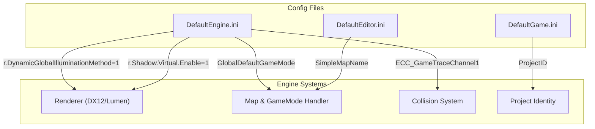
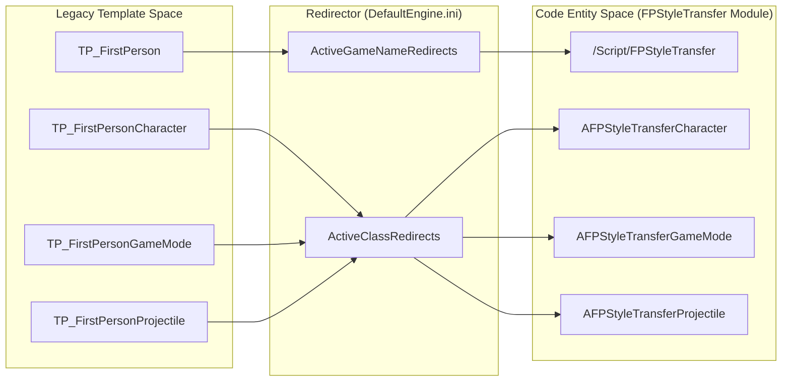

<!-- source: DeepWiki mcp.deepwiki.com · repo microsoft/OnnxRuntime-UnrealEngine · page 5.1 Engine, Game & Editor Settings · fetched 2026-10-26 -->

# Engine, Game & Editor Settings

Relevant source files

The following files were used as context for generating this wiki page:

- [FPStyleTransfer/Config/DefaultEditor.ini](FPStyleTransfer/Config/DefaultEditor.ini)
- [FPStyleTransfer/Config/DefaultEditorPerProjectUserSettings.ini](FPStyleTransfer/Config/DefaultEditorPerProjectUserSettings.ini)
- [FPStyleTransfer/Config/DefaultEngine.ini](FPStyleTransfer/Config/DefaultEngine.ini)
- [FPStyleTransfer/Config/DefaultGame.ini](FPStyleTransfer/Config/DefaultGame.ini)

This page details the core configuration files (`.ini`) that define the project identity, rendering pipeline requirements, startup maps, and class redirects for the **FPStyleTransfer** project. These settings ensure that the Unreal Engine environment is correctly tuned for DirectX 12, Lumen Global Illumination, and the specific collision needs of the style transfer gameplay.

## DefaultEngine.ini: Core Framework & Rendering

The `DefaultEngine.ini` file is the primary configuration hub for the engine's behavior, including the rendering hardware interface (RHI), global illumination methods, and game framework defaults.

### Rendering & Hardware Targeting
The project is configured for high-end desktop rendering to support the computational overhead of real-time neural network inference. It explicitly targets DirectX 12 to leverage modern GPU features.

| Setting | Value | Description |
| :--- | :--- | :--- |
| `DefaultGraphicsRHI` | `DefaultGraphicsRHI_DX12` | Sets DX12 as the primary rendering API. |
| `r.DynamicGlobalIlluminationMethod` | `1` | Enables **Lumen** for dynamic global illumination. |
| `r.ReflectionMethod` | `1` | Enables **Lumen** reflections. |
| `r.Shadow.Virtual.Enable` | `1` | Enables **Virtual Shadow Maps** (VSM) for high-resolution shadowing. |
| `r.GenerateMeshDistanceFields` | `True` | Required for Distance Field Ambient Occlusion and certain Lumen features. |
| `TargetedHardwareClass` | `Desktop` | Optimizes engine scalability for desktop platforms. |
| `DefaultGraphicsPerformance` | `Maximum` | Ensures the engine defaults to high-quality settings. |

### Game Framework & Maps
The `[/Script/EngineSettings.GameMapsSettings]` section defines which map loads by default and which C++ classes govern the game logic.

*   **Startup Maps**: Both `EditorStartupMap` and `GameDefaultMap` point to `/Game/FirstPerson/Maps/FirstPersonMap.FirstPersonMap` [FPStyleTransfer/Config/DefaultEngine.ini:7-14]().
*   **Game Mode**: The `GlobalDefaultGameMode` is set to `/Script/FPStyleTransfer.FPStyleTransferGameMode` [FPStyleTransfer/Config/DefaultEngine.ini:16]().

### Class Redirects
Since the project originated from the Unreal First Person Template, several `ActiveGameNameRedirects` and `ActiveClassRedirects` are implemented to map old template names to the new `FPStyleTransfer` namespace. This prevents broken references in Blueprints and levels when classes are renamed in C++.

| Old Name | New Name |
| :--- | :--- |
| `TP_FirstPerson` | `/Script/FPStyleTransfer` |
| `TP_FirstPersonProjectile` | `FPStyleTransferProjectile` |
| `TP_FirstPersonGameMode` | `FPStyleTransferGameMode` |
| `TP_FirstPersonCharacter` | `FPStyleTransferCharacter` |

### Collision Profiles
A custom collision channel and profile are defined to handle the projectile physics:
*   **Projectile Channel**: A new object type named `Projectile` is defined via `ECC_GameTraceChannel1` [FPStyleTransfer/Config/DefaultEngine.ini:2-3]().
*   **Trigger Interaction**: The `Trigger` profile is modified to ignore the `Projectile` channel, preventing projectiles from being blocked by invisible trigger volumes [FPStyleTransfer/Config/DefaultEngine.ini:4]().

**Sources:**
* [FPStyleTransfer/Config/DefaultEngine.ini:1-60]()

---

## DefaultGame.ini: Project Identity

`DefaultGame.ini` handles the project's metadata and startup content requirements.

### Project Identification
The project is identified by a unique `ProjectID` and the name "First Person Template" [FPStyleTransfer/Config/DefaultGame.ini:1-6]().

### Starter Content
The project is configured to automatically include the Unreal Starter Content pack upon initialization. This is managed via the `[StartupActions]` section, which ensures `StarterContent.upack` is inserted into the project [FPStyleTransfer/Config/DefaultGame.ini:8-10]().

**Sources:**
* [FPStyleTransfer/Config/DefaultGame.ini:1-11]()

---

## Editor Configuration

The editor-specific settings control the developer experience, including Blueprint loading behavior and Content Browser defaults.

### DefaultEditor.ini
This file manages internal editor behaviors and map defaults.
*   **Simple Map**: Defines the map used for simple preview operations [FPStyleTransfer/Config/DefaultEditor.ini:1-2]().
*   **Editor-Only Blueprints**: The `[EditoronlyBP]` section optimizes memory by ensuring that certain Blueprint metadata and types are not loaded outside of the editor environment [FPStyleTransfer/Config/DefaultEditor.ini:4-8]().

### DefaultEditorPerProjectUserSettings.ini
This file stores preferences specific to the project's local development environment.
*   **Content Browser**: Sets the default path for the Content Browser to `/Game/FirstPerson` upon opening the project [FPStyleTransfer/Config/DefaultEditorPerProjectUserSettings.ini:1-2]().

**Sources:**
* [FPStyleTransfer/Config/DefaultEditor.ini:1-8]()
* [FPStyleTransfer/Config/DefaultEditorPerProjectUserSettings.ini:1-2]()

---

## Configuration Data Flow

The following diagram illustrates how the `.ini` settings influence the initialization of the Engine and Game modules.

**Engine Initialization Flow**

**Sources:**
* [FPStyleTransfer/Config/DefaultEngine.ini:1-45]()
* [FPStyleTransfer/Config/DefaultGame.ini:1-6]()
* [FPStyleTransfer/Config/DefaultEditor.ini:1-2]()

---

## Redirector and Class Mapping

This diagram bridges the "Natural Language Space" (Template Names) to the "Code Entity Space" (C++ Classes) via the Redirectors defined in the configuration.

**Class Mapping & Redirects**

**Sources:**
* [FPStyleTransfer/Config/DefaultEngine.ini:39-45]()

---

