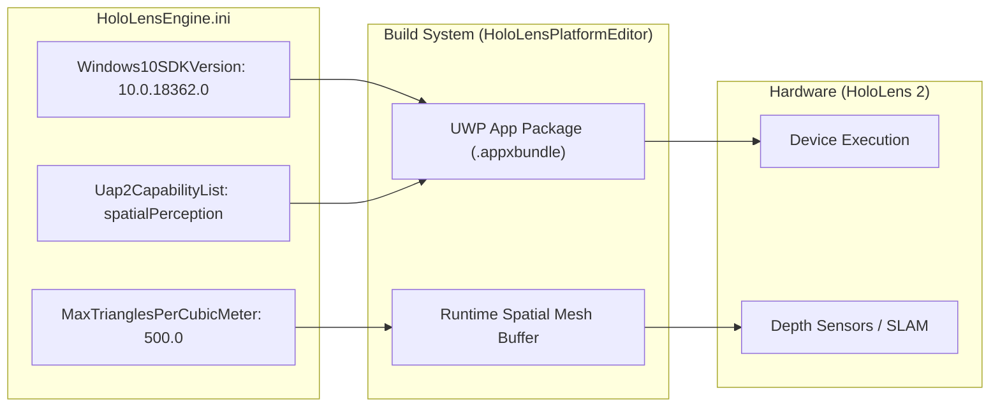

<!-- source: DeepWiki mcp.deepwiki.com · repo microsoft/OnnxRuntime-UnrealEngine · page 5.2 Input Configuration & Platform Targets · fetched 2026-10-26 -->

# Input Configuration & Platform Targets

<details>
<summary>Relevant source files</summary>

The following files were used as context for generating this wiki page:

- [FPStyleTransfer/Config/DefaultInput.ini](FPStyleTransfer/Config/DefaultInput.ini)
- [FPStyleTransfer/Config/HoloLens/HoloLensEngine.ini](FPStyleTransfer/Config/HoloLens/HoloLensEngine.ini)

</details>


This page details the project's input mapping systems and platform-specific configurations for the HoloLens. The project utilizes Unreal Engine's legacy Input System via `DefaultInput.ini` to handle cross-platform controls ranging from standard Mouse/Keyboard to advanced XR controllers. Additionally, it specifies UWP (Universal Windows Platform) requirements for HoloLens deployment in `HoloLensEngine.ini`.

## Input Configuration (DefaultInput.ini)

The input system is defined under the `[/Script/Engine.InputSettings]` section. It establishes how raw hardware signals (Axis and Action) are interpreted by the gameplay framework, specifically the `AFPStyleTransferCharacter`.

### Axis Configurations & DeadZones
The project defines specific `AxisConfig` entries to normalize input from various hardware. These settings control the sensitivity, exponent (curve), and deadzones for analog sticks and mice [FPStyleTransfer/Config/DefaultInput.ini:1-18]().

| Axis Key Name | DeadZone | Sensitivity | Purpose |
| :--- | :--- | :--- | :--- |
| `MouseX` / `MouseY` | 0.0 | 0.07 | High-precision mouse look [FPStyleTransfer/Config/DefaultInput.ini:14-15]() |
| `Gamepad_LeftX/Y` | 0.25 | 1.0 | Movement sticks with standard deadzone [FPStyleTransfer/Config/DefaultInput.ini:10-11]() |
| `Gamepad_RightX/Y` | 0.25 | 1.0 | Aiming sticks with standard deadzone [FPStyleTransfer/Config/DefaultInput.ini:12-13]() |

### XR Controller Support
The configuration includes comprehensive mappings for virtual reality and mixed reality controllers. This ensures that the `AFPStyleTransferCharacter` can receive movement and interaction events regardless of the connected HMD [FPStyleTransfer/Config/DefaultInput.ini:21-60]().

*   **Oculus Touch:** Mappings for Grip, Trigger, and Thumbsticks [FPStyleTransfer/Config/DefaultInput.ini:37-44]().
*   **Valve Index:** Includes specialized mappings for Grip Force and Trackpad Touch/Force [FPStyleTransfer/Config/DefaultInput.ini:45-53]().
*   **Windows Mixed Reality:** Standard Trigger, Thumbstick, and Trackpad support [FPStyleTransfer/Config/DefaultInput.ini:27-36]().
*   **Vive Controller:** Trigger and Trackpad X/Y mappings [FPStyleTransfer/Config/DefaultInput.ini:21-26]().

### Action & Axis Mappings
These link hardware keys to logical game events used in C++ code.

*   **Action Mappings:**
    *   `Jump`: Bound to Space Bar, Gamepad Face Button Bottom, and Oculus/Vive touch buttons [FPStyleTransfer/Config/DefaultInput.ini:64-68]().
    *   `PrimaryAction`: Bound to Left Mouse Button, Gamepad Right Trigger, and XR Controller Triggers. This triggers the weapon fire logic [FPStyleTransfer/Config/DefaultInput.ini:70-76]().
*   **Axis Mappings:**
    *   `MoveForward`: Combines 'W' (1.0), 'S' (-1.0), and Gamepad Left Thumbstick Y (1.0) [FPStyleTransfer/Config/DefaultInput.ini:78-82]().
    *   `MoveRight`: Combines 'D' (1.0), 'A' (-1.0), and Gamepad Left Thumbstick X (1.0) [FPStyleTransfer/Config/DefaultInput.ini:84-88]().
    *   `Turn Around / Look Up`: Maps mouse movement and right thumbsticks to rotation [FPStyleTransfer/Config/DefaultInput.ini:90-97]().

### Logic Flow: Input to Character
The following diagram illustrates how the `InputSettings` in `DefaultInput.ini` are consumed by the character class.

**Input Entity Mapping**
```mermaid
graph TD
    subgraph "Natural Language Space"
        A["User Presses Trigger"]
        B["User Moves Mouse"]
    end

    subgraph "Code Entity Space (DefaultInput.ini)"
        A -->|"+ActionMapping"| C["PrimaryAction"]
        B -->|"+AxisMapping"| D["Turn"]
    end

    subgraph "Code Entity Space (AFPStyleTransferCharacter)"
        C -->| "BindAction()" | E["OnPrimaryAction()"]
        D -->| "BindAxis()" | F["AddControllerYawInput()"]
    end
    
    E --> G["UTP_WeaponComponent::Fire()"]
```
Sources: [FPStyleTransfer/Config/DefaultInput.ini:70-76](), [FPStyleTransfer/Config/DefaultInput.ini:90-93]()

---

## HoloLens Platform Targets (HoloLensEngine.ini)

The `HoloLensEngine.ini` file configures the `HoloLensTargetSettings` for deployment to Windows Holographic devices. It defines the hardware interface capabilities and environment scanning parameters required for AR-based style transfer.

### UWP Capabilities
To interact with the HoloLens hardware, specific UWP capabilities must be enabled. The project explicitly disables default capabilities to maintain a minimal security footprint and defines a custom list [FPStyleTransfer/Config/HoloLens/HoloLensEngine.ini:23-26]().

*   **internetClientServer:** Allows network communication.
*   **privateNetworkClientServer:** Allows communication over local networks.
*   **spatialPerception:** **Critical.** Required for the device to understand the physical environment and perform spatial meshing [FPStyleTransfer/Config/HoloLens/HoloLensEngine.ini:25]().

### Spatial Meshing & SDK Targeting
The project configures how the HoloLens scans the real world. This is vital if the style transfer is intended to be applied to AR overlays or spatialized elements.

*   **MaxTrianglesPerCubicMeter:** Set to `500.0`, balancing mesh detail with performance on the mobile chipset [FPStyleTransfer/Config/HoloLens/HoloLensEngine.ini:19]().
*   **SpatialMeshingVolumeSize:** Defined as `20.0` meters [FPStyleTransfer/Config/HoloLens/HoloLensEngine.ini:20]().
*   **Windows10SDKVersion:** Targets version `10.0.18362.0` [FPStyleTransfer/Config/HoloLens/HoloLensEngine.ini:22]().
*   **MaximumPlatformVersionTested:** Also set to `10.0.18362.0` [FPStyleTransfer/Config/HoloLens/HoloLensEngine.ini:18]().

### Performance & Debugging
*   **bEnablePIXProfiling:** Set to `False` by default to maximize retail performance, but can be toggled for GPU profiling on the device [FPStyleTransfer/Config/HoloLens/HoloLensEngine.ini:12]().
*   **TargetDeviceFamily:** Set to `Windows.Holographic` [FPStyleTransfer/Config/HoloLens/HoloLensEngine.ini:16]().

### Logic Flow: Platform Configuration
The diagram below shows the relationship between the HoloLens target settings and the resulting application package.

**HoloLens Target Configuration**

Sources: [FPStyleTransfer/Config/HoloLens/HoloLensEngine.ini:3-26]()

---

## Summary of Key Settings

| File | Key Setting | Value | Description |
| :--- | :--- | :--- | :--- |
| `DefaultInput.ini` | `bCaptureMouseOnLaunch` | `True` | Ensures the style transfer view is controlled immediately. |
| `DefaultInput.ini` | `MouseSensitivity` | `0.07` | Calibrated for first-person precision. |
| `HoloLensEngine.ini` | `bBuildForDevice` | `True` | Enables ARM64 compilation for physical hardware [FPStyleTransfer/Config/HoloLens/HoloLensEngine.ini:5](). |
| `HoloLensEngine.ini` | `bBuildForEmulation` | `False` | Disables x86/x64 emulation builds [FPStyleTransfer/Config/HoloLens/HoloLensEngine.ini:4](). |

Sources: [FPStyleTransfer/Config/DefaultInput.ini:6-15](), [FPStyleTransfer/Config/HoloLens/HoloLensEngine.ini:4-5]()

---

