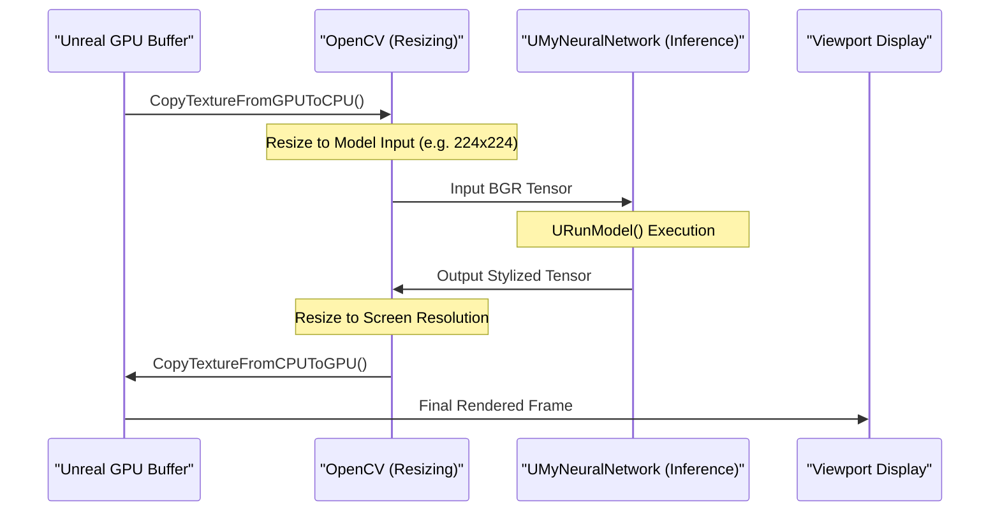

<!-- source: DeepWiki mcp.deepwiki.com · repo microsoft/OnnxRuntime-UnrealEngine · page 6 Glossary · fetched 2026-10-26 -->

# Glossary

<details>
<summary>Relevant source files</summary>

The following files were used as context for generating this wiki page:

- [FPStyleTransfer/Config/DefaultEngine.ini](FPStyleTransfer/Config/DefaultEngine.ini)
- [FPStyleTransfer/Config/DefaultInput.ini](FPStyleTransfer/Config/DefaultInput.ini)
- [FPStyleTransfer/Config/HoloLens/HoloLensEngine.ini](FPStyleTransfer/Config/HoloLens/HoloLensEngine.ini)
- [FPStyleTransfer/Content/FPWeapon/Audio/FirstPersonTemplateWeaponFire02.uasset](FPStyleTransfer/Content/FPWeapon/Audio/FirstPersonTemplateWeaponFire02.uasset)
- [FPStyleTransfer/Content/FPWeapon/Materials/BaseMaterial.uasset](FPStyleTransfer/Content/FPWeapon/Materials/BaseMaterial.uasset)
- [FPStyleTransfer/Content/FirstPerson/Blueprints/StyleTransferConfig.uasset](FPStyleTransfer/Content/FirstPerson/Blueprints/StyleTransferConfig.uasset)
- [FPStyleTransfer/Content/Models/candy-9.onnx](FPStyleTransfer/Content/Models/candy-9.onnx)

</details>


This glossary defines core concepts, Unreal Engine terminology, and machine learning abstractions specific to the **OnnxRuntime-UnrealEngine** (FPStyleTransfer) project. It serves as a technical reference for engineers onboarding to the codebase.

## 1. System Context & Code Entity Mapping

The following diagram bridges natural language concepts to their specific C++ class and file implementations within the project.

### Entity Relationship Diagram
```mermaid
graph TD
    subgraph "Unreal Engine Rendering"
        A["SceneViewExtension"] -- "Hooks into" --> B["FRealtimeStyleTransferViewExtension"]
        B -- "Implements" --> C["PostProcessPass"]
    end

    subgraph "Neural Inference"
        D["NeuralNetwork"] -- "Wrapped by" --> E["UMyNeuralNetwork"]
        E -- "Uses" --> F["ONNX Runtime (NNI)"]
    end

    subgraph "Application Logic"
        G["Blueprint Library"] -- "Exposes" --> H["UStyleTransferBlueprintLibrary"]
        H -- "Configures" --> B
        H -- "Triggers" --> E
    end

    [RealtimeStyleTransferViewExtension.h] -.-> B
    [MyNeuralNetwork.h] -.-> E
    [StyleTransferBlueprintLibrary.h] -.-> H
```
**Sources:** [Source/FPStyleTransfer/RealtimeStyleTransferViewExtension.h:12-25](), [Source/FPStyleTransfer/MyNeuralNetwork.h:12-20](), [Source/FPStyleTransfer/StyleTransferBlueprintLibrary.h:13-22]()

---

## 2. Technical Definitions

### ONNX (Open Neural Network Exchange)
A cross-platform format for machine learning models. In this project, ONNX models (e.g., `candy-9.onnx`) define the weights and operations for style transfer [Content/Models/candy-9.onnx:1-10]().

### NNI (Neural Network Inference) Plugin
A specialized Unreal Engine plugin provided by Microsoft that integrates ONNX Runtime into the engine. It provides the base class `UNeuralNetwork` which this project extends to handle specific image-based tensors [Source/FPStyleTransfer/MyNeuralNetwork.h:13-15]().

### View Extension (`FSceneViewExtensionBase`)
A system in Unreal Engine that allows developers to hook into the renderer at specific stages.
*   **Implementation:** `FRealtimeStyleTransferViewExtension` [Source/FPStyleTransfer/RealtimeStyleTransferViewExtension.h:12-15]().
*   **Hook Point:** The project hooks into the pipeline after the Tonemapping pass using `SubscribeToPostProcessingPass` [Source/FPStyleTransfer/RealtimeStyleTransferViewExtension.cpp:55-60]().

### StyleTransferConfig
A Blueprint Data Asset used to define which ONNX model should be active. It allows designers to swap visual styles (e.g., "Mosaic" vs "Candy") without C++ recompilation [Content/FirstPerson/Blueprints/StyleTransferConfig.uasset:4-12]().

### BGR Float Tensor
The specific data format required by the bundled ONNX models. 
*   **Channel Order:** Blue, Green, Red (BGR).
*   **Format:** Planar (CHW - Channel, Height, Width) rather than Interleaved (HWC).
*   **Conversion:** Handled within `UMyNeuralNetwork::URunModel` [Source/FPStyleTransfer/MyNeuralNetwork.cpp:45-70]().

---

## 3. Data Flow: Rendering to Inference

The following diagram tracks the lifecycle of a single frame as it moves from the Unreal GPU buffer through the ONNX model and back to the screen.

### Frame Stylization Pipeline

**Sources:** [Source/FPStyleTransfer/RealtimeStyleTransferViewExtension.cpp:110-150](), [Source/FPStyleTransfer/MyNeuralNetwork.cpp:80-105]()

---

## 4. Key Abbreviations

| Abbreviation | Full Term | Context in Codebase |
| :--- | :--- | :--- |
| **RHI** | Render Hardware Interface | Used for low-level GPU operations like `RHICmdList.CopyTexture` [Source/FPStyleTransfer/RealtimeStyleTransferViewExtension.cpp:160-170](). |
| **CHW** | Channel-Height-Width | The tensor shape layout used in `UMyNeuralNetwork` [Source/FPStyleTransfer/MyNeuralNetwork.cpp:55-58](). |
| **UWP** | Universal Windows Platform | Targeted platform for HoloLens deployment [Config/HoloLens/HoloLensEngine.ini:16-18](). |
| **DX12** | DirectX 12 | The default Graphics RHI configured for Windows [Config/DefaultEngine.ini:37](). |
| **NNI** | Neural Network Inference | The plugin namespace for ONNX Runtime integration [Source/FPStyleTransfer/MyNeuralNetwork.h:10](). |

---

## 5. File & Class Pointers

### Core Logic
*   `FRealtimeStyleTransferViewExtension`: Manages the rendering lifecycle and texture capture.
    *   Defined in: [Source/FPStyleTransfer/RealtimeStyleTransferViewExtension.h:12-45]()
*   `UMyNeuralNetwork`: Manages the ONNX model loading and tensor conversion.
    *   Defined in: [Source/FPStyleTransfer/MyNeuralNetwork.h:12-35]()
*   `UStyleTransferBlueprintLibrary`: Static helper functions for Blueprint access.
    *   Defined in: [Source/FPStyleTransfer/StyleTransferBlueprintLibrary.h:13-30]()

### Configuration
*   `DefaultEngine.ini`: Controls rendering settings like Lumen, Virtual Shadows, and the default GameMode [Config/DefaultEngine.ini:16-28]().
*   `DefaultInput.ini`: Defines mappings for movement, jumping, and firing the weapon [Config/DefaultInput.ini:1-50]().
*   `HoloLensEngine.ini`: Contains spatial meshing and UWP capability settings [Config/HoloLens/HoloLensEngine.ini:19-25]().

**Sources:** [Source/FPStyleTransfer/RealtimeStyleTransferViewExtension.h](), [Source/FPStyleTransfer/MyNeuralNetwork.h](), [Config/DefaultEngine.ini](), [Config/HoloLens/HoloLensEngine.ini]()