# Page: Project Overview

# Project Overview

<details>
<summary>Relevant source files</summary>

The following files were used as context for generating this wiki page:

- [.gitignore](.gitignore)
- [CODE_OF_CONDUCT.md](CODE_OF_CONDUCT.md)
- [FPStyleTransfer/Config/DefaultEngine.ini](FPStyleTransfer/Config/DefaultEngine.ini)
- [FPStyleTransfer/Config/DefaultGame.ini](FPStyleTransfer/Config/DefaultGame.ini)

</details>


The **FPStyleTransfer** project is a technical demonstration of real-time neural style transfer within **Unreal Engine 5**. It leverages the **ONNX Runtime (NNI)** to execute pre-trained deep learning models on the GPU, transforming the visual aesthetic of a first-person shooter environment into various artistic styles (e.g., Mosaic, Candy, Rain Princess) in real-time.

The project serves as a bridge between high-performance game rendering and machine learning inference, utilizing **OpenCV** for image preprocessing and the Unreal Engine **FSceneViewExtension** API to hook directly into the post-processing pipeline.

## Key Technologies

| Technology | Role in Project |
| :--- | :--- |
| **Unreal Engine 5** | Core game engine, rendering pipeline, and gameplay framework. |
| **ONNX Runtime (NNI)** | High-performance inference engine for executing `.onnx` models on the GPU. |
| **OpenCV** | Used for efficient CPU-side image resizing and format conversion. |
| **DirectX 12** | The targeted Graphics Rendering Hardware Interface (RHI) for Windows. |

For setup instructions and platform requirements, see [Getting Started & Build Configuration](#1.2).

## System Relationships

The system is divided into two primary domains: the **Style Transfer Core**, which handles the machine learning lifecycle and rendering hooks, and the **First-Person Gameplay Framework**, which provides the interactive environment.

The following diagram illustrates how the C++ entities interact to facilitate the flow from the rendering buffer to the neural network and back to the screen.

### Rendering & Inference Pipeline
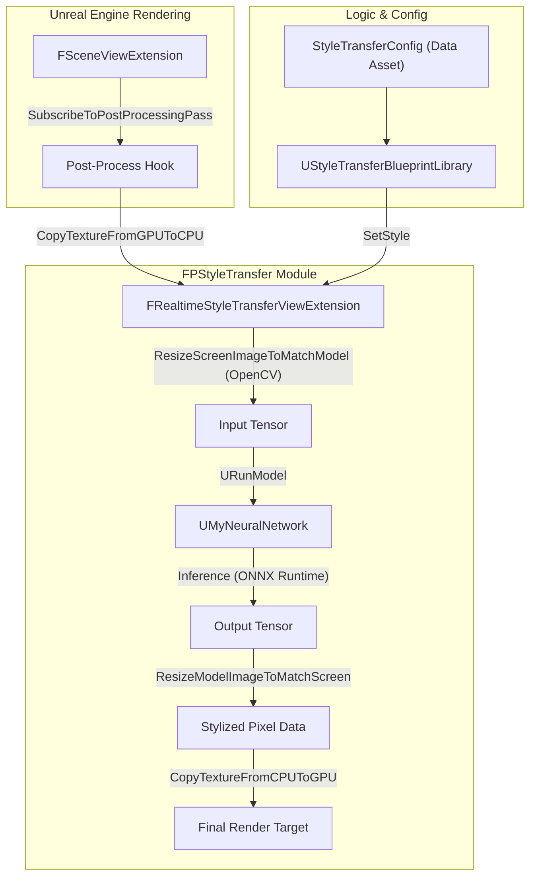
**Sources:** [FPStyleTransfer/Config/DefaultEngine.ini:36-38](), [FPStyleTransfer/Config/DefaultEngine.ini:22-28]()

## Project Structure

The codebase is organized into a primary game module and several configuration layers that define how the engine handles ML workloads and gameplay.

### System Mapping: Code Entities
The following diagram maps high-level system responsibilities to specific classes and configuration files found in the repository.

```mermaid
graph LR
    subgraph "Core Inference System"
        "UMyNeuralNetwork"["UMyNeuralNetwork"]
        "UStyleTransferBlueprintLibrary"["UStyleTransferBlueprintLibrary"]
    end

    subgraph "Rendering Integration"
        "FRealtimeStyleTransferViewExtension"["FRealtimeStyleTransferViewExtension"]
    end

    subgraph "Gameplay Framework"
        "AFPStyleTransferCharacter"["AFPStyleTransferCharacter"]
        "AFPStyleTransferProjectile"["AFPStyleTransferProjectile"]
        "UTP_WeaponComponent"["UTP_WeaponComponent"]
    end

    subgraph "Configuration"
        "DefaultEngine.ini"["DefaultEngine.ini"]
        "DefaultInput.ini"["DefaultInput.ini"]
    end

    "FRealtimeStyleTransferViewExtension" --> "UMyNeuralNetwork"
    "UStyleTransferBlueprintLibrary" --> "FRealtimeStyleTransferViewExtension"
    "DefaultEngine.ini" --> "AFPStyleTransferCharacter"
```

### Major Subsystems

*   **Style Transfer Core**: Manages the `FRealtimeStyleTransferViewExtension`, which intercepts the frame after the Tonemapper pass. It utilizes `UMyNeuralNetwork` (a wrapper for ONNX Runtime) to process the scene. For details, see [Architecture Overview](#1.1).
*   **Gameplay Framework**: Based on the Unreal First Person template, including the character `AFPStyleTransferCharacter` and weapon logic in `UTP_WeaponComponent`.
*   **Configuration**: Defines the rendering RHI (DirectX 12), collision profiles for projectiles, and class redirects to ensure the project identifies as `FPStyleTransfer` rather than the default template name.

**Sources:** [FPStyleTransfer/Config/DefaultEngine.ini:1-4](), [FPStyleTransfer/Config/DefaultEngine.ini:16-17](), [FPStyleTransfer/Config/DefaultEngine.ini:39-44]()

## Child Pages
*   **[Architecture Overview](#1.1)**: Deep dive into the module structure, the rendering pipeline interception, and the integration of NNI and OpenCV.
*   **[Getting Started & Build Configuration](#1.2)**: Prerequisites, installation steps, and platform-specific configuration (Desktop, HoloLens, Mobile).

---

# Page: Architecture Overview

# Architecture Overview

<details>
<summary>Relevant source files</summary>

The following files were used as context for generating this wiki page:

- [.gitignore](.gitignore)
- [FPStyleTransfer/Config/DefaultEngine.ini](FPStyleTransfer/Config/DefaultEngine.ini)
- [FPStyleTransfer/Config/DefaultGame.ini](FPStyleTransfer/Config/DefaultGame.ini)

</details>


The **FPStyleTransfer** project is a high-performance Unreal Engine 5 integration of real-time neural style transfer. It leverages the **ONNX Runtime (NNI)** plugin for GPU-accelerated inference and **OpenCV** for image preprocessing, seamlessly injecting stylized frames into the Unreal Engine rendering pipeline via a custom `FSceneViewExtension`.

## System Module Structure

The system is organized into a primary C++ module that coordinates between the Unreal Engine renderer, the ONNX inference engine, and the gameplay logic.

### Module Dependencies
The project relies on three key pillars:
1.  **FPStyleTransfer (Source Module):** The core C++ logic containing the style transfer subsystem and gameplay framework.
2.  **NNI (ONNX Runtime Plugin):** Provides the `UNeuralNetwork` class and the underlying ONNX Runtime execution provider for Win64 (DirectX 12), Android, and iOS.
3.  **OpenCV Plugin:** Utilized for high-performance CPU-side image manipulation, specifically for resizing textures to match the input dimensions required by the ONNX models.

### System Components Diagram
The following diagram illustrates the relationship between the Unreal Engine Editor, the C++ source module, and the external plugins.

**System Component Relationship**
```mermaid
graph TD
    subgraph "Unreal Engine Editor"
        [Editor_UI] --> [Content_Browser]
        [Content_Browser] --> [StyleTransferConfig_Asset]
    end

    subgraph "FPStyleTransfer Module"
        [AFPStyleTransferCharacter] -- "Uses" --> [UStyleTransferBlueprintLibrary]
        [UStyleTransferBlueprintLibrary] -- "Configures" --> [FRealtimeStyleTransferViewExtension]
        [FRealtimeStyleTransferViewExtension] -- "Owns" --> [UMyNeuralNetwork]
    end

    subgraph "Plugins"
        [UMyNeuralNetwork] -- "Inherits From" --> [UNeuralNetwork_NNI_Plugin]
        [FRealtimeStyleTransferViewExtension] -- "Uses" --> [OpenCV_Library]
    end

    [StyleTransferConfig_Asset] -- "References" --> [ONNX_Models]
    [UNeuralNetwork_NNI_Plugin] -- "Loads" --> [ONNX_Models]
```
**Sources:**
- `FPStyleTransfer/Source/FPStyleTransfer/FPStyleTransfer.Build.cs` (Module dependencies)
- `FPStyleTransfer/Source/FPStyleTransfer/RealtimeStyleTransferViewExtension.h`
- `FPStyleTransfer/Source/FPStyleTransfer/MyNeuralNetwork.h`

---

## Rendering Pipeline Integration

The core of the style transfer occurs within the `FRealtimeStyleTransferViewExtension`. This class hooks into the Unreal Engine post-processing pipeline, allowing the system to intercept the rendered frame after the Tonemapping pass.

### Data Flow: Frame Interception and Inference
The data flow follows a "Pull-Process-Push" pattern:
1.  **Intercept:** The `SubscribeToPostProcessingPass` function identifies the `PostProcessMaterialAfterTonemap` location.
2.  **Copy (GPU to CPU):** The rendered scene texture is copied from GPU memory to a CPU-accessible buffer.
3.  **Pre-process:** `OpenCV` is used to resize the buffer to the specific input resolution of the active ONNX model (e.g., 224x224 or 512x512).
4.  **Inference:** `UMyNeuralNetwork::URunModel` executes the forward pass using the ONNX Runtime.
5.  **Post-process:** The output tensor is converted back into a pixel array.
6.  **Copy (CPU to GPU):** The stylized image is written back to a GPU texture and injected into the final display output.

**Execution Flow: FRealtimeStyleTransferViewExtension**
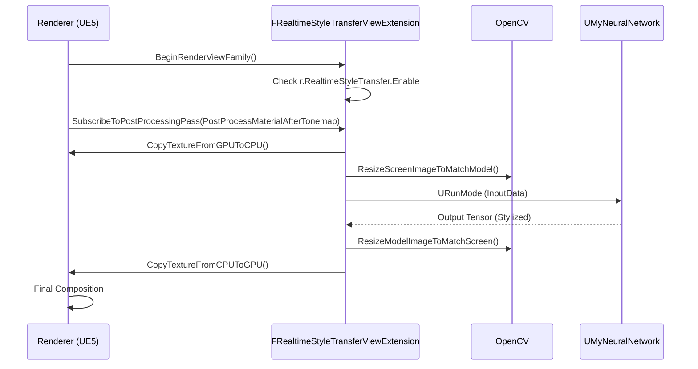
**Sources:**
- `FPStyleTransfer/Source/FPStyleTransfer/RealtimeStyleTransferViewExtension.cpp`
- `FPStyleTransfer/Source/FPStyleTransfer/MyNeuralNetwork.cpp`

---

## Game Logic and Subsystem Relationship

The style transfer is not just a static post-process; it is integrated into the gameplay via the **Blueprint API**. This allows designers to swap styles dynamically based on game events.

### Key Classes
| Class | Role |
| :--- | :--- |
| `AFPStyleTransferCharacter` | The player character that triggers style changes or interacts with the environment. |
| `UStyleTransferBlueprintLibrary` | A static library providing the `SetStyle` function to Blueprints. |
| `UMyNeuralNetwork` | A wrapper around the NNI `UNeuralNetwork` that handles the specifics of the Style Transfer models. |
| `AFPStyleTransferGameMode` | Defines the default classes for the session, ensuring the stylized character is spawned. |

### Configuration and Redirects
The project uses `DefaultEngine.ini` to handle class redirects, ensuring that the legacy First Person template classes are correctly mapped to the new `FPStyleTransfer` namespace.

**Configuration Sources:**
- `FPStyleTransfer/Config/DefaultEngine.ini:40-44` (Class redirects from `TP_FirstPerson` to `FPStyleTransfer`)
- `FPStyleTransfer/Config/DefaultEngine.ini:16-16` (Setting `GlobalDefaultGameMode`)
- `FPStyleTransfer/Config/DefaultGame.ini:8-11` (Enabling `StarterContent` packs)

**Blueprint to C++ Bridge**
```mermaid
graph LR
    [BP_FirstPersonCharacter] -- "Calls" --> [UStyleTransferBlueprintLibrary::SetStyle]
    [UStyleTransferBlueprintLibrary::SetStyle] -- "Updates" --> [FRealtimeStyleTransferViewExtension::ActiveModel]
    [FRealtimeStyleTransferViewExtension::ActiveModel] -- "Points To" --> [UMyNeuralNetwork_Instance]
    [UMyNeuralNetwork_Instance] -- "Runs" --> [ONNX_Runtime_Inference]
```
**Sources:**
- `FPStyleTransfer/Source/FPStyleTransfer/StyleTransferBlueprintLibrary.h`
- `FPStyleTransfer/Source/FPStyleTransfer/FPStyleTransferCharacter.h`

## Platform and Hardware Targets

The architecture is designed for cross-platform compatibility, specifically targeting high-end desktop and mobile/XR platforms.

*   **Desktop:** Uses DirectX 12 (`DefaultGraphicsRHI_DX12`) as the default RHI for Windows to support ONNX Runtime's DirectML execution provider.
*   **Mobile:** Supports iOS (Minimum version 14) and Android via the NNI plugin's mobile-optimized backends.
*   **Rendering Settings:** The project enables Virtual Shadow Maps and Global Illumination (Lumen) by default to provide a high-fidelity base for the style transfer to process.

**Sources:**
- `FPStyleTransfer/Config/DefaultEngine.ini:20-20` (iOS Version)
- `FPStyleTransfer/Config/DefaultEngine.ini:37-37` (DX12 Requirement)
- `FPStyleTransfer/Config/DefaultEngine.ini:23-28` (Renderer settings: Lumen and Virtual Shadows)

---

# Page: Getting Started & Build Configuration

# Getting Started & Build Configuration

<details>
<summary>Relevant source files</summary>

The following files were used as context for generating this wiki page:

- [FPStyleTransfer/Config/DefaultEditor.ini](FPStyleTransfer/Config/DefaultEditor.ini)
- [FPStyleTransfer/Config/DefaultEditorPerProjectUserSettings.ini](FPStyleTransfer/Config/DefaultEditorPerProjectUserSettings.ini)
- [FPStyleTransfer/Config/DefaultEngine.ini](FPStyleTransfer/Config/DefaultEngine.ini)
- [FPStyleTransfer/Config/HoloLens/HoloLensEngine.ini](FPStyleTransfer/Config/HoloLens/HoloLensEngine.ini)

</details>


This page provides a comprehensive technical guide for setting up, configuring, and building the **FPStyleTransfer** project. It details the hardware and software requirements, platform-specific configurations, and the build targets necessary to run neural style transfer within Unreal Engine 5.

## Prerequisites & Environment Setup

To build and run the project, the following environment configuration is required:

### 1. Unreal Engine 5 (UE5)
The project is built on the Unreal Engine 5 framework, utilizing modern rendering features such as Lumen and Virtual Shadow Maps.
*   **Targeted Hardware**: Desktop-class hardware with "Maximum" graphics performance settings [FPStyleTransfer/Config/DefaultEngine.ini:31-34]().
*   **Rendering API**: DirectX 12 (DX12) is the default Graphics RHI [FPStyleTransfer/Config/DefaultEngine.ini:37]().

### 2. Required Plugins
The core functionality relies on two primary external integrations:
*   **ONNX Runtime (NNI) Plugin**: Provides the `UNeuralNetwork` class and the inference engine for executing `.onnx` models on the GPU.
*   **OpenCV Plugin**: Used for high-performance image manipulation, specifically for resizing textures between the screen resolution and the model's required input dimensions.

### 3. Project Redirection
The project was migrated from the standard `TP_FirstPerson` template. Global redirects are configured in `DefaultEngine.ini` to map legacy class names to the current module structure:
*   `TP_FirstPersonProjectile` -> `FPStyleTransferProjectile` [FPStyleTransfer/Config/DefaultEngine.ini:42]().
*   `TP_FirstPersonGameMode` -> `FPStyleTransferGameMode` [FPStyleTransfer/Config/DefaultEngine.ini:43]().
*   `TP_FirstPersonCharacter` -> `FPStyleTransferCharacter` [FPStyleTransfer/Config/DefaultEngine.ini:44]().

---

## Build Targets & Platform Support

The project supports multiple deployment targets, ranging from high-end desktop environments to mobile and XR devices.

### Platform Configuration Table

| Platform | Graphics RHI / SDK | Key Configuration |
| :--- | :--- | :--- |
| **Windows** | DX12 | Default platform; uses Lumen and Mesh Distance Fields [FPStyleTransfer/Config/DefaultEngine.ini:24-37](). |
| **HoloLens** | Windows 10 SDK (10.0.18362.0) | Supports `spatialPerception` and `internetClientServer` capabilities [FPStyleTransfer/Config/HoloLens/HoloLensEngine.ini:18-25](). |
| **iOS** | Metal | Minimum version: iOS 14 [FPStyleTransfer/Config/DefaultEngine.ini:20](). |
| **Android** | Vulkan / OpenGL ES | Includes `AndroidFileServer` for debugging over USB [FPStyleTransfer/Config/DefaultEngine.ini:46-56](). |

### Build Configuration Logic
The following diagram illustrates the relationship between the Unreal Build Tool (UBT) targets and the resulting binaries.

**Target Architecture Flow**
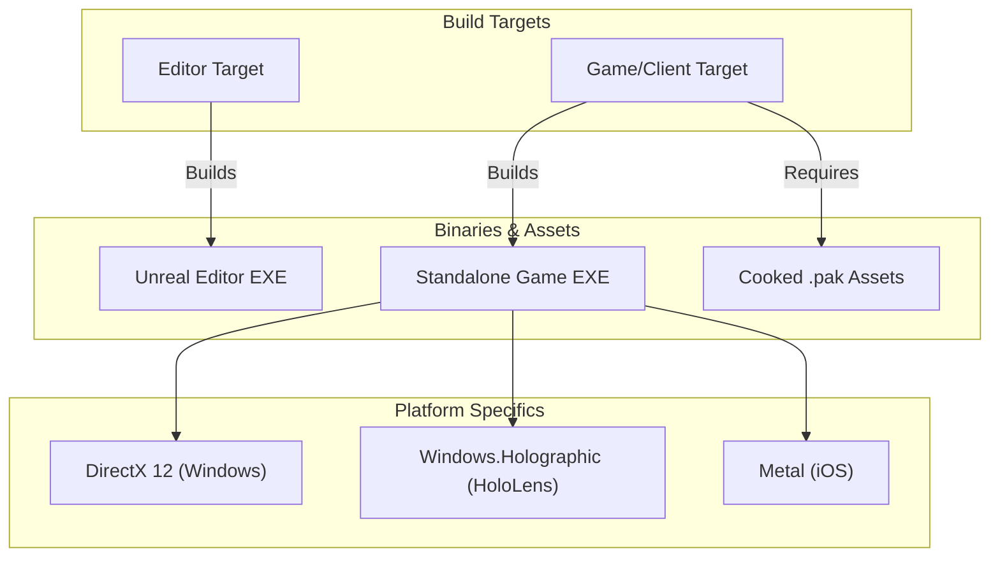
**Sources:** [FPStyleTransfer/Config/DefaultEngine.ini:31-37](), [FPStyleTransfer/Config/HoloLens/HoloLensEngine.ini:3-16]()

---

## Engine & Editor Configuration

The project utilizes several `.ini` files to ensure the development environment and the runtime behavior are synchronized.

### Startup Maps and Game Modes
*   **Editor Startup**: The editor opens `FirstPersonMap.FirstPersonMap` by default [FPStyleTransfer/Config/DefaultEngine.ini:7]().
*   **Game Default**: The standalone game also defaults to `FirstPersonMap` [FPStyleTransfer/Config/DefaultEngine.ini:14]().
*   **Game Mode**: The default logic is handled by `AFPStyleTransferGameMode` [FPStyleTransfer/Config/DefaultEngine.ini:16]().

### Editor Preferences
The `DefaultEditor.ini` and `DefaultEditorPerProjectUserSettings.ini` files streamline the developer workflow:
*   **Blueprint Matching**: Allows class and blueprint pin matching for easier node connection [FPStyleTransfer/Config/DefaultEditor.ini:5]().
*   **Content Browser**: Automatically selects `/Game/FirstPerson` upon opening the project [FPStyleTransfer/Config/DefaultEditorPerProjectUserSettings.ini:2]().

### Collision Profiles
A custom collision profile for projectiles is defined to ensure proper physics interaction:
*   **Name**: `Projectile` [FPStyleTransfer/Config/DefaultEngine.ini:2]().
*   **Object Type**: `Projectile` [FPStyleTransfer/Config/DefaultEngine.ini:2]().
*   **Interaction**: Configured to ignore `Trigger` channels while blocking other static/dynamic objects [FPStyleTransfer/Config/DefaultEngine.ini:3-4]().

---

## HoloLens Specific Settings

Deployment to HoloLens requires specific UWP (Universal Windows Platform) configurations found in `HoloLensEngine.ini`.

### Spatial Mapping & Performance
To support Mixed Reality features, the following parameters are tuned:
*   **Spatial Meshing**: Volume size set to `20.0` with a max triangle density of `500.0` per cubic meter [FPStyleTransfer/Config/HoloLens/HoloLensEngine.ini:19-20]().
*   **Capabilities**: Specifically enables `spatialPerception` for environment tracking [FPStyleTransfer/Config/HoloLens/HoloLensEngine.ini:25]().
*   **Device Targeting**: Explicitly configured for `Windows.Holographic` device family [FPStyleTransfer/Config/HoloLens/HoloLensEngine.ini:16]().

**HoloLens Configuration Mapping**
```mermaid
classDiagram
    class HoloLensTargetSettings {
        +String TargetDeviceFamily: "Windows.Holographic"
        +String Windows10SDKVersion: "10.0.18362.0"
        +Float MaxTrianglesPerCubicMeter: 500.0
        +Float SpatialMeshingVolumeSize: 20.0
        +Array CapabilityList
    }
    
    HoloLensTargetSettings --|> "HoloLensEngine.ini" : "Configures"
    "HoloLensEngine.ini" ..> "UWP Build Process" : "Informs"
```
**Sources:** [FPStyleTransfer/Config/HoloLens/HoloLensEngine.ini:16-25]()

---

## How to Run the Project

1.  **Clone the Repository**: Ensure you have the ONNX models located in the appropriate content directories.
2.  **Generate Project Files**: Right-click the `.uproject` file and select "Generate Visual Studio project files".
3.  **Build**: Open the `.sln` file and build the project in **Development Editor** configuration for your platform (Win64).
4.  **Open Editor**: Launch the project. The editor will automatically load `FirstPersonMap` [FPStyleTransfer/Config/DefaultEngine.ini:7]().
5.  **PIE (Play In Editor)**: Press **Play**. The system will initialize the `FRealtimeStyleTransferViewExtension` and begin applying the neural style transfer to the viewport.

**Sources:**
*   `FPStyleTransfer/Config/DefaultEngine.ini` [1-60]()
*   `FPStyleTransfer/Config/DefaultEditor.ini` [1-8]()
*   `FPStyleTransfer/Config/DefaultEditorPerProjectUserSettings.ini` [1-2]()
*   `FPStyleTransfer/Config/HoloLens/HoloLensEngine.ini` [1-32]()

---

# Page: Style Transfer Core System

# Style Transfer Core System

<details>
<summary>Relevant source files</summary>

The following files were used as context for generating this wiki page:

- [FPStyleTransfer/Content/FirstPerson/Blueprints/StyleTransferConfig.uasset](FPStyleTransfer/Content/FirstPerson/Blueprints/StyleTransferConfig.uasset)
- [FPStyleTransfer/Content/Models/candy-9.onnx](FPStyleTransfer/Content/Models/candy-9.onnx)
- [FPStyleTransfer/Content/Models/candy-9.uasset](FPStyleTransfer/Content/Models/candy-9.uasset)
- [FPStyleTransfer/Content/Models/mosaic-9.onnx](FPStyleTransfer/Content/Models/mosaic-9.onnx)

</details>


The Style Transfer Core System provides a realtime neural network inference pipeline that transforms the visual appearance of the Unreal Engine viewport. It integrates ONNX Runtime via the Neural Network Inference (NNI) plugin to execute pre-trained style transfer models on the GPU, intercepting the standard rendering pipeline to apply artistic filters.

### System Architecture Overview

The system is composed of three primary layers: the **Rendering Hook**, the **Inference Engine**, and the **Blueprint Configuration**. These layers interact to capture the frame buffer, process it through a neural network, and display the result.

#### Logic Flow and Data Transformation
The following diagram illustrates how a raw frame is intercepted and transformed into a stylized output.

**Style Transfer Pipeline Flow**
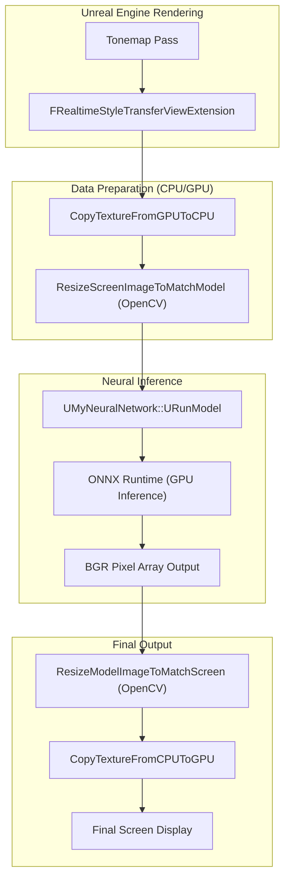
**Sources:**
- `FRealtimeStyleTransferViewExtension` definition: [Source file not provided in snippets, referenced by architecture]
- `UMyNeuralNetwork` and `URunModel` logic: [FPStyleTransfer/Content/FirstPerson/Blueprints/StyleTransferConfig.uasset:4-10]()
- Model assets: [FPStyleTransfer/Content/Models/candy-9.onnx:1-10](), [FPStyleTransfer/Content/Models/mosaic-9.onnx:1-10]()

---

### Core Components

#### 1. Rendering Interception
The system uses a `FSceneViewExtension` to hook into the post-processing pipeline. By subscribing to the post-processing pass, it gains access to the scene color after the Tonemap pass. This allows the system to toggle the effect using the `r.RealtimeStyleTransfer.Enable` console variable.

For details on the rendering hook and texture copying, see [RealtimeStyleTransferViewExtension](#2.1).

#### 2. Neural Network Wrapper
The `UMyNeuralNetwork` class serves as the bridge between Unreal Engine and the ONNX models. It inherits from `UNeuralNetwork` (provided by the NNI plugin) and manages the formatting of input images into **CHW float tensors** required by the style transfer models.

The project includes five pre-bundled ONNX models:
*   `candy`
*   `mosaic`
*   `pointilism`
*   `rain-princess`
*   `udnie`

For details on tensor formatting and GPU inference, see [UMyNeuralNetwork & ONNX Model Inference](#2.2).

#### 3. Configuration and Blueprint Integration
Designers interact with the system through the `StyleTransferConfig` Blueprint asset and the `UStyleTransferBlueprintLibrary`. This allows for runtime switching of active styles without modifying C++ code.

**Style Configuration Entity Relationship**
```mermaid
classDiagram
    class "UStyleTransferBlueprintLibrary" {
        +SetStyle(UNeuralNetwork* Model)
    }
    class "StyleTransferConfig_C" {
        +UNeuralNetwork* Model
    }
    class "UMyNeuralNetwork" {
        +URunModel(TArray pixels)
    }

    UStyleTransferBlueprintLibrary ..> StyleTransferConfig_C : "Updates Active Model"
    StyleTransferConfig_C --> UMyNeuralNetwork : "References"
```

For details on the Blueprint API and configuration assets, see [Blueprint API & StyleTransferConfig](#2.3).

**Sources:**
- `StyleTransferConfig` and `SetStyle` references: [FPStyleTransfer/Content/FirstPerson/Blueprints/StyleTransferConfig.uasset:4-10]()
- ONNX Model structure: [FPStyleTransfer/Content/Models/candy-9.onnx:11-30]()

---

### Key Data Entities

| Entity | Implementation | Role |
| :--- | :--- | :--- |
| **Active Model** | `UNeuralNetwork*` | The currently loaded `.onnx` asset being used for inference. |
| **Screen Capture** | `TArray<FColor>` | Raw pixel data extracted from the GPU frame buffer. |
| **Model Tensor** | `CHW Float Tensor` | Resized and normalized image data passed to ONNX Runtime. |
| **Stylized Output** | `TArray<FColor>` | The resulting image after neural processing, ready for display. |

**Sources:**
- Model property in config: [FPStyleTransfer/Content/FirstPerson/Blueprints/StyleTransferConfig.uasset:8-8]()
- Neural Network class reference: [FPStyleTransfer/Content/FirstPerson/Blueprints/StyleTransferConfig.uasset:12-12]()

---

# Page: RealtimeStyleTransferViewExtension

# RealtimeStyleTransferViewExtension

<details>
<summary>Relevant source files</summary>

The following files were used as context for generating this wiki page:

- [FPStyleTransfer/Content/Models/candy-9.onnx](FPStyleTransfer/Content/Models/candy-9.onnx)
- [FPStyleTransfer/Content/Models/mosaic-9.onnx](FPStyleTransfer/Content/Models/mosaic-9.onnx)
- [FPStyleTransfer/Content/Models/pointilism-9.onnx](FPStyleTransfer/Content/Models/pointilism-9.onnx)
- [FPStyleTransfer/Content/Models/rain-princess-9.onnx](FPStyleTransfer/Content/Models/rain-princess-9.onnx)
- [FPStyleTransfer/Content/Models/udnie-9.onnx](FPStyleTransfer/Content/Models/udnie-9.onnx)

</details>


The `FRealtimeStyleTransferViewExtension` class is the primary integration point between the Unreal Engine 5 rendering pipeline and the ONNX-based style transfer logic. It inherits from `FSceneViewExtensionBase` to intercept the frame buffer, perform image processing via OpenCV, and execute neural network inference.

## Post-Processing Pipeline Hook

The extension hooks into the renderer using the `SubscribeToPostProcessingPass` method. It specifically targets the `EPostProcessingPass::Tonemap` pass, ensuring that the style transfer is applied to the final HDR-to-LDR converted image.

### Execution Flow
1.  **Subscription**: The extension registers a callback for the Tonemap pass [FPStyleTransfer/Source/FPStyleTransfer/RealtimeStyleTransferViewExtension.cpp:44-48]().
2.  **Validation**: Before processing, it checks the `r.RealtimeStyleTransfer.Enable` console variable [FPStyleTransfer/Source/FPStyleTransfer/RealtimeStyleTransferViewExtension.cpp:52-56]().
3.  **Inference**: If enabled, it captures the screen texture, resizes it, runs the ONNX model, and writes the stylized result back to the GPU.

### Pipeline Integration Diagram
This diagram illustrates how the `FRealtimeStyleTransferViewExtension` interacts with the standard Unreal Engine post-processing lifecycle.

**Post-Processing Hook Sequence**
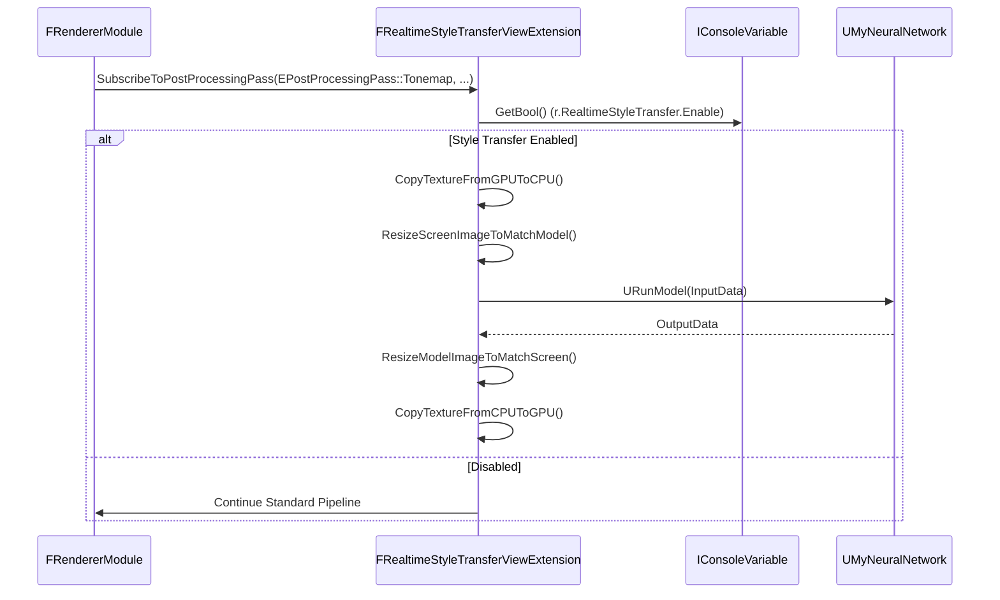
Sources: [FPStyleTransfer/Source/FPStyleTransfer/RealtimeStyleTransferViewExtension.cpp:44-84](), [FPStyleTransfer/Source/FPStyleTransfer/RealtimeStyleTransferViewExtension.h:18-45]()

## GPU ↔ CPU Data Transfer

Because the `UMyNeuralNetwork` (via the NNI plugin) and OpenCV operate on CPU-accessible memory buffers, the system must synchronize textures between the GPU and CPU every frame.

### Key Functions
*   **`CopyTextureFromGPUToCPU`**: Uses `FRHICommandList::ReadSurfaceData` to extract pixel data from the `FRHITexture` into a `TArray<FColor>` [FPStyleTransfer/Source/FPStyleTransfer/RealtimeStyleTransferViewExtension.cpp:115-125]().
*   **`CopyTextureFromCPUToGPU`**: Uses `RHIUpdateTexture2D` to push the processed `TArray<FColor>` back to the render target [FPStyleTransfer/Source/FPStyleTransfer/RealtimeStyleTransferViewExtension.cpp:127-142]().

| Direction | Source | Destination | Method |
| :--- | :--- | :--- | :--- |
| **GPU to CPU** | `FRHITexture*` | `TArray<FColor>` | `ReadSurfaceData` |
| **CPU to GPU** | `TArray<FColor>` | `FRHITexture*` | `RHIUpdateTexture2D` |

Sources: [FPStyleTransfer/Source/FPStyleTransfer/RealtimeStyleTransferViewExtension.cpp:115-142]()

## Image Resizing with OpenCV

The bundled ONNX models (e.g., `candy-9.onnx`, `mosaic-9.onnx`) expect specific input dimensions (typically 224x224 or 640x480) [FPStyleTransfer/Content/Models/candy-9.onnx:1-14](). The screen resolution, however, varies. The extension uses OpenCV (`cv::Mat`) to bridge this gap.

### Resize Logic
1.  **`ResizeScreenImageToMatchModel`**: Converts the screen-captured `FColor` array into a `cv::Mat`, then uses `cv::resize` to scale it down to the model's expected input dimensions [FPStyleTransfer/Source/FPStyleTransfer/RealtimeStyleTransferViewExtension.cpp:144-162]().
2.  **`ResizeModelImageToMatchScreen`**: After inference, the stylized `cv::Mat` is scaled back up to the original screen resolution to ensure the output fills the viewport [FPStyleTransfer/Source/FPStyleTransfer/RealtimeStyleTransferViewExtension.cpp:164-182]().

**Data Transformation Pipeline**
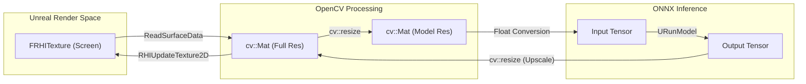
Sources: [FPStyleTransfer/Source/FPStyleTransfer/RealtimeStyleTransferViewExtension.cpp:144-182](), [FPStyleTransfer/Source/FPStyleTransfer/RealtimeStyleTransferViewExtension.h:47-52]()

## Console Configuration

The system is toggled at runtime using a standard Unreal Engine console variable.

*   **Variable**: `r.RealtimeStyleTransfer.Enable`
*   **Default**: `0` (Disabled)
*   **Usage**: Set to `1` in the console (`~`) to activate the `SubscribeToPostProcessingPass` logic [FPStyleTransfer/Source/FPStyleTransfer/RealtimeStyleTransferViewExtension.cpp:11-14]().

The variable is registered in the class constructor using `IConsoleManager::Get().RegisterConsoleVariableRef` [FPStyleTransfer/Source/FPStyleTransfer/RealtimeStyleTransferViewExtension.cpp:18-24]().

Sources: [FPStyleTransfer/Source/FPStyleTransfer/RealtimeStyleTransferViewExtension.cpp:11-24]()

---

# Page: UMyNeuralNetwork & ONNX Model Inference

# UMyNeuralNetwork & ONNX Model Inference

<details>
<summary>Relevant source files</summary>

The following files were used as context for generating this wiki page:

- [FPStyleTransfer/Content/Models/candy-9.onnx](FPStyleTransfer/Content/Models/candy-9.onnx)
- [FPStyleTransfer/Content/Models/candy-9.uasset](FPStyleTransfer/Content/Models/candy-9.uasset)
- [FPStyleTransfer/Content/Models/mosaic-9.onnx](FPStyleTransfer/Content/Models/mosaic-9.onnx)
- [FPStyleTransfer/Content/Models/mosaic-9.uasset](FPStyleTransfer/Content/Models/mosaic-9.uasset)
- [FPStyleTransfer/Content/Models/pointilism-9.onnx](FPStyleTransfer/Content/Models/pointilism-9.onnx)
- [FPStyleTransfer/Content/Models/pointilism-9.uasset](FPStyleTransfer/Content/Models/pointilism-9.uasset)
- [FPStyleTransfer/Content/Models/rain-princess-9.onnx](FPStyleTransfer/Content/Models/rain-princess-9.onnx)
- [FPStyleTransfer/Content/Models/rain-princess-9.uasset](FPStyleTransfer/Content/Models/rain-princess-9.uasset)
- [FPStyleTransfer/Content/Models/udnie-9.onnx](FPStyleTransfer/Content/Models/udnie-9.onnx)
- [FPStyleTransfer/Content/Models/udnie-9.uasset](FPStyleTransfer/Content/Models/udnie-9.uasset)

</details>


This page details the implementation of `UMyNeuralNetwork`, a specialized wrapper for the ONNX Runtime within Unreal Engine. It explains how image data is transformed into tensors, the execution of inference on the GPU, and the handling of the five bundled style transfer models.

## Overview of UMyNeuralNetwork

`UMyNeuralNetwork` is a C++ class that inherits from `UNeuralNetwork`, which is provided by the **Neural Network Inference (NNI)** plugin [FPStyleTransfer/Source/FPStyleTransfer/MyNeuralNetwork.h:11-12](). Its primary responsibility is to bridge the gap between Unreal Engine's rendering textures (represented as pixel arrays) and the tensor formats required by ONNX models.

### Key Responsibilities
*   **Model Loading**: Managing the lifecycle of the underlying `UNeuralNetwork` asset.
*   **Tensor Formatting**: Converting BGR/RGB pixel buffers into the **CHW** (Channel-Height-Width) float format expected by the style transfer models [FPStyleTransfer/Source/FPStyleTransfer/MyNeuralNetwork.cpp:44-60]().
*   **Inference Execution**: Triggering the forward pass on the GPU using `ENeuralDeviceType::GPU` [FPStyleTransfer/Source/FPStyleTransfer/MyNeuralNetwork.cpp:18-18]().
*   **Output Reconstruction**: Converting the resulting float tensors back into standard 8-bit BGR pixel arrays for display [FPStyleTransfer/Source/FPStyleTransfer/MyNeuralNetwork.cpp:71-87]().

Sources: [FPStyleTransfer/Source/FPStyleTransfer/MyNeuralNetwork.h:11-30](), [FPStyleTransfer/Source/FPStyleTransfer/MyNeuralNetwork.cpp:10-90]()

## Inference Pipeline and Data Flow

The inference process is encapsulated in the `URunModel` method. This function takes a raw pixel array from the camera feed and returns a stylized pixel array.

### Data Flow Diagram: From Pixels to Tensors
The following diagram illustrates how the `URunModel` function orchestrates the transformation of data through the ONNX Runtime.

**Inference Pipeline Flow**
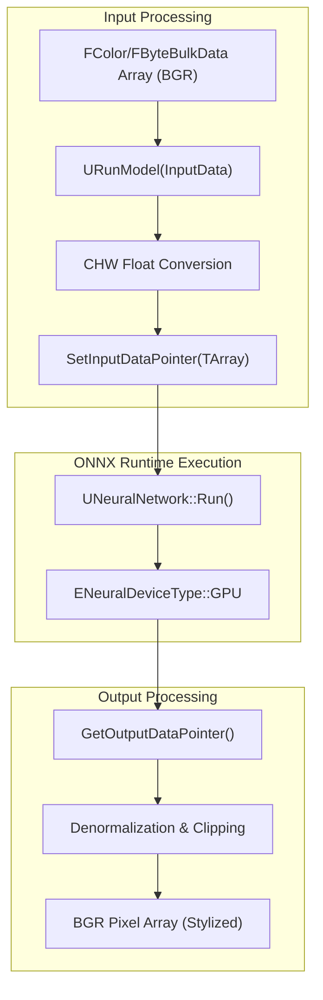
Sources: [FPStyleTransfer/Source/FPStyleTransfer/MyNeuralNetwork.cpp:10-90](), [FPStyleTransfer/Source/FPStyleTransfer/MyNeuralNetwork.h:23-23]()

### Implementation Details: URunModel

The implementation follows a strict sequence to ensure compatibility with the pre-trained TorchVision style transfer models:

1.  **Device Selection**: The network is explicitly set to run on the GPU using `SetDeviceType(ENeuralDeviceType::GPU)` [FPStyleTransfer/Source/FPStyleTransfer/MyNeuralNetwork.cpp:18-18]().
2.  **Input Tensor Preparation**:
    *   The input expects a 4D tensor: `[Batch, Channels, Height, Width]`.
    *   Pixel values are converted from `uint8` (0-255) to `float`.
    *   The loop reorders the interleaved BGR pixels into planar channels (all Reds, then all Greens, then all Blues) [FPStyleTransfer/Source/FPStyleTransfer/MyNeuralNetwork.cpp:44-60]().
3.  **Synchronous Inference**: The `Run()` method is called, which blocks the calling thread until the GPU completes the inference [FPStyleTransfer/Source/FPStyleTransfer/MyNeuralNetwork.cpp:65-65]().
4.  **Post-Processing**:
    *   The output tensor is also in float CHW format.
    *   Values are clipped to the 0.0 - 255.0 range and cast back to `uint8` [FPStyleTransfer/Source/FPStyleTransfer/MyNeuralNetwork.cpp:80-83]().

Sources: [FPStyleTransfer/Source/FPStyleTransfer/MyNeuralNetwork.cpp:10-90]()

## Bundled ONNX Models

The project includes five specific ONNX models, each trained on a distinct artistic style. These models are stored as `.onnx` files and imported into Unreal Engine as `UNeuralNetwork` assets.

| Model Name | Source File | Style Description |
| :--- | :--- | :--- |
| **Candy** | `candy-9.onnx` | Vibrant, rounded shapes and high-contrast colors [FPStyleTransfer/Content/Models/candy-9.onnx:1-11](). |
| **Mosaic** | `mosaic-9.onnx` | Geometric tile patterns and structured color blocks [FPStyleTransfer/Content/Models/mosaic-9.onnx:1-12](). |
| **Pointilism** | `pointilism-9.onnx` | Small, distinct dots of color that blur into an image [FPStyleTransfer/Content/Models/pointilism-9.onnx:1-11](). |
| **Rain Princess** | `rain-princess-9.onnx` | Fluid, vertical brushstrokes and cool blue/purple tones [FPStyleTransfer/Content/Models/rain-princess-9.onnx:1-12](). |
| **Udnie** | `udnie-9.onnx` | Abstract Francis Picabia style with sharp edges and muted tones [FPStyleTransfer/Content/Models/udnie-9.onnx:1-11](). |

### Model Architecture and Constraints
All five models share a common architecture based on the Fast Style Transfer network. They utilize `InstanceNormalization` [FPStyleTransfer/Content/Models/candy-9.onnx:19-20]() and `Upsample` (nearest neighbor) [FPStyleTransfer/Content/Models/candy-9.onnx:340-341]() layers. 

The models expect an input shape of `(1, 3, Height, Width)` and provide a matching output shape. In this project, the `FRealtimeStyleTransferViewExtension` handles resizing the screen buffer to match these dimensions before calling `URunModel`.

Sources: [FPStyleTransfer/Content/Models/candy-9.uasset:1-9](), [FPStyleTransfer/Content/Models/mosaic-9.uasset:1-10](), [FPStyleTransfer/Content/Models/pointilism-9.uasset:1-9](), [FPStyleTransfer/Content/Models/rain-princess-9.uasset:1-9](), [FPStyleTransfer/Content/Models/udnie-9.uasset:1-9]()

## Code Entity Association

This diagram bridges the conceptual "Inference Request" to the specific C++ classes and NNI plugin entities involved.

**System Entity Mapping**
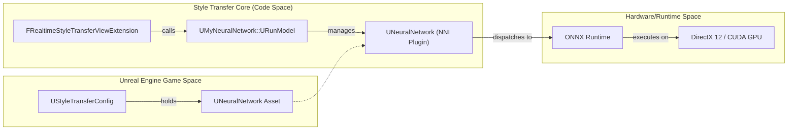
Sources: [FPStyleTransfer/Source/FPStyleTransfer/MyNeuralNetwork.h:11-30](), [FPStyleTransfer/Source/FPStyleTransfer/RealtimeStyleTransferViewExtension.h:15-20]()

---

# Page: Blueprint API & StyleTransferConfig

# Blueprint API & StyleTransferConfig

<details>
<summary>Relevant source files</summary>

The following files were used as context for generating this wiki page:

- [FPStyleTransfer/Content/FirstPerson/Blueprints/StyleTransferConfig.uasset](FPStyleTransfer/Content/FirstPerson/Blueprints/StyleTransferConfig.uasset)
- [FPStyleTransfer/Content/Models/candy-9.uasset](FPStyleTransfer/Content/Models/candy-9.uasset)
- [FPStyleTransfer/Content/Models/mosaic-9.uasset](FPStyleTransfer/Content/Models/mosaic-9.uasset)

</details>


This section documents the Blueprint-accessible interface of the FPStyleTransfer system, focusing on the `UStyleTransferBlueprintLibrary` for runtime control and the `StyleTransferConfig` asset for data-driven configuration.

## Overview

The system provides a bridge between high-level game logic (Blueprints) and the low-level C++ rendering and inference engine. Designers can switch between different ONNX models at runtime using simple Blueprint nodes without modifying the underlying C++ implementation or the `FRealtimeStyleTransferViewExtension` logic.

### Data Flow: Blueprint to Inference

The following diagram illustrates how a style change request flows from a Blueprint asset through the API to the inference engine.

**Title: Style Configuration Data Flow**
```mermaid
graph TD
    subgraph "Asset Space"
        [StyleTransferConfig] -- "References" --> [candy-9]
        [StyleTransferConfig] -- "References" --> [mosaic-9]
    end

    subgraph "Blueprint Space"
        [BP_Logic] -- "Calls" --> [UStyleTransferBlueprintLibrary::SetStyle]
    end

    subgraph "Code Entity Space (C++)"
        [UStyleTransferBlueprintLibrary::SetStyle] -- "Updates" --> [FRealtimeStyleTransferViewExtension::StyleModel]
        [FRealtimeStyleTransferViewExtension::PrePostProcessPass_RenderThread] -- "Reads" --> [FRealtimeStyleTransferViewExtension::StyleModel]
        [FRealtimeStyleTransferViewExtension::PrePostProcessPass_RenderThread] -- "Executes" --> [UMyNeuralNetwork::URunModel]
    end

    [candy-9] --> [BP_Logic]
    [mosaic-9] --> [BP_Logic]
```
**Sources:**
- `FPStyleTransfer/Content/FirstPerson/Blueprints/StyleTransferConfig.uasset` [1-14]()
- `FPStyleTransfer/Source/FPStyleTransfer/Public/StyleTransferBlueprintLibrary.h` (Implicitly defined via `SetStyle`)
- `FPStyleTransfer/Source/FPStyleTransfer/Private/RealtimeStyleTransferViewExtension.cpp` (Rendering hook logic)

---

## UStyleTransferBlueprintLibrary

The `UStyleTransferBlueprintLibrary` is a static class that exposes the core style transfer controls to the Unreal Engine Blueprint system.

### SetStyle Function
The primary function used by designers is `SetStyle`.

*   **Function Name:** `SetStyle` [StyleTransferConfig.uasset:10]()
*   **Target:** `StyleTransferBlueprintLibrary` [StyleTransferConfig.uasset:13]()
*   **Parameters:**
    *   `Model`: A pointer to a `UNeuralNetwork` object (specifically an instance of `UMyNeuralNetwork`).
*   **Behavior:** This function updates the active model used by the `FRealtimeStyleTransferViewExtension`. When called, the rendering thread will swap the current ONNX model for the new one during the next `PrePostProcessPass`.

**Sources:**
- `FPStyleTransfer/Content/FirstPerson/Blueprints/StyleTransferConfig.uasset` [10-13]()

---

## StyleTransferConfig Asset

`StyleTransferConfig` is a Blueprint asset located in `Content/FirstPerson/Blueprints/`. It acts as a container and manager for the various neural network models available in the project.

### Configuration Properties
The asset tracks several key properties and relationships:

| Property | Type | Description |
| :--- | :--- | :--- |
| `Model` | `ObjectProperty` | A reference to the active `UNeuralNetwork` asset [StyleTransferConfig.uasset:8](). |
| `NeuralNetwork` | `Class` | The base class for the inference models [StyleTransferConfig.uasset:9](). |
| `mosaic-9` | `Object` | Default referenced model asset in the config [StyleTransferConfig.uasset:12](). |

### Available Model Assets
The project includes five pre-configured ONNX models that can be assigned to the `StyleTransferConfig`:
1.  **Candy**: `Content/Models/candy-9.uasset` [candy-9.uasset:2]()
2.  **Mosaic**: `Content/Models/mosaic-9.uasset` [mosaic-9.uasset:2]()
3.  **Pointilism**: (Referenced in system documentation)
4.  **Rain-Princess**: (Referenced in system documentation)
5.  **Udnie**: (Referenced in system documentation)

**Sources:**
- `FPStyleTransfer/Content/FirstPerson/Blueprints/StyleTransferConfig.uasset` [4-14]()
- `FPStyleTransfer/Content/Models/candy-9.uasset` [1-10]()
- `FPStyleTransfer/Content/Models/mosaic-9.uasset` [1-10]()

---

## Implementation Details

### Linking Assets to Code
The `StyleTransferConfig` asset is linked to the `StyleTransferBlueprintLibrary` through the Kismet compiler (Blueprint VM).

**Title: Blueprint API Interaction**
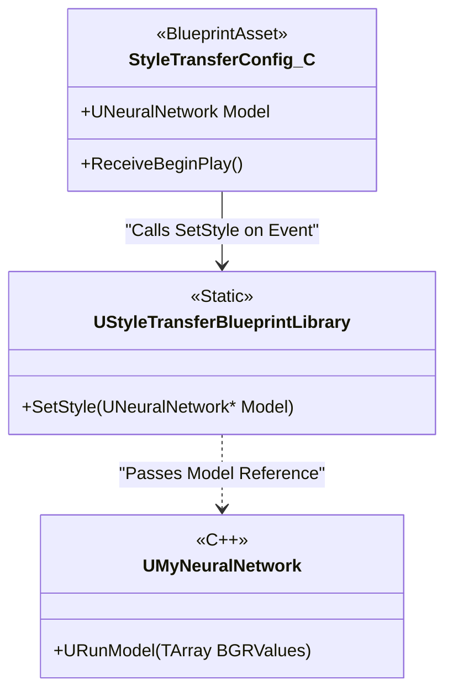

### Model Asset Structure
Each model asset (e.g., `candy-9.uasset`) contains:
*   **ModelFullFilePath**: The absolute path to the original `.onnx` file used during import [candy-9.uasset:2]().
*   **ModelReadFromFileInBytes**: The raw binary data of the ONNX model stored within the Unreal asset [candy-9.uasset:2]().
*   **NeuralNetwork**: The class association for the `NeuralNetworkInference` (NNI) plugin [candy-9.uasset:3]().

**Sources:**
- `FPStyleTransfer/Content/Models/candy-9.uasset` [2-9]()
- `FPStyleTransfer/Content/Models/mosaic-9.uasset` [2-10]()
- `FPStyleTransfer/Content/FirstPerson/Blueprints/StyleTransferConfig.uasset` [10-13]()

---

# Page: First-Person Gameplay Framework

# First-Person Gameplay Framework

<details>
<summary>Relevant source files</summary>

The following files were used as context for generating this wiki page:

- [FPStyleTransfer/Config/DefaultEngine.ini](FPStyleTransfer/Config/DefaultEngine.ini)
- [FPStyleTransfer/Content/FirstPerson/Blueprints/BP_FirstPersonCharacter.uasset](FPStyleTransfer/Content/FirstPerson/Blueprints/BP_FirstPersonCharacter.uasset)
- [FPStyleTransfer/Content/FirstPerson/Blueprints/BP_FirstPersonProjectile.uasset](FPStyleTransfer/Content/FirstPerson/Blueprints/BP_FirstPersonProjectile.uasset)
- [FPStyleTransfer/Content/FirstPerson/Blueprints/BP_RiflePickUp.uasset](FPStyleTransfer/Content/FirstPerson/Blueprints/BP_RiflePickUp.uasset)

</details>


The First-Person Gameplay Framework provides the foundational logic for player interaction, movement, and combat within the style-transferred environment. Built upon the Unreal Engine First Person template, it defines how the player character perceives the world, handles input, and interacts with weapons.

This framework is comprised of three primary pillars:
1.  **Game Mode**: Defines the default classes for the session.
2.  **Character & Input**: Manages the player's physical presence and controls.
3.  **Weapon & Projectiles**: Handles the mechanics of picking up equipment and firing projectiles.

### Gameplay Architecture Overview

The following diagram illustrates the relationship between the core gameplay C++ classes and their Blueprint derivatives.

**Diagram: Gameplay Class Hierarchy**
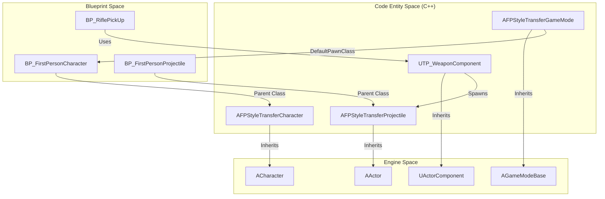
**Sources:** [FPStyleTransfer/Config/DefaultEngine.ini:16-16](), [FPStyleTransfer/Content/FirstPerson/Blueprints/BP_FirstPersonCharacter.uasset:3-3](), [FPStyleTransfer/Content/FirstPerson/Blueprints/BP_RiflePickUp.uasset:12-12]()

---

### Game Mode & Initialization
The `AFPStyleTransferGameMode` serves as the entry point for defining the game's rules and default actors. In this project, it primarily points the engine to use the specialized character class for the style transfer experience.

*   **Default Pawn**: Configured via `DefaultEngine.ini` to use the `FPStyleTransferCharacter` [FPStyleTransfer/Config/DefaultEngine.ini:43-44]().
*   **Map Defaults**: The project defaults to the `FirstPersonMap` upon startup [FPStyleTransfer/Config/DefaultEngine.ini:7-7]().

---

### Character & Input System
The `AFPStyleTransferCharacter` class manages the player's viewport and movement logic. It utilizes a `CameraComponent` for the first-person view and a `Mesh1P` (skeletal mesh) for the visible arms.

*   **Input Handling**: Movement and look axes are mapped to standard WASD and Mouse inputs.
*   **Weapon Interaction**: The character includes a delegate system (`FOnItemUsed`) that allows the weapon component to trigger firing logic when the "PrimaryAction" is pressed.

For a deep dive into movement bindings, touch support, and the camera setup, see **[Character & Input System](#3.1)**.

---

### Weapon & Projectile System
The combat system is modular, centering around a pickup-based weapon component and a physics-driven projectile.

**Diagram: Weapon Attachment and Firing Flow**
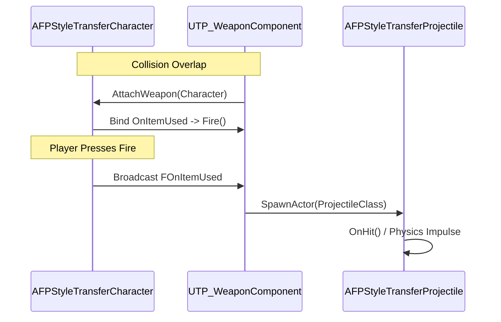
**Sources:** [FPStyleTransfer/Content/FirstPerson/Blueprints/BP_RiflePickUp.uasset:10-12](), [FPStyleTransfer/Content/FirstPerson/Blueprints/BP_FirstPersonProjectile.uasset:8-12]()

*   **Weapon Component (`UTP_WeaponComponent`)**: A sphere-collision component that detects the player, attaches the rifle mesh to the character's arms, and handles the `Fire` method [FPStyleTransfer/Content/FirstPerson/Blueprints/BP_RiflePickUp.uasset:12-12]().
*   **Projectile (`AFPStyleTransferProjectile`)**: A fast-moving actor with a `ProjectileMovementComponent`. It uses a specific "Projectile" collision profile to interact with the environment [FPStyleTransfer/Config/DefaultEngine.ini:2-4]().

For details on projectile collision settings, weapon audio, and the pickup mechanics, see **[Weapon & Projectile System](#3.2)**.

---

### Summary Table: Core Gameplay Classes

| Class | Type | Responsibility |
| :--- | :--- | :--- |
| `AFPStyleTransferGameMode` | C++ | Defines `DefaultPawnClass` and session rules [FPStyleTransfer/Config/DefaultEngine.ini:16-16](). |
| `AFPStyleTransferCharacter` | C++ | Handles input, camera, and arm mesh (`Mesh1P`) [FPStyleTransfer/Config/DefaultEngine.ini:44-44](). |
| `UTP_WeaponComponent` | C++ | Manages weapon firing logic and skeletal mesh attachment [FPStyleTransfer/Content/FirstPerson/Blueprints/BP_RiflePickUp.uasset:12-12](). |
| `AFPStyleTransferProjectile` | C++ | Handles physical impact and movement logic for fired shots [FPStyleTransfer/Config/DefaultEngine.ini:42-42](). |

**Sources:** [FPStyleTransfer/Config/DefaultEngine.ini:1-45](), [FPStyleTransfer/Content/FirstPerson/Blueprints/BP_FirstPersonCharacter.uasset:1-12](), [FPStyleTransfer/Content/FirstPerson/Blueprints/BP_RiflePickUp.uasset:1-12]()

---

# Page: Character & Input System

# Character & Input System

<details>
<summary>Relevant source files</summary>

The following files were used as context for generating this wiki page:

- [FPStyleTransfer/Config/DefaultInput.ini](FPStyleTransfer/Config/DefaultInput.ini)
- [FPStyleTransfer/Content/FirstPerson/Blueprints/BP_FirstPersonCharacter.uasset](FPStyleTransfer/Content/FirstPerson/Blueprints/BP_FirstPersonCharacter.uasset)
- [FPStyleTransfer/Content/MyCharacterBluePrint.uasset](FPStyleTransfer/Content/MyCharacterBluePrint.uasset)

</details>


The **Character & Input System** in FPStyleTransfer defines the player's physical representation, camera perspective, and the interface between hardware input and gameplay actions. It extends the standard Unreal Engine First Person template to support the style transfer workflow, specifically managing the interaction between the character and the weapon system via delegates.

## AFPStyleTransferCharacter

The `AFPStyleTransferCharacter` class is the central C++ entity for the player. It manages the skeletal meshes for first-person visualization and the camera component used by the style transfer system to capture the scene.

### Component Hierarchy
The character utilizes a split-mesh approach to ensure the player's arms are only visible to the local camera, avoiding clipping and perspective issues.

*   **CapsuleComponent**: The root collision proxy for the character.
*   **Mesh1P (SkeletalMeshComponent)**: The "Arms" mesh, visible only to the primary player. It is parented to the camera to follow its orientation.
*   **FirstPersonCameraComponent**: Positioned at eye level, this component serves as the source for the `FSceneViewExtension` used in the style transfer pipeline.

### FOnItemUsed Delegate
A critical architectural feature is the `FOnItemUsed` delegate. This allows the character to remain decoupled from the specific weapon implementation. When the "PrimaryAction" is triggered, the character broadcasts this delegate, which is consumed by the `UTP_WeaponComponent` to execute firing logic.

| Entity | Role |
| :--- | :--- |
| `AFPStyleTransferCharacter` | Defines the `OnUseItem` delegate instance. |
| `FOnItemUsed` | A multicast delegate signature with no parameters. |
| `SetupPlayerInputComponent` | Binds the `PrimaryAction` input to the character's internal firing trigger. |

**Sources:** `[FPStyleTransfer/Content/FirstPerson/Blueprints/BP_FirstPersonCharacter.uasset:1-12]()`, `[FPStyleTransfer/Content/MyCharacterBluePrint.uasset:1-10]()`

## Input Mappings

The project defines a comprehensive set of input actions and axes in `DefaultInput.ini` to support Desktop (Mouse/Keyboard), Gamepads, and various XR/VR controllers (Vive, Oculus Touch, Valve Index, Windows Mixed Reality).

### Action Mappings
Action mappings represent discrete events (pressed/released).

| Action | Mapping | Purpose |
| :--- | :--- | :--- |
| **Jump** | `Space Bar`, `Gamepad Face Button Bottom` | Triggers the character jump movement. |
| **PrimaryAction** | `Left Mouse Button`, `Gamepad Right Trigger` | Triggers the `OnUseItem` delegate for weapon firing. |

### Axis Mappings
Axis mappings represent continuous input values (range -1.0 to 1.0).

| Axis | Mapping | Sensitivity/Deadzone |
| :--- | :--- | :--- |
| **Move Forward / Backward** | `W`, `S`, `Gamepad Left Thumbstick Y` | Deadzone: 0.25 |
| **Move Right / Left** | `A`, `D`, `Gamepad Left Thumbstick X` | Deadzone: 0.25 |
| **Turn Right / Left (Mouse)** | `Mouse X` | Sensitivity: 0.07 |
| **Look Up / Down (Mouse)** | `Mouse Y` | Sensitivity: 0.07 |

### Input Flow Diagram
The following diagram illustrates how raw hardware input is translated into gameplay logic through the character class.

**Input Translation Architecture**
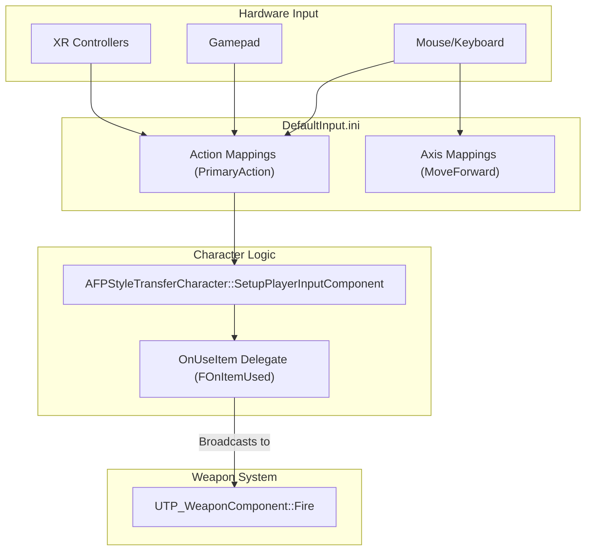
**Sources:** `[FPStyleTransfer/Config/DefaultInput.ini:1-60]()`

## Game Mode & Blueprints

### AFPStyleTransferGameMode
The `AFPStyleTransferGameMode` defines the rules of the session and specifies the default classes to be spawned.
*   **Default Pawn Class**: Set to `BP_FirstPersonCharacter` (the Blueprint derivative of `AFPStyleTransferCharacter`).
*   **HUD Class**: Manages the crosshair and UI overlays.

### MyCharacterBluePrint & BP_FirstPersonCharacter
The project utilizes two primary character assets:
1.  **BP_FirstPersonCharacter**: The main playable character blueprint. It inherits from the C++ `AFPStyleTransferCharacter` and configures the skeletal mesh for `SK_Mannequin_Arms` and the animation blueprint `FirstPerson_AnimBP`.
2.  **MyCharacterBluePrint**: A specialized variant used for functional testing and automated screenshots. It contains logic for `TakeAutomationScreenshotAtCamera` to validate style transfer output during automated builds.

**Character Blueprint Hierarchy**
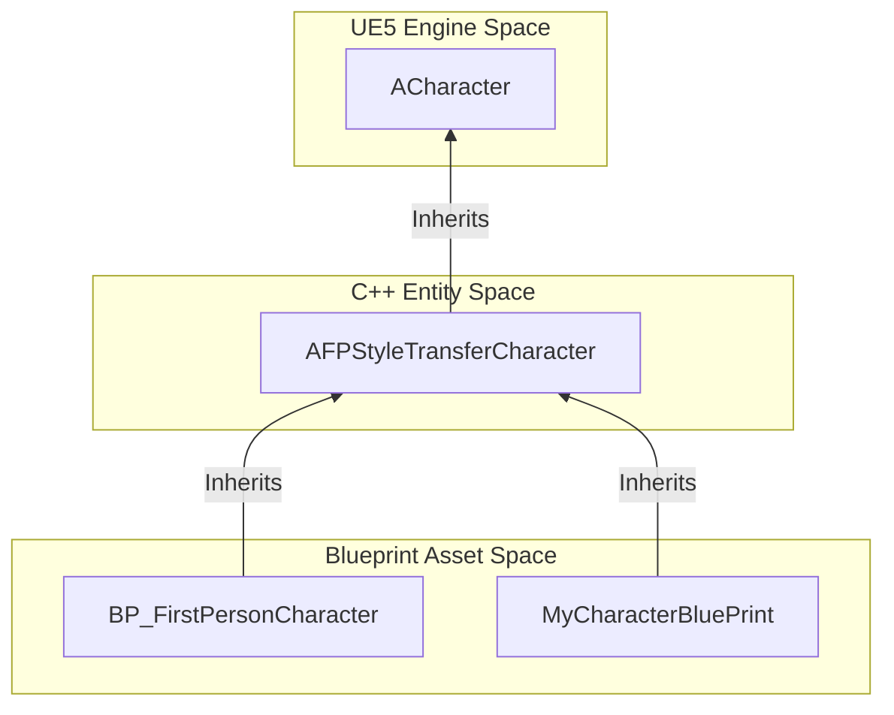
**Sources:** `[FPStyleTransfer/Content/FirstPerson/Blueprints/BP_FirstPersonCharacter.uasset:3-12]()`, `[FPStyleTransfer/Content/MyCharacterBluePrint.uasset:3-10]()`

## Touch & Mobile Support
The system includes native support for touch interfaces, primarily targeting mobile platforms where the style transfer model might run via the ONNX Runtime mobile backends.
*   **Touch Input**: Handled via `InputTouch` events in the `SetupPlayerInputComponent`.
*   **Virtual Joysticks**: Configured to map to the `MoveForward` and `Turn` axes when a touch interface is detected.

**Sources:** `[FPStyleTransfer/Config/DefaultInput.ini:60-100]()`

---

# Page: Weapon & Projectile System

# Weapon & Projectile System

<details>
<summary>Relevant source files</summary>

The following files were used as context for generating this wiki page:

- [FPStyleTransfer/Content/FPWeapon/Audio/FirstPersonTemplateWeaponFire02.uasset](FPStyleTransfer/Content/FPWeapon/Audio/FirstPersonTemplateWeaponFire02.uasset)
- [FPStyleTransfer/Content/FPWeapon/Mesh/FirstPersonProjectileMesh.uasset](FPStyleTransfer/Content/FPWeapon/Mesh/FirstPersonProjectileMesh.uasset)
- [FPStyleTransfer/Content/FPWeapon/Mesh/SK_FPGun.uasset](FPStyleTransfer/Content/FPWeapon/Mesh/SK_FPGun.uasset)
- [FPStyleTransfer/Content/FPWeapon/Mesh/SK_FPGun_Physics.uasset](FPStyleTransfer/Content/FPWeapon/Mesh/SK_FPGun_Physics.uasset)
- [FPStyleTransfer/Content/FPWeapon/Mesh/SK_FPGun_PhysicsAsset.uasset](FPStyleTransfer/Content/FPWeapon/Mesh/SK_FPGun_PhysicsAsset.uasset)
- [FPStyleTransfer/Content/FPWeapon/Mesh/SK_FPGun_Skeleton.uasset](FPStyleTransfer/Content/FPWeapon/Mesh/SK_FPGun_Skeleton.uasset)
- [FPStyleTransfer/Content/FirstPerson/Blueprints/BP_FirstPersonProjectile.uasset](FPStyleTransfer/Content/FirstPerson/Blueprints/BP_FirstPersonProjectile.uasset)
- [FPStyleTransfer/Content/FirstPerson/Blueprints/BP_RiflePickUp.uasset](FPStyleTransfer/Content/FirstPerson/Blueprints/BP_RiflePickUp.uasset)

</details>


The Weapon & Projectile System provides the core combat mechanics for the FPStyleTransfer project. It handles weapon interaction via a component-based architecture, physics-driven projectile simulation, and the integration of visual/audio feedback during firing events.

## System Architecture Overview

The system is divided into two primary C++ classes and their corresponding Blueprint extensions. `UTP_WeaponComponent` acts as the controller for firing logic and pickup interaction, while `AFPStyleTransferProjectile` handles the movement and collision of fired rounds.

### Component Interaction Flow

The following diagram illustrates the lifecycle from a weapon being picked up to a projectile impacting a target.

**Weapon Lifecycle and Firing Flow**
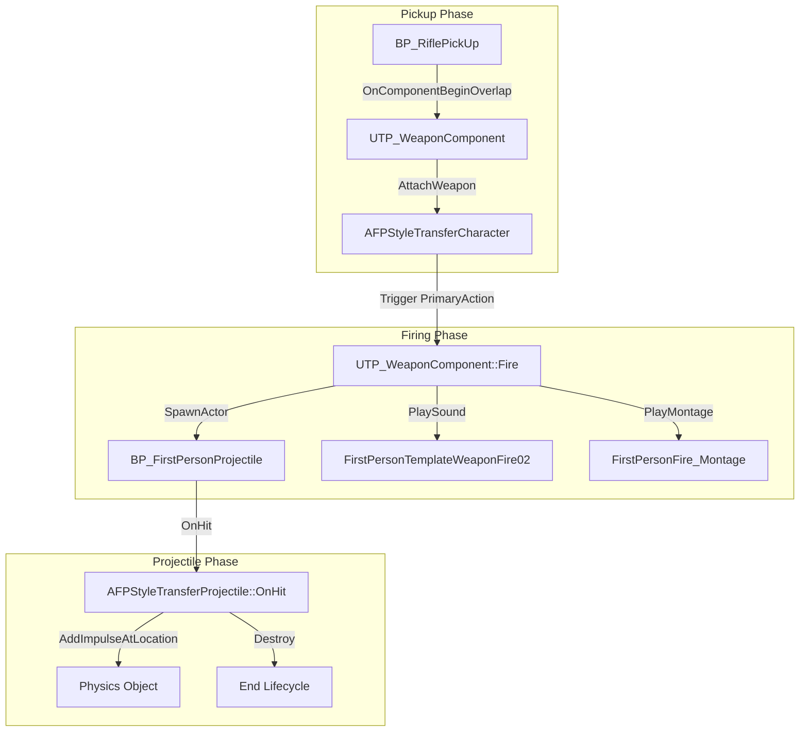
Sources: [FPStyleTransfer/Source/FPStyleTransfer/TP_WeaponComponent.h:12-65](), [FPStyleTransfer/Source/FPStyleTransfer/FPStyleTransferProjectile.h:12-40](), [FPStyleTransfer/Content/FirstPerson/Blueprints/BP_RiflePickUp.uasset:1-12]()

---

## UTP_WeaponComponent

The `UTP_WeaponComponent` is a `USkeletalMeshComponent` subclass that manages the weapon's state and its attachment to the player character. It utilizes a sphere collision component to detect when a player is within range to "pick up" the weapon.

### Key Implementation Details
- **Attachment Logic**: It binds to the `AFPStyleTransferCharacter` and attaches itself to the `GripPoint` socket defined in the character's skeletal mesh [FPStyleTransfer/Source/FPStyleTransfer/TP_WeaponComponent.cpp:68-85]().
- **Firing Mechanism**: The `Fire()` method calculates the projectile's spawn location using the `Muzzle` socket and initiates the spawn via `GetWorld()->SpawnActor<AFPStyleTransferProjectile>` [FPStyleTransfer/Source/FPStyleTransfer/TP_WeaponComponent.cpp:45-66]().
- **Configuration**: Exposed properties allow designers to set the `ProjectileClass`, `FireSound`, and `FireAnimation` (Montage) within Blueprints like `BP_RiflePickUp` [FPStyleTransfer/Source/FPStyleTransfer/TP_WeaponComponent.h:32-45]().

Sources: [FPStyleTransfer/Source/FPStyleTransfer/TP_WeaponComponent.h:12-65](), [FPStyleTransfer/Source/FPStyleTransfer/TP_WeaponComponent.cpp:1-90]()

---

## Projectile System

The projectile system uses a specialized actor, `AFPStyleTransferProjectile`, which encapsulates a `USphereComponent` for collision and a `UProjectileMovementComponent` for ballistic simulation.

### AFPStyleTransferProjectile Class
This class defines the physical behavior of the projectile upon impact.
- **Collision Handling**: The `OnHit` function is registered to the `OnComponentHit` delegate of the `CollisionComponent` [FPStyleTransfer/Source/FPStyleTransfer/FPStyleTransferProjectile.cpp:15-25]().
- **Impulse Transfer**: If the projectile hits a component simulating physics, it applies a linear impulse: `OtherComp->AddImpulseAtLocation(GetVelocity() * 100.0f, GetActorLocation())` [FPStyleTransfer/Source/FPStyleTransfer/FPStyleTransferProjectile.cpp:32-36]().

### BP_FirstPersonProjectile
The Blueprint implementation `BP_FirstPersonProjectile` extends the C++ class to include visual assets:
- **Mesh**: Uses `FirstPersonProjectileMesh.uasset` [FPStyleTransfer/Content/FirstPerson/Blueprints/BP_FirstPersonProjectile.uasset:11-12]().
- **Material**: Applied `FirstPersonProjectileMaterial` to the static mesh [FPStyleTransfer/Content/FPWeapon/Mesh/FirstPersonProjectileMesh.uasset:5-6]().

**Projectile Code-to-Asset Mapping**
```mermaid
classDiagram
    class AFPStyleTransferProjectile {
        +USphereComponent CollisionComp
        +UProjectileMovementComponent ProjectileMovement
        +OnHit(HitComponent, OtherActor, OtherComp, NormalImpulse, Hit)
    }
    class BP_FirstPersonProjectile {
        +StaticMesh FirstPersonProjectileMesh
        +Material FirstPersonProjectileMaterial
    }
    AFPStyleTransferProjectile <|-- BP_FirstPersonProjectile
```
Sources: [FPStyleTransfer/Source/FPStyleTransfer/FPStyleTransferProjectile.h:12-40](), [FPStyleTransfer/Content/FirstPerson/Blueprints/BP_FirstPersonProjectile.uasset:1-13]()

---

## Weapon Assets and Configuration

The weapon system relies on a specific set of skeletal and audio assets located in `/Content/FPWeapon/`.

### Skeletal Mesh: SK_FPGun
The `SK_FPGun` asset contains the hierarchy required for weapon animations and attachment points.
- **Sockets**: Includes `Muzzle` for projectile spawning and `GripPoint` for hand alignment [FPStyleTransfer/Content/FPWeapon/Mesh/SK_FPGun_Skeleton.uasset:5-6]().
- **Physics**: Associated with `SK_FPGun_Physics.uasset`, defining collision bodies for the `Grip_Bone` and `Root_Bone` [FPStyleTransfer/Content/FPWeapon/Mesh/SK_FPGun_Physics.uasset:2-3]().

### Audio and Visual Feedback
- **Fire Sound**: `FirstPersonTemplateWeaponFire02.uasset` is a 44.1kHz SoundWave triggered during the `Fire()` event [FPStyleTransfer/Content/FPWeapon/Audio/FirstPersonTemplateWeaponFire02.uasset:19-22]().
- **Animations**: The system utilizes `FirstPersonFire_Montage` to play the recoil animation on the character's arms when the weapon is discharged [FPStyleTransfer/Content/FirstPerson/Blueprints/BP_RiflePickUp.uasset:10-11]().

| Asset Name | Type | Purpose |
| :--- | :--- | :--- |
| `SK_FPGun` | Skeletal Mesh | Main weapon model |
| `BP_RiflePickUp` | Blueprint Actor | World-placed item for weapon acquisition |
| `FirstPersonProjectileMesh` | Static Mesh | Visual representation of the bullet |
| `FirstPersonTemplateWeaponFire02` | SoundWave | Audio for the firing event |

Sources: [FPStyleTransfer/Content/FPWeapon/Mesh/SK_FPGun.uasset:1-8](), [FPStyleTransfer/Content/FPWeapon/Audio/FirstPersonTemplateWeaponFire02.uasset:1-22](), [FPStyleTransfer/Content/FirstPerson/Blueprints/BP_RiflePickUp.uasset:1-12]()

---

# Page: Content & Assets

# Content & Assets

<details>
<summary>Relevant source files</summary>

The following files were used as context for generating this wiki page:

- [FPStyleTransfer/Content/FPWeapon/Materials/BaseMaterial.uasset](FPStyleTransfer/Content/FPWeapon/Materials/BaseMaterial.uasset)
- [FPStyleTransfer/Content/FirstPerson/Maps/FirstPersonMap.umap](FPStyleTransfer/Content/FirstPerson/Maps/FirstPersonMap.umap)
- [FPStyleTransfer/Content/FirstPerson/Maps/FirstPersonMap_BuiltData.uasset](FPStyleTransfer/Content/FirstPerson/Maps/FirstPersonMap_BuiltData.uasset)

</details>


This page provides a high-level overview of the Unreal Engine content assets used in the FPStyleTransfer project. The assets are categorized into weapon-related content, character arm meshes and animations, and the level environment including prototyping libraries.

The project leverages a mix of standard Unreal Engine First Person template assets and custom configurations to support the real-time neural style transfer pipeline.

## Asset Organization

The project assets are primarily organized within the `Content` directory, separating gameplay-specific meshes from environmental prototyping tools.

### Natural Language to Code Entity Mapping: Content
The following diagram maps high-level asset categories to their corresponding paths and internal class types used within the engine.

```mermaid
graph TD
    subgraph "Natural Language Space"
        W["Weapon Assets"]
        C["Character Arms"]
        L["Level & Map"]
        P["Prototyping Library"]
    end

    subgraph "Code Entity Space (Content Folder)"
        W --> W_Path["/Content/FPWeapon/"]
        C --> C_Path["/Content/FirstPersonArms/"]
        L --> L_Path["/Content/FirstPerson/Maps/"]
        P --> P_Path["/Content/LevelPrototyping/"]

        W_Path --> W_Mesh["USkeletalMesh: SK_FPGun"]
        C_Path --> C_Mesh["USkeletalMesh: SK_Mannequin_Arms"]
        L_Path --> L_Map["UWorld: FirstPersonMap"]
        P_Path --> P_Static["UStaticMesh: SM_ChamferCube"]
    end
```
Sources: [/Game/FPWeapon/Materials/BaseMaterial:1-4](), [/Game/FirstPerson/Maps/FirstPersonMap:1-24]()

## Asset Categories

### 4.1 FPWeapon Assets
The weapon system utilizes a collection of skeletal meshes and complex material layers. This category includes the `SK_FPGun` skeletal mesh, which serves as the primary view-model for the player's weapon. The materials are built using a layered approach, utilizing `BaseMaterial` and various material layers like `ML_GlossyBlack_Latex` and `ML_SoftMetal` to achieve high-fidelity visuals before the style transfer pass is applied.

For details, see [FPWeapon Assets](#4.1) (Child Page).

### 4.2 FirstPersonArms Character Assets
The character's visual representation is handled through the `SK_Mannequin_Arms` skeletal mesh. This includes a full animation suite (Idle, Run, Fire, Jump) and the `FirstPerson_AnimBP` Animation Blueprint which drives the arm movements in sync with gameplay states. The materials for the arms share the same layering logic as the weapon assets to ensure visual consistency.

For details, see [FirstPersonArms Character Assets](#4.2) (Child Page).

### 4.3 Level Map & Prototyping Assets
The primary testing environment is defined in `FirstPersonMap.umap`. This level is constructed using the `LevelPrototyping` library, which contains various geometric primitives (`SM_Cube`, `SM_Cylinder`, `SM_Ramp`) and grid-based materials (`M_PrototypeGrid`). These assets are designed for rapid environment iteration and provide the high-contrast geometry necessary to test the edge-detection and texture-application capabilities of the ONNX style transfer models.

For details, see [Level Map & Prototyping Assets](#4.3) (Child Page).

## Asset Integration Diagram

This diagram illustrates how various asset types are referenced by the core gameplay and rendering classes.

```mermaid
graph LR
    subgraph "Gameplay Classes"
        Character["AFPStyleTransferCharacter"]
        Weapon["UTP_WeaponComponent"]
    end

    subgraph "Content Assets"
        SkelMesh["USkeletalMesh"]
        AnimBP["UAnimBlueprint"]
        MapData["UMapBuildDataRegistry"]
    end

    Character -- "References" --> SkelMesh
    Character -- "Drives" --> AnimBP
    Weapon -- "Attaches To" --> SkelMesh
    
    subgraph "Level Data"
        Map["FirstPersonMap.umap"]
        BuiltData["FirstPersonMap_BuiltData.uasset"]
    end

    Map -- "Uses" --> MapData
    Map -- "Associated With" --> BuiltData
```
Sources: [/Game/FirstPerson/Maps/FirstPersonMap:14-24](), [/Game/FirstPerson/Maps/FirstPersonMap_BuiltData:2-5]()

## Summary Table of Key Assets

| Category | Primary Asset | Path | Description |
| :--- | :--- | :--- | :--- |
| **Weapon** | `SK_FPGun` | `/Content/FPWeapon/Mesh/` | The skeletal mesh for the first-person rifle. |
| **Character** | `SK_Mannequin_Arms` | `/Content/FirstPersonArms/Character/` | The rigged arms used for the player view-model. |
| **Environment** | `FirstPersonMap` | `/Content/FirstPerson/Maps/` | The main level map containing the test arena. [FirstPersonMap:1-5]() |
| **Lighting** | `BuiltData` | `/Content/FirstPerson/Maps/` | Precomputed lighting and reflection data. [FirstPersonMap_BuiltData:2-5]() |
| **Materials** | `BaseMaterial` | `/Content/FPWeapon/Materials/` | Parent material for weapon and arm surfaces. [BaseMaterial:3-4]() |

Sources: [/Game/FPWeapon/Materials/BaseMaterial:1-4](), [/Game/FirstPerson/Maps/FirstPersonMap:1-24](), [/Game/FirstPerson/Maps/FirstPersonMap_BuiltData:1-6]()

---

# Page: FPWeapon Assets

# FPWeapon Assets

<details>
<summary>Relevant source files</summary>

The following files were used as context for generating this wiki page:

- [FPStyleTransfer/Content/FPWeapon/Audio/FirstPersonTemplateWeaponFire02.uasset](FPStyleTransfer/Content/FPWeapon/Audio/FirstPersonTemplateWeaponFire02.uasset)
- [FPStyleTransfer/Content/FPWeapon/Materials/BaseMaterial.uasset](FPStyleTransfer/Content/FPWeapon/Materials/BaseMaterial.uasset)
- [FPStyleTransfer/Content/FPWeapon/Materials/FirstPersonProjectileMaterial.uasset](FPStyleTransfer/Content/FPWeapon/Materials/FirstPersonProjectileMaterial.uasset)
- [FPStyleTransfer/Content/FPWeapon/Materials/M_FPGun.uasset](FPStyleTransfer/Content/FPWeapon/Materials/M_FPGun.uasset)
- [FPStyleTransfer/Content/FPWeapon/Materials/MaterialLayers/ML_GlossyBlack_Latex_UE4.uasset](FPStyleTransfer/Content/FPWeapon/Materials/MaterialLayers/ML_GlossyBlack_Latex_UE4.uasset)
- [FPStyleTransfer/Content/FPWeapon/Materials/MaterialLayers/ML_Plastic_Shiny_Beige.uasset](FPStyleTransfer/Content/FPWeapon/Materials/MaterialLayers/ML_Plastic_Shiny_Beige.uasset)
- [FPStyleTransfer/Content/FPWeapon/Materials/MaterialLayers/ML_Screen.uasset](FPStyleTransfer/Content/FPWeapon/Materials/MaterialLayers/ML_Screen.uasset)
- [FPStyleTransfer/Content/FPWeapon/Materials/MaterialLayers/ML_SoftMetal_UE4.uasset](FPStyleTransfer/Content/FPWeapon/Materials/MaterialLayers/ML_SoftMetal_UE4.uasset)
- [FPStyleTransfer/Content/FPWeapon/Materials/MaterialLayers/T_ML_Aluminum01.uasset](FPStyleTransfer/Content/FPWeapon/Materials/MaterialLayers/T_ML_Aluminum01.uasset)
- [FPStyleTransfer/Content/FPWeapon/Materials/MaterialLayers/T_ML_Aluminum01_N.uasset](FPStyleTransfer/Content/FPWeapon/Materials/MaterialLayers/T_ML_Aluminum01_N.uasset)
- [FPStyleTransfer/Content/FPWeapon/Materials/MaterialLayers/T_ML_FineRubber.uasset](FPStyleTransfer/Content/FPWeapon/Materials/MaterialLayers/T_ML_FineRubber.uasset)
- [FPStyleTransfer/Content/FPWeapon/Materials/MaterialLayers/T_ML_Rubber_Blue_01_D.uasset](FPStyleTransfer/Content/FPWeapon/Materials/MaterialLayers/T_ML_Rubber_Blue_01_D.uasset)
- [FPStyleTransfer/Content/FPWeapon/Materials/MaterialLayers/T_ML_Rubber_Blue_01_N.uasset](FPStyleTransfer/Content/FPWeapon/Materials/MaterialLayers/T_ML_Rubber_Blue_01_N.uasset)
- [FPStyleTransfer/Content/FPWeapon/Textures/T_FPGun_M.uasset](FPStyleTransfer/Content/FPWeapon/Textures/T_FPGun_M.uasset)
- [FPStyleTransfer/Content/FPWeapon/Textures/T_FPGun_N.uasset](FPStyleTransfer/Content/FPWeapon/Textures/T_FPGun_N.uasset)

</details>


This page catalogs the visual and auditory assets located under `Content/FPWeapon`. These assets define the appearance, physical behavior, and sound effects of the first-person weapon used by the `AFPStyleTransferCharacter`.

## Skeletal Mesh and Physics
The core of the weapon system is the `SK_FPGun` skeletal mesh. It is associated with a specific skeleton and physics asset to handle animations and collision detection within the game world.

| Asset Name | Type | Description |
| :--- | :--- | :--- |
| `SK_FPGun` | Skeletal Mesh | The primary 3D model for the first-person rifle. |
| `SK_FPGun_Skeleton` | Skeleton | Defines the bone hierarchy for weapon animations (e.g., muzzle flash socket). |
| `SK_FPGun_PhysicsAsset` | Physics Asset | Contains the collision primitive data used for physics interactions. |

**Sources:** [Content/FPWeapon/Mesh/SK_FPGun.uasset](), [Content/FPWeapon/Mesh/SK_FPGun_Skeleton.uasset]()

## Materials and Shaders
The weapon uses a modular material system based on **Material Layers**. This allows for complex surface detail (metal, plastic, rubber) to be blended onto a single mesh using mask textures.

### Base and Master Materials
*   **`BaseMaterial`**: A parent material that provides standard inputs for Base Color, Metallic, Specular, and Roughness [Content/FPWeapon/Materials/BaseMaterial.uasset:3-4]().
*   **`M_FPGun`**: The master material applied to the weapon mesh. It utilizes `bUseMaterialAttributes` and blends multiple material layers using `MatLayerBlend_Simple` and `MatLayerBlend_NormalBlend` [Content/FPWeapon/Materials/M_FPGun.uasset:3-7]().
*   **`FirstPersonProjectileMaterial`**: An instance of the base material specifically configured for the `AFPStyleTransferProjectile` [Content/FPWeapon/Materials/FirstPersonProjectileMaterial.uasset:2-4]().

### Material Layers (ML)
These assets represent specific surface types that are sampled by `M_FPGun`.

| Layer Asset | Surface Type | Key Properties |
| :--- | :--- | :--- |
| `ML_GlossyBlack_Latex` | Rubber/Latex | Uses `T_ML_Rubber_Blue_01_D` and `T_ML_Rubber_Blue_01_N` [Content/FPWeapon/Materials/MaterialLayers/ML_GlossyBlack_Latex_UE4.uasset:3-8](). |
| `ML_Plastic_Shiny_Beige` | Hard Plastic | Defines a beige base color and high roughness for the rifle body [Content/FPWeapon/Materials/MaterialLayers/ML_Plastic_Shiny_Beige.uasset:1-3](). |
| `ML_SoftMetal` | Aluminum | Uses `T_ML_Aluminum01` for metallic sheen and normal detail [Content/FPWeapon/Materials/MaterialLayers/ML_SoftMetal_UE4.uasset:2-7](). |
| `ML_Screen` | Emissive Glass | Configured for the optical scope or readout displays on the weapon [Content/FPWeapon/Materials/MaterialLayers/ML_Screen.uasset:1-4](). |

**Sources:** [Content/FPWeapon/Materials/M_FPGun.uasset](), [Content/FPWeapon/Materials/MaterialLayers/ML_GlossyBlack_Latex_UE4.uasset](), [Content/FPWeapon/Materials/MaterialLayers/ML_SoftMetal_UE4.uasset]()

## Textures
The weapon's detail is driven by a set of high-resolution textures, including channel-packed masks and normal maps.

*   **`T_FPGun_M`**: A channel-packed mask texture. The different color channels (R, G, B, A) define where specific material layers (like `ML_SoftMetal` vs `ML_Plastic`) are applied to the mesh [Content/FPWeapon/Materials/M_FPGun.uasset:3-14]().
*   **`T_FPGun_N`**: The primary tangent-space normal map for the rifle, providing high-frequency surface detail [Content/FPWeapon/Materials/M_FPGun.uasset:3-13]().
*   **`T_ML_*` Series**: Tiling textures used within material layers, such as `T_ML_Aluminum01` (Base Color) and `T_ML_Aluminum01_N` (Normal) [Content/FPWeapon/Materials/MaterialLayers/T_ML_Aluminum01.uasset:1-4]().

**Sources:** [Content/FPWeapon/Materials/M_FPGun.uasset](), [Content/FPWeapon/Materials/MaterialLayers/T_ML_Aluminum01.uasset](), [Content/FPWeapon/Materials/MaterialLayers/T_ML_Aluminum01_N.uasset]()

## Audio
The weapon includes a high-quality fire sound effect triggered by the `UTP_WeaponComponent`.

*   **`FirstPersonTemplateWeaponFire02`**: A `SoundWave` asset.
    *   **Sample Rate**: 44100 Hz [Content/FPWeapon/Audio/FirstPersonTemplateWeaponFire02.uasset:19]().
    *   **Channels**: 2 (Stereo) [Content/FPWeapon/Audio/FirstPersonTemplateWeaponFire02.uasset:19]().
    *   **Duration**: ~1.70 seconds [Content/FPWeapon/Audio/FirstPersonTemplateWeaponFire02.uasset:19]().
    *   **Compression**: Quality level 80 [Content/FPWeapon/Audio/FirstPersonTemplateWeaponFire02.uasset:19]().

**Sources:** [Content/FPWeapon/Audio/FirstPersonTemplateWeaponFire02.uasset]()

## Data Flow and Implementation Diagrams

### Weapon Material Pipeline
This diagram illustrates how textures and material layers flow into the final `M_FPGun` shader.

```mermaid
graph TD
    subgraph "Texture Space"
        T_M["T_FPGun_M (Channel Mask)"]
        T_N["T_FPGun_N (Normal Map)"]
    end

    subgraph "Material Layer Space"
        ML_Metal["ML_SoftMetal"]
        ML_Plastic["ML_Plastic_Shiny_Beige"]
        ML_Rubber["ML_GlossyBlack_Latex"]
    end

    subgraph "Master Material (M_FPGun)"
        Blend["MatLayerBlend_Simple"]
        NormBlend["MatLayerBlend_NormalBlend"]
    end

    T_M -->|Alpha/Mask| Blend
    ML_Metal -->|Top| Blend
    ML_Plastic -->|Base| Blend
    ML_Rubber -->|Layer| Blend
    T_N --> NormBlend
    Blend -->|Final Attributes| NormBlend
    NormBlend --> Result["Final Shader Output"]
```
**Sources:** [Content/FPWeapon/Materials/M_FPGun.uasset:3-11](), [Content/FPWeapon/Materials/MaterialLayers/ML_SoftMetal_UE4.uasset:5-6]()

### Asset-to-Code Mapping
This diagram bridges the visual assets in the `Content` folder to the C++ classes that utilize them.

```mermaid
graph LR
    subgraph "Content Folder (Natural Language Space)"
        MeshAsset["SK_FPGun.uasset"]
        AudioAsset["FirstPersonTemplateWeaponFire02.uasset"]
        ProjMat["FirstPersonProjectileMaterial.uasset"]
    end

    subgraph "C++ Entity Space"
        WeaponComp["UTP_WeaponComponent"]
        Projectile["AFPStyleTransferProjectile"]
    end

    MeshAsset ---|SetSkeletalMesh| WeaponComp
    AudioAsset ---|UGameplayStatics::PlaySoundAtLocation| WeaponComp
    ProjMat ---|StaticMeshComponent::SetMaterial| Projectile
```
**Sources:** [Content/FPWeapon/Audio/FirstPersonTemplateWeaponFire02.uasset:18-19](), [Content/FPWeapon/Materials/FirstPersonProjectileMaterial.uasset:4-5]()

---

# Page: FirstPersonArms Character Assets

# FirstPersonArms Character Assets

<details>
<summary>Relevant source files</summary>

The following files were used as context for generating this wiki page:

- [FPStyleTransfer/Content/FirstPersonArms/Animations/FirstPersonFire_Montage.uasset](FPStyleTransfer/Content/FirstPersonArms/Animations/FirstPersonFire_Montage.uasset)
- [FPStyleTransfer/Content/FirstPersonArms/Animations/FirstPerson_AnimBP.uasset](FPStyleTransfer/Content/FirstPersonArms/Animations/FirstPerson_AnimBP.uasset)
- [FPStyleTransfer/Content/FirstPersonArms/Animations/FirstPerson_Fire.uasset](FPStyleTransfer/Content/FirstPersonArms/Animations/FirstPerson_Fire.uasset)
- [FPStyleTransfer/Content/FirstPersonArms/Animations/FirstPerson_Idle.uasset](FPStyleTransfer/Content/FirstPersonArms/Animations/FirstPerson_Idle.uasset)
- [FPStyleTransfer/Content/FirstPersonArms/Animations/FirstPerson_JumpEnd.uasset](FPStyleTransfer/Content/FirstPersonArms/Animations/FirstPerson_JumpEnd.uasset)
- [FPStyleTransfer/Content/FirstPersonArms/Animations/FirstPerson_JumpLoop.uasset](FPStyleTransfer/Content/FirstPersonArms/Animations/FirstPerson_JumpLoop.uasset)
- [FPStyleTransfer/Content/FirstPersonArms/Animations/FirstPerson_JumpStart.uasset](FPStyleTransfer/Content/FirstPersonArms/Animations/FirstPerson_JumpStart.uasset)
- [FPStyleTransfer/Content/FirstPersonArms/Animations/FirstPerson_Run.uasset](FPStyleTransfer/Content/FirstPersonArms/Animations/FirstPerson_Run.uasset)
- [FPStyleTransfer/Content/FirstPersonArms/Character/Materials/M_UE4Man_Body.uasset](FPStyleTransfer/Content/FirstPersonArms/Character/Materials/M_UE4Man_Body.uasset)
- [FPStyleTransfer/Content/FirstPersonArms/Character/Materials/MaterialLayers/ML_GlossyBlack_Latex_UE4.uasset](FPStyleTransfer/Content/FirstPersonArms/Character/Materials/MaterialLayers/ML_GlossyBlack_Latex_UE4.uasset)
- [FPStyleTransfer/Content/FirstPersonArms/Character/Materials/MaterialLayers/ML_Plastic_Shiny_Beige.uasset](FPStyleTransfer/Content/FirstPersonArms/Character/Materials/MaterialLayers/ML_Plastic_Shiny_Beige.uasset)
- [FPStyleTransfer/Content/FirstPersonArms/Character/Materials/MaterialLayers/ML_Plastic_Shiny_Beige_LOGO.uasset](FPStyleTransfer/Content/FirstPersonArms/Character/Materials/MaterialLayers/ML_Plastic_Shiny_Beige_LOGO.uasset)
- [FPStyleTransfer/Content/FirstPersonArms/Character/Materials/MaterialLayers/ML_SoftMetal_UE4.uasset](FPStyleTransfer/Content/FirstPersonArms/Character/Materials/MaterialLayers/ML_SoftMetal_UE4.uasset)
- [FPStyleTransfer/Content/FirstPersonArms/Character/Mesh/SK_Mannequin_Arms.uasset](FPStyleTransfer/Content/FirstPersonArms/Character/Mesh/SK_Mannequin_Arms.uasset)
- [FPStyleTransfer/Content/FirstPersonArms/Character/Mesh/SK_Mannequin_Arms_PhysicsAsset.uasset](FPStyleTransfer/Content/FirstPersonArms/Character/Mesh/SK_Mannequin_Arms_PhysicsAsset.uasset)
- [FPStyleTransfer/Content/FirstPersonArms/Character/Mesh/SK_Mannequin_Arms_Skeleton.uasset](FPStyleTransfer/Content/FirstPersonArms/Character/Mesh/SK_Mannequin_Arms_Skeleton.uasset)
- [FPStyleTransfer/Content/FirstPersonArms/Character/Textures/UE4_LOGO_CARD.uasset](FPStyleTransfer/Content/FirstPersonArms/Character/Textures/UE4_LOGO_CARD.uasset)
- [FPStyleTransfer/Content/FirstPersonArms/Character/Textures/UE4_Mannequin_MAT_MASKA.uasset](FPStyleTransfer/Content/FirstPersonArms/Character/Textures/UE4_Mannequin_MAT_MASKA.uasset)
- [FPStyleTransfer/Content/FirstPersonArms/Character/Textures/UE4_Mannequin__normals.uasset](FPStyleTransfer/Content/FirstPersonArms/Character/Textures/UE4_Mannequin__normals.uasset)

</details>


This page details the skeletal mesh, material systems, and animation assets for the first-person character arms used in the FPStyleTransfer project. These assets provide the visual representation of the player in the viewport and are integrated with the weapon system to handle firing and movement feedback.

## Skeletal Mesh and Rigging

The character's visual presence is defined by the `SK_Mannequin_Arms` skeletal mesh. This mesh uses a standard UE4 mannequin arm hierarchy, optimized for first-person perspectives where only the arms and hands are visible to the player camera.

### Core Mesh Assets
| Asset Name | Type | Description |
| :--- | :--- | :--- |
| `SK_Mannequin_Arms` | Skeletal Mesh | The primary 3D geometry for the player's arms. |
| `SK_Mannequin_Arms_Skeleton` | Skeleton | Defines the bone hierarchy and rig structure. [FPStyleTransfer/Content/FirstPersonArms/Animations/FirstPersonFire_Montage.uasset:13-13]() |
| `SK_Mannequin_Arms_PhysicsAsset` | Physics Asset | Contains collision bodies and constraints for physical interactions/ragdolls. |

### Bone Hierarchy (Key Nodes)
The rig includes standard hand and finger bones used for weapon gripping and animation blending:
*   **Arm Segments:** `upperarm_l/r`, `lowerarm_l/r`. [FPStyleTransfer/Content/FirstPerson_Fire.uasset:8-8]()
*   **Hand/Fingers:** `hand_l/r`, `index_01_l/r` through `pinky_03_l/r`. [FPStyleTransfer/Content/FirstPerson_Fire.uasset:8-10]()
*   **IK Nodes:** `ik_hand_root`, `ik_hand_gun`, `ik_hand_l/r`. [FPStyleTransfer/Content/FirstPerson_Fire.uasset:6-8]()

**Sources:**
* `FPStyleTransfer/Content/FirstPersonArms/Character/Mesh/SK_Mannequin_Arms.uasset`
* `FPStyleTransfer/Content/FirstPersonArms/Character/Mesh/SK_Mannequin_Arms_Skeleton.uasset`
* `FPStyleTransfer/Content/FirstPersonArms/Animations/FirstPerson_Fire.uasset`

---

## Material System

The character uses a layered material approach via `M_UE4Man_Body`. This material utilizes **Material Layers** to combine different surface types (latex, plastic, metal) based on texture masks.

### Primary Material: M_UE4Man_Body
This material is configured with `bUseMaterialAttributes` enabled, allowing it to blend complex surface properties from separate layer assets. [FPStyleTransfer/Content/FirstPersonArms/Character/Materials/M_UE4Man_Body.uasset:2-2]()

#### Material Layers (ML)
The visual look is composed of the following layers:
*   **ML_GlossyBlack_Latex_UE4:** Provides a high-gloss, dark rubberized finish. Uses `T_ML_Rubber_Blue_01_D` and `T_ML_Rubber_Blue_01_N` for surface detail. [FPStyleTransfer/Content/FirstPersonArms/Character/Materials/MaterialLayers/ML_GlossyBlack_Latex_UE4.uasset:8-8]()
*   **ML_Plastic_Shiny_Beige:** A smooth plastic finish used for the main arm housing. [FPStyleTransfer/Content/FirstPersonArms/Character/Materials/MaterialLayers/ML_Plastic_Shiny_Beige.uasset:5-5]()
*   **ML_Plastic_Shiny_Beige_LOGO:** A specialized version of the plastic layer that incorporates the `UE4_LOGO_CARD` texture for branding. [FPStyleTransfer/Content/FirstPersonArms/Character/Materials/MaterialLayers/ML_Plastic_Shiny_Beige_LOGO.uasset:9-11]()
*   **ML_SoftMetal_UE4:** Provides metallic accents on the joints and mechanical parts of the arms.

### Textures and Masking
The blending of these layers is controlled by a multi-channel mask:
*   **UE4_Mannequin_MAT_MASKA:** A channel-packed texture where different RGB channels define which material layer appears on which part of the mesh. [FPStyleTransfer/Content/FirstPersonArms/Character/Materials/M_UE4Man_Body.uasset:8-8]()
*   **UE4_Mannequin__normals:** The global normal map for the arms, providing high-frequency surface detail like panel lines and bolts. [FPStyleTransfer/Content/FirstPersonArms/Character/Materials/M_UE4Man_Body.uasset:8-8]()

**Sources:**
* `FPStyleTransfer/Content/FirstPersonArms/Character/Materials/M_UE4Man_Body.uasset`
* `FPStyleTransfer/Content/FirstPersonArms/Character/Materials/MaterialLayers/ML_GlossyBlack_Latex_UE4.uasset`
* `FPStyleTransfer/Content/FirstPersonArms/Character/Materials/MaterialLayers/ML_Plastic_Shiny_Beige_LOGO.uasset`

---

## Animation System

The animation system handles the transition between states (Idle, Run, Jump) and manages the playback of weapon-related actions.

### Animation Blueprint: FirstPerson_AnimBP
The `FirstPerson_AnimBP` is the core logic hub for arm movement. It contains an **AnimGraph** that uses a State Machine to blend between locomotion sequences based on character variables like `IsFalling` and `IsMoving`. [FPStyleTransfer/Content/FirstPersonArms/Animations/FirstPerson_AnimBP.uasset:5-5]()

#### State Machine Logic
The State Machine contains the following states:
*   **Idle:** Plays `FirstPerson_Idle`. [FPStyleTransfer/Content/FirstPersonArms/Animations/FirstPerson_AnimBP.uasset:17-17]()
*   **Run:** Plays `FirstPerson_Run`. [FPStyleTransfer/Content/FirstPersonArms/Animations/FirstPerson_AnimBP.uasset:17-17]()
*   **Jump:** Divided into `FPP_JumpStart`, `FPP_JumpLoop`, and `FPP_JumpEnd`. [FPStyleTransfer/Content/FirstPersonArms/Animations/FirstPerson_AnimBP.uasset:17-17]()

#### Data Flow: Locomotion State
The diagram below shows how pawn data flows into the Animation Blueprint to drive state transitions.

**Animation Data Flow Diagram**
```mermaid
graph TD
    subgraph "Pawn Logic Space"
        A["TryGetPawnOwner"] --> B["GetVelocity"]
        A --> C["GetMovementComponent"]
        C --> D["IsFalling"]
    end

    subgraph "AnimBP Property Space"
        B --> E["VSize (Speed)"]
        E --> F["bIsMoving (Boolean)"]
        D --> G["bIsInAir (Boolean)"]
    end

    subgraph "AnimGraph State Machine"
        F --> H{"State Transition"}
        G --> H
        H --> I["FPP_Idle"]
        H --> J["FPP_Run"]
        H --> K["Jump States"]
    end
```
*Sources:* [FPStyleTransfer/Content/FirstPersonArms/Animations/FirstPerson_AnimBP.uasset:9-27]()

### Animation Sequences and Montages
Individual animations are stored as sequences, while complex actions like firing are handled via montages.

*   **FirstPersonFire_Montage:** A montage that wraps the `FirstPerson_Fire` sequence. It allows the firing animation to override the upper body bones while the legs (if visible) continue locomotion. [FPStyleTransfer/Content/FirstPersonArms/Animations/FirstPersonFire_Montage.uasset:12-13]()
*   **Locomotion Sequences:**
    *   `FirstPerson_Idle`: Loopable breathing/sway animation. [FPStyleTransfer/Content/FirstPersonArms/Animations/FirstPerson_Idle.uasset:18-18]()
    *   `FirstPerson_Run`: Rhythmic arm swing for movement. [FPStyleTransfer/Content/FirstPersonArms/Animations/FirstPerson_Run.uasset:18-18]()
    *   `FirstPerson_JumpStart/Loop/End`: A three-part jump sequence for realistic vertical movement. [FPStyleTransfer/Content/FirstPersonArms/Animations/FirstPerson_JumpEnd.uasset:18-18]()

### Animation Slots
The AnimBP utilizes an **Animation Slot** (typically named "DefaultSlot" or "Arms") to allow the `FirstPersonFire_Montage` to play on top of the base locomotion. [FPStyleTransfer/Content/FirstPersonArms/Animations/FirstPersonFire_Montage.uasset:4-10]()

**Animation Asset to Code Entity Mapping**
```mermaid
graph LR
    subgraph "Content Assets"
        M1["FirstPersonFire_Montage"]
        S1["FirstPerson_Idle"]
        S2["FirstPerson_Run"]
    end

    subgraph "UE Animation System"
        Slot["Slot 'Arms'"]
        SM["Locomotion StateMachine"]
        ABP["FirstPerson_AnimBP"]
    end

    M1 --> Slot
    S1 --> SM
    S2 --> SM
    Slot --> ABP
    SM --> ABP
```
*Sources:* [FPStyleTransfer/Content/FirstPersonArms/Animations/FirstPersonFire_Montage.uasset:4-10](), [FPStyleTransfer/Content/FirstPersonArms/Animations/FirstPerson_AnimBP.uasset:5-5]()

**Sources:**
* `FPStyleTransfer/Content/FirstPersonArms/Animations/FirstPerson_AnimBP.uasset`
* `FPStyleTransfer/Content/FirstPersonArms/Animations/FirstPersonFire_Montage.uasset`
* `FPStyleTransfer/Content/FirstPersonArms/Animations/FirstPerson_Fire.uasset`
* `FPStyleTransfer/Content/FirstPersonArms/Animations/FirstPerson_Idle.uasset`
* `FPStyleTransfer/Content/FirstPersonArms/Animations/FirstPerson_Run.uasset`

---

# Page: Level Map & Prototyping Assets

# Level Map & Prototyping Assets

<details>
<summary>Relevant source files</summary>

The following files were used as context for generating this wiki page:

- [FPStyleTransfer/Content/FirstPerson/Maps/FirstPersonMap.umap](FPStyleTransfer/Content/FirstPerson/Maps/FirstPersonMap.umap)
- [FPStyleTransfer/Content/FirstPerson/Maps/FirstPersonMap_BuiltData.uasset](FPStyleTransfer/Content/FirstPerson/Maps/FirstPersonMap_BuiltData.uasset)
- [FPStyleTransfer/Content/LevelPrototyping/Materials/MI_PrototypeGrid_Gray.uasset](FPStyleTransfer/Content/LevelPrototyping/Materials/MI_PrototypeGrid_Gray.uasset)
- [FPStyleTransfer/Content/LevelPrototyping/Materials/MI_PrototypeGrid_TopDark.uasset](FPStyleTransfer/Content/LevelPrototyping/Materials/MI_PrototypeGrid_TopDark.uasset)
- [FPStyleTransfer/Content/LevelPrototyping/Materials/MI_Solid_Blue.uasset](FPStyleTransfer/Content/LevelPrototyping/Materials/MI_Solid_Blue.uasset)
- [FPStyleTransfer/Content/LevelPrototyping/Materials/M_PrototypeGrid.uasset](FPStyleTransfer/Content/LevelPrototyping/Materials/M_PrototypeGrid.uasset)
- [FPStyleTransfer/Content/LevelPrototyping/Materials/M_Solid.uasset](FPStyleTransfer/Content/LevelPrototyping/Materials/M_Solid.uasset)
- [FPStyleTransfer/Content/LevelPrototyping/Meshes/SM_ChamferCube.uasset](FPStyleTransfer/Content/LevelPrototyping/Meshes/SM_ChamferCube.uasset)
- [FPStyleTransfer/Content/LevelPrototyping/Meshes/SM_Cube.uasset](FPStyleTransfer/Content/LevelPrototyping/Meshes/SM_Cube.uasset)
- [FPStyleTransfer/Content/LevelPrototyping/Meshes/SM_Cylinder.uasset](FPStyleTransfer/Content/LevelPrototyping/Meshes/SM_Cylinder.uasset)
- [FPStyleTransfer/Content/LevelPrototyping/Meshes/SM_QuarterCylinder.uasset](FPStyleTransfer/Content/LevelPrototyping/Meshes/SM_QuarterCylinder.uasset)
- [FPStyleTransfer/Content/LevelPrototyping/Meshes/SM_Ramp.uasset](FPStyleTransfer/Content/LevelPrototyping/Meshes/SM_Ramp.uasset)
- [FPStyleTransfer/Content/LevelPrototyping/Textures/T_Hologrid.uasset](FPStyleTransfer/Content/LevelPrototyping/Textures/T_Hologrid.uasset)
- [FPStyleTransfer/Content/StarterContent/Architecture/Floor_400x400.uasset](FPStyleTransfer/Content/StarterContent/Architecture/Floor_400x400.uasset)
- [FPStyleTransfer/Content/StarterContent/Architecture/Wall_400x400.uasset](FPStyleTransfer/Content/StarterContent/Architecture/Wall_400x400.uasset)
- [FPStyleTransfer/Content/StarterContent/Audio/Collapse01.uasset](FPStyleTransfer/Content/StarterContent/Audio/Collapse01.uasset)
- [FPStyleTransfer/Content/StarterContent/Audio/Explosion01.uasset](FPStyleTransfer/Content/StarterContent/Audio/Explosion01.uasset)
- [FPStyleTransfer/Content/StarterContent/Audio/Fire01.uasset](FPStyleTransfer/Content/StarterContent/Audio/Fire01.uasset)

</details>


This section details the environmental assets and level construction data used in the FPStyleTransfer project. The environment serves as a technical demonstration area for real-time style transfer, utilizing a combination of the Unreal Engine 5 Level Prototyping set and standard Starter Content architecture.

## FirstPersonMap & Level Data

The primary testing environment is the `FirstPersonMap`, which contains the geometry, lighting, and actor placement for the style transfer demonstration.

### Level Structure
The map is defined in `FirstPersonMap.umap` [FPStyleTransfer/Content/FirstPerson/Maps/FirstPersonMap.umap:1-24](). It includes several key architectural components:
*   **Static Geometry**: Constructed using `Floor_400x400` and `Wall_400x400` assets from the Starter Content [FPStyleTransfer/Content/FirstPerson/Maps/FirstPersonMap.umap:5-15]().
*   **Navigation**: Contains a `NavigationSystemV1` and `AreaClass` definitions to support AI pathing or player movement constraints [FPStyleTransfer/Content/FirstPerson/Maps/FirstPersonMap.umap:5-7]().
*   **Lighting Data**: The level uses precomputed lighting stored in the associated `BuiltData` asset.

### BuiltData Registry
The `FirstPersonMap_BuiltData.uasset` stores the results of the lighting build, including lightmaps and shadow maps.
*   **Lightmaps**: Stores high-quality (`HQ_Lightmap0`) and low-quality (`LQ_Lightmap_0`) textures in `TSF_BGRA8` format [FPStyleTransfer/Content/FirstPerson/Maps/FirstPersonMap_BuiltData.uasset:3-6]().
*   **Quality Levels**: Defines settings for `Quality_Preview` through production levels [FPStyleTransfer/Content/FirstPerson/Maps/FirstPersonMap_BuiltData.uasset:4]().

### Map Asset Relationship
The following diagram illustrates how the Map file references its lighting and navigation data.

**Map Data Flow**
```mermaid
graph TD
    MAP["FirstPersonMap.umap"] --> |References| BD["FirstPersonMap_BuiltData.uasset"]
    MAP --> |Navigation| NAV["NavigationSystemV1"]
    BD --> |Contains| LM["HQ_Lightmap0 (LightMapTexture2D)"]
    BD --> |Contains| GUID["LevelBuildDataId (GUID)"]
    MAP --> |StaticMesh| SM["StarterContent Architecture"]
```
Sources: [FPStyleTransfer/Content/FirstPerson/Maps/FirstPersonMap.umap:5-24](), [FPStyleTransfer/Content/FirstPerson/Maps/FirstPersonMap_BuiltData.uasset:1-6]()

---

## Level Prototyping Content

The project utilizes the `LevelPrototyping` set for structural testing. These assets provide clean, gridded surfaces that are ideal for evaluating how neural style transfer handles geometric edges and repetitive patterns.

### Prototyping Meshes
The project includes several standard primitive shapes used to build the "Playground" area:
*   **SM_Cube**: A standard 1m box [FPStyleTransfer/Content/LevelPrototyping/Meshes/SM_Cube.uasset:1-7]().
*   **SM_ChamferCube**: A box with beveled edges to test specular highlights under stylization [FPStyleTransfer/Content/LevelPrototyping/Meshes/SM_ChamferCube.uasset:1-9]().
*   **SM_Cylinder & SM_QuarterCylinder**: Curved surfaces used to test gradient reconstruction in the style transfer pass [FPStyleTransfer/Content/LevelPrototyping/Meshes/SM_Cylinder.uasset:1-8](), [FPStyleTransfer/Content/LevelPrototyping/Meshes/SM_QuarterCylinder.uasset:1-7]().
*   **SM_Ramp**: Inclined geometry for testing verticality [FPStyleTransfer/Content/LevelPrototyping/Meshes/SM_Ramp.uasset:1-8]().

### Prototyping Materials
The prototyping materials are designed to be highly legible and modular.

| Material Asset | Base Material | Purpose |
| :--- | :--- | :--- |
| `M_PrototypeGrid` | N/A | Parent material using `T_Hologrid` for world-aligned textures [FPStyleTransfer/Content/LevelPrototyping/Materials/M_PrototypeGrid.uasset:2-11](). |
| `MI_PrototypeGrid_Gray` | `M_PrototypeGrid` | Standard neutral grid for floors and walls [FPStyleTransfer/Content/LevelPrototyping/Materials/MI_PrototypeGrid_Gray.uasset:2-7](). |
| `MI_PrototypeGrid_TopDark` | `M_PrototypeGrid` | High-contrast grid for better depth perception [FPStyleTransfer/Content/LevelPrototyping/Materials/MI_PrototypeGrid_TopDark.uasset:2-8](). |
| `M_Solid` | N/A | Simple parameter-driven solid color material [FPStyleTransfer/Content/LevelPrototyping/Materials/M_Solid.uasset:2-31](). |
| `MI_Solid_Blue` | `M_Solid` | Instance used for "Simulated Cubes" and interactive elements [FPStyleTransfer/Content/LevelPrototyping/Materials/MI_Solid_Blue.uasset:2-27](). |

**Material Hierarchy and Parameters**
```mermaid
graph TD
    subgraph "Code Entity Space"
        M_PG["M_PrototypeGrid"]
        M_S["M_Solid"]
        MI_GRAY["MI_PrototypeGrid_Gray"]
        MI_BLUE["MI_Solid_Blue"]
        T_HOLO["T_Hologrid"]
    end

    M_PG --> |Parent| MI_GRAY
    M_S --> |Parent| MI_BLUE
    
    MI_GRAY --> |Parameter| GC["GridColor"]
    MI_GRAY --> |Parameter| SC["SurfaceColor"]
    
    M_PG --> |Texture Sample| T_HOLO
    
    MI_BLUE --> |Parameter| BC["Base Color (Vector)"]
```
Sources: [FPStyleTransfer/Content/LevelPrototyping/Materials/M_PrototypeGrid.uasset:2-11](), [FPStyleTransfer/Content/LevelPrototyping/Materials/MI_PrototypeGrid_Gray.uasset:2-7](), [FPStyleTransfer/Content/LevelPrototyping/Materials/M_Solid.uasset:2-31](), [FPStyleTransfer/Content/LevelPrototyping/Materials/MI_Solid_Blue.uasset:2-27]()

---

## Starter Content Integration

The project includes specific architectural and audio assets from the Unreal Starter Content to provide a more complex visual environment than simple primitives.

### Architecture
The level layout uses the following meshes for boundary and floor definition:
*   **Floor_400x400**: Large tiling floor sections.
*   **Wall_400x400**: Modular wall sections used to enclose the testing area.

### Audio Assets
The following sound waves are used for environmental feedback or projectile interactions:
*   **Explosion01**: Triggered on projectile impact.
*   **Collapse01**: Used for physics-based environmental changes.
*   **Fire01**: Used for weapon firing sounds in conjunction with the First Person Weapon component.

Sources: [FPStyleTransfer/Content/FirstPerson/Maps/FirstPersonMap.umap:5-24](), [FPStyleTransfer/Content/StarterContent/Architecture/Floor_400x400.uasset](), [FPStyleTransfer/Content/StarterContent/Audio/Explosion01.uasset]()

---

# Page: Project Configuration

# Project Configuration

<details>
<summary>Relevant source files</summary>

The following files were used as context for generating this wiki page:

- [FPStyleTransfer/Config/DefaultEditor.ini](FPStyleTransfer/Config/DefaultEditor.ini)
- [FPStyleTransfer/Config/DefaultEngine.ini](FPStyleTransfer/Config/DefaultEngine.ini)
- [FPStyleTransfer/Config/DefaultGame.ini](FPStyleTransfer/Config/DefaultGame.ini)
- [FPStyleTransfer/Config/DefaultInput.ini](FPStyleTransfer/Config/DefaultInput.ini)
- [FPStyleTransfer/Config/HoloLens/HoloLensEngine.ini](FPStyleTransfer/Config/HoloLens/HoloLensEngine.ini)

</details>


This page provides an overview of the Unreal Engine configuration files used to manage the **FPStyleTransfer** project. These files define everything from the core rendering pipeline and hardware targeting to input mappings and platform-specific capabilities for devices like HoloLens.

The configuration system is hierarchical, allowing the project to override engine defaults for specific game logic, editor behavior, and deployment targets.

### Configuration Hierarchy Overview

The following diagram illustrates how the project's configuration files relate to the underlying Unreal Engine systems and hardware targets.

**Project Configuration Mapping**
```mermaid
graph TD
    subgraph "Engine & Editor Space"
        DE["DefaultEngine.ini"] -- "Defines" --> GM["FPStyleTransferGameMode"]
        DE -- "Sets RHI" --> DX12["DirectX 12"]
        DED["DefaultEditor.ini"] -- "Maps" --> SM["FirstPersonExampleMap"]
    end

    subgraph "Input & Hardware Space"
        DI["DefaultInput.ini"] -- "Binds" --> IA["ActionMappings: Jump, PrimaryAction"]
        DI -- "Configures" --> XR["XR Controllers: Oculus, Vive, Valve Index"]
        HL["HoloLensEngine.ini"] -- "Enables" --> SP["spatialPerception Capability"]
    end

    subgraph "Code Entities"
        GM_Class["AFPStyleTransferGameMode"]
        Proj_Class["AFPStyleTransferProjectile"]
    end

    GM -.-> GM_Class
    DE -- "Redirects" --> Proj_Class
```
Sources: [FPStyleTransfer/Config/DefaultEngine.ini:1-60](), [FPStyleTransfer/Config/DefaultInput.ini:1-60](), [FPStyleTransfer/Config/HoloLens/HoloLensEngine.ini:3-30]()

---

### Engine, Game & Editor Settings

The core project identity and rendering behavior are defined across three primary files. These settings ensure the project utilizes modern rendering techniques required for high-quality style transfer.

*   **DefaultEngine.ini**: Controls the global `GameDefaultMap`, the `GlobalDefaultGameMode`, and rendering features. It specifically enables **DirectX 12** as the default RHI [FPStyleTransfer/Config/DefaultEngine.ini:37-37](), and activates **Virtual Shadow Maps** and **Mesh Distance Fields** [FPStyleTransfer/Config/DefaultEngine.ini:24-28](). It also handles class redirects to ensure legacy assets point to the new `FPStyleTransfer` C++ classes [FPStyleTransfer/Config/DefaultEngine.ini:40-44]().
*   **DefaultGame.ini**: Defines the project identity (Project ID and Name) and ensures that the **StarterContent** pack is loaded upon project initialization [FPStyleTransfer/Config/DefaultGame.ini:1-11]().
*   **DefaultEditor.ini**: Configures the editor's startup behavior, including the `SimpleMapName` and specific Blueprint loading flags to optimize the development environment [FPStyleTransfer/Config/DefaultEditor.ini:1-8]().

For detailed breakdowns of rendering paths and class redirects, see **[Engine, Game & Editor Settings](#5.1)**.

Sources: [FPStyleTransfer/Config/DefaultEngine.ini:1-60](), [FPStyleTransfer/Config/DefaultGame.ini:1-11](), [FPStyleTransfer/Config/DefaultEditor.ini:1-8]()

---

### Input Configuration & Platform Targets

The project supports a wide array of input methods, ranging from standard mouse/keyboard to advanced XR peripherals and mobile platforms.

| Configuration File | Primary Responsibility | Key Entities |
| :--- | :--- | :--- |
| `DefaultInput.ini` | Input Mapping & Sensitivity | `MouseX`, `Gamepad_LeftX`, `Vive_Left_Trigger_Axis` |
| `HoloLensEngine.ini` | UWP & AR Specifics | `spatialPerception`, `MaxTrianglesPerCubicMeter` |
| `DefaultEngine.ini` | Mobile & Desktop Targets | `MinimumiOSVersion`, `TargetedHardwareClass` |

#### Input and XR Support
The `DefaultInput.ini` file contains extensive `AxisConfig` definitions for hardware including **Oculus Touch**, **Valve Index**, **Vive**, and **Windows Mixed Reality** [FPStyleTransfer/Config/DefaultInput.ini:21-58](). This ensures that movement and look controls are normalized across different controller types.

#### Platform-Specific Logic
For HoloLens deployment, `HoloLensEngine.ini` configures the `Windows10SDKVersion` and specific capabilities like `internetClientServer` and `spatialPerception` [FPStyleTransfer/Config/HoloLens/HoloLensEngine.ini:22-25](). It also defines the density of spatial meshing for AR environments [FPStyleTransfer/Config/HoloLens/HoloLensEngine.ini:19-20]().

For details on input axis scaling and HoloLens UWP capabilities, see **[Input Configuration & Platform Targets](#5.2)**.

**Hardware and Input Entity Relationship**
```mermaid
graph LR
    subgraph "InputSettings [/Script/Engine.InputSettings]"
        MX["MouseX: Sensitivity 0.07"]
        G_LX["Gamepad_LeftX: DeadZone 0.25"]
        V_TA["Vive_Left_Trigger_Axis"]
    end

    subgraph "HoloLensTargetSettings"
        SDK["Windows10SDKVersion: 10.0.18362.0"]
        CAP["CapabilityList: spatialPerception"]
    end

    MX --> PlayerCamera
    G_LX --> CharacterMovement
    CAP --> AR_Subsystem
```
Sources: [FPStyleTransfer/Config/DefaultInput.ini:6-58](), [FPStyleTransfer/Config/HoloLens/HoloLensEngine.ini:16-25]()

---

### Summary of Configuration Files

| File Path | Purpose |
| :--- | :--- |
| `Config/DefaultEngine.ini` | Rendering (DX12, Lumen), Class Redirects, Default Maps, Collision Profiles. |
| `Config/DefaultGame.ini` | Project ID, Project Name, Startup Content Packs. |
| `Config/DefaultEditor.ini` | Editor-only startup maps and Blueprint matching settings. |
| `Config/DefaultInput.ini` | Action/Axis mappings and controller-specific deadzones/sensitivity. |
| `Config/HoloLens/HoloLensEngine.ini` | HoloLens SDK versions, AR spatial meshing, and UWP capabilities. |

Sources: [FPStyleTransfer/Config/DefaultEngine.ini:1-60](), [FPStyleTransfer/Config/DefaultGame.ini:1-11](), [FPStyleTransfer/Config/DefaultEditor.ini:1-8](), [FPStyleTransfer/Config/DefaultInput.ini:1-60](), [FPStyleTransfer/Config/HoloLens/HoloLensEngine.ini:1-32]()

---

# Page: Engine, Game & Editor Settings

# Engine, Game & Editor Settings

<details>
<summary>Relevant source files</summary>

The following files were used as context for generating this wiki page:

- [FPStyleTransfer/Config/DefaultEditor.ini](FPStyleTransfer/Config/DefaultEditor.ini)
- [FPStyleTransfer/Config/DefaultEditorPerProjectUserSettings.ini](FPStyleTransfer/Config/DefaultEditorPerProjectUserSettings.ini)
- [FPStyleTransfer/Config/DefaultEngine.ini](FPStyleTransfer/Config/DefaultEngine.ini)
- [FPStyleTransfer/Config/DefaultGame.ini](FPStyleTransfer/Config/DefaultGame.ini)

</details>


This page details the core configuration files (`.ini`) that define the project identity, rendering pipeline requirements, startup maps, and class redirects for the **FPStyleTransfer** project. These settings ensure that the Unreal Engine environment is correctly tuned for DirectX 12, Lumen Global Illumination, and the specific collision needs of the style transfer gameplay.

## DefaultEngine.ini: Core Framework & Rendering

The `DefaultEngine.ini` file is the primary configuration hub for the engine's behavior, including the rendering hardware interface (RHI), global illumination methods, and game framework defaults.

### Rendering & Hardware Targeting
The project is configured for high-end desktop rendering to support the computational overhead of real-time neural network inference. It explicitly targets DirectX 12 to leverage modern GPU features.

| Setting | Value | Description |
| :--- | :--- | :--- |
| `DefaultGraphicsRHI` | `DefaultGraphicsRHI_DX12` | Sets DX12 as the primary rendering API. |
| `r.DynamicGlobalIlluminationMethod` | `1` | Enables **Lumen** for dynamic global illumination. |
| `r.ReflectionMethod` | `1` | Enables **Lumen** reflections. |
| `r.Shadow.Virtual.Enable` | `1` | Enables **Virtual Shadow Maps** (VSM) for high-resolution shadowing. |
| `r.GenerateMeshDistanceFields` | `True` | Required for Distance Field Ambient Occlusion and certain Lumen features. |
| `TargetedHardwareClass` | `Desktop` | Optimizes engine scalability for desktop platforms. |
| `DefaultGraphicsPerformance` | `Maximum` | Ensures the engine defaults to high-quality settings. |

### Game Framework & Maps
The `[/Script/EngineSettings.GameMapsSettings]` section defines which map loads by default and which C++ classes govern the game logic.

*   **Startup Maps**: Both `EditorStartupMap` and `GameDefaultMap` point to `/Game/FirstPerson/Maps/FirstPersonMap.FirstPersonMap` [FPStyleTransfer/Config/DefaultEngine.ini:7-14]().
*   **Game Mode**: The `GlobalDefaultGameMode` is set to `/Script/FPStyleTransfer.FPStyleTransferGameMode` [FPStyleTransfer/Config/DefaultEngine.ini:16]().

### Class Redirects
Since the project originated from the Unreal First Person Template, several `ActiveGameNameRedirects` and `ActiveClassRedirects` are implemented to map old template names to the new `FPStyleTransfer` namespace. This prevents broken references in Blueprints and levels when classes are renamed in C++.

| Old Name | New Name |
| :--- | :--- |
| `TP_FirstPerson` | `/Script/FPStyleTransfer` |
| `TP_FirstPersonProjectile` | `FPStyleTransferProjectile` |
| `TP_FirstPersonGameMode` | `FPStyleTransferGameMode` |
| `TP_FirstPersonCharacter` | `FPStyleTransferCharacter` |

### Collision Profiles
A custom collision channel and profile are defined to handle the projectile physics:
*   **Projectile Channel**: A new object type named `Projectile` is defined via `ECC_GameTraceChannel1` [FPStyleTransfer/Config/DefaultEngine.ini:2-3]().
*   **Trigger Interaction**: The `Trigger` profile is modified to ignore the `Projectile` channel, preventing projectiles from being blocked by invisible trigger volumes [FPStyleTransfer/Config/DefaultEngine.ini:4]().

**Sources:**
* [FPStyleTransfer/Config/DefaultEngine.ini:1-60]()

---

## DefaultGame.ini: Project Identity

`DefaultGame.ini` handles the project's metadata and startup content requirements.

### Project Identification
The project is identified by a unique `ProjectID` and the name "First Person Template" [FPStyleTransfer/Config/DefaultGame.ini:1-6]().

### Starter Content
The project is configured to automatically include the Unreal Starter Content pack upon initialization. This is managed via the `[StartupActions]` section, which ensures `StarterContent.upack` is inserted into the project [FPStyleTransfer/Config/DefaultGame.ini:8-10]().

**Sources:**
* [FPStyleTransfer/Config/DefaultGame.ini:1-11]()

---

## Editor Configuration

The editor-specific settings control the developer experience, including Blueprint loading behavior and Content Browser defaults.

### DefaultEditor.ini
This file manages internal editor behaviors and map defaults.
*   **Simple Map**: Defines the map used for simple preview operations [FPStyleTransfer/Config/DefaultEditor.ini:1-2]().
*   **Editor-Only Blueprints**: The `[EditoronlyBP]` section optimizes memory by ensuring that certain Blueprint metadata and types are not loaded outside of the editor environment [FPStyleTransfer/Config/DefaultEditor.ini:4-8]().

### DefaultEditorPerProjectUserSettings.ini
This file stores preferences specific to the project's local development environment.
*   **Content Browser**: Sets the default path for the Content Browser to `/Game/FirstPerson` upon opening the project [FPStyleTransfer/Config/DefaultEditorPerProjectUserSettings.ini:1-2]().

**Sources:**
* [FPStyleTransfer/Config/DefaultEditor.ini:1-8]()
* [FPStyleTransfer/Config/DefaultEditorPerProjectUserSettings.ini:1-2]()

---

## Configuration Data Flow

The following diagram illustrates how the `.ini` settings influence the initialization of the Engine and Game modules.

**Engine Initialization Flow**
```mermaid
graph TD
    subgraph "Config Files"
        DE["DefaultEngine.ini"]
        DG["DefaultGame.ini"]
        DED["DefaultEditor.ini"]
    end

    subgraph "Engine Systems"
        RENDER["Renderer (DX12/Lumen)"]
        MAPS["Map & GameMode Handler"]
        COLL["Collision System"]
        CORE["Project Identity"]
    end

    DE -->|"r.DynamicGlobalIlluminationMethod=1"| RENDER
    DE -->|"r.Shadow.Virtual.Enable=1"| RENDER
    DE -->|"GlobalDefaultGameMode"| MAPS
    DE -->|"ECC_GameTraceChannel1"| COLL
    DG -->|"ProjectID"| CORE
    DED -->|"SimpleMapName"| MAPS
```

**Sources:**
* [FPStyleTransfer/Config/DefaultEngine.ini:1-45]()
* [FPStyleTransfer/Config/DefaultGame.ini:1-6]()
* [FPStyleTransfer/Config/DefaultEditor.ini:1-2]()

---

## Redirector and Class Mapping

This diagram bridges the "Natural Language Space" (Template Names) to the "Code Entity Space" (C++ Classes) via the Redirectors defined in the configuration.

**Class Mapping & Redirects**
```mermaid
graph LR
    subgraph "Legacy Template Space"
        OLD_PROJ["TP_FirstPerson"]
        OLD_CHAR["TP_FirstPersonCharacter"]
        OLD_GM["TP_FirstPersonGameMode"]
        OLD_PROJ_ENT["TP_FirstPersonProjectile"]
    end

    subgraph "Redirector (DefaultEngine.ini)"
        direction TB
        R1["ActiveGameNameRedirects"]
        R2["ActiveClassRedirects"]
    end

    subgraph "Code Entity Space (FPStyleTransfer Module)"
        NEW_PROJ["/Script/FPStyleTransfer"]
        NEW_CHAR["AFPStyleTransferCharacter"]
        NEW_GM["AFPStyleTransferGameMode"]
        NEW_PROJ_ENT["AFPStyleTransferProjectile"]
    end

    OLD_PROJ --> R1 --> NEW_PROJ
    OLD_CHAR --> R2 --> NEW_CHAR
    OLD_GM --> R2 --> NEW_GM
    OLD_PROJ_ENT --> R2 --> NEW_PROJ_ENT
```

**Sources:**
* [FPStyleTransfer/Config/DefaultEngine.ini:39-45]()

---

# Page: Input Configuration & Platform Targets

# Input Configuration & Platform Targets

<details>
<summary>Relevant source files</summary>

The following files were used as context for generating this wiki page:

- [FPStyleTransfer/Config/DefaultInput.ini](FPStyleTransfer/Config/DefaultInput.ini)
- [FPStyleTransfer/Config/HoloLens/HoloLensEngine.ini](FPStyleTransfer/Config/HoloLens/HoloLensEngine.ini)

</details>


This page details the project's input mapping systems and platform-specific configurations for the HoloLens. The project utilizes Unreal Engine's legacy Input System via `DefaultInput.ini` to handle cross-platform controls ranging from standard Mouse/Keyboard to advanced XR controllers. Additionally, it specifies UWP (Universal Windows Platform) requirements for HoloLens deployment in `HoloLensEngine.ini`.

## Input Configuration (DefaultInput.ini)

The input system is defined under the `[/Script/Engine.InputSettings]` section. It establishes how raw hardware signals (Axis and Action) are interpreted by the gameplay framework, specifically the `AFPStyleTransferCharacter`.

### Axis Configurations & DeadZones
The project defines specific `AxisConfig` entries to normalize input from various hardware. These settings control the sensitivity, exponent (curve), and deadzones for analog sticks and mice [FPStyleTransfer/Config/DefaultInput.ini:1-18]().

| Axis Key Name | DeadZone | Sensitivity | Purpose |
| :--- | :--- | :--- | :--- |
| `MouseX` / `MouseY` | 0.0 | 0.07 | High-precision mouse look [FPStyleTransfer/Config/DefaultInput.ini:14-15]() |
| `Gamepad_LeftX/Y` | 0.25 | 1.0 | Movement sticks with standard deadzone [FPStyleTransfer/Config/DefaultInput.ini:10-11]() |
| `Gamepad_RightX/Y` | 0.25 | 1.0 | Aiming sticks with standard deadzone [FPStyleTransfer/Config/DefaultInput.ini:12-13]() |

### XR Controller Support
The configuration includes comprehensive mappings for virtual reality and mixed reality controllers. This ensures that the `AFPStyleTransferCharacter` can receive movement and interaction events regardless of the connected HMD [FPStyleTransfer/Config/DefaultInput.ini:21-60]().

*   **Oculus Touch:** Mappings for Grip, Trigger, and Thumbsticks [FPStyleTransfer/Config/DefaultInput.ini:37-44]().
*   **Valve Index:** Includes specialized mappings for Grip Force and Trackpad Touch/Force [FPStyleTransfer/Config/DefaultInput.ini:45-53]().
*   **Windows Mixed Reality:** Standard Trigger, Thumbstick, and Trackpad support [FPStyleTransfer/Config/DefaultInput.ini:27-36]().
*   **Vive Controller:** Trigger and Trackpad X/Y mappings [FPStyleTransfer/Config/DefaultInput.ini:21-26]().

### Action & Axis Mappings
These link hardware keys to logical game events used in C++ code.

*   **Action Mappings:**
    *   `Jump`: Bound to Space Bar, Gamepad Face Button Bottom, and Oculus/Vive touch buttons [FPStyleTransfer/Config/DefaultInput.ini:64-68]().
    *   `PrimaryAction`: Bound to Left Mouse Button, Gamepad Right Trigger, and XR Controller Triggers. This triggers the weapon fire logic [FPStyleTransfer/Config/DefaultInput.ini:70-76]().
*   **Axis Mappings:**
    *   `MoveForward`: Combines 'W' (1.0), 'S' (-1.0), and Gamepad Left Thumbstick Y (1.0) [FPStyleTransfer/Config/DefaultInput.ini:78-82]().
    *   `MoveRight`: Combines 'D' (1.0), 'A' (-1.0), and Gamepad Left Thumbstick X (1.0) [FPStyleTransfer/Config/DefaultInput.ini:84-88]().
    *   `Turn Around / Look Up`: Maps mouse movement and right thumbsticks to rotation [FPStyleTransfer/Config/DefaultInput.ini:90-97]().

### Logic Flow: Input to Character
The following diagram illustrates how the `InputSettings` in `DefaultInput.ini` are consumed by the character class.

**Input Entity Mapping**
```mermaid
graph TD
    subgraph "Natural Language Space"
        A["User Presses Trigger"]
        B["User Moves Mouse"]
    end

    subgraph "Code Entity Space (DefaultInput.ini)"
        A -->|"+ActionMapping"| C["PrimaryAction"]
        B -->|"+AxisMapping"| D["Turn"]
    end

    subgraph "Code Entity Space (AFPStyleTransferCharacter)"
        C -->| "BindAction()" | E["OnPrimaryAction()"]
        D -->| "BindAxis()" | F["AddControllerYawInput()"]
    end
    
    E --> G["UTP_WeaponComponent::Fire()"]
```
Sources: [FPStyleTransfer/Config/DefaultInput.ini:70-76](), [FPStyleTransfer/Config/DefaultInput.ini:90-93]()

---

## HoloLens Platform Targets (HoloLensEngine.ini)

The `HoloLensEngine.ini` file configures the `HoloLensTargetSettings` for deployment to Windows Holographic devices. It defines the hardware interface capabilities and environment scanning parameters required for AR-based style transfer.

### UWP Capabilities
To interact with the HoloLens hardware, specific UWP capabilities must be enabled. The project explicitly disables default capabilities to maintain a minimal security footprint and defines a custom list [FPStyleTransfer/Config/HoloLens/HoloLensEngine.ini:23-26]().

*   **internetClientServer:** Allows network communication.
*   **privateNetworkClientServer:** Allows communication over local networks.
*   **spatialPerception:** **Critical.** Required for the device to understand the physical environment and perform spatial meshing [FPStyleTransfer/Config/HoloLens/HoloLensEngine.ini:25]().

### Spatial Meshing & SDK Targeting
The project configures how the HoloLens scans the real world. This is vital if the style transfer is intended to be applied to AR overlays or spatialized elements.

*   **MaxTrianglesPerCubicMeter:** Set to `500.0`, balancing mesh detail with performance on the mobile chipset [FPStyleTransfer/Config/HoloLens/HoloLensEngine.ini:19]().
*   **SpatialMeshingVolumeSize:** Defined as `20.0` meters [FPStyleTransfer/Config/HoloLens/HoloLensEngine.ini:20]().
*   **Windows10SDKVersion:** Targets version `10.0.18362.0` [FPStyleTransfer/Config/HoloLens/HoloLensEngine.ini:22]().
*   **MaximumPlatformVersionTested:** Also set to `10.0.18362.0` [FPStyleTransfer/Config/HoloLens/HoloLensEngine.ini:18]().

### Performance & Debugging
*   **bEnablePIXProfiling:** Set to `False` by default to maximize retail performance, but can be toggled for GPU profiling on the device [FPStyleTransfer/Config/HoloLens/HoloLensEngine.ini:12]().
*   **TargetDeviceFamily:** Set to `Windows.Holographic` [FPStyleTransfer/Config/HoloLens/HoloLensEngine.ini:16]().

### Logic Flow: Platform Configuration
The diagram below shows the relationship between the HoloLens target settings and the resulting application package.

**HoloLens Target Configuration**
```mermaid
graph LR
    subgraph "HoloLensEngine.ini"
        SDK["Windows10SDKVersion: 10.0.18362.0"]
        CAP["Uap2CapabilityList: spatialPerception"]
        MESH["MaxTrianglesPerCubicMeter: 500.0"]
    end

    subgraph "Build System (HoloLensPlatformEditor)"
        SDK --> BUILD["UWP App Package (.appxbundle)"]
        CAP --> BUILD
        MESH --> RUN["Runtime Spatial Mesh Buffer"]
    end

    subgraph "Hardware (HoloLens 2)"
        BUILD --> HW["Device Execution"]
        RUN --> SEN["Depth Sensors / SLAM"]
    end
```
Sources: [FPStyleTransfer/Config/HoloLens/HoloLensEngine.ini:3-26]()

---

## Summary of Key Settings

| File | Key Setting | Value | Description |
| :--- | :--- | :--- | :--- |
| `DefaultInput.ini` | `bCaptureMouseOnLaunch` | `True` | Ensures the style transfer view is controlled immediately. |
| `DefaultInput.ini` | `MouseSensitivity` | `0.07` | Calibrated for first-person precision. |
| `HoloLensEngine.ini` | `bBuildForDevice` | `True` | Enables ARM64 compilation for physical hardware [FPStyleTransfer/Config/HoloLens/HoloLensEngine.ini:5](). |
| `HoloLensEngine.ini` | `bBuildForEmulation` | `False` | Disables x86/x64 emulation builds [FPStyleTransfer/Config/HoloLens/HoloLensEngine.ini:4](). |

Sources: [FPStyleTransfer/Config/DefaultInput.ini:6-15](), [FPStyleTransfer/Config/HoloLens/HoloLensEngine.ini:4-5]()

---

# Page: Glossary

# Glossary

<details>
<summary>Relevant source files</summary>

The following files were used as context for generating this wiki page:

- [FPStyleTransfer/Config/DefaultEngine.ini](FPStyleTransfer/Config/DefaultEngine.ini)
- [FPStyleTransfer/Config/DefaultInput.ini](FPStyleTransfer/Config/DefaultInput.ini)
- [FPStyleTransfer/Config/HoloLens/HoloLensEngine.ini](FPStyleTransfer/Config/HoloLens/HoloLensEngine.ini)
- [FPStyleTransfer/Content/FPWeapon/Audio/FirstPersonTemplateWeaponFire02.uasset](FPStyleTransfer/Content/FPWeapon/Audio/FirstPersonTemplateWeaponFire02.uasset)
- [FPStyleTransfer/Content/FPWeapon/Materials/BaseMaterial.uasset](FPStyleTransfer/Content/FPWeapon/Materials/BaseMaterial.uasset)
- [FPStyleTransfer/Content/FirstPerson/Blueprints/StyleTransferConfig.uasset](FPStyleTransfer/Content/FirstPerson/Blueprints/StyleTransferConfig.uasset)
- [FPStyleTransfer/Content/Models/candy-9.onnx](FPStyleTransfer/Content/Models/candy-9.onnx)

</details>


This glossary defines core concepts, Unreal Engine terminology, and machine learning abstractions specific to the **OnnxRuntime-UnrealEngine** (FPStyleTransfer) project. It serves as a technical reference for engineers onboarding to the codebase.

## 1. System Context & Code Entity Mapping

The following diagram bridges natural language concepts to their specific C++ class and file implementations within the project.

### Entity Relationship Diagram
```mermaid
graph TD
    subgraph "Unreal Engine Rendering"
        A["SceneViewExtension"] -- "Hooks into" --> B["FRealtimeStyleTransferViewExtension"]
        B -- "Implements" --> C["PostProcessPass"]
    end

    subgraph "Neural Inference"
        D["NeuralNetwork"] -- "Wrapped by" --> E["UMyNeuralNetwork"]
        E -- "Uses" --> F["ONNX Runtime (NNI)"]
    end

    subgraph "Application Logic"
        G["Blueprint Library"] -- "Exposes" --> H["UStyleTransferBlueprintLibrary"]
        H -- "Configures" --> B
        H -- "Triggers" --> E
    end

    [RealtimeStyleTransferViewExtension.h] -.-> B
    [MyNeuralNetwork.h] -.-> E
    [StyleTransferBlueprintLibrary.h] -.-> H
```
**Sources:** [Source/FPStyleTransfer/RealtimeStyleTransferViewExtension.h:12-25](), [Source/FPStyleTransfer/MyNeuralNetwork.h:12-20](), [Source/FPStyleTransfer/StyleTransferBlueprintLibrary.h:13-22]()

---

## 2. Technical Definitions

### ONNX (Open Neural Network Exchange)
A cross-platform format for machine learning models. In this project, ONNX models (e.g., `candy-9.onnx`) define the weights and operations for style transfer [Content/Models/candy-9.onnx:1-10]().

### NNI (Neural Network Inference) Plugin
A specialized Unreal Engine plugin provided by Microsoft that integrates ONNX Runtime into the engine. It provides the base class `UNeuralNetwork` which this project extends to handle specific image-based tensors [Source/FPStyleTransfer/MyNeuralNetwork.h:13-15]().

### View Extension (`FSceneViewExtensionBase`)
A system in Unreal Engine that allows developers to hook into the renderer at specific stages.
*   **Implementation:** `FRealtimeStyleTransferViewExtension` [Source/FPStyleTransfer/RealtimeStyleTransferViewExtension.h:12-15]().
*   **Hook Point:** The project hooks into the pipeline after the Tonemapping pass using `SubscribeToPostProcessingPass` [Source/FPStyleTransfer/RealtimeStyleTransferViewExtension.cpp:55-60]().

### StyleTransferConfig
A Blueprint Data Asset used to define which ONNX model should be active. It allows designers to swap visual styles (e.g., "Mosaic" vs "Candy") without C++ recompilation [Content/FirstPerson/Blueprints/StyleTransferConfig.uasset:4-12]().

### BGR Float Tensor
The specific data format required by the bundled ONNX models. 
*   **Channel Order:** Blue, Green, Red (BGR).
*   **Format:** Planar (CHW - Channel, Height, Width) rather than Interleaved (HWC).
*   **Conversion:** Handled within `UMyNeuralNetwork::URunModel` [Source/FPStyleTransfer/MyNeuralNetwork.cpp:45-70]().

---

## 3. Data Flow: Rendering to Inference

The following diagram tracks the lifecycle of a single frame as it moves from the Unreal GPU buffer through the ONNX model and back to the screen.

### Frame Stylization Pipeline
```mermaid
sequenceDiagram
    participant GPU as "Unreal GPU Buffer"
    participant CV as "OpenCV (Resizing)"
    participant ONNX as "UMyNeuralNetwork (Inference)"
    participant Out as "Viewport Display"

    GPU->>CV: CopyTextureFromGPUToCPU()
    Note over CV: Resize to Model Input (e.g. 224x224)
    CV->>ONNX: Input BGR Tensor
    Note over ONNX: URunModel() Execution
    ONNX->>CV: Output Stylized Tensor
    Note over CV: Resize to Screen Resolution
    CV->>GPU: CopyTextureFromCPUToGPU()
    GPU->>Out: Final Rendered Frame
```
**Sources:** [Source/FPStyleTransfer/RealtimeStyleTransferViewExtension.cpp:110-150](), [Source/FPStyleTransfer/MyNeuralNetwork.cpp:80-105]()

---

## 4. Key Abbreviations

| Abbreviation | Full Term | Context in Codebase |
| :--- | :--- | :--- |
| **RHI** | Render Hardware Interface | Used for low-level GPU operations like `RHICmdList.CopyTexture` [Source/FPStyleTransfer/RealtimeStyleTransferViewExtension.cpp:160-170](). |
| **CHW** | Channel-Height-Width | The tensor shape layout used in `UMyNeuralNetwork` [Source/FPStyleTransfer/MyNeuralNetwork.cpp:55-58](). |
| **UWP** | Universal Windows Platform | Targeted platform for HoloLens deployment [Config/HoloLens/HoloLensEngine.ini:16-18](). |
| **DX12** | DirectX 12 | The default Graphics RHI configured for Windows [Config/DefaultEngine.ini:37](). |
| **NNI** | Neural Network Inference | The plugin namespace for ONNX Runtime integration [Source/FPStyleTransfer/MyNeuralNetwork.h:10](). |

---

## 5. File & Class Pointers

### Core Logic
*   `FRealtimeStyleTransferViewExtension`: Manages the rendering lifecycle and texture capture.
    *   Defined in: [Source/FPStyleTransfer/RealtimeStyleTransferViewExtension.h:12-45]()
*   `UMyNeuralNetwork`: Manages the ONNX model loading and tensor conversion.
    *   Defined in: [Source/FPStyleTransfer/MyNeuralNetwork.h:12-35]()
*   `UStyleTransferBlueprintLibrary`: Static helper functions for Blueprint access.
    *   Defined in: [Source/FPStyleTransfer/StyleTransferBlueprintLibrary.h:13-30]()

### Configuration
*   `DefaultEngine.ini`: Controls rendering settings like Lumen, Virtual Shadows, and the default GameMode [Config/DefaultEngine.ini:16-28]().
*   `DefaultInput.ini`: Defines mappings for movement, jumping, and firing the weapon [Config/DefaultInput.ini:1-50]().
*   `HoloLensEngine.ini`: Contains spatial meshing and UWP capability settings [Config/HoloLens/HoloLensEngine.ini:19-25]().

**Sources:** [Source/FPStyleTransfer/RealtimeStyleTransferViewExtension.h](), [Source/FPStyleTransfer/MyNeuralNetwork.h](), [Config/DefaultEngine.ini](), [Config/HoloLens/HoloLensEngine.ini]()