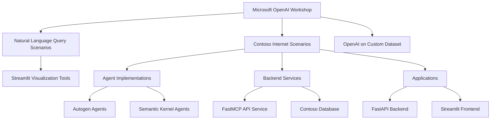
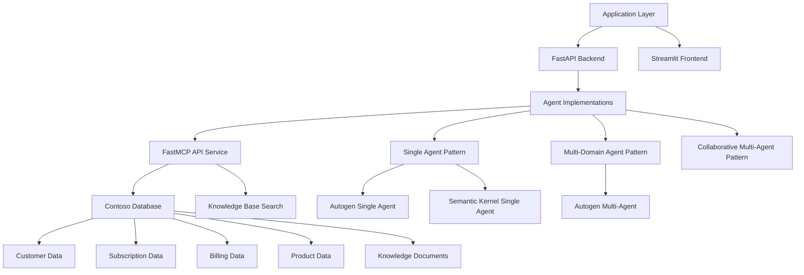
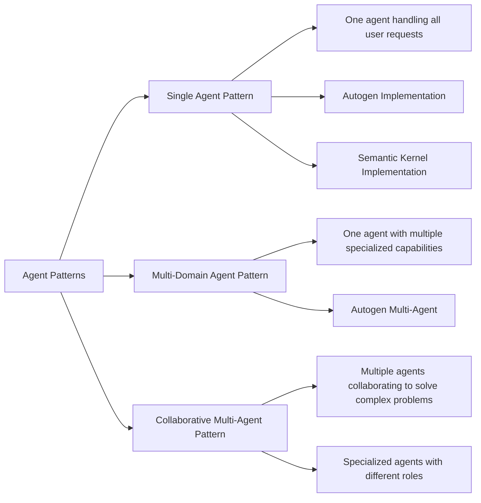
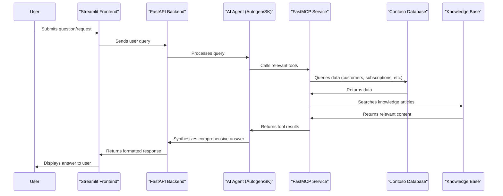
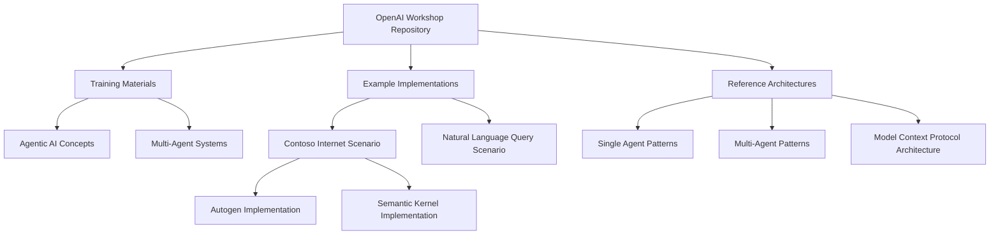

<!-- source: DeepWiki mcp.deepwiki.com · repo microsoft/OpenAIWorkshop · page 1 Overview · fetched 2026-10-26 -->

# Overview

Relevant source files

The following files were used as context for generating this wiki page:

- [.gitignore](.gitignore)
- [README.md](README.md)

## Purpose and Scope

The Microsoft OpenAI Workshop repository serves as a comprehensive resource for learning and implementing advanced AI capabilities, with a focus on Agentic AI and multi-agent systems. This repository provides training materials, reference architectures, and hands-on scenarios to help developers design, build, and deploy intelligent agent solutions using Microsoft AI technologies.

For detailed information about specific scenarios, see [Contoso Internet Scenario](#2) and [Natural Language Query Scenario](#3).

Sources: [README.md:1-7]()

## Repository Components

The repository is organized into several key components that demonstrate different aspects of AI agent implementations.

**Diagram: Repository Component Structure**

Sources: [README.md:1-7]()

## Key Scenarios

### Contoso Internet Scenario

The Contoso Internet Scenario serves as the primary example implementation, demonstrating how AI agents can assist with customer support for a fictional internet service provider. This scenario showcases various agent patterns, integration with backend services, and user-facing applications.

**Diagram: Contoso Internet Scenario Architecture**

Sources: [README.md:3-7]()

### Natural Language Query Scenario

The Natural Language Query Scenario demonstrates techniques for querying datasets using natural language, with visualization tools built on Streamlit. This scenario focuses on translating natural language questions into structured queries and presenting results in an intuitive manner.

### OpenAI on Custom Dataset

This component showcases how to apply OpenAI capabilities to custom datasets, enabling organizations to leverage their proprietary data for AI-powered solutions.

## Agent Patterns

The repository demonstrates three primary agent patterns that represent different approaches to building AI solutions:

**Diagram: Agent Patterns and Implementations**

Sources: [README.md:3-7]()

## Implementation Technologies

The repository leverages several key technologies to implement AI agent solutions:

| Technology | Purpose | Used In |
|------------|---------|---------|
| Autogen | Framework for building autonomous agents | Agent implementations |
| Semantic Kernel | Orchestration framework for AI | Agent implementations |
| FastAPI | Backend web services | Application layer |
| Streamlit | Interactive frontend | User interface |
| FastMCP | Model Context Protocol service | Backend services |

## Deployment Architecture

The repository includes deployment options for both local development using Docker containers and cloud deployment using Azure services.

**Diagram: Agent Interaction Flow**

Sources: [README.md:5-7]()

## Repository Structure

The repository follows a structured organization that separates different components and scenarios:

**Diagram: Repository Educational Purpose**

Sources: [README.md:1-7](), [.gitignore:1-7]()

## Getting Started

To get started with the repository, you should:

1. Clone the repository
2. Set up your environment variables (note that sensitive information should be in `.env` or `secrets.env` files, which are gitignored)
3. Explore the example scenarios
4. Follow the hands-on labs and exercises

For detailed information about repository structure and configuration, see [Repository Structure and Configuration](#4).

Sources: [.gitignore:1-7](), [README.md:1-7]()

---

