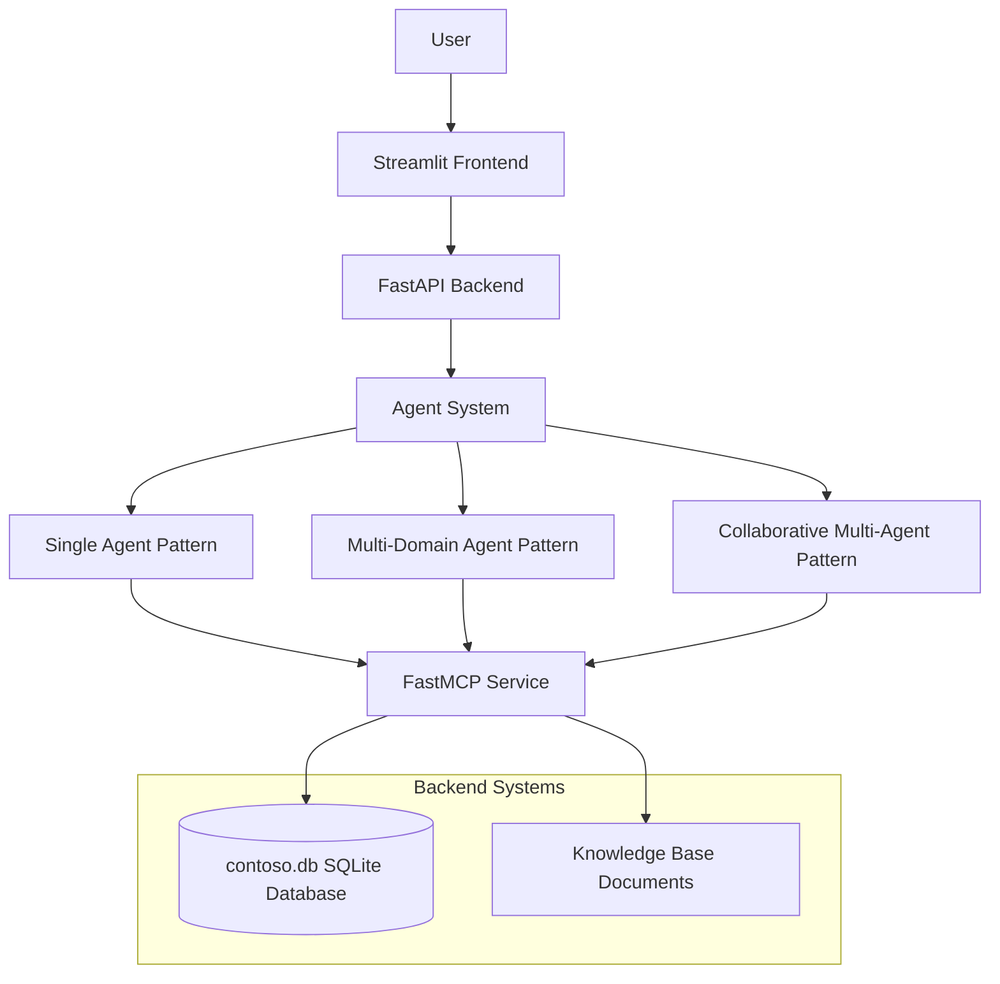
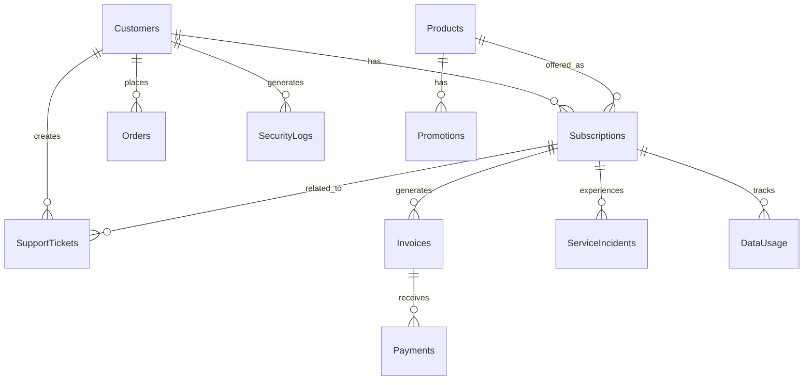
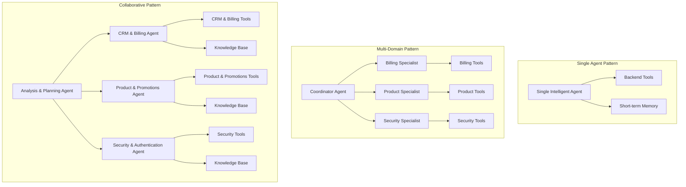
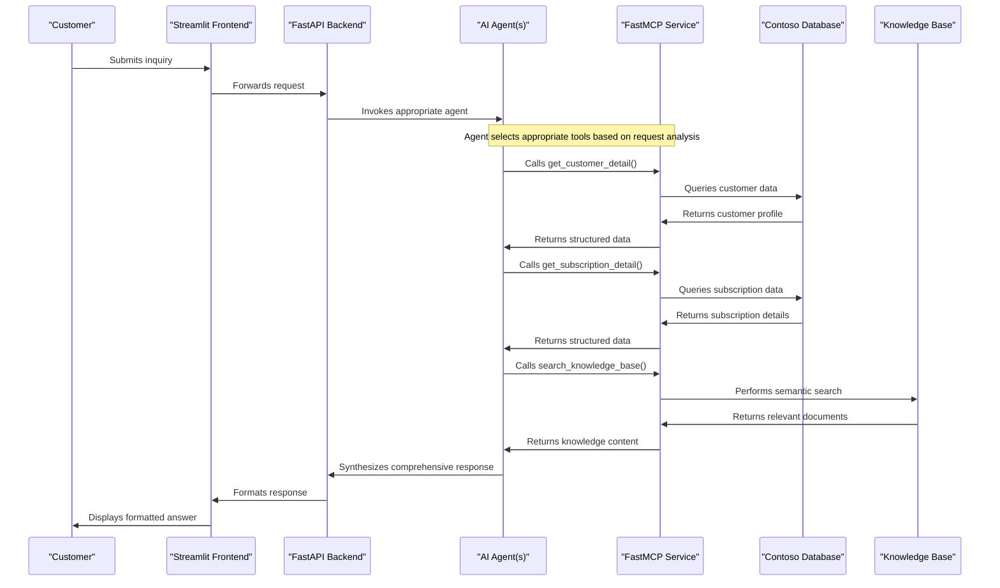
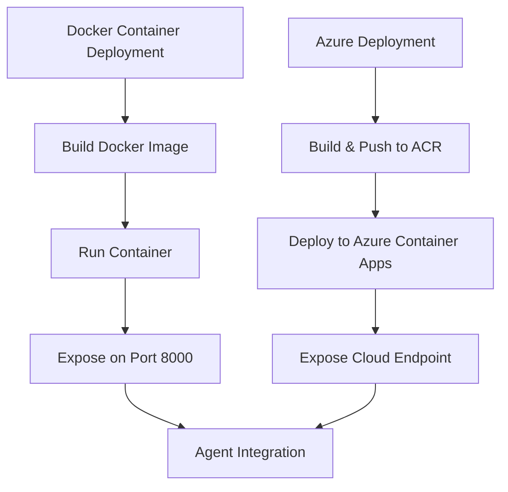

<!-- source: DeepWiki mcp.deepwiki.com · repo microsoft/OpenAIWorkshop · page 2 Contoso Internet Scenario · fetched 2026-10-26 -->

# Contoso Internet Scenario

<details>
<summary>Relevant source files</summary>

The following files were used as context for generating this wiki page:

- [scenarios/contoso_internet/README.md](scenarios/contoso_internet/README.md)
- [scenarios/contoso_internet/backend_services/.env.sample](scenarios/contoso_internet/backend_services/.env.sample)
- [scenarios/contoso_internet/backend_services/README.md](scenarios/contoso_internet/backend_services/README.md)
- [scenarios/contoso_internet/backend_services/data/contoso.db](scenarios/contoso_internet/backend_services/data/contoso.db)
- [scenarios/contoso_internet/backend_services/data/create_db.py](scenarios/contoso_internet/backend_services/data/create_db.py)
- [scenarios/contoso_internet/backend_services/data/customer_scenarios.md](scenarios/contoso_internet/backend_services/data/customer_scenarios.md)
- [scenarios/contoso_internet/backend_services/data/kb.json](scenarios/contoso_internet/backend_services/data/kb.json)
- [scenarios/contoso_internet/backend_services/mcp_service.py](scenarios/contoso_internet/backend_services/mcp_service.py)

</details>


## Purpose and Scope

The Contoso Internet Scenario simulates a telecommunications and internet service provider called "Contoso Communications." This scenario provides a realistic business environment where AI agents handle customer inquiries related to billing, account management, service status, and promotions. It serves as a practical demonstration platform for implementing and evaluating AI agent architectures using various frameworks like Autogen and Semantic Kernel.

This document covers the core components of the Contoso Internet Scenario, including the backend data model, API services, agent patterns, and sample customer scenarios. For information about Natural Language Query capabilities, see [Natural Language Query Scenario](#3).

Sources: [scenarios/contoso_internet/README.md:5-7](), [scenarios/contoso_internet/README.md:11-12]()

## System Architecture

The Contoso Internet Scenario consists of several integrated components that form a complete end-to-end system for demonstrating AI agent capabilities.

### High-Level Architecture



The Contoso Internet scenario implements a multi-tier architecture where:

1. **Frontend Layer** (Streamlit): Provides the user interface for submitting customer inquiries
2. **Backend Layer** (FastAPI): Handles API requests and routes them to the appropriate agent system
3. **Agent Layer**: Implements various agent patterns to process customer inquiries
4. **Service Layer** (FastMCP): Exposes database and knowledge base operations as typed tools
5. **Data Layer**: Stores customer data, transactions, and knowledge documents

Sources: [scenarios/contoso_internet/README.md:9-21](), [scenarios/contoso_internet/backend_services/README.md:8-10]()

## Data Model

The Contoso Internet scenario is built around a comprehensive data model that simulates a telecommunications company's customer management system.

### Database Schema



The database contains the following key entities:

| Entity | Description | Key Fields |
|--------|-------------|------------|
| Customers | Customer profiles | customer_id, first_name, last_name, email, loyalty_level |
| Subscriptions | Service subscriptions | subscription_id, customer_id, product_id, status |
| Products | Service offerings | product_id, name, category, monthly_fee |
| Invoices | Billing records | invoice_id, subscription_id, amount, due_date |
| Payments | Payment transactions | payment_id, invoice_id, amount, status |
| Promotions | Special offers | promotion_id, product_id, eligibility_criteria |
| KnowledgeDocuments | Policy and support docs | document_id, title, content, topic_embedding |

The database is generated with 250 random customers plus 9 deterministic scenarios that are designed to test specific agent capabilities.

Sources: [scenarios/contoso_internet/backend_services/data/create_db.py:62-251](), [scenarios/contoso_internet/backend_services/data/contoso.db]()

### Knowledge Base

The Knowledge Base contains policy documents, troubleshooting guides, and FAQs that agents can reference when handling customer inquiries. These documents cover topics such as:

- Invoice adjustment policy
- Troubleshooting slow internet
- International roaming options
- Account unlock procedures
- Promotion eligibility guidelines
- Return policy and process
- Late payment fee policy

Each document is stored with embedded vector representations for semantic search capabilities.

Sources: [scenarios/contoso_internet/backend_services/data/kb.json]()

## FastMCP Service API

The Model Context Protocol (MCP) service provides a structured API that exposes database operations as tools for AI agents to use.

### API Tools Overview

```mermaid
graph TD
    MCPService["mcp = FastMCP(name='Contoso Customer API as Tools')"] --> CustomerTools["Customer Management Tools"]
    MCPService --> BillingTools["Billing & Payment Tools"]
    MCPService --> SubscriptionTools["Subscription Management Tools"]
    MCPService --> KnowledgeTools["Knowledge Base Tools"]
    MCPService --> SupportTools["Support & Service Tools"]
    
    CustomerTools --> get_all_customers["get_all_customers()"]
    CustomerTools --> get_customer_detail["get_customer_detail(params: CustomerIdParam)"]
    
    BillingTools --> get_invoice_payments["get_invoice_payments(params: InvoiceIdParam)"]
    BillingTools --> pay_invoice["pay_invoice(invoice_id, amount, method)"]
    BillingTools --> get_billing_summary["get_billing_summary(params: CustomerIdParam)"]
    
    SubscriptionTools --> get_subscription_detail["get_subscription_detail(params: SubscriptionIdParam)"]
    SubscriptionTools --> update_subscription["update_subscription(subscription_id, update_data)"]
    SubscriptionTools --> get_data_usage["get_data_usage(subscription_id, start_date, end_date)"]
    
    KnowledgeTools --> search_knowledge_base["search_knowledge_base(params: KBSearchParams)"]
    
    SupportTools --> get_support_tickets["get_support_tickets(params: CustomerIdParam)"]
    SupportTools --> create_support_ticket["create_support_ticket(ticket_data)"]
```



The service provides 18 distinct API endpoints that are implemented as tools with the FastMCP framework:

| Tool Category | Examples | Purpose |
|---------------|----------|---------|
| Customer Data | get_customer_detail | Retrieve customer profiles and account information |
| Subscription | get_subscription_detail | Access subscription details, invoices, and service incidents |
| Billing | pay_invoice, get_billing_summary | Manage payments and view billing information |
| Knowledge | search_knowledge_base | Semantic search on policy/procedure documents |
| Support | create_support_ticket | Create and manage customer support tickets |
| Security | get_security_logs, unlock_account | View security events and manage account access |

These tools provide a standardized interface for AI agents to interact with the Contoso backend systems.

Sources: [scenarios/contoso_internet/backend_services/mcp_service.py:8-16](), [scenarios/contoso_internet/backend_services/mcp_service.py:206-515]()

## Agent Patterns

The Contoso Internet scenario demonstrates three progressive agent design patterns for handling customer inquiries.

### Agent Pattern Comparison



1. **Intelligent Single Agent**
   - One agent handles end-to-end customer requests
   - Directly uses all available tools as needed
   - Maintains short-term conversational memory

2. **Multi-Domain Agent Setup**
   - Coordinator agent performs lightweight domain detection and routing
   - Specialist agents handle requests within their specific domains
   - Each specialist has access to domain-specific tools
   - Requests are handed back to the coordinator when switching domains

3. **Collaborative Multi-Agent System**
   - Analysis & Planning agent orchestrates the interaction
   - Decomposes customer requests into subtasks
   - Delegates to domain-specific agents
   - All agents proactively access the knowledge base
   - Specialist agents execute subtasks and report back
   - Final response synthesized from all agent contributions

Each pattern demonstrates increasing sophistication in handling complex customer inquiries.

Sources: [scenarios/contoso_internet/README.md:52-139]()

## Request Handling Flow

The following diagram illustrates how a typical customer request flows through the system:



This flow demonstrates how agents leverage the FastMCP service to access multiple data sources, synthesize information, and generate comprehensive responses to customer inquiries.

Sources: [scenarios/contoso_internet/backend_services/mcp_service.py:11-15](), [scenarios/contoso_internet/README.md:85-100]()

## Sample Customer Scenarios

The Contoso Internet scenario includes 9 predefined customer scenarios designed to test various agent capabilities.

### Scenario Examples

| ID | Customer | Challenge | Required Agent Capabilities |
|----|----------|-----------|----------------------------|
| 1 | John Doe | Invoice higher than usual | Billing analysis, Data usage analysis, Policy reference |
| 2 | Jane Doe | Internet slower than before | Service status check, Troubleshooting guidance |
| 3 | Mark Doe | Traveling abroad - needs roaming | Product recommendation, Policy explanation |
| 4 | Alice Doe | Account locked | Security log analysis, Account unlock procedure |
| 5 | Ron Doe | Promotion eligibility | Loyalty status check, Promotion matching |

Each scenario has a well-defined solution path that requires the agent to:
1. Query the appropriate data sources using MCP tools
2. Reference relevant knowledge base documents
3. Synthesize a comprehensive response that addresses the customer's inquiry

These scenarios provide a structured way to evaluate agent effectiveness and compare different agent architectures.

Sources: [scenarios/contoso_internet/backend_services/data/customer_scenarios.md]()

## Integration and Deployment

### Local Setup

To set up the Contoso Internet scenario locally:

1. Generate the database:
   ```
   cd backend_services/data
   python create_db.py
   ```

2. Configure environment variables:
   - Copy `.env.sample` to `.env`
   - Set appropriate values for Azure OpenAI (optional)

3. Run the FastMCP service:
   ```
   cd backend_services
   python mcp_service.py
   ```

4. Implement agent patterns using Autogen or Semantic Kernel frameworks

5. Test against the predefined customer scenarios

### Deployment Options

The scenario supports containerized deployment:



Docker commands:
```
docker build -f Dockerfile.mcp -t mcp-backend .
docker run -it -p 8000:8000 --env-file .env mcp-backend
```

The deployment scripts in the repository automate the process of building, pushing, and deploying to Azure Container Apps.

Sources: [scenarios/contoso_internet/backend_services/README.md:79-115]()

## Conclusion

The Contoso Internet Scenario provides a comprehensive framework for developing and testing AI agents in a realistic customer service context. It demonstrates how agents can leverage structured data sources and knowledge base content to provide accurate, helpful responses to diverse customer inquiries.

The scenario showcases different agent architectures—from simple single-agent designs to sophisticated multi-agent collaborative systems—enabling comparison and evaluation of various approaches to AI-driven customer service automation.

---

