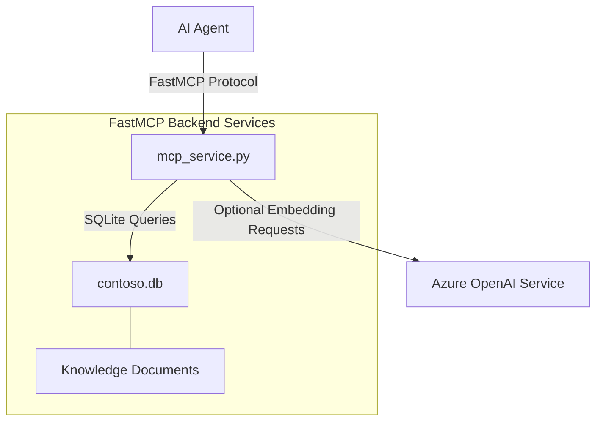
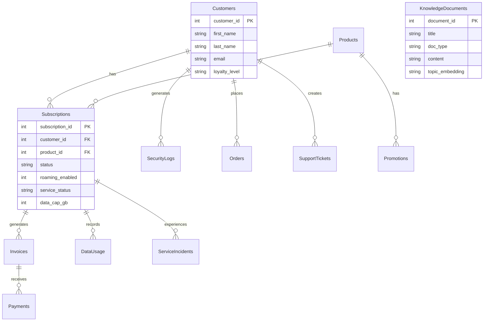
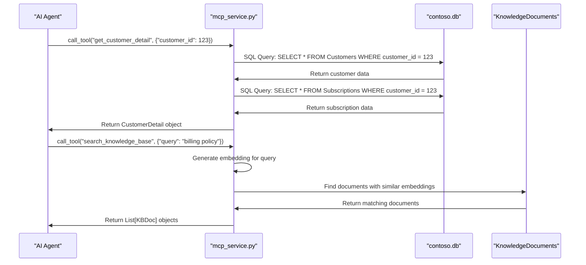

<!-- source: DeepWiki mcp.deepwiki.com · repo microsoft/OpenAIWorkshop · page 2.1 FastMCP Backend Services · fetched 2026-10-26 -->

# FastMCP Backend Services

<details>
<summary>Relevant source files</summary>

The following files were used as context for generating this wiki page:

- [scenarios/contoso_internet/README.md](scenarios/contoso_internet/README.md)
- [scenarios/contoso_internet/backend_services/.dockerigore](scenarios/contoso_internet/backend_services/.dockerigore)
- [scenarios/contoso_internet/backend_services/.env.sample](scenarios/contoso_internet/backend_services/.env.sample)
- [scenarios/contoso_internet/backend_services/Dockerfile.mcp](scenarios/contoso_internet/backend_services/Dockerfile.mcp)
- [scenarios/contoso_internet/backend_services/README.md](scenarios/contoso_internet/backend_services/README.md)
- [scenarios/contoso_internet/backend_services/data/contoso.db](scenarios/contoso_internet/backend_services/data/contoso.db)
- [scenarios/contoso_internet/backend_services/data/create_db.py](scenarios/contoso_internet/backend_services/data/create_db.py)
- [scenarios/contoso_internet/backend_services/data/customer_scenarios.md](scenarios/contoso_internet/backend_services/data/customer_scenarios.md)
- [scenarios/contoso_internet/backend_services/data/kb.json](scenarios/contoso_internet/backend_services/data/kb.json)
- [scenarios/contoso_internet/backend_services/mcp_service.py](scenarios/contoso_internet/backend_services/mcp_service.py)
- [scenarios/contoso_internet/backend_services/requirements.txt](scenarios/contoso_internet/backend_services/requirements.txt)
- [scenarios/contoso_internet/backend_services/test_mcp_service.py](scenarios/contoso_internet/backend_services/test_mcp_service.py)

</details>


## Purpose and Overview

The FastMCP Backend Services component provides a simulated telecommunications and internet services backend for the Contoso Internet scenario within the Microsoft OpenAI Workshop. This system serves as a realistic business environment for developing and testing AI agents, enabling them to access customer data, manage subscriptions, process billing, and provide customer support without requiring integration with actual production systems.

This documentation covers the architecture, data model, API endpoints, and deployment options for the FastMCP backend services. For information about using these services with specific agent implementations, see:
- [Autogen Agents](#2.2.1)
- [Semantic Kernel Agents](#2.2.2)

Sources:
- [scenarios/contoso_internet/README.md:1-49]()
- [scenarios/contoso_internet/backend_services/README.md:1-7]()

## System Architecture

### High-Level Architecture Diagram



The FastMCP Backend Services consists of:

1. **FastMCP Service** - A Python service that exposes API endpoints as tools via the FastMCP protocol
2. **SQLite Database** - Contains customer data, subscriptions, billing information, etc.
3. **Knowledge Base** - Collection of documents with embeddings for semantic search functionality

The system is designed to be consumed by AI agents through the FastMCP protocol, which allows for structured tool calling.

Sources:
- [scenarios/contoso_internet/backend_services/mcp_service.py:8-16]()
- [scenarios/contoso_internet/backend_services/README.md:8-35]()

## Data Model and Database Schema

### Core Entity Relationship Diagram



Sources:
- [scenarios/contoso_internet/backend_services/data/create_db.py:62-251]()
- [scenarios/contoso_internet/backend_services/mcp_service.py:55-205]()

The database contains 12 main tables modeling a telecom provider's business domain:

| Table | Description | Key Fields |
|-------|-------------|------------|
| Customers | Customer accounts | customer_id, name, email, loyalty_level |
| Products | Service offerings | product_id, name, category, monthly_fee |
| Subscriptions | Service contracts | subscription_id, customer_id, product_id, status |
| Invoices | Billing records | invoice_id, subscription_id, amount, due_date |
| Payments | Payment transactions | payment_id, invoice_id, amount, status |
| Promotions | Special offers | promotion_id, product_id, eligibility_criteria |
| SecurityLogs | Security events | log_id, customer_id, event_type, description |
| Orders | Product purchases | order_id, customer_id, product_id, status |
| SupportTickets | Service issues | ticket_id, customer_id, status, priority |
| DataUsage | Usage metrics | usage_id, subscription_id, data_used_mb |
| ServiceIncidents | Service problems | incident_id, subscription_id, resolution_status |
| KnowledgeDocuments | KB articles | document_id, title, content, topic_embedding |

The database includes both generated random customers (~250) and specific test scenarios with predetermined customer data, designed to provide realistic business cases for agent testing.

Sources:
- [scenarios/contoso_internet/backend_services/mcp_service.py:55-205]()
- [scenarios/contoso_internet/backend_services/data/create_db.py:257-350]()

## API Tools and Endpoints

The FastMCP service exposes functionality as "tools" that agents can call programmatically. Each tool is implemented as a Python function with a specific purpose, parameters, and return type.

### Tool Interaction Flow



Sources:
- [scenarios/contoso_internet/backend_services/mcp_service.py:205-572]()
- [scenarios/contoso_internet/backend_services/test_mcp_service.py:52-191]()

### Customer Information Tools

| Tool Name | Description | Parameters | Return Type |
|-----------|-------------|------------|-------------|
| `get_all_customers` | List customers with basic info | None | List[CustomerSummary] |
| `get_customer_detail` | Customer profile with subscriptions | customer_id: int | CustomerDetail |

Sources:
- [scenarios/contoso_internet/backend_services/mcp_service.py:206-229]()

### Subscription and Billing Tools

| Tool Name | Description | Parameters | Return Type |
|-----------|-------------|------------|-------------|
| `get_subscription_detail` | Detail view with invoices and incidents | subscription_id: int | SubscriptionDetail |
| `get_invoice_payments` | List payments for an invoice | invoice_id: int | List[Payment] |
| `pay_invoice` | Record payment | invoice_id: int, amount: float | Dict[str, Any] |
| `get_data_usage` | Usage records for date range | subscription_id: int, dates, aggregate: bool | List[DataUsageRecord] |
| `get_billing_summary` | Customer's total outstanding balance | customer_id: int | Dict[str, Any] |
| `update_subscription` | Modify subscription properties | subscription_id: int, update: dict | Dict[str, Any] |

Sources:
- [scenarios/contoso_internet/backend_services/mcp_service.py:232-355]()
- [scenarios/contoso_internet/backend_services/mcp_service.py:473-491]()
- [scenarios/contoso_internet/backend_services/mcp_service.py:520-572]()

### Product and Promotion Tools

| Tool Name | Description | Parameters | Return Type |
|-----------|-------------|------------|-------------|
| `get_promotions` | List all active promotions | None | List[Promotion] |
| `get_eligible_promotions` | Promotions for specific customer | customer_id: int | List[Promotion] |
| `get_products` | List available products | category: str (optional) | List[Dict] |
| `get_product_detail` | Get single product | product_id: int | Dict |

Sources:
- [scenarios/contoso_internet/backend_services/mcp_service.py:358-391]()
- [scenarios/contoso_internet/backend_services/mcp_service.py:508-519]()

### Support and Knowledge Tools

| Tool Name | Description | Parameters | Return Type |
|-----------|-------------|------------|-------------|
| `search_knowledge_base` | Semantic search on KB documents | query: str, topk: int | List[KBDoc] |
| `get_security_logs` | Security events for customer | customer_id: int | List[SecurityLog] |
| `unlock_account` | Unlock locked account | customer_id: int | Dict[str, Any] |
| `get_customer_orders` | Customer order history | customer_id: int | List[Order] |
| `get_support_tickets` | Customer support tickets | customer_id: int, only_open: bool | List[SupportTicket] |
| `create_support_ticket` | Create new ticket | customer_id, subscription_id, details | Dict[str, Any] |

Sources:
- [scenarios/contoso_internet/backend_services/mcp_service.py:394-427]()
- [scenarios/contoso_internet/backend_services/mcp_service.py:430-472]()
- [scenarios/contoso_internet/backend_services/mcp_service.py:492-507]()

## Knowledge Base and Semantic Search

The knowledge base contains documents related to company policies, procedures, and troubleshooting guides. Documents are stored in the `KnowledgeDocuments` table with the following structure:

- `document_id`: Unique identifier
- `title`: Document title
- `doc_type`: Document type (Policy, Procedure, Troubleshooting, FAQ)
- `content`: Full text content
- `topic_embedding`: Vector embedding of content for semantic search

The system includes documents on:
- Billing and invoice policies
- Technical troubleshooting (internet, calls, messaging)
- Service policies (international roaming, data usage)
- Account procedures (security, unlocking)
- Return and refund policies

The `search_knowledge_base` tool performs semantic search by:
1. Converting the query to an embedding vector
2. Comparing it to document embeddings using cosine similarity
3. Returning the most relevant documents

Sources:
- [scenarios/contoso_internet/backend_services/data/kb.json:1-73]()
- [scenarios/contoso_internet/backend_services/mcp_service.py:394-414]()
- [scenarios/contoso_internet/backend_services/mcp_service.py:27-52]()

## Deployment and Configuration

### Local Development Setup

To run the FastMCP Backend Services locally:

1. Install requirements:
   ```bash
   pip install -r requirements.txt
   ```

2. Configure environment variables (copy `.env.sample` to `.env`):
   ```
   AZURE_OPENAI_ENDPOINT="https://your-resource.openai.azure.com"
   AZURE_OPENAI_API_KEY="your-api-key"
   AZURE_OPENAI_CHAT_DEPLOYMENT="gpt-4o"
   AZURE_OPENAI_API_VERSION="2025-03-01-preview"
   AZURE_OPENAI_EMBEDDING_DEPLOYMENT="text-embedding-ada-002"
   DB_PATH="data/contoso.db"
   ```

3. Generate the database (if not already present):
   ```bash
   cd data/
   python create_db.py
   ```

4. Run the service:
   ```bash
   python mcp_service.py
   ```

The service will listen on port 8000 by default.

Sources:
- [scenarios/contoso_internet/backend_services/README.md:79-101]()
- [scenarios/contoso_internet/backend_services/.env.sample:1-7]()

### Docker Container Deployment

```bash
# Build the Docker image
docker build -f Dockerfile.mcp -t mcp-backend .

# Run the container
docker run -it -p 8000:8000 --env-file .env mcp-backend
```

Sources:
- [scenarios/contoso_internet/backend_services/README.md:103-109]()
- [scenarios/contoso_internet/backend_services/Dockerfile.mcp:1-22]()

### Azure Container Apps Deployment

The service can be deployed to Azure Container Apps using the provided deployment script:

```bash
bash deploy_mcp.sh
```

Edit the script to configure Azure resources, registry, and other deployment parameters.

Sources:
- [scenarios/contoso_internet/backend_services/README.md:111-116]()

## Customer Scenarios for Agent Testing

The system includes 9 predefined customer scenarios specifically designed to test and demonstrate agent capabilities:

1. **Invoice Higher Than Usual** (Customer ID: 251)
   - Challenge: Customer's invoice is 2.5× normal amount
   - Cause: Data usage exceeding plan limits

2. **Internet Performance Issues** (Customer ID: 252)
   - Challenge: Throughput lower than advertised 1 Gbps tier
   - Cause: Active service incident under investigation

3. **International Roaming Setup** (Customer ID: 253)
   - Challenge: Customer traveling abroad needs roaming
   - Solution: Enable International Roaming add-on

4. **Account Security Issue** (Customer ID: 254)
   - Challenge: Account locked after failed login attempts
   - Solution: Follow unlock procedure with verification

5. **Promotion Eligibility** (Customer ID: 255)
   - Challenge: Customer wants available promotions
   - Solution: Check loyalty-based discount eligibility

6. **Product Return Processing** (Customer ID: 256)
   - Challenge: Customer returned device, awaiting refund
   - Solution: Verify return status within policy timeframe

7. **Service Quality Issue** (Customer ID: 257)
   - Challenge: Dropped calls in specific locations
   - Solution: Investigate network issues, create ticket

8. **Payment Problem** (Customer ID: 258)
   - Challenge: Service suspended, customer wants fee waiver
   - Solution: Apply relevant hardship policies

9. **Data Overage Charge** (Customer ID: 259)
   - Challenge: Unexpected charges from data usage
   - Solution: Explain retroactive plan change options

These scenarios provide realistic customer service situations requiring agents to access multiple data sources, search knowledge content, and recommend appropriate solutions.

Sources:
- [scenarios/contoso_internet/backend_services/data/customer_scenarios.md:1-174]()
- [scenarios/contoso_internet/README.md:142-204]()

## Integration with AI Agents

### Client Usage Example

```python
from fastmcp import Client

async def get_customer_info(customer_id):
    async with Client("http://localhost:8000/sse") as client:
        # Get customer details with subscriptions
        response = await client.call_tool(
            "get_customer_detail", 
            {"customer_id": customer_id}
        )
        customer = response[0].as_json()
        
        # Get billing summary
        response = await client.call_tool(
            "get_billing_summary", 
            {"customer_id": customer_id}
        )
        billing = response[0].as_json()
        
        return {
            "customer": customer,
            "billing": billing
        }
```

Sources:
- [scenarios/contoso_internet/backend_services/test_mcp_service.py:52-191]()

### Integration with Agent Frameworks

The FastMCP service is designed to be integrated with AI agent frameworks through the FastMCP protocol:

1. **Autogen Integration**: 
   - Register FastMCP endpoints as callable tools for Autogen agents
   - Enable agents to query customer data and perform operations

2. **Semantic Kernel Integration**:
   - Create plugins that call FastMCP endpoints
   - Define semantic functions that use these tools

The system accommodates various agent interaction patterns, from single-agent to collaborative multi-agent systems, with tools that can be used across different domain specialists.

Sources:
- [scenarios/contoso_internet/README.md:52-139]()
- [scenarios/contoso_internet/backend_services/README.md:120-126]()

## Dependencies and Requirements

The FastMCP Backend Services depends on:

- `fastmcp`: FastMCP protocol implementation
- `pydantic`: Data validation and schema definitions
- `python-dotenv`: Environment variable management
- `openai`: Azure OpenAI client for embeddings (optional)
- `sqlite3`: Database access (standard library)

Python 3.11+ is recommended for optimal performance.

Sources:
- [scenarios/contoso_internet/backend_services/requirements.txt:1-10]()
- [scenarios/contoso_internet/backend_services/mcp_service.py:1-7]()

---

