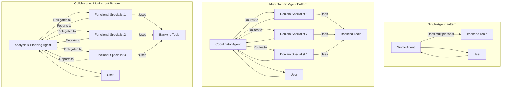
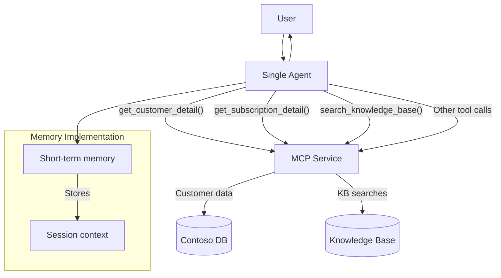
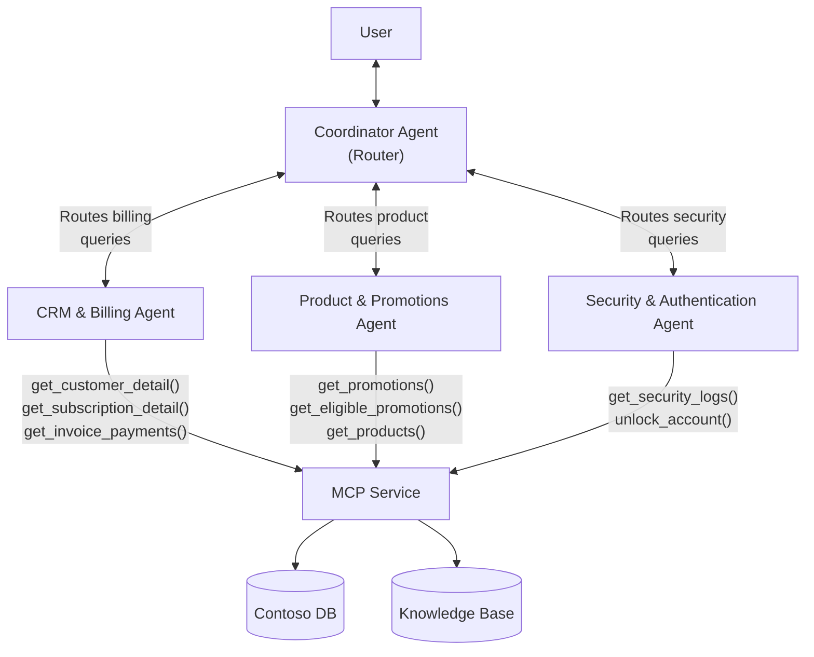
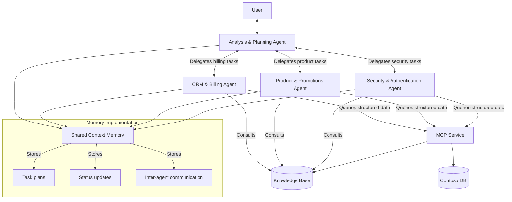
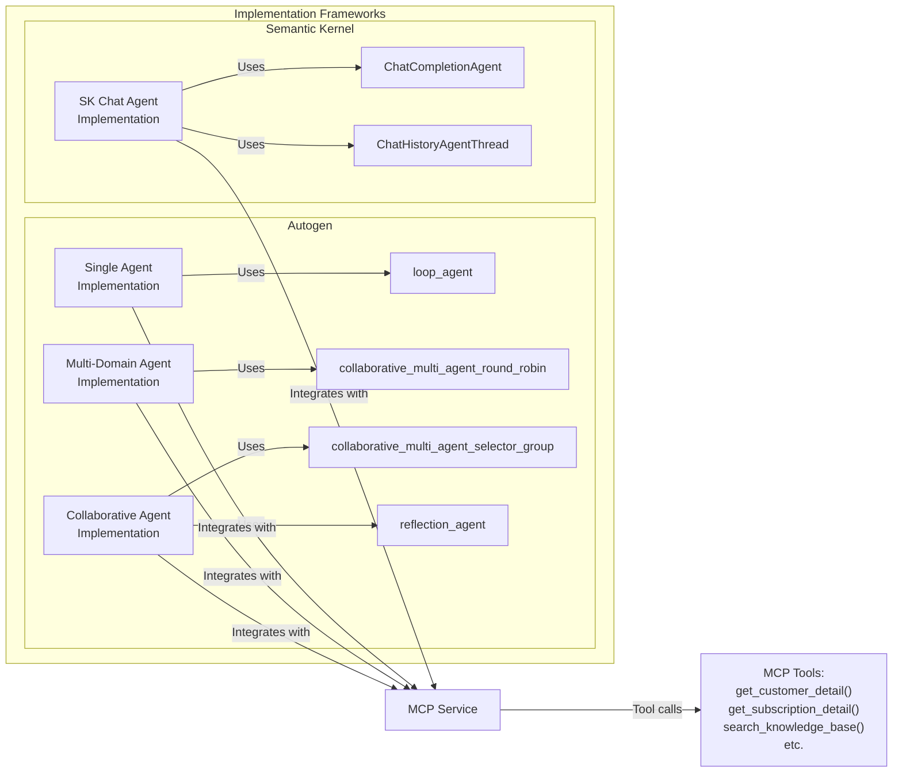
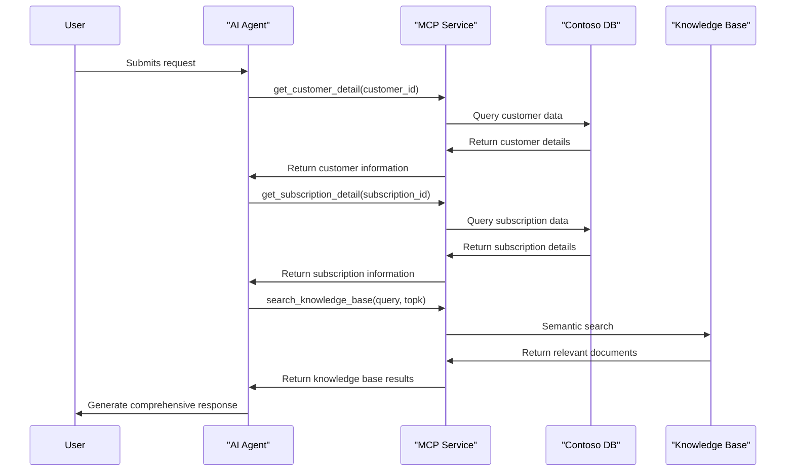

<!-- source: DeepWiki mcp.deepwiki.com · repo microsoft/OpenAIWorkshop · page 2.2 Agent Patterns and Implementations · fetched 2026-10-26 -->

# Agent Patterns and Implementations

<details>
<summary>Relevant source files</summary>

The following files were used as context for generating this wiki page:

- [scenarios/contoso_internet/README.md](scenarios/contoso_internet/README.md)
- [scenarios/contoso_internet/agents/semantic_kernel/single_agent/sk_chat_agent.py](scenarios/contoso_internet/agents/semantic_kernel/single_agent/sk_chat_agent.py)
- [scenarios/contoso_internet/applications/README.md](scenarios/contoso_internet/applications/README.md)
- [scenarios/contoso_internet/applications/requirements.txt](scenarios/contoso_internet/applications/requirements.txt)
- [scenarios/contoso_internet/backend_services/.env.sample](scenarios/contoso_internet/backend_services/.env.sample)
- [scenarios/contoso_internet/backend_services/README.md](scenarios/contoso_internet/backend_services/README.md)
- [scenarios/contoso_internet/backend_services/data/contoso.db](scenarios/contoso_internet/backend_services/data/contoso.db)
- [scenarios/contoso_internet/backend_services/data/create_db.py](scenarios/contoso_internet/backend_services/data/create_db.py)
- [scenarios/contoso_internet/backend_services/data/customer_scenarios.md](scenarios/contoso_internet/backend_services/data/customer_scenarios.md)
- [scenarios/contoso_internet/backend_services/data/kb.json](scenarios/contoso_internet/backend_services/data/kb.json)
- [scenarios/contoso_internet/backend_services/mcp_service.py](scenarios/contoso_internet/backend_services/mcp_service.py)

</details>


## Purpose and Scope

This document provides detailed technical information about the agent patterns and their implementations within the Contoso Internet scenario of the OpenAI Workshop. It covers the architectural patterns for AI agents, their specific implementations using different frameworks, and how they integrate with the Model Context Protocol (MCP) service to access backend tools and data.

For details about the FastMCP Backend Services that these agents interact with, see [FastMCP Backend Services](#2.1).

Sources: [scenarios/contoso_internet/README.md:53-64]()

## Agent Patterns Overview

The Contoso Internet scenario implements three primary agent design patterns, each with different capabilities and complexity levels:



Sources: [scenarios/contoso_internet/README.md:53-64](), [scenarios/contoso_internet/README.md:68-86]()

## Single Agent Pattern

The Intelligent Single Agent pattern involves a single AI agent that handles the entire conversation with the user, from initial request through resolution. This agent has access to all the necessary tools to query backend systems and knowledge bases.

### Components and Responsibilities



### Key Characteristics

- **End-to-end responsibility**: The agent analyzes customer requests, determines the required backend data, queries the appropriate systems, and synthesizes responses.
- **Tool utilization**: Directly calls MCP service tools like `get_customer_detail()`, `get_subscription_detail()`, and `search_knowledge_base()`.
- **Memory implementation**: Maintains short-term memory for session context during the interaction.

Sources: [scenarios/contoso_internet/README.md:68-81](), [scenarios/contoso_internet/agents/semantic_kernel/single_agent/sk_chat_agent.py:16-82]()

## Multi-Domain Agent Pattern

The Multi-Domain Agent pattern uses a Coordinator Agent (router) that analyzes customer requests and routes them to domain-specific specialist agents. This architecture enables domain-focused expertise while maintaining a seamless user experience.

### Components and Responsibilities



### Key Characteristics

- **Coordinator Agent**: Performs lightweight domain detection and request routing without complex planning.
- **Domain Specialists**:
  - **CRM & Billing Agent**: Handles customer profile data, account details, billing, invoices, and subscription information.
  - **Product & Promotions Agent**: Manages products, promotions, discounts, and subscription plan queries.
  - **Security & Authentication Agent**: Specializes in account security, authentication issues, and account unlock procedures.
- **Handoff mechanism**: Specialist agents return control to the Coordinator when the user's request moves beyond their domain.

Sources: [scenarios/contoso_internet/README.md:87-109]()

## Collaborative Multi-Agent System Pattern

The Collaborative Multi-Agent System uses a more sophisticated approach where multiple agents collaborate to address complex customer requests. An Analysis & Planning Agent orchestrates the process, delegating subtasks to specialists and integrating their outputs.

### Components and Responsibilities



### Key Characteristics

- **Analysis & Planning Agent**: Orchestrates the process by parsing requests, identifying subtasks, delegating work, and synthesizing final responses.
- **Functional Specialists**:
  - **CRM & Billing Agent**: Accesses CRM and billing backend data.
  - **Product & Promotions Agent**: Accesses product and promotional information.
  - **Security & Authentication Agent**: Handles security logs and authentication issues.
- **Knowledge Base Integration**: All specialist agents independently access the Knowledge Base for policies, procedures, and guidelines.
- **Memory Implementation**:
  - **Individual Agent Memory**: Short-term context storage for each agent.
  - **Shared Context Memory**: Facilitates coordination between agents through shared task plans and status updates.

Sources: [scenarios/contoso_internet/README.md:114-139]()

## Implementation Frameworks

The Contoso Internet scenario includes implementations of these agent patterns using two frameworks: Autogen and Semantic Kernel.



### Autogen Implementations

Autogen provides several agent implementations for the patterns described above:

- **Single Agent**: Implemented as a loop agent that processes user input and generates responses in a single agent context.
- **Multi-Domain Agent**: Implemented as a collaborative multi-agent using a round-robin approach for domain specialists.
- **Collaborative Multi-Agent**: Implemented as a collaborative multi-agent using a selector group pattern for more complex reasoning.
- **Reflection Agent**: A special implementation that adds self-reflection capabilities to improve reasoning.

The agent module can be selected via environment configuration:

```
AGENT_MODULE="agents.autogen.multi_agent.collaborative_multi_agent_selector_group"
```

Sources: [scenarios/contoso_internet/applications/README.md:68-74]()

### Semantic Kernel Implementation

The Semantic Kernel implementation uses the `ChatCompletionAgent` and `ChatHistoryAgentThread` classes to create a single agent implementation:

- The agent is initialized with the Azure OpenAI service and the MCP plugin.
- Conversation state is managed through a thread that can be persisted between sessions.
- The agent uses the MCP tools to query backend services and knowledge base.

Sources: [scenarios/contoso_internet/agents/semantic_kernel/single_agent/sk_chat_agent.py:16-82]()

## Agent-MCP Integration

Agents interact with the Model Context Protocol (MCP) service to access backend tools and data. This service provides a standardized way for agents to query customer information, billing data, knowledge base content, and more.



### Available MCP Tools

The MCP service exposes a rich set of tools that agents can use:

| Tool Name | Description | Input |
|-----------|-------------|-------|
| `get_all_customers` | List all customers with basic info | None |
| `get_customer_detail` | Get a full customer profile including subscriptions | `customer_id` |
| `get_subscription_detail` | Detailed subscription view with invoices and incidents | `subscription_id` |
| `get_invoice_payments` | Return invoice-level payments list | `invoice_id` |
| `pay_invoice` | Record a payment for an invoice | `invoice_id`, `amount`, `method` |
| `get_data_usage` | Daily data-usage records for a subscription | `subscription_id`, `start_date`, `end_date`, `aggregate` |
| `get_promotions` | List every active promotion | None |
| `get_eligible_promotions` | Promotions eligible for a given customer | `customer_id` |
| `search_knowledge_base` | Semantic search on knowledge documents | `query`, `topk` |
| `get_security_logs` | Security events for a customer | `customer_id` |
| `get_customer_orders` | All orders placed by a customer | `customer_id` |
| `get_support_tickets` | Retrieve support tickets for a customer | `customer_id` |
| `create_support_ticket` | Create a new support ticket | Multiple parameters |
| `get_products` | List or search available products | Optional parameters |
| `get_product_detail` | Return a single product by ID | `product_id` |
| `update_subscription` | Update subscription fields | Multiple parameters |
| `unlock_account` | Unlock a customer account | `customer_id` |
| `get_billing_summary` | Get a customer's current amount owed | `customer_id` |

Sources: [scenarios/contoso_internet/README.md:27-49](), [scenarios/contoso_internet/backend_services/mcp_service.py:8-16](), [scenarios/contoso_internet/backend_services/mcp_service.py:206-321]()

## Configuration and Usage

Agents are configured and selected through environment variables in the application's `.env` file.

### Agent Selection

The agent implementation is specified using the `AGENT_MODULE` environment variable:

```
# Single agent implementation
AGENT_MODULE="agents.autogen.single_agent.loop_agent"

# Multi-domain agent implementation
AGENT_MODULE="agents.autogen.multi_agent.collaborative_multi_agent_round_robin"

# Collaborative multi-agent implementation
AGENT_MODULE="agents.autogen.multi_agent.collaborative_multi_agent_selector_group"

# Reflection agent implementation
AGENT_MODULE="agents.autogen.multi_agent.reflection_agent"
```

### MCP Service Configuration

The MCP service is configured with:

```
MCP_SERVER_URI="https://mcp-backend-service.whitefield-2abc17d9.westus.azurecontainerapps.io/sse"
```

### Azure OpenAI Configuration

The agents require Azure OpenAI credentials and configuration:

```
AZURE_OPENAI_ENDPOINT="https://<your-endpoint>.openai.azure.com"
AZURE_OPENAI_API_KEY="<your-azure-api-key>"
AZURE_OPENAI_CHAT_DEPLOYMENT="gpt-4o"
AZURE_OPENAI_API_VERSION="2025-03-01-preview"
AZURE_OPENAI_EMBEDDING_DEPLOYMENT="text-embedding-ada-002"
```

Sources: [scenarios/contoso_internet/applications/README.md:62-75](), [scenarios/contoso_internet/backend_services/.env.sample:1-7]()

## Customer Interaction Examples

Here are examples of the types of customer interactions these agents can handle:

1. **Billing inquiry**: Understanding unexpectedly high invoices and explaining data overages
2. **Technical support**: Diagnosing slow internet service and checking for outages
3. **Travel preparation**: Setting up international roaming for upcoming trips
4. **Account security**: Helping with account lockouts and verification procedures
5. **Promotion eligibility**: Determining what discounts and promotions a customer qualifies for
6. **Product returns**: Explaining return policies and initiating return processes

Each of these scenarios requires the agent to use multiple tools, access relevant knowledge base articles, and synthesize a comprehensive response for the customer.

Sources: [scenarios/contoso_internet/README.md:146-235](), [scenarios/contoso_internet/backend_services/data/customer_scenarios.md:1-174]()

---

