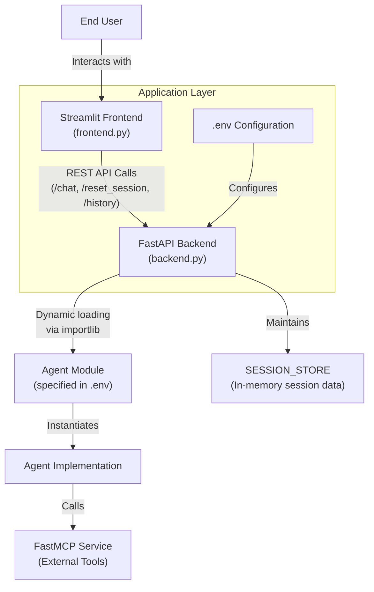
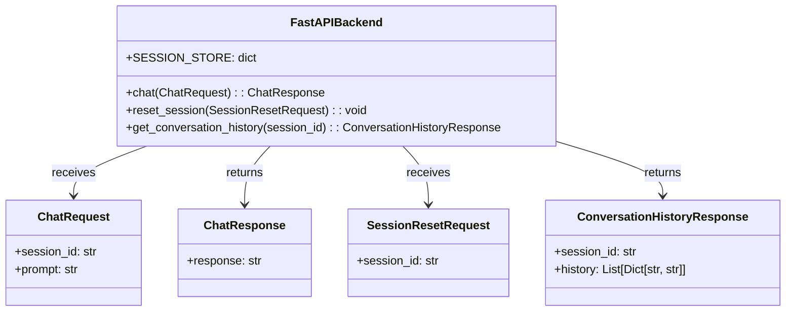
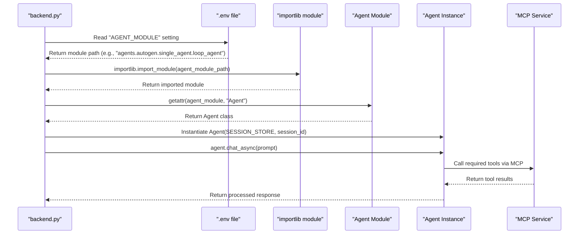
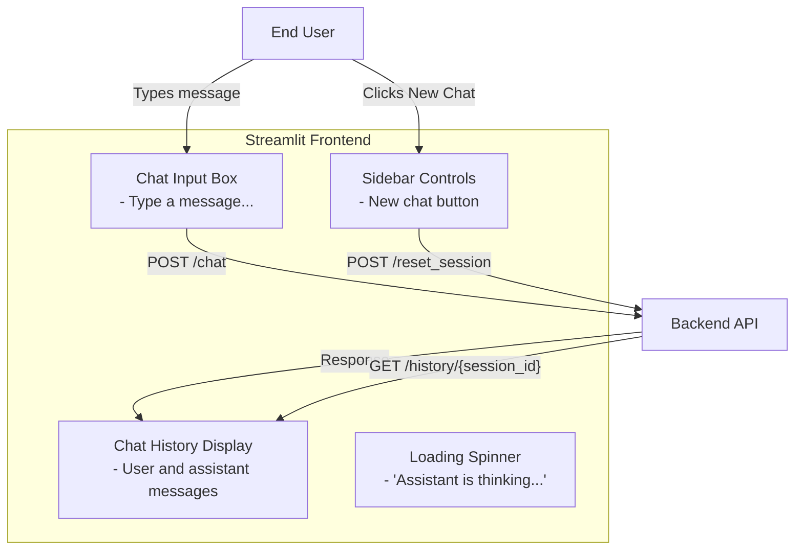
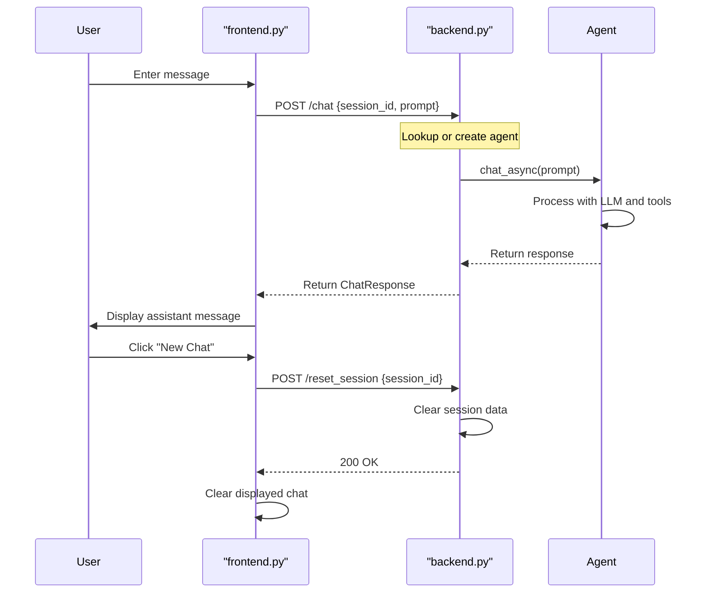

<!-- source: DeepWiki mcp.deepwiki.com · repo microsoft/OpenAIWorkshop · page 2.3 Application Layer · fetched 2026-10-26 -->

# Application Layer

<details>
<summary>Relevant source files</summary>

The following files were used as context for generating this wiki page:

- [scenarios/contoso_internet/agents/semantic_kernel/single_agent/sk_chat_agent.py](scenarios/contoso_internet/agents/semantic_kernel/single_agent/sk_chat_agent.py)
- [scenarios/contoso_internet/applications/.env.sample](scenarios/contoso_internet/applications/.env.sample)
- [scenarios/contoso_internet/applications/README.md](scenarios/contoso_internet/applications/README.md)
- [scenarios/contoso_internet/applications/backend.py](scenarios/contoso_internet/applications/backend.py)
- [scenarios/contoso_internet/applications/frontend.py](scenarios/contoso_internet/applications/frontend.py)
- [scenarios/contoso_internet/applications/requirements.txt](scenarios/contoso_internet/applications/requirements.txt)

</details>


## Purpose and Scope

The Application Layer in the Contoso Internet scenario provides the interface between users and the Agent implementations. It consists of a FastAPI backend service for request handling and a Streamlit frontend for user interaction. This document explains the architecture, components, and functionality of these application services. For information about the agent implementations that this layer interacts with, see [Agent Patterns and Implementations](#2.2).

## Architecture Overview

The Application Layer sits between end-users and the agent implementation layer, providing REST API endpoints and a modern web interface for interacting with the AI assistant capabilities.



Sources:
- [scenarios/contoso_internet/applications/backend.py]()
- [scenarios/contoso_internet/applications/frontend.py]()
- [scenarios/contoso_internet/applications/.env.sample]()
- [scenarios/contoso_internet/applications/README.md]()

## Backend Service

The backend service is a FastAPI application that manages chat sessions, processes user requests, and coordinates with the appropriate agent implementation.

### Key Components



Sources:
- [scenarios/contoso_internet/applications/backend.py:1-27]()
- [scenarios/contoso_internet/applications/backend.py:29-45]()

### Endpoints

The backend exposes three main REST endpoints:

| Endpoint | Method | Purpose | Request Payload | Response |
|----------|--------|---------|----------------|----------|
| `/chat` | POST | Process user messages | `session_id`, `prompt` | AI assistant's response |
| `/reset_session` | POST | Clear chat history | `session_id` | None |
| `/history/{session_id}` | GET | Retrieve conversation history | Path parameter: `session_id` | List of chat messages |

Sources:
- [scenarios/contoso_internet/applications/backend.py:47-70]()
- [scenarios/contoso_internet/applications/README.md:128-136]()

### Dynamic Agent Loading

The backend dynamically loads the Agent implementation based on the `AGENT_MODULE` environment variable, allowing for easy switching between different agent patterns without code changes.



Sources:
- [scenarios/contoso_internet/applications/backend.py:16-20]()
- [scenarios/contoso_internet/applications/backend.py:47-54]()
- [scenarios/contoso_internet/applications/.env.sample:8-10]()

### Session Management

The backend maintains chat sessions in an in-memory dictionary called `SESSION_STORE`. For each session:

- A unique `session_id` is used as the key to store session data
- Chat history is stored under `{session_id}_chat_history`
- The agent instance can maintain its own state within the session store

Note: As mentioned in the README, in production environments, this in-memory store should be replaced with a persistent solution like Redis or a database.

Sources:
- [scenarios/contoso_internet/applications/backend.py:23-24]()
- [scenarios/contoso_internet/applications/backend.py:57-63]()
- [scenarios/contoso_internet/applications/README.md:141-143]()

## Frontend Interface

The frontend is a Streamlit application that provides a chat-like interface for users to interact with the AI assistant.

### User Interface Components



Sources:
- [scenarios/contoso_internet/applications/frontend.py:9-17]()
- [scenarios/contoso_internet/applications/frontend.py:18-22]()
- [scenarios/contoso_internet/applications/frontend.py:34-38]()
- [scenarios/contoso_internet/applications/frontend.py:40-54]()

### Request Flow Diagram



Sources:
- [scenarios/contoso_internet/applications/frontend.py:40-54]()
- [scenarios/contoso_internet/applications/backend.py:47-54]()
- [scenarios/contoso_internet/applications/frontend.py:10-17]()

## Configuration

The application layer is configured through environment variables, typically specified in a `.env` file. This allows for flexible configuration of the agents, AI models, and services without code changes.

### Key Configuration Parameters

| Variable | Purpose | Example Value |
|----------|---------|---------------|
| `AZURE_OPENAI_ENDPOINT` | Azure OpenAI service endpoint | `https://<name>.openai.azure.com` |
| `AZURE_OPENAI_API_KEY` | API key for authentication | `<your-api-key>` |
| `AZURE_OPENAI_CHAT_DEPLOYMENT` | Deployment name of chat model | `gpt-4o` |
| `AZURE_OPENAI_API_VERSION` | API version | `2025-03-01-preview` |
| `BACKEND_URL` | URL for the backend service | `http://localhost:7000` |
| `AGENT_MODULE` | Module path for the agent implementation | `agents.autogen.single_agent.loop_agent` |
| `MCP_SERVER_URI` | URL for the MCP service | `http://localhost:8000/sse` |

Sources:
- [scenarios/contoso_internet/applications/.env.sample:1-11]()
- [scenarios/contoso_internet/applications/README.md:60-75]()

### Agent Module Selection

The configuration supports multiple agent patterns by changing the `AGENT_MODULE` setting:

- Single agent: `agents.autogen.single_agent.loop_agent`
- Multi-agent collaboration: `agents.autogen.multi_agent.collaborative_multi_agent_selector_group`
- Reflection agent: `agents.autogen.multi_agent.reflection_agent`
- Semantic Kernel agent: `agents.semantic_kernel.single_agent.sk_chat_agent`

This flexibility allows for experimenting with different agent architectures and behaviors without modifying the application code.

Sources:
- [scenarios/contoso_internet/applications/.env.sample:8-10]()
- [scenarios/contoso_internet/applications/README.md:69-73]()

## Deployment and Usage

The application can be run locally or deployed to production environments.

### Running Locally

Two options are available for running the application locally:

1. Run both backend and frontend together using the provided script:
   ```bash
   bash run_application.sh
   ```

2. Run the components separately:
   ```bash
   # Start the backend
   python backend.py
   
   # Start the frontend
   streamlit run frontend.py
   ```

The backend will be available at http://localhost:7000, and the Streamlit frontend will typically be at http://localhost:8501.

Sources:
- [scenarios/contoso_internet/applications/README.md:85-107]()

### Dependencies

The application requires several Python packages:

- `fastapi` and `uvicorn` for the backend API
- `streamlit` for the frontend
- `openai` for OpenAI API access
- `fastmcp` for interacting with the MCP service
- `autogen-ext[mcp]` and `autogen-agentchat` for agent functionality
- `requests` for HTTP communication
- `pydantic` for data validation
- `semantic-kernel` for Semantic Kernel agent implementations

Sources:
- [scenarios/contoso_internet/applications/requirements.txt:1-15]()

## Integration with Agent Layer

The Application Layer dynamically loads and interacts with the agent implementations. Each agent implementation must follow a consistent interface:

1. It must be instantiable with `Agent(SESSION_STORE, session_id)` parameters
2. It must have a `chat_async(prompt)` method that returns a string response

The agent is responsible for:
- Processing user prompts
- Accessing external tools via MCP
- Maintaining conversation context
- Generating coherent responses

Sources:
- [scenarios/contoso_internet/applications/backend.py:16-20]()
- [scenarios/contoso_internet/applications/backend.py:47-54]()
- [scenarios/contoso_internet/agents/semantic_kernel/single_agent/sk_chat_agent.py:16-65]()

---

