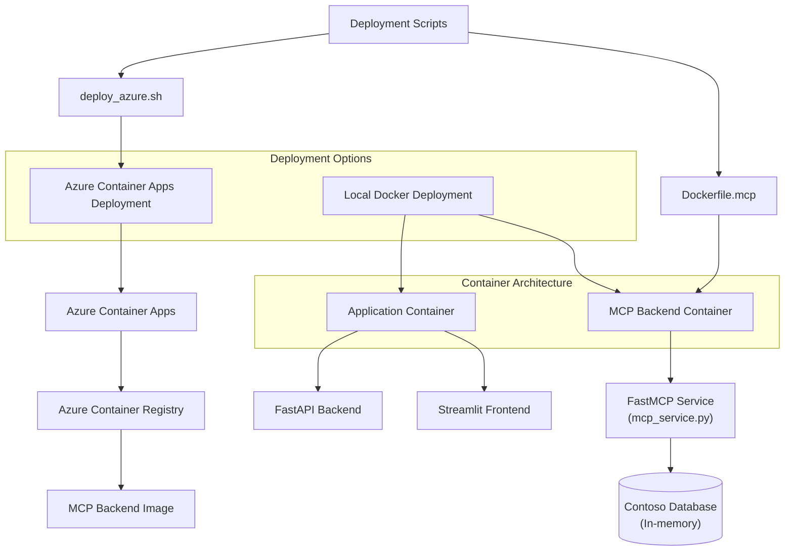
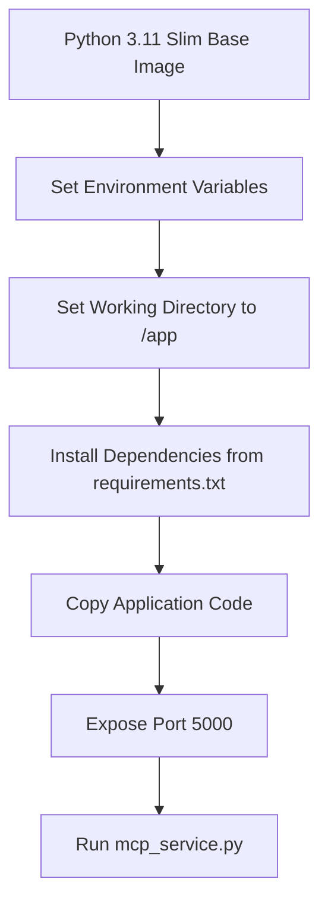
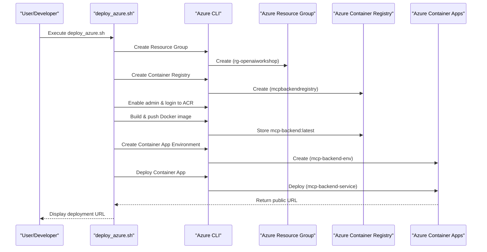
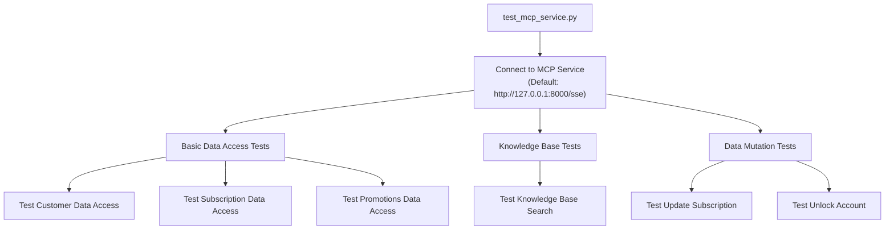
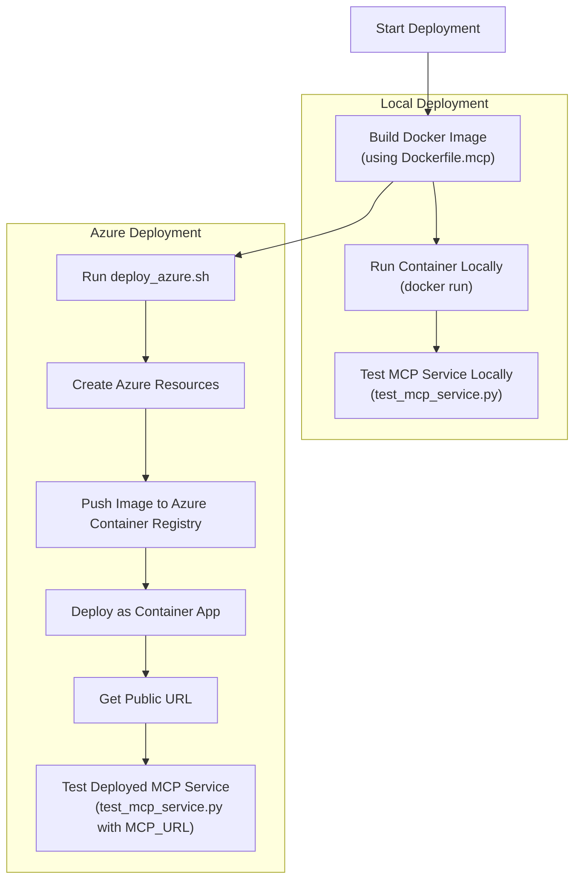

<!-- source: DeepWiki mcp.deepwiki.com · repo microsoft/OpenAIWorkshop · page 2.4 Deployment · fetched 2026-10-26 -->

# Deployment

Relevant source files

The following files were used as context for generating this wiki page:

- [scenarios/contoso_internet/backend_services/Dockerfile.mcp](scenarios/contoso_internet/backend_services/Dockerfile.mcp)
- [scenarios/contoso_internet/backend_services/deploy_azure.sh](scenarios/contoso_internet/backend_services/deploy_azure.sh)
- [scenarios/contoso_internet/backend_services/requirements.txt](scenarios/contoso_internet/backend_services/requirements.txt)
- [scenarios/contoso_internet/backend_services/test_mcp_service.py](scenarios/contoso_internet/backend_services/test_mcp_service.py)

This document describes the deployment architecture and processes for the Contoso Internet scenario components. It covers both Docker containerization for local development and Azure deployment for production environments. For information about the components being deployed, see [FastMCP Backend Services](#2.1) and [Application Layer](#2.3).

## Deployment Architecture Overview

The Contoso Internet scenario uses a containerized architecture with two primary components:

1. **MCP Backend Service** - Provides the Model Context Protocol API that handles customer data, subscriptions, billing information, and knowledge base access.
2. **Application Container** - Houses the FastAPI backend and Streamlit frontend for user interactions.

Sources: [scenarios/contoso_internet/backend_services/deploy_azure.sh](), [scenarios/contoso_internet/backend_services/Dockerfile.mcp]()

## Docker Containerization

The MCP Backend Service is containerized using Docker, which enables consistent deployment across different environments.

### MCP Service Dockerfile

The `Dockerfile.mcp` defines how to build the MCP service container:

Sources: [scenarios/contoso_internet/backend_services/Dockerfile.mcp]()

The Docker container:
- Uses Python 3.11 slim as the base image
- Sets up environment variables for Python optimization
- Installs required dependencies listed in `requirements.txt`
- Exposes port 5000 for the MCP service
- Runs the MCP service application

### MCP Service Dependencies

The MCP Backend Service requires several Python dependencies:

| Dependency | Purpose |
|------------|---------|
| Flask | Web framework for the MCP service |
| Faker | Generates fake data for demo purposes |
| python-dotenv | Manages environment variables |
| tenacity | Provides retry capability for API calls |
| openai | OpenAI API client |
| flasgger | Swagger documentation for Flask APIs |
| fastmcp | MCP protocol implementation |
| autogen-ext[mcp] | Autogen extensions for MCP |
| autogen-agentchat | Autogen chat agent framework |

Sources: [scenarios/contoso_internet/backend_services/requirements.txt]()

## Azure Deployment

The deployment to Azure is automated through the `deploy_azure.sh` script, which sets up the necessary Azure resources and deploys the MCP Backend Service.

### Deployment Process

Sources: [scenarios/contoso_internet/backend_services/deploy_azure.sh]()

### Azure Resources Created

The deployment script creates the following Azure resources:

1. **Resource Group** (`rg-openaiworkshop`) - Container for all deployment resources
2. **Azure Container Registry** (`mcpbackendregistry`) - Stores the Docker image
3. **Container App Environment** (`mcp-backend-env`) - Environment for running container apps
4. **Container App** (`mcp-backend-service`) - The deployed MCP backend service

### Deployment Script Details

The `deploy_azure.sh` script performs the following operations:

1. Creates or updates an Azure Resource Group
2. Creates an Azure Container Registry (ACR)
3. Builds the Docker image using `Dockerfile.mcp`
4. Pushes the image to ACR
5. Creates a Container App Environment
6. Deploys the MCP backend as a Container App
7. Outputs the public URL for the deployed service

Key configuration in the script includes:
- Service exposed on port 8000
- External ingress enabled
- Replica count set to 1

Sources: [scenarios/contoso_internet/backend_services/deploy_azure.sh:1-48]()

## Validating Deployment

After deployment, it's essential to validate that the MCP service is functioning correctly. The repository includes a test script for this purpose.

### Testing the MCP Service

The `test_mcp_service.py` script performs a comprehensive smoke test of the MCP service:

Sources: [scenarios/contoso_internet/backend_services/test_mcp_service.py:1-229]()

The test script:
1. Connects to the MCP service at the specified URL (default: `http://127.0.0.1:8000/sse`)
2. Tests all key MCP service functionalities, including:
   - Customer data retrieval
   - Subscription management
   - Knowledge base search
   - Billing and data usage information
   - Security log access
3. Tests mutating operations like updating subscriptions and unlocking accounts
4. Reports success or failure for each test

To run the test script against a deployed service:

1. Set the `MCP_URL` environment variable to the deployed service URL
2. Run the test script: `python test_mcp_service.py`

Sources: [scenarios/contoso_internet/backend_services/test_mcp_service.py:8-11]()

## End-to-End Deployment Workflow

The complete deployment workflow involves:

Sources: [scenarios/contoso_internet/backend_services/deploy_azure.sh](), [scenarios/contoso_internet/backend_services/Dockerfile.mcp](), [scenarios/contoso_internet/backend_services/test_mcp_service.py]()

This deployment architecture ensures consistent operation across both development and production environments, with automated testing to validate service functionality.

---

