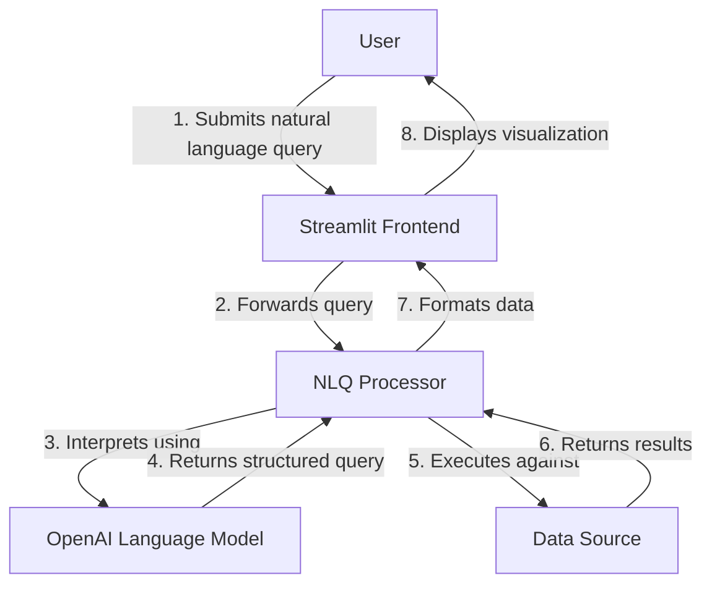
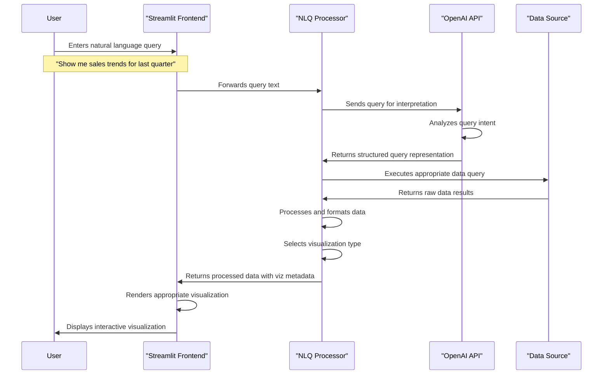
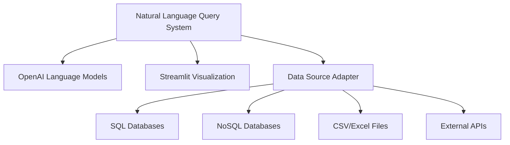

<!-- source: DeepWiki mcp.deepwiki.com · repo microsoft/OpenAIWorkshop · page 3 Natural Language Query Scenario · fetched 2026-10-26 -->

# Natural Language Query Scenario

Relevant source files

The following files were used as context for generating this wiki page:

- [.gitignore](.gitignore)

## Purpose and Scope

This document details the Natural Language Query (NLQ) Scenario in the Microsoft OpenAI Workshop repository. The NLQ Scenario demonstrates how to build systems that allow users to query data using natural language instead of structured query languages. It showcases how language models can interpret natural language questions, convert them to appropriate queries, and visualize the results through Streamlit-based tools.

For information about the related Contoso Internet customer service scenario, see [Contoso Internet Scenario](#2).

## Overview Architecture

The following diagram illustrates the high-level architecture of the Natural Language Query system:

Sources: Based on repository structure overview

## Key Components

### Streamlit Frontend

The NLQ scenario leverages Streamlit, a Python library for building interactive data applications. The Streamlit frontend serves as both the input interface for natural language queries and the visualization platform for displaying results.

Key responsibilities:
- Providing a user-friendly interface for entering natural language questions
- Rendering dynamic visualizations based on query results
- Supporting interactive filtering and exploration of data

### NLQ Processor

The NLQ Processor forms the core of the system, handling the interpretation of natural language queries and their conversion to structured data operations.

Key responsibilities:
- Processing natural language input through OpenAI models
- Converting user intent into appropriate data operations
- Retrieving and preprocessing data for visualization
- Determining the most appropriate visualization method

### Data Flow Sequence

The following sequence diagram illustrates the typical flow of a user query through the Natural Language Query system:

Sources: Based on repository structure overview

## Use Cases

The Natural Language Query Scenario supports several key use cases:

| Use Case | Description | Example Query |
|----------|-------------|---------------|
| Data Exploration | Allows users to explore datasets through conversational interfaces | "What were our top-selling products last month?" |
| Trend Analysis | Enables quick identification of patterns and trends | "Show me the sales trend over the past year" |
| Comparative Analysis | Facilitates comparisons between different data segments | "Compare revenue between North and South regions" |
| Anomaly Detection | Helps identify outliers or unexpected patterns | "Show me unusual spending patterns in the marketing budget" |
| Report Generation | Creates formatted reports based on natural language specifications | "Create a summary of Q2 financial performance" |

## System Integration

The Natural Language Query system is designed to be adaptable to different data sources:

Sources: Based on repository structure overview

## Example Visualization Types

The Streamlit visualization component supports various visualization types depending on the query and data characteristics:

| Query Type | Data Characteristics | Visualization Type |
|------------|----------------------|-------------------|
| Time-based trends | Temporal data with metrics | Line charts |
| Comparisons between categories | Categorical data with metrics | Bar charts |
| Composition analysis | Part-to-whole relationships | Pie/Donut charts |
| Relationships between variables | Multiple dimensions | Scatter plots |
| Geographical analysis | Location-based data | Maps |
| Detailed records | Tabular data | Interactive tables |

## Implementation Considerations

When implementing or extending the Natural Language Query system, consider the following:

1. **Query Interpretation**: Ensure prompts to OpenAI are well-crafted to extract the correct query intent
2. **Data Connector Flexibility**: Build adaptable connectors to support various data sources
3. **Visualization Selection Logic**: Implement rules for selecting the most appropriate visualization
4. **Error Handling**: Provide clear feedback when queries cannot be processed
5. **Performance Optimization**: Consider caching frequently accessed data or query results

## Security and Access Control

Important security considerations for the Natural Language Query system include:

1. **Data Access Controls**: Ensure users can only query data they have permission to access
2. **Query Validation**: Validate generated structured queries to prevent injection attacks
3. **Rate Limiting**: Implement rate limiting to prevent abuse of the OpenAI API
4. **Sensitive Data Handling**: Avoid exposing sensitive data in visualizations or logs

## Conclusion

The Natural Language Query Scenario demonstrates a powerful pattern for making data accessible through natural language. By combining OpenAI's language understanding capabilities with Streamlit's visualization tools, it creates an intuitive interface for data exploration that doesn't require specialized query language knowledge.

This scenario complements the other examples in the repository by focusing specifically on data query and visualization rather than complex agent interactions.

---

