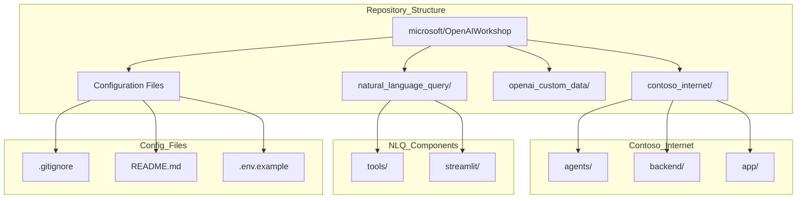
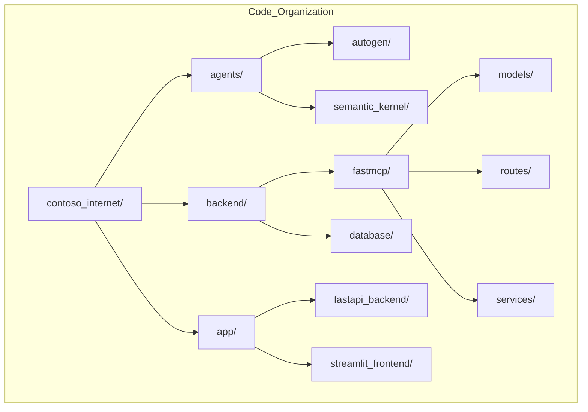
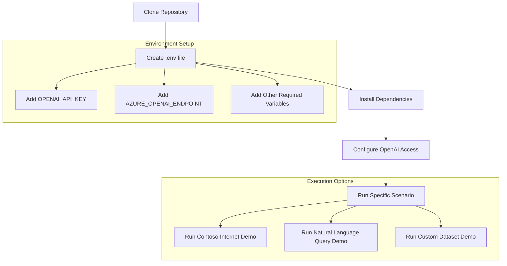
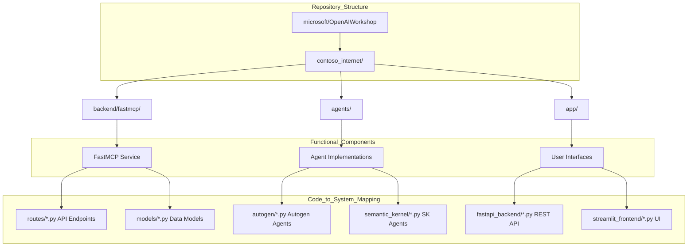
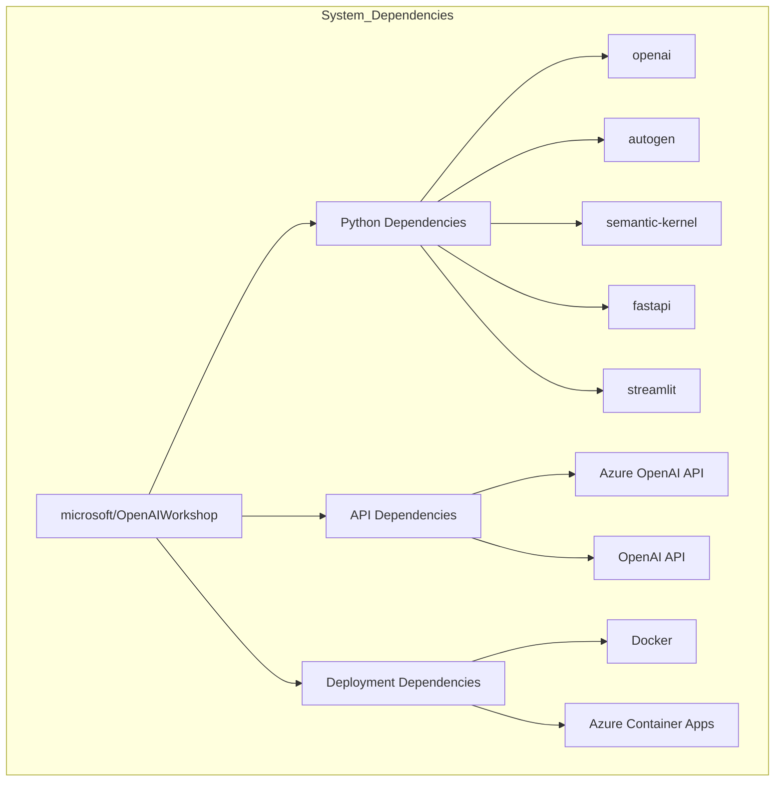

<!-- source: DeepWiki mcp.deepwiki.com · repo microsoft/OpenAIWorkshop · page 4 Repository Structure and Configuration · fetched 2026-10-26 -->

# Repository Structure and Configuration

<details>
<summary>Relevant source files</summary>

The following files were used as context for generating this wiki page:

- [.gitignore](.gitignore)
- [README.md](README.md)

</details>


This document provides an overview of the Microsoft OpenAI Workshop repository structure, configuration files, and setup procedures. It explains the organization of code, configuration patterns, and environment setup required to work with the repository effectively. For specific information about the Contoso Internet scenario components, see [Contoso Internet Scenario](#2).

## Repository Overview

The Microsoft OpenAI Workshop repository is organized around educational scenarios demonstrating different AI agent patterns and architectures. The repository serves as a learning resource for building intelligent AI solutions using Microsoft technologies.



**Diagram: High-level Repository Structure**

Sources: [README.md:1-7]()

## Main Components

The repository is organized into several main functional areas, each containing specific implementation scenarios for agent-based AI solutions.

| Component | Path | Description |
|-----------|------|-------------|
| Contoso Internet | `contoso_internet/` | Customer service scenario with agent implementations for a fictional internet provider |
| Natural Language Query | `natural_language_query/` | Scenarios for natural language querying with visualization tools |
| OpenAI Custom Dataset | `openai_custom_data/` | Demonstrations of using OpenAI with custom data sources |
| Configuration Files | Root directory | Setup and configuration files including README and environment configurations |

Each component contains its own subdirectories for agent implementations, backend services, and user interfaces.

## Folder Structure and Code Organization

The repository follows a modular structure where each scenario is self-contained with its own implementation files.



**Diagram: Contoso Internet Component Structure**

Sources: [README.md:3-7]()

## Configuration Files

The repository uses several configuration files to manage dependencies, environment variables, and runtime settings.

### Environment Variables

The repository likely uses `.env` files for configuration. While actual `.env` files are gitignored for security reasons, there may be example files (like `.env.example`) that show required variables.

Typical environment variables would include:

| Variable | Purpose |
|----------|---------|
| OPENAI_API_KEY | Authentication key for OpenAI API |
| AZURE_OPENAI_API_KEY | Authentication key for Azure OpenAI services |
| AZURE_OPENAI_ENDPOINT | Endpoint URL for Azure OpenAI |
| DATABASE_CONNECTION | Connection string for backend database |

### Gitignore Configuration

The repository's `.gitignore` file specifies files and directories that should be excluded from version control:

```
secrets.env
.env
__pycache__/
.tmp/
.vscode/
.azure
OAI_CONFIG_LIST
```

This configuration ensures that:
- Sensitive information in environment files (`.env`, `secrets.env`) is not committed
- Python bytecode files (`__pycache__/`) are excluded
- IDE-specific settings (`.vscode/`) stay local
- Temporary files (`.tmp/`) are ignored
- Azure configuration files (`.azure`) remain private
- OpenAI configuration lists (`OAI_CONFIG_LIST`) with potentially sensitive information are excluded

Sources: [.gitignore:1-7]()

## Development Environment Setup

Setting up the development environment for this repository would typically involve:

1. Cloning the repository
2. Creating environment files with necessary credentials
3. Installing dependencies
4. Configuring OpenAI or Azure OpenAI access



**Diagram: Development Environment Setup Process**

Sources: [.gitignore:1-2]()

## Repository Connection to Code Components

The following diagram illustrates how the repository structure maps to actual code components and services:



**Diagram: Repository-to-Code Component Mapping**

## System Configuration and Dependencies

Each main component in the repository likely has its own dependencies and configuration needs:



**Diagram: System Dependencies**

## Conclusion

The Microsoft OpenAI Workshop repository is structured as an educational resource organized around practical AI scenarios. The repository's configuration supports secure development by excluding sensitive information from version control. Each scenario component is modularly organized with its own agents, backend services, and user interfaces.

For more detailed information on specific components:
- For Contoso Internet scenario details, see [Contoso Internet Scenario](#2)
- For FastMCP backend services, see [FastMCP Backend Services](#2.1)
- For agent implementations, see [Agent Patterns and Implementations](#2.2)