# Page: Overview

# Overview

<details>
<summary>Relevant source files</summary>

The following files were used as context for generating this wiki page:

- [.gitignore](.gitignore)
- [README.md](README.md)

</details>


## Purpose and Scope

The Microsoft OpenAI Workshop repository serves as a comprehensive resource for learning and implementing advanced AI capabilities, with a focus on Agentic AI and multi-agent systems. This repository provides training materials, reference architectures, and hands-on scenarios to help developers design, build, and deploy intelligent agent solutions using Microsoft AI technologies.

For detailed information about specific scenarios, see [Contoso Internet Scenario](#2) and [Natural Language Query Scenario](#3).

Sources: [README.md:1-7]()

## Repository Components

The repository is organized into several key components that demonstrate different aspects of AI agent implementations.

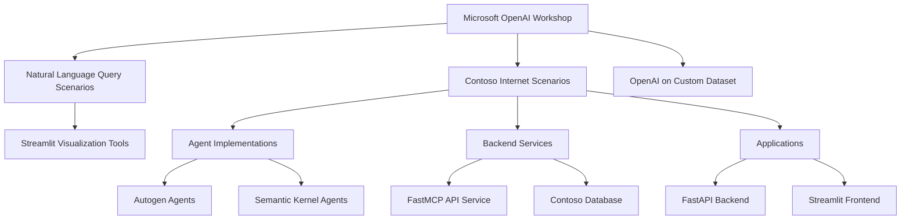

**Diagram: Repository Component Structure**

Sources: [README.md:1-7]()

## Key Scenarios

### Contoso Internet Scenario

The Contoso Internet Scenario serves as the primary example implementation, demonstrating how AI agents can assist with customer support for a fictional internet service provider. This scenario showcases various agent patterns, integration with backend services, and user-facing applications.

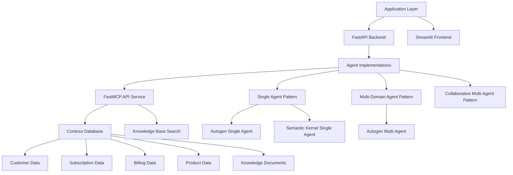

**Diagram: Contoso Internet Scenario Architecture**

Sources: [README.md:3-7]()

### Natural Language Query Scenario

The Natural Language Query Scenario demonstrates techniques for querying datasets using natural language, with visualization tools built on Streamlit. This scenario focuses on translating natural language questions into structured queries and presenting results in an intuitive manner.

### OpenAI on Custom Dataset

This component showcases how to apply OpenAI capabilities to custom datasets, enabling organizations to leverage their proprietary data for AI-powered solutions.

## Agent Patterns

The repository demonstrates three primary agent patterns that represent different approaches to building AI solutions:

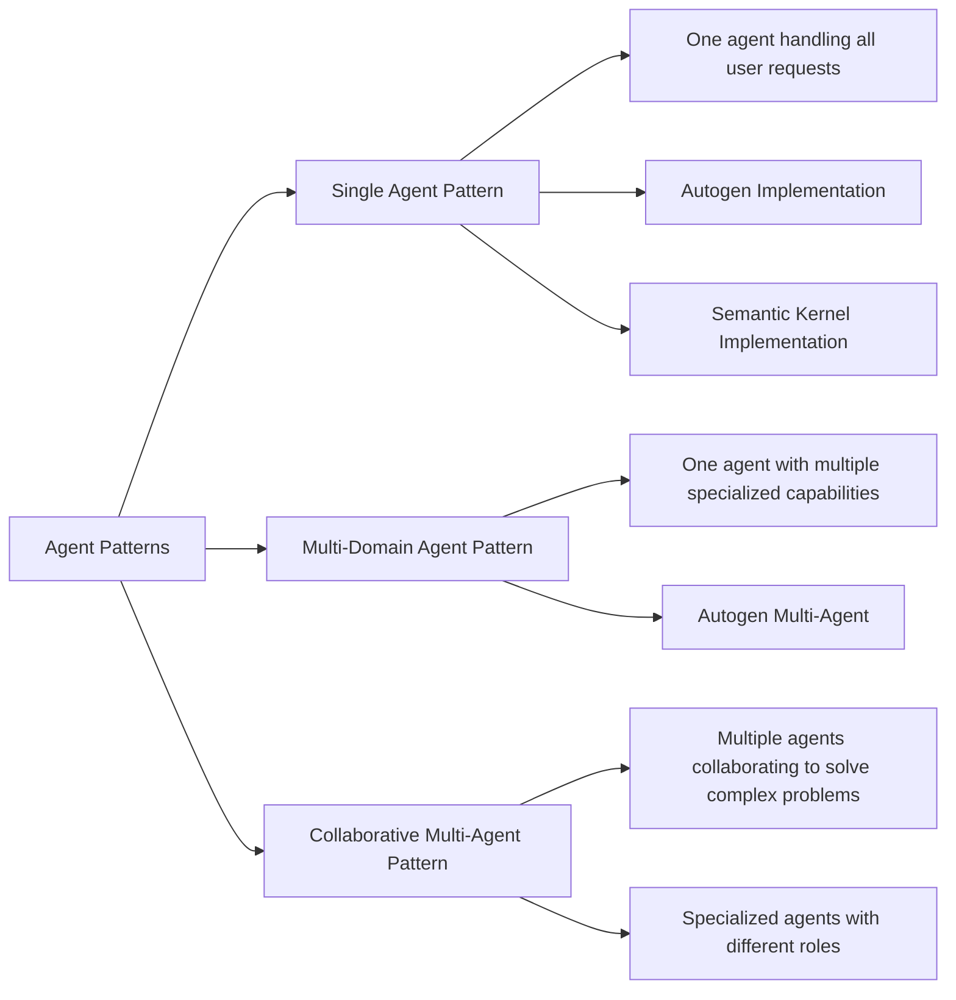

**Diagram: Agent Patterns and Implementations**

Sources: [README.md:3-7]()

## Implementation Technologies

The repository leverages several key technologies to implement AI agent solutions:

| Technology | Purpose | Used In |
|------------|---------|---------|
| Autogen | Framework for building autonomous agents | Agent implementations |
| Semantic Kernel | Orchestration framework for AI | Agent implementations |
| FastAPI | Backend web services | Application layer |
| Streamlit | Interactive frontend | User interface |
| FastMCP | Model Context Protocol service | Backend services |

## Deployment Architecture

The repository includes deployment options for both local development using Docker containers and cloud deployment using Azure services.

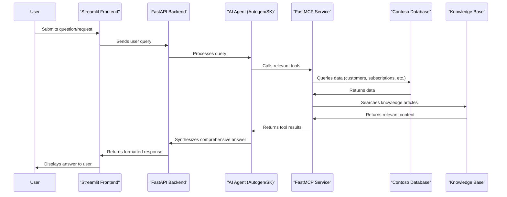

**Diagram: Agent Interaction Flow**

Sources: [README.md:5-7]()

## Repository Structure

The repository follows a structured organization that separates different components and scenarios:

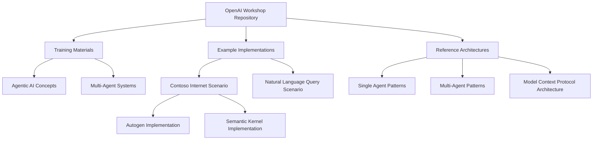

**Diagram: Repository Educational Purpose**

Sources: [README.md:1-7](), [.gitignore:1-7]()

## Getting Started

To get started with the repository, you should:

1. Clone the repository
2. Set up your environment variables (note that sensitive information should be in `.env` or `secrets.env` files, which are gitignored)
3. Explore the example scenarios
4. Follow the hands-on labs and exercises

For detailed information about repository structure and configuration, see [Repository Structure and Configuration](#4).

Sources: [.gitignore:1-7](), [README.md:1-7]()

---

# Page: Contoso Internet Scenario

# Contoso Internet Scenario

<details>
<summary>Relevant source files</summary>

The following files were used as context for generating this wiki page:

- [scenarios/contoso_internet/README.md](scenarios/contoso_internet/README.md)
- [scenarios/contoso_internet/backend_services/.env.sample](scenarios/contoso_internet/backend_services/.env.sample)
- [scenarios/contoso_internet/backend_services/README.md](scenarios/contoso_internet/backend_services/README.md)
- [scenarios/contoso_internet/backend_services/data/contoso.db](scenarios/contoso_internet/backend_services/data/contoso.db)
- [scenarios/contoso_internet/backend_services/data/create_db.py](scenarios/contoso_internet/backend_services/data/create_db.py)
- [scenarios/contoso_internet/backend_services/data/customer_scenarios.md](scenarios/contoso_internet/backend_services/data/customer_scenarios.md)
- [scenarios/contoso_internet/backend_services/data/kb.json](scenarios/contoso_internet/backend_services/data/kb.json)
- [scenarios/contoso_internet/backend_services/mcp_service.py](scenarios/contoso_internet/backend_services/mcp_service.py)

</details>


## Purpose and Scope

The Contoso Internet Scenario simulates a telecommunications and internet service provider called "Contoso Communications." This scenario provides a realistic business environment where AI agents handle customer inquiries related to billing, account management, service status, and promotions. It serves as a practical demonstration platform for implementing and evaluating AI agent architectures using various frameworks like Autogen and Semantic Kernel.

This document covers the core components of the Contoso Internet Scenario, including the backend data model, API services, agent patterns, and sample customer scenarios. For information about Natural Language Query capabilities, see [Natural Language Query Scenario](#3).

Sources: [scenarios/contoso_internet/README.md:5-7](), [scenarios/contoso_internet/README.md:11-12]()

## System Architecture

The Contoso Internet Scenario consists of several integrated components that form a complete end-to-end system for demonstrating AI agent capabilities.

### High-Level Architecture

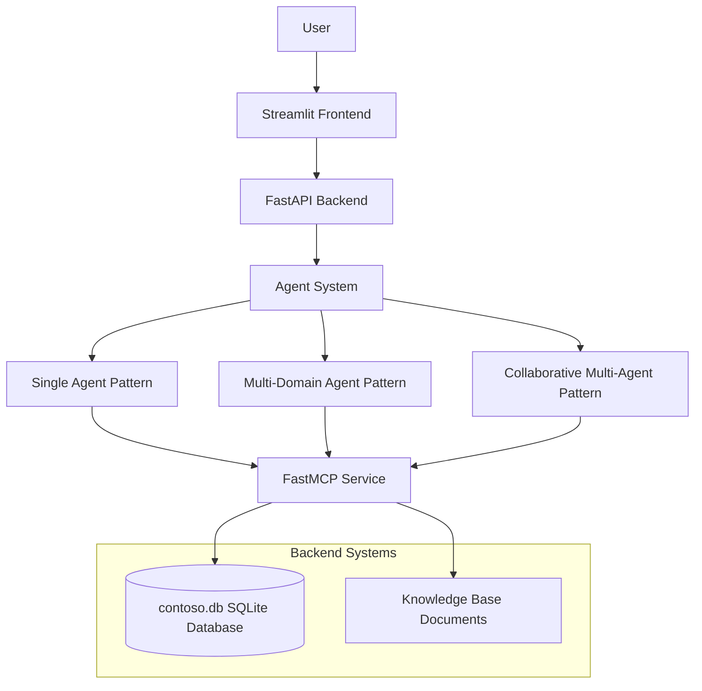

The Contoso Internet scenario implements a multi-tier architecture where:

1. **Frontend Layer** (Streamlit): Provides the user interface for submitting customer inquiries
2. **Backend Layer** (FastAPI): Handles API requests and routes them to the appropriate agent system
3. **Agent Layer**: Implements various agent patterns to process customer inquiries
4. **Service Layer** (FastMCP): Exposes database and knowledge base operations as typed tools
5. **Data Layer**: Stores customer data, transactions, and knowledge documents

Sources: [scenarios/contoso_internet/README.md:9-21](), [scenarios/contoso_internet/backend_services/README.md:8-10]()

## Data Model

The Contoso Internet scenario is built around a comprehensive data model that simulates a telecommunications company's customer management system.

### Database Schema

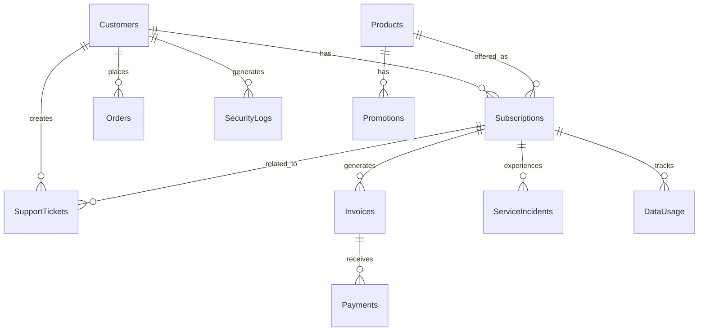

The database contains the following key entities:

| Entity | Description | Key Fields |
|--------|-------------|------------|
| Customers | Customer profiles | customer_id, first_name, last_name, email, loyalty_level |
| Subscriptions | Service subscriptions | subscription_id, customer_id, product_id, status |
| Products | Service offerings | product_id, name, category, monthly_fee |
| Invoices | Billing records | invoice_id, subscription_id, amount, due_date |
| Payments | Payment transactions | payment_id, invoice_id, amount, status |
| Promotions | Special offers | promotion_id, product_id, eligibility_criteria |
| KnowledgeDocuments | Policy and support docs | document_id, title, content, topic_embedding |

The database is generated with 250 random customers plus 9 deterministic scenarios that are designed to test specific agent capabilities.

Sources: [scenarios/contoso_internet/backend_services/data/create_db.py:62-251](), [scenarios/contoso_internet/backend_services/data/contoso.db]()

### Knowledge Base

The Knowledge Base contains policy documents, troubleshooting guides, and FAQs that agents can reference when handling customer inquiries. These documents cover topics such as:

- Invoice adjustment policy
- Troubleshooting slow internet
- International roaming options
- Account unlock procedures
- Promotion eligibility guidelines
- Return policy and process
- Late payment fee policy

Each document is stored with embedded vector representations for semantic search capabilities.

Sources: [scenarios/contoso_internet/backend_services/data/kb.json]()

## FastMCP Service API

The Model Context Protocol (MCP) service provides a structured API that exposes database operations as tools for AI agents to use.

### API Tools Overview

```mermaid
graph TD
    MCPService["mcp = FastMCP(name='Contoso Customer API as Tools')"] --> CustomerTools["Customer Management Tools"]
    MCPService --> BillingTools["Billing & Payment Tools"]
    MCPService --> SubscriptionTools["Subscription Management Tools"]
    MCPService --> KnowledgeTools["Knowledge Base Tools"]
    MCPService --> SupportTools["Support & Service Tools"]
    
    CustomerTools --> get_all_customers["get_all_customers()"]
    CustomerTools --> get_customer_detail["get_customer_detail(params: CustomerIdParam)"]
    
    BillingTools --> get_invoice_payments["get_invoice_payments(params: InvoiceIdParam)"]
    BillingTools --> pay_invoice["pay_invoice(invoice_id, amount, method)"]
    BillingTools --> get_billing_summary["get_billing_summary(params: CustomerIdParam)"]
    
    SubscriptionTools --> get_subscription_detail["get_subscription_detail(params: SubscriptionIdParam)"]
    SubscriptionTools --> update_subscription["update_subscription(subscription_id, update_data)"]
    SubscriptionTools --> get_data_usage["get_data_usage(subscription_id, start_date, end_date)"]
    
    KnowledgeTools --> search_knowledge_base["search_knowledge_base(params: KBSearchParams)"]
    
    SupportTools --> get_support_tickets["get_support_tickets(params: CustomerIdParam)"]
    SupportTools --> create_support_ticket["create_support_ticket(ticket_data)"]
```

The service provides 18 distinct API endpoints that are implemented as tools with the FastMCP framework:

| Tool Category | Examples | Purpose |
|---------------|----------|---------|
| Customer Data | get_customer_detail | Retrieve customer profiles and account information |
| Subscription | get_subscription_detail | Access subscription details, invoices, and service incidents |
| Billing | pay_invoice, get_billing_summary | Manage payments and view billing information |
| Knowledge | search_knowledge_base | Semantic search on policy/procedure documents |
| Support | create_support_ticket | Create and manage customer support tickets |
| Security | get_security_logs, unlock_account | View security events and manage account access |

These tools provide a standardized interface for AI agents to interact with the Contoso backend systems.

Sources: [scenarios/contoso_internet/backend_services/mcp_service.py:8-16](), [scenarios/contoso_internet/backend_services/mcp_service.py:206-515]()

## Agent Patterns

The Contoso Internet scenario demonstrates three progressive agent design patterns for handling customer inquiries.

### Agent Pattern Comparison

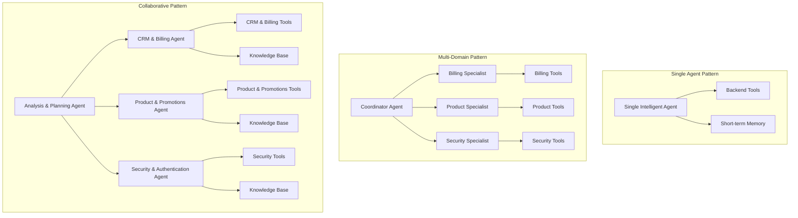

1. **Intelligent Single Agent**
   - One agent handles end-to-end customer requests
   - Directly uses all available tools as needed
   - Maintains short-term conversational memory

2. **Multi-Domain Agent Setup**
   - Coordinator agent performs lightweight domain detection and routing
   - Specialist agents handle requests within their specific domains
   - Each specialist has access to domain-specific tools
   - Requests are handed back to the coordinator when switching domains

3. **Collaborative Multi-Agent System**
   - Analysis & Planning agent orchestrates the interaction
   - Decomposes customer requests into subtasks
   - Delegates to domain-specific agents
   - All agents proactively access the knowledge base
   - Specialist agents execute subtasks and report back
   - Final response synthesized from all agent contributions

Each pattern demonstrates increasing sophistication in handling complex customer inquiries.

Sources: [scenarios/contoso_internet/README.md:52-139]()

## Request Handling Flow

The following diagram illustrates how a typical customer request flows through the system:

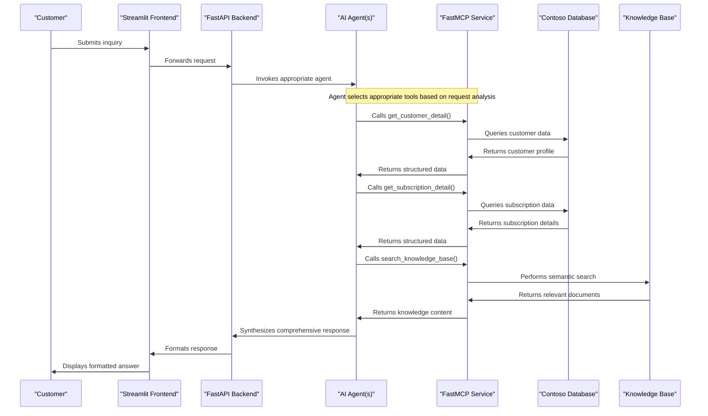

This flow demonstrates how agents leverage the FastMCP service to access multiple data sources, synthesize information, and generate comprehensive responses to customer inquiries.

Sources: [scenarios/contoso_internet/backend_services/mcp_service.py:11-15](), [scenarios/contoso_internet/README.md:85-100]()

## Sample Customer Scenarios

The Contoso Internet scenario includes 9 predefined customer scenarios designed to test various agent capabilities.

### Scenario Examples

| ID | Customer | Challenge | Required Agent Capabilities |
|----|----------|-----------|----------------------------|
| 1 | John Doe | Invoice higher than usual | Billing analysis, Data usage analysis, Policy reference |
| 2 | Jane Doe | Internet slower than before | Service status check, Troubleshooting guidance |
| 3 | Mark Doe | Traveling abroad - needs roaming | Product recommendation, Policy explanation |
| 4 | Alice Doe | Account locked | Security log analysis, Account unlock procedure |
| 5 | Ron Doe | Promotion eligibility | Loyalty status check, Promotion matching |

Each scenario has a well-defined solution path that requires the agent to:
1. Query the appropriate data sources using MCP tools
2. Reference relevant knowledge base documents
3. Synthesize a comprehensive response that addresses the customer's inquiry

These scenarios provide a structured way to evaluate agent effectiveness and compare different agent architectures.

Sources: [scenarios/contoso_internet/backend_services/data/customer_scenarios.md]()

## Integration and Deployment

### Local Setup

To set up the Contoso Internet scenario locally:

1. Generate the database:
   ```
   cd backend_services/data
   python create_db.py
   ```

2. Configure environment variables:
   - Copy `.env.sample` to `.env`
   - Set appropriate values for Azure OpenAI (optional)

3. Run the FastMCP service:
   ```
   cd backend_services
   python mcp_service.py
   ```

4. Implement agent patterns using Autogen or Semantic Kernel frameworks

5. Test against the predefined customer scenarios

### Deployment Options

The scenario supports containerized deployment:

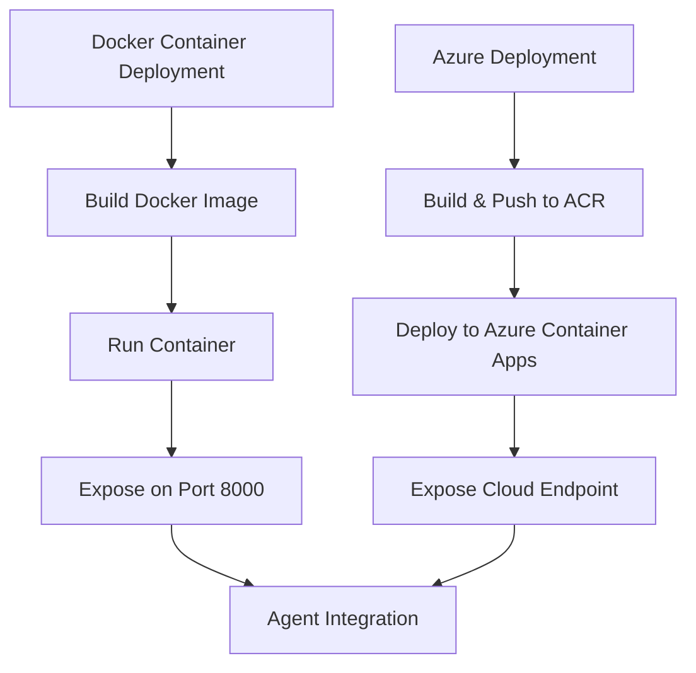

Docker commands:
```
docker build -f Dockerfile.mcp -t mcp-backend .
docker run -it -p 8000:8000 --env-file .env mcp-backend
```

The deployment scripts in the repository automate the process of building, pushing, and deploying to Azure Container Apps.

Sources: [scenarios/contoso_internet/backend_services/README.md:79-115]()

## Conclusion

The Contoso Internet Scenario provides a comprehensive framework for developing and testing AI agents in a realistic customer service context. It demonstrates how agents can leverage structured data sources and knowledge base content to provide accurate, helpful responses to diverse customer inquiries.

The scenario showcases different agent architectures—from simple single-agent designs to sophisticated multi-agent collaborative systems—enabling comparison and evaluation of various approaches to AI-driven customer service automation.

---

# Page: FastMCP Backend Services

# FastMCP Backend Services

<details>
<summary>Relevant source files</summary>

The following files were used as context for generating this wiki page:

- [scenarios/contoso_internet/README.md](scenarios/contoso_internet/README.md)
- [scenarios/contoso_internet/backend_services/.dockerigore](scenarios/contoso_internet/backend_services/.dockerigore)
- [scenarios/contoso_internet/backend_services/.env.sample](scenarios/contoso_internet/backend_services/.env.sample)
- [scenarios/contoso_internet/backend_services/Dockerfile.mcp](scenarios/contoso_internet/backend_services/Dockerfile.mcp)
- [scenarios/contoso_internet/backend_services/README.md](scenarios/contoso_internet/backend_services/README.md)
- [scenarios/contoso_internet/backend_services/data/contoso.db](scenarios/contoso_internet/backend_services/data/contoso.db)
- [scenarios/contoso_internet/backend_services/data/create_db.py](scenarios/contoso_internet/backend_services/data/create_db.py)
- [scenarios/contoso_internet/backend_services/data/customer_scenarios.md](scenarios/contoso_internet/backend_services/data/customer_scenarios.md)
- [scenarios/contoso_internet/backend_services/data/kb.json](scenarios/contoso_internet/backend_services/data/kb.json)
- [scenarios/contoso_internet/backend_services/mcp_service.py](scenarios/contoso_internet/backend_services/mcp_service.py)
- [scenarios/contoso_internet/backend_services/requirements.txt](scenarios/contoso_internet/backend_services/requirements.txt)
- [scenarios/contoso_internet/backend_services/test_mcp_service.py](scenarios/contoso_internet/backend_services/test_mcp_service.py)

</details>


## Purpose and Overview

The FastMCP Backend Services component provides a simulated telecommunications and internet services backend for the Contoso Internet scenario within the Microsoft OpenAI Workshop. This system serves as a realistic business environment for developing and testing AI agents, enabling them to access customer data, manage subscriptions, process billing, and provide customer support without requiring integration with actual production systems.

This documentation covers the architecture, data model, API endpoints, and deployment options for the FastMCP backend services. For information about using these services with specific agent implementations, see:
- [Autogen Agents](#2.2.1)
- [Semantic Kernel Agents](#2.2.2)

Sources:
- [scenarios/contoso_internet/README.md:1-49]()
- [scenarios/contoso_internet/backend_services/README.md:1-7]()

## System Architecture

### High-Level Architecture Diagram

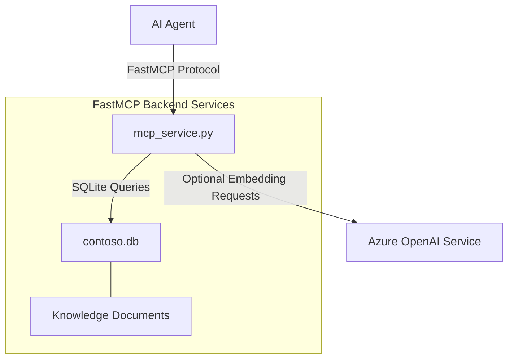

The FastMCP Backend Services consists of:

1. **FastMCP Service** - A Python service that exposes API endpoints as tools via the FastMCP protocol
2. **SQLite Database** - Contains customer data, subscriptions, billing information, etc.
3. **Knowledge Base** - Collection of documents with embeddings for semantic search functionality

The system is designed to be consumed by AI agents through the FastMCP protocol, which allows for structured tool calling.

Sources:
- [scenarios/contoso_internet/backend_services/mcp_service.py:8-16]()
- [scenarios/contoso_internet/backend_services/README.md:8-35]()

## Data Model and Database Schema

### Core Entity Relationship Diagram

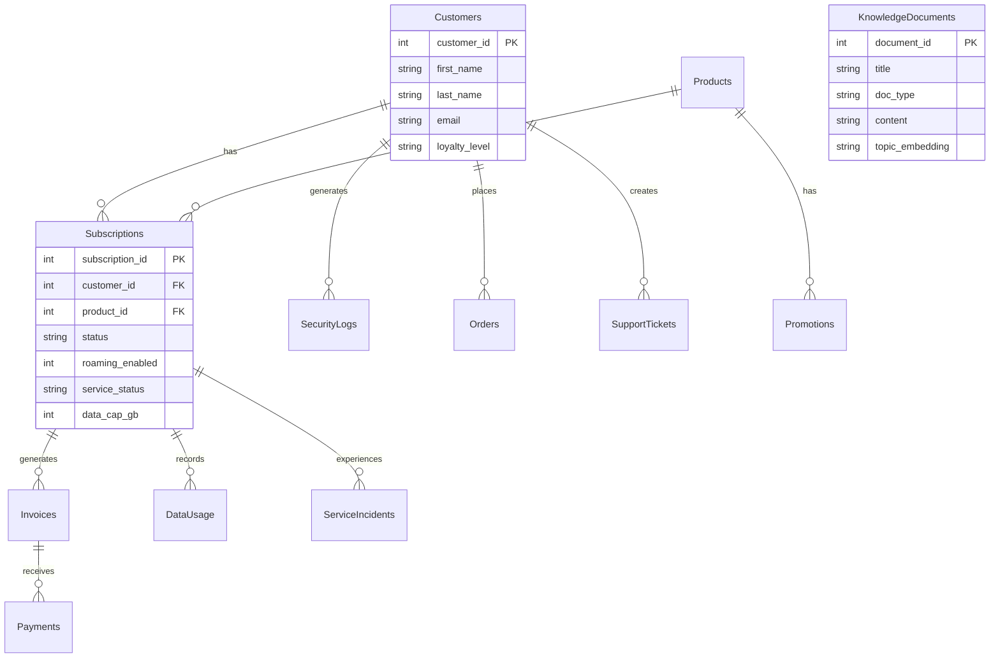

Sources:
- [scenarios/contoso_internet/backend_services/data/create_db.py:62-251]()
- [scenarios/contoso_internet/backend_services/mcp_service.py:55-205]()

The database contains 12 main tables modeling a telecom provider's business domain:

| Table | Description | Key Fields |
|-------|-------------|------------|
| Customers | Customer accounts | customer_id, name, email, loyalty_level |
| Products | Service offerings | product_id, name, category, monthly_fee |
| Subscriptions | Service contracts | subscription_id, customer_id, product_id, status |
| Invoices | Billing records | invoice_id, subscription_id, amount, due_date |
| Payments | Payment transactions | payment_id, invoice_id, amount, status |
| Promotions | Special offers | promotion_id, product_id, eligibility_criteria |
| SecurityLogs | Security events | log_id, customer_id, event_type, description |
| Orders | Product purchases | order_id, customer_id, product_id, status |
| SupportTickets | Service issues | ticket_id, customer_id, status, priority |
| DataUsage | Usage metrics | usage_id, subscription_id, data_used_mb |
| ServiceIncidents | Service problems | incident_id, subscription_id, resolution_status |
| KnowledgeDocuments | KB articles | document_id, title, content, topic_embedding |

The database includes both generated random customers (~250) and specific test scenarios with predetermined customer data, designed to provide realistic business cases for agent testing.

Sources:
- [scenarios/contoso_internet/backend_services/mcp_service.py:55-205]()
- [scenarios/contoso_internet/backend_services/data/create_db.py:257-350]()

## API Tools and Endpoints

The FastMCP service exposes functionality as "tools" that agents can call programmatically. Each tool is implemented as a Python function with a specific purpose, parameters, and return type.

### Tool Interaction Flow

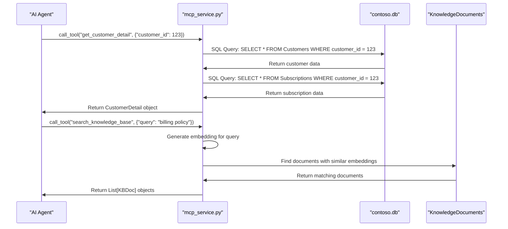

Sources:
- [scenarios/contoso_internet/backend_services/mcp_service.py:205-572]()
- [scenarios/contoso_internet/backend_services/test_mcp_service.py:52-191]()

### Customer Information Tools

| Tool Name | Description | Parameters | Return Type |
|-----------|-------------|------------|-------------|
| `get_all_customers` | List customers with basic info | None | List[CustomerSummary] |
| `get_customer_detail` | Customer profile with subscriptions | customer_id: int | CustomerDetail |

Sources:
- [scenarios/contoso_internet/backend_services/mcp_service.py:206-229]()

### Subscription and Billing Tools

| Tool Name | Description | Parameters | Return Type |
|-----------|-------------|------------|-------------|
| `get_subscription_detail` | Detail view with invoices and incidents | subscription_id: int | SubscriptionDetail |
| `get_invoice_payments` | List payments for an invoice | invoice_id: int | List[Payment] |
| `pay_invoice` | Record payment | invoice_id: int, amount: float | Dict[str, Any] |
| `get_data_usage` | Usage records for date range | subscription_id: int, dates, aggregate: bool | List[DataUsageRecord] |
| `get_billing_summary` | Customer's total outstanding balance | customer_id: int | Dict[str, Any] |
| `update_subscription` | Modify subscription properties | subscription_id: int, update: dict | Dict[str, Any] |

Sources:
- [scenarios/contoso_internet/backend_services/mcp_service.py:232-355]()
- [scenarios/contoso_internet/backend_services/mcp_service.py:473-491]()
- [scenarios/contoso_internet/backend_services/mcp_service.py:520-572]()

### Product and Promotion Tools

| Tool Name | Description | Parameters | Return Type |
|-----------|-------------|------------|-------------|
| `get_promotions` | List all active promotions | None | List[Promotion] |
| `get_eligible_promotions` | Promotions for specific customer | customer_id: int | List[Promotion] |
| `get_products` | List available products | category: str (optional) | List[Dict] |
| `get_product_detail` | Get single product | product_id: int | Dict |

Sources:
- [scenarios/contoso_internet/backend_services/mcp_service.py:358-391]()
- [scenarios/contoso_internet/backend_services/mcp_service.py:508-519]()

### Support and Knowledge Tools

| Tool Name | Description | Parameters | Return Type |
|-----------|-------------|------------|-------------|
| `search_knowledge_base` | Semantic search on KB documents | query: str, topk: int | List[KBDoc] |
| `get_security_logs` | Security events for customer | customer_id: int | List[SecurityLog] |
| `unlock_account` | Unlock locked account | customer_id: int | Dict[str, Any] |
| `get_customer_orders` | Customer order history | customer_id: int | List[Order] |
| `get_support_tickets` | Customer support tickets | customer_id: int, only_open: bool | List[SupportTicket] |
| `create_support_ticket` | Create new ticket | customer_id, subscription_id, details | Dict[str, Any] |

Sources:
- [scenarios/contoso_internet/backend_services/mcp_service.py:394-427]()
- [scenarios/contoso_internet/backend_services/mcp_service.py:430-472]()
- [scenarios/contoso_internet/backend_services/mcp_service.py:492-507]()

## Knowledge Base and Semantic Search

The knowledge base contains documents related to company policies, procedures, and troubleshooting guides. Documents are stored in the `KnowledgeDocuments` table with the following structure:

- `document_id`: Unique identifier
- `title`: Document title
- `doc_type`: Document type (Policy, Procedure, Troubleshooting, FAQ)
- `content`: Full text content
- `topic_embedding`: Vector embedding of content for semantic search

The system includes documents on:
- Billing and invoice policies
- Technical troubleshooting (internet, calls, messaging)
- Service policies (international roaming, data usage)
- Account procedures (security, unlocking)
- Return and refund policies

The `search_knowledge_base` tool performs semantic search by:
1. Converting the query to an embedding vector
2. Comparing it to document embeddings using cosine similarity
3. Returning the most relevant documents

Sources:
- [scenarios/contoso_internet/backend_services/data/kb.json:1-73]()
- [scenarios/contoso_internet/backend_services/mcp_service.py:394-414]()
- [scenarios/contoso_internet/backend_services/mcp_service.py:27-52]()

## Deployment and Configuration

### Local Development Setup

To run the FastMCP Backend Services locally:

1. Install requirements:
   ```bash
   pip install -r requirements.txt
   ```

2. Configure environment variables (copy `.env.sample` to `.env`):
   ```
   AZURE_OPENAI_ENDPOINT="https://your-resource.openai.azure.com"
   AZURE_OPENAI_API_KEY="your-api-key"
   AZURE_OPENAI_CHAT_DEPLOYMENT="gpt-4o"
   AZURE_OPENAI_API_VERSION="2025-03-01-preview"
   AZURE_OPENAI_EMBEDDING_DEPLOYMENT="text-embedding-ada-002"
   DB_PATH="data/contoso.db"
   ```

3. Generate the database (if not already present):
   ```bash
   cd data/
   python create_db.py
   ```

4. Run the service:
   ```bash
   python mcp_service.py
   ```

The service will listen on port 8000 by default.

Sources:
- [scenarios/contoso_internet/backend_services/README.md:79-101]()
- [scenarios/contoso_internet/backend_services/.env.sample:1-7]()

### Docker Container Deployment

```bash
# Build the Docker image
docker build -f Dockerfile.mcp -t mcp-backend .

# Run the container
docker run -it -p 8000:8000 --env-file .env mcp-backend
```

Sources:
- [scenarios/contoso_internet/backend_services/README.md:103-109]()
- [scenarios/contoso_internet/backend_services/Dockerfile.mcp:1-22]()

### Azure Container Apps Deployment

The service can be deployed to Azure Container Apps using the provided deployment script:

```bash
bash deploy_mcp.sh
```

Edit the script to configure Azure resources, registry, and other deployment parameters.

Sources:
- [scenarios/contoso_internet/backend_services/README.md:111-116]()

## Customer Scenarios for Agent Testing

The system includes 9 predefined customer scenarios specifically designed to test and demonstrate agent capabilities:

1. **Invoice Higher Than Usual** (Customer ID: 251)
   - Challenge: Customer's invoice is 2.5× normal amount
   - Cause: Data usage exceeding plan limits

2. **Internet Performance Issues** (Customer ID: 252)
   - Challenge: Throughput lower than advertised 1 Gbps tier
   - Cause: Active service incident under investigation

3. **International Roaming Setup** (Customer ID: 253)
   - Challenge: Customer traveling abroad needs roaming
   - Solution: Enable International Roaming add-on

4. **Account Security Issue** (Customer ID: 254)
   - Challenge: Account locked after failed login attempts
   - Solution: Follow unlock procedure with verification

5. **Promotion Eligibility** (Customer ID: 255)
   - Challenge: Customer wants available promotions
   - Solution: Check loyalty-based discount eligibility

6. **Product Return Processing** (Customer ID: 256)
   - Challenge: Customer returned device, awaiting refund
   - Solution: Verify return status within policy timeframe

7. **Service Quality Issue** (Customer ID: 257)
   - Challenge: Dropped calls in specific locations
   - Solution: Investigate network issues, create ticket

8. **Payment Problem** (Customer ID: 258)
   - Challenge: Service suspended, customer wants fee waiver
   - Solution: Apply relevant hardship policies

9. **Data Overage Charge** (Customer ID: 259)
   - Challenge: Unexpected charges from data usage
   - Solution: Explain retroactive plan change options

These scenarios provide realistic customer service situations requiring agents to access multiple data sources, search knowledge content, and recommend appropriate solutions.

Sources:
- [scenarios/contoso_internet/backend_services/data/customer_scenarios.md:1-174]()
- [scenarios/contoso_internet/README.md:142-204]()

## Integration with AI Agents

### Client Usage Example

```python
from fastmcp import Client

async def get_customer_info(customer_id):
    async with Client("http://localhost:8000/sse") as client:
        # Get customer details with subscriptions
        response = await client.call_tool(
            "get_customer_detail", 
            {"customer_id": customer_id}
        )
        customer = response[0].as_json()
        
        # Get billing summary
        response = await client.call_tool(
            "get_billing_summary", 
            {"customer_id": customer_id}
        )
        billing = response[0].as_json()
        
        return {
            "customer": customer,
            "billing": billing
        }
```

Sources:
- [scenarios/contoso_internet/backend_services/test_mcp_service.py:52-191]()

### Integration with Agent Frameworks

The FastMCP service is designed to be integrated with AI agent frameworks through the FastMCP protocol:

1. **Autogen Integration**: 
   - Register FastMCP endpoints as callable tools for Autogen agents
   - Enable agents to query customer data and perform operations

2. **Semantic Kernel Integration**:
   - Create plugins that call FastMCP endpoints
   - Define semantic functions that use these tools

The system accommodates various agent interaction patterns, from single-agent to collaborative multi-agent systems, with tools that can be used across different domain specialists.

Sources:
- [scenarios/contoso_internet/README.md:52-139]()
- [scenarios/contoso_internet/backend_services/README.md:120-126]()

## Dependencies and Requirements

The FastMCP Backend Services depends on:

- `fastmcp`: FastMCP protocol implementation
- `pydantic`: Data validation and schema definitions
- `python-dotenv`: Environment variable management
- `openai`: Azure OpenAI client for embeddings (optional)
- `sqlite3`: Database access (standard library)

Python 3.11+ is recommended for optimal performance.

Sources:
- [scenarios/contoso_internet/backend_services/requirements.txt:1-10]()
- [scenarios/contoso_internet/backend_services/mcp_service.py:1-7]()

---

# Page: Database Schema and Knowledge Base

# Database Schema and Knowledge Base

<details>
<summary>Relevant source files</summary>

The following files were used as context for generating this wiki page:

- [scenarios/contoso_internet/README.md](scenarios/contoso_internet/README.md)
- [scenarios/contoso_internet/backend_services/.env.sample](scenarios/contoso_internet/backend_services/.env.sample)
- [scenarios/contoso_internet/backend_services/README.md](scenarios/contoso_internet/backend_services/README.md)
- [scenarios/contoso_internet/backend_services/data/contoso.db](scenarios/contoso_internet/backend_services/data/contoso.db)
- [scenarios/contoso_internet/backend_services/data/create_db.py](scenarios/contoso_internet/backend_services/data/create_db.py)
- [scenarios/contoso_internet/backend_services/data/customer_scenarios.md](scenarios/contoso_internet/backend_services/data/customer_scenarios.md)
- [scenarios/contoso_internet/backend_services/data/kb.json](scenarios/contoso_internet/backend_services/data/kb.json)
- [scenarios/contoso_internet/backend_services/mcp_service.py](scenarios/contoso_internet/backend_services/mcp_service.py)

</details>


## Purpose and Scope

This document provides a detailed technical overview of the database schema and knowledge base used in the Contoso Internet scenario. It covers the SQLite database structure, table relationships, and the knowledge base implementation used by AI agents to query customer data, process billing information, and provide support through the Model Context Protocol (MCP) service.

For information about the MCP Service API that interacts with this database, see [MCP Service API](#2.1.2).

Sources: [scenarios/contoso_internet/README.md:1-50](), [scenarios/contoso_internet/backend_services/README.md:1-20]()

## Database Overview

The Contoso Internet scenario uses a SQLite database (`contoso.db`) that simulates a telecom company's customer management system. This database contains structured information about customers, subscriptions, billing, and support, as well as a knowledge base of company policies and procedures.

### Database Structure Diagram

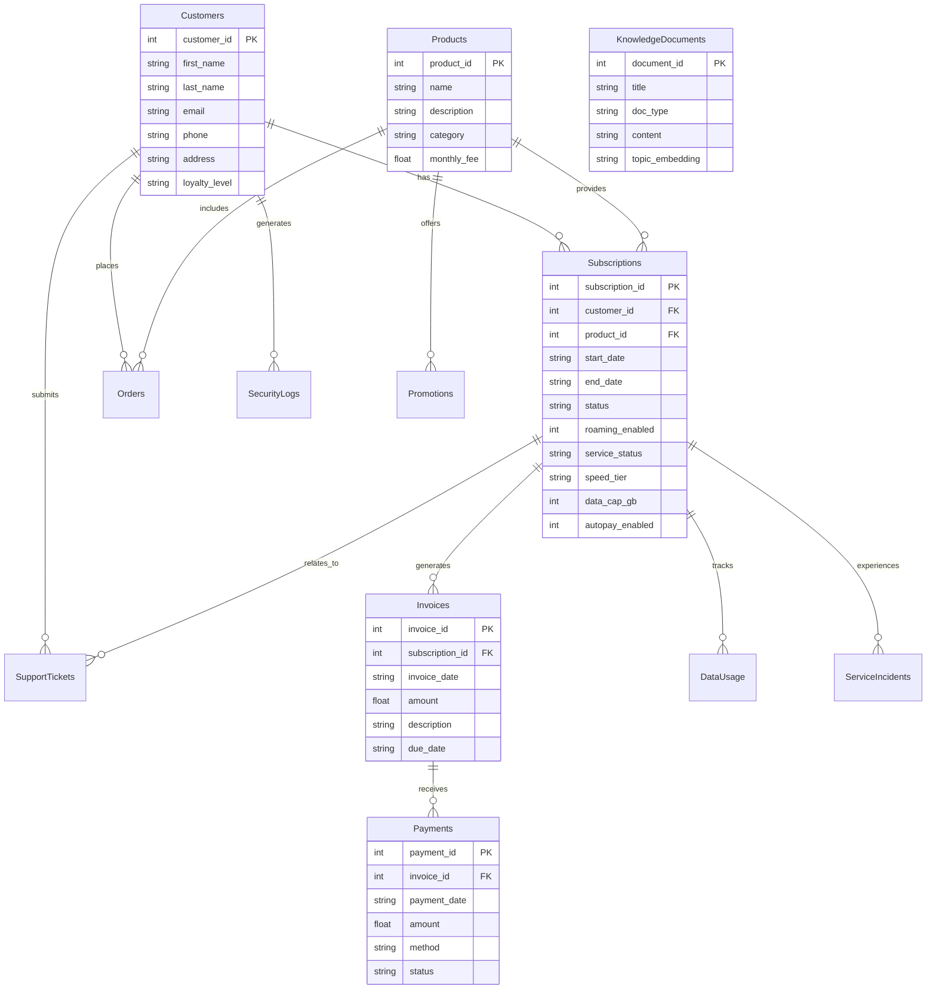

Sources: [scenarios/contoso_internet/backend_services/data/create_db.py:62-251](), [scenarios/contoso_internet/backend_services/mcp_service.py:58-175]()

## Table Descriptions

The database consists of 12 tables that represent the core business entities and their relationships:

| Table Name | Description | Primary Purpose |
|------------|-------------|-----------------|
| `Customers` | Customer profiles with personal information | Stores basic customer data and loyalty level |
| `Products` | Service offerings available to customers | Defines the products Contoso offers (mobile, internet, bundles) |
| `Subscriptions` | Active service subscriptions | Links customers to products with specific terms |
| `Invoices` | Billing records for subscriptions | Tracks amounts due for services |
| `Payments` | Payment records against invoices | Records payment history, methods, and status |
| `Promotions` | Special offers and discounts | Stores promotional details and eligibility criteria |
| `SecurityLogs` | Account security events | Tracks login attempts and security incidents |
| `Orders` | Product purchase history | Records product orders and their status |
| `SupportTickets` | Customer service requests | Tracks customer issues and resolution status |
| `DataUsage` | Usage metrics for subscriptions | Records data, voice, and SMS consumption |
| `ServiceIncidents` | Service interruptions | Logs service problems and their resolution |
| `KnowledgeDocuments` | Knowledge base articles | Stores policies, procedures, and troubleshooting guides |

Sources: [scenarios/contoso_internet/backend_services/data/create_db.py:62-251](), [scenarios/contoso_internet/backend_services/mcp_service.py:58-175]()

## Detailed Schema

### Core Customer and Subscription Tables

#### Customers Table
```
CREATE TABLE Customers(
    customer_id   INTEGER PRIMARY KEY AUTOINCREMENT,
    first_name    TEXT NOT NULL,
    last_name     TEXT NOT NULL,
    email         TEXT UNIQUE,
    phone         TEXT,
    address       TEXT,
    loyalty_level TEXT
)
```

The `loyalty_level` can be "Bronze", "Silver", or "Gold", which affects eligibility for promotions.

#### Products Table
```
CREATE TABLE Products(
    product_id   INTEGER PRIMARY KEY AUTOINCREMENT,
    name         TEXT NOT NULL,
    description  TEXT,
    category     TEXT,
    monthly_fee  REAL
)
```

Product categories include "mobile", "internet", "bundle", and "addon".

#### Subscriptions Table
```
CREATE TABLE Subscriptions(
    subscription_id  INTEGER PRIMARY KEY AUTOINCREMENT,
    customer_id      INTEGER NOT NULL,
    product_id       INTEGER NOT NULL,
    start_date       TEXT,
    end_date         TEXT,
    status           TEXT,
    roaming_enabled  INTEGER DEFAULT 0,
    service_status   TEXT,
    speed_tier       TEXT,
    data_cap_gb      INTEGER,
    autopay_enabled  INTEGER DEFAULT 1,
    FOREIGN KEY(customer_id) REFERENCES Customers(customer_id),
    FOREIGN KEY(product_id)  REFERENCES Products(product_id)
)
```

The `service_status` can be "normal", "slow", or "offline", and `speed_tier` options include "50Mbps", "100Mbps", "300Mbps", and "1Gbps".

Sources: [scenarios/contoso_internet/backend_services/data/create_db.py:74-114]()

### Billing and Payments Tables

#### Invoices Table
```
CREATE TABLE Invoices(
    invoice_id      INTEGER PRIMARY KEY AUTOINCREMENT,
    subscription_id INTEGER,
    invoice_date    TEXT,
    amount          REAL,
    description     TEXT,
    due_date        TEXT,
    FOREIGN KEY (subscription_id) REFERENCES Subscriptions(subscription_id)
)
```

#### Payments Table
```
CREATE TABLE Payments(
    payment_id   INTEGER PRIMARY KEY AUTOINCREMENT,
    invoice_id   INTEGER,
    payment_date TEXT,
    amount       REAL,
    method       TEXT,
    status       TEXT,
    FOREIGN KEY (invoice_id) REFERENCES Invoices(invoice_id)
)
```

Payment status can be "successful", "failed", or "pending".

Sources: [scenarios/contoso_internet/backend_services/data/create_db.py:117-140]()

### Marketing and Promotional Tables

#### Promotions Table
```
CREATE TABLE Promotions(
    promotion_id       INTEGER PRIMARY KEY AUTOINCREMENT,
    product_id         INTEGER,
    name               TEXT,
    description        TEXT,
    eligibility_criteria TEXT,
    start_date         TEXT,
    end_date           TEXT,
    discount_percent   INTEGER,
    FOREIGN KEY (product_id) REFERENCES Products(product_id)
)
```

The `eligibility_criteria` field contains conditions like "loyalty_level = 'Gold'" that determine which customers qualify for the promotion.

Sources: [scenarios/contoso_internet/backend_services/data/create_db.py:143-155]()

### Support and Service Tables

#### SupportTickets Table
```
CREATE TABLE SupportTickets(
    ticket_id       INTEGER PRIMARY KEY AUTOINCREMENT,
    customer_id     INTEGER,
    subscription_id INTEGER,
    category        TEXT,
    opened_at       TEXT,
    closed_at       TEXT,
    status          TEXT,
    priority        TEXT,
    subject         TEXT,
    description     TEXT,
    cs_agent        TEXT,
    FOREIGN KEY(customer_id)     REFERENCES Customers(customer_id),
    FOREIGN KEY(subscription_id) REFERENCES Subscriptions(subscription_id)
)
```

#### ServiceIncidents Table
```
CREATE TABLE ServiceIncidents(
    incident_id       INTEGER PRIMARY KEY AUTOINCREMENT,
    subscription_id   INTEGER,
    incident_date     TEXT,
    description       TEXT,
    resolution_status TEXT,
    FOREIGN KEY(subscription_id) REFERENCES Subscriptions(subscription_id)
)
```

Sources: [scenarios/contoso_internet/backend_services/data/create_db.py:184-225]()

### Usage and Security Tables

#### DataUsage Table
```
CREATE TABLE DataUsage(
    usage_id        INTEGER PRIMARY KEY AUTOINCREMENT,
    subscription_id INTEGER,
    usage_date      TEXT,
    data_used_mb    INTEGER,
    voice_minutes   INTEGER,
    sms_count       INTEGER,
    FOREIGN KEY(subscription_id) REFERENCES Subscriptions(subscription_id)
)
```

#### SecurityLogs Table
```
CREATE TABLE SecurityLogs(
    log_id         INTEGER PRIMARY KEY AUTOINCREMENT,
    customer_id    INTEGER,
    event_type     TEXT,
    event_timestamp TEXT,
    description    TEXT,
    FOREIGN KEY (customer_id) REFERENCES Customers(customer_id)
)
```

Event types include "account_locked", "failed_login", and "password_change".

Sources: [scenarios/contoso_internet/backend_services/data/create_db.py:158-182]()), [scenarios/contoso_internet/backend_services/data/create_db.py:202-214]()

## Knowledge Base Structure

### KnowledgeDocuments Table

```
CREATE TABLE KnowledgeDocuments(
    document_id     INTEGER PRIMARY KEY AUTOINCREMENT,
    title           TEXT,
    doc_type        TEXT,
    content         TEXT,
    topic_embedding TEXT
)
```

The `topic_embedding` column stores vector embeddings of the document content as a JSON string, enabling semantic search functionality. These embeddings are generated using Azure OpenAI's embedding model (or zero-vectors if Azure OpenAI is not configured).

Sources: [scenarios/contoso_internet/backend_services/data/create_db.py:228-236](), [scenarios/contoso_internet/backend_services/data/create_db.py:37-53]()

### Knowledge Document Types

Knowledge documents are categorized by `doc_type`:

| Type | Purpose | Example |
|------|---------|---------|
| Policy | Official business rules | "Invoice Adjustment Policy", "Late Payment Fee Policy" |
| Procedure | Step-by-step instructions | "Account Unlock Procedure", "Financial Hardship Payment Plan Procedure" |
| Troubleshooting | Technical problem guidance | "Troubleshooting Slow Internet", "Troubleshooting Call Dropping Issues" |
| FAQ | Frequently asked questions | "International Roaming Options", "Text Messaging Issues" |

Sources: [scenarios/contoso_internet/backend_services/data/kb.json:1-104]()

### Knowledge Base Content Loading

The Knowledge Base documents are initially defined in `kb.json` and loaded into the database during initialization. Each document contains:

- `document_title`: The title of the knowledge document
- `topic`: The main subject of the document
- `doc_type`: The document category
- `content`: The full text content of the document

During database creation, each document's content is processed to generate embeddings using Azure OpenAI (if configured) or a fallback zero-vector if Azure OpenAI is not available.

Sources: [scenarios/contoso_internet/backend_services/data/kb.json:1-104](), [scenarios/contoso_internet/backend_services/data/create_db.py:37-53]()

## Integration with MCP Service

### Database Access Flow

```mermaid
flowchart TD
    "Agent" --> "get_customer_detail tool" --> "get_db() function"
    "Agent" --> "get_subscription_detail tool" --> "get_db() function"
    "Agent" --> "search_knowledge_base tool" --> "get_db() function"
    "get_db() function" --> "contoso.db" 
    "contoso.db" --> "DB Results" --> "Pydantic Models"
    "Pydantic Models" --> "JSON Response" --> "Agent"
    
    subgraph "MCP Service API"
        "get_customer_detail tool"
        "get_subscription_detail tool"
        "search_knowledge_base tool"
        "get_db() function"
    end
    
    subgraph "Database Layer"
        "contoso.db"
        "DB Results"
    end
    
    subgraph "Response Formatting"
        "Pydantic Models"
        "JSON Response"
    end
```

Sources: [scenarios/contoso_internet/backend_services/mcp_service.py:9-16](), [scenarios/contoso_internet/backend_services/mcp_service.py:22-25](), [scenarios/contoso_internet/backend_services/mcp_service.py:206-427]()

### Knowledge Base Search Implementation

The `search_knowledge_base` tool provides semantic search capabilities using the following process:

1. Convert the search query to an embedding vector using Azure OpenAI or fallback to a zero-vector
2. Retrieve all knowledge documents from the database
3. Calculate cosine similarity between the query embedding and each document's embedding
4. Sort documents by similarity score and return the top K results

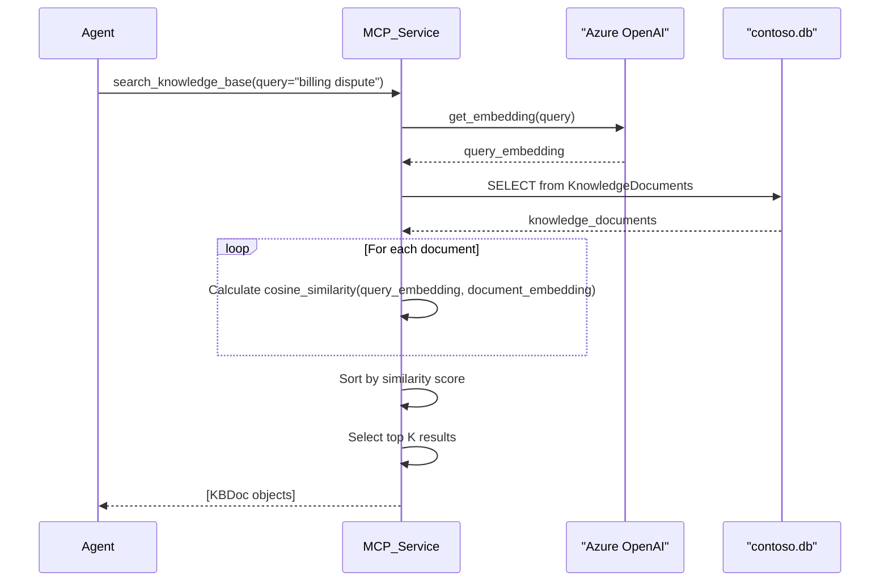

Sources: [scenarios/contoso_internet/backend_services/mcp_service.py:395-414](), [scenarios/contoso_internet/backend_services/mcp_service.py:38-52]()

## Data Models and Schemas

The database tables are represented as Pydantic models in the MCP service, providing strong typing for API responses:

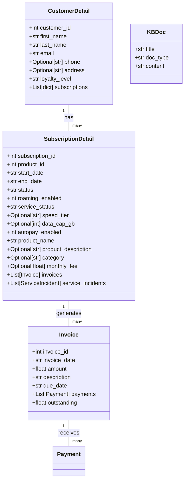

Sources: [scenarios/contoso_internet/backend_services/mcp_service.py:58-175]()

## Sample Knowledge Base Content

The knowledge base contains company policies, procedures, troubleshooting guides, and FAQs. Examples include:

| Title | Type | Purpose |
|-------|------|---------|
| Invoice Adjustment Policy | Policy | Describes how customers can request and receive adjustments on their billing statements |
| Troubleshooting Slow Internet | Troubleshooting | Steps to diagnose and resolve slow internet performance issues |
| International Roaming Options | FAQ | Explains how travelers can use roaming packages abroad |
| Account Unlock Procedure | Procedure | Verification steps to unlock an account after failed login attempts |
| Data Overage Policy | Policy | Rules for handling data usage that exceeds plan limits |

The knowledge base plays a critical role in enabling AI agents to provide context-specific responses based on company policies and procedures.

Sources: [scenarios/contoso_internet/backend_services/data/kb.json:1-104]()

## Database Initialization and Data Generation

The database is created and populated using the `create_db.py` script, which:

1. Defines table schemas and creates tables with appropriate foreign key relationships
2. Creates indexes for efficient querying
3. Populates reference data (products, promotions)
4. Generates random customer data (250 random customers)
5. Creates 9 deterministic "challenge scenarios" with specific customer data
6. Loads knowledge base documents from `kb.json` and creates embeddings

The script ensures deterministic data generation using fixed random seeds, making the scenarios reproducible.

Sources: [scenarios/contoso_internet/backend_services/data/create_db.py:15-27](), [scenarios/contoso_internet/backend_services/data/create_db.py:257-343]()

## Conclusion

The Contoso Internet database schema and knowledge base form the foundation of the simulated telecommunications company scenario. The SQLite database stores structured customer, subscription, and billing data, while the knowledge base contains company policies and procedures. Together, they enable AI agents to access information, answer questions, and solve customer problems within the simulated business context.

For information about how the MCP service API interacts with this database, see [MCP Service API](#2.1.2), and for information about how agents use this data, see [Agent Patterns and Implementations](#2.2).

---

# Page: MCP Service API

# MCP Service API

<details>
<summary>Relevant source files</summary>

The following files were used as context for generating this wiki page:

- [scenarios/contoso_internet/README.md](scenarios/contoso_internet/README.md)
- [scenarios/contoso_internet/backend_services/.env.sample](scenarios/contoso_internet/backend_services/.env.sample)
- [scenarios/contoso_internet/backend_services/Dockerfile.mcp](scenarios/contoso_internet/backend_services/Dockerfile.mcp)
- [scenarios/contoso_internet/backend_services/README.md](scenarios/contoso_internet/backend_services/README.md)
- [scenarios/contoso_internet/backend_services/data/contoso.db](scenarios/contoso_internet/backend_services/data/contoso.db)
- [scenarios/contoso_internet/backend_services/data/create_db.py](scenarios/contoso_internet/backend_services/data/create_db.py)
- [scenarios/contoso_internet/backend_services/data/customer_scenarios.md](scenarios/contoso_internet/backend_services/data/customer_scenarios.md)
- [scenarios/contoso_internet/backend_services/data/kb.json](scenarios/contoso_internet/backend_services/data/kb.json)
- [scenarios/contoso_internet/backend_services/mcp_service.py](scenarios/contoso_internet/backend_services/mcp_service.py)
- [scenarios/contoso_internet/backend_services/requirements.txt](scenarios/contoso_internet/backend_services/requirements.txt)
- [scenarios/contoso_internet/backend_services/test_mcp_service.py](scenarios/contoso_internet/backend_services/test_mcp_service.py)

</details>


This document details the Model Context Protocol (MCP) Service API that powers the Contoso Internet scenario. The MCP Service provides a structured interface for AI agents to access customer information, subscription details, billing data, and knowledge resources within the Contoso telecommunications business ecosystem.

Sources: [scenarios/contoso_internet/backend_services/README.md:34-44]()

## 1. Overview

The MCP Service API is a FastMCP-based backend that exposes a collection of typed tools designed for consumption by AI agents. It acts as the bridge between agent implementations and the Contoso database, providing a structured and secure way to query and manipulate customer data.

The service follows the Model Context Protocol pattern, which allows AI agents to interact with backend systems through well-defined tools with clear input/output schemas.

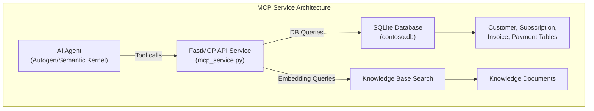

**MCP Service Components Diagram**

Sources: [scenarios/contoso_internet/backend_services/mcp_service.py:8-16](), [scenarios/contoso_internet/backend_services/README.md:34-44]()

## 2. Service Initialization

The MCP Service is initialized using the FastMCP framework, which creates a service with defined tools and authentication scopes.

```python
mcp = FastMCP(
    name="Contoso Customer API as Tools",
    instructions=(
        "All customer, billing and knowledge data is accessible ONLY via the declared "
        "tools below. Return values follow the pydantic schemas. Always call the most "
        "specific tool that answers the user's question."
    ),
)
```

The service includes:
- SQLite database connection management
- Optional OpenAI embedding integration for knowledge base searches
- Error handling for both expected and unexpected conditions

Sources: [scenarios/contoso_internet/backend_services/mcp_service.py:8-46]()

## 3. Data Models

The MCP Service defines Pydantic models to structure data and enforce type safety. These models are used for both request parameters and response schemas.

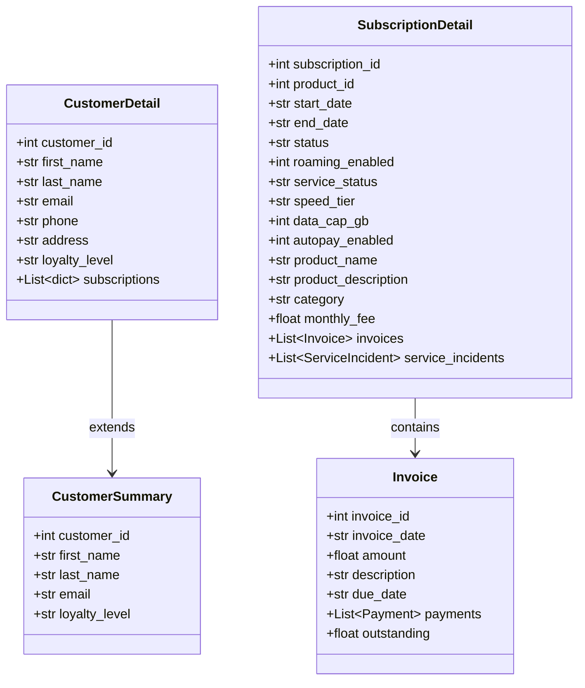

**Core Data Models Diagram**

The service defines a total of 16 Pydantic models, including:
- `CustomerSummary`, `CustomerDetail`: Customer information models
- `SubscriptionDetail`: Detailed subscription information with related invoices and incidents
- `Invoice`, `Payment`: Billing-related models
- `Promotion`: Product promotions and discounts
- `KBDoc`, `KBSearchParams`: Knowledge base search models
- `SecurityLog`, `Order`, `DataUsageRecord`: Additional customer data models
- `SupportTicket`: Customer support information

Sources: [scenarios/contoso_internet/backend_services/mcp_service.py:55-187]()

## 4. API Endpoints (Tools)

The MCP Service exposes 18 tool endpoints for different operations. Each tool has a defined purpose, input schema, and output schema.

```mermaid
graph TD
    subgraph "Customer Information Tools"
        get_all_customers["get_all_customers()"]
        get_customer_detail["get_customer_detail(customer_id)"]
    end
    
    subgraph "Subscription & Billing Tools"
        get_subscription_detail["get_subscription_detail(subscription_id)"]
        get_invoice_payments["get_invoice_payments(invoice_id)"]
        pay_invoice["pay_invoice(invoice_id, amount, method)"]
        get_data_usage["get_data_usage(subscription_id, start_date, end_date, aggregate)"]
        get_billing_summary["get_billing_summary(customer_id)"]
        update_subscription["update_subscription(subscription_id, update)"]
    end
    
    subgraph "Promotions & Products Tools"
        get_promotions["get_promotions()"]
        get_eligible_promotions["get_eligible_promotions(customer_id)"]
        get_products["get_products(category)"]
        get_product_detail["get_product_detail(product_id)"]
    end
    
    subgraph "Support & Security Tools"
        search_knowledge_base["search_knowledge_base(query, topk)"]
        get_security_logs["get_security_logs(customer_id)"]
        get_customer_orders["get_customer_orders(customer_id)"]
        get_support_tickets["get_support_tickets(customer_id, open_only)"]
        create_support_ticket["create_support_ticket(...)"]
        unlock_account["unlock_account(customer_id)"]
    end
```

**MCP Service Tools Diagram**

### 4.1 Customer Information Tools

| Tool Name | Description | Parameters | Return Type |
|-----------|-------------|------------|-------------|
| `get_all_customers` | Lists all customers with basic info | None | `List[CustomerSummary]` |
| `get_customer_detail` | Gets full customer profile including subscriptions | `customer_id: int` | `CustomerDetail` |

### 4.2 Subscription & Billing Tools

| Tool Name | Description | Parameters | Return Type |
|-----------|-------------|------------|-------------|
| `get_subscription_detail` | Gets detailed subscription info including invoices and service incidents | `subscription_id: int` | `SubscriptionDetail` |
| `get_invoice_payments` | Gets payment list for a specific invoice | `invoice_id: int` | `List[Payment]` |
| `pay_invoice` | Records a payment for a given invoice | `invoice_id: int, amount: float, method: str` | `Dict[str, Any]` |
| `get_data_usage` | Gets daily data usage records for a subscription | `subscription_id: int, start_date: str, end_date: str, aggregate: bool` | `List[DataUsageRecord]` or `Dict[str, Any]` |
| `get_billing_summary` | Gets a summary of what customer owes across all subscriptions | `customer_id: int` | `Dict[str, Any]` |
| `update_subscription` | Updates one or more fields on a subscription | `subscription_id: int, update: SubscriptionUpdateRequest` | `Dict[str, Any]` |

### 4.3 Promotions & Products Tools

| Tool Name | Description | Parameters | Return Type |
|-----------|-------------|------------|-------------|
| `get_promotions` | Lists all active promotions | None | `List[Promotion]` |
| `get_eligible_promotions` | Gets promotions eligible for a specific customer | `customer_id: int` | `List[Promotion]` |
| `get_products` | Lists available products with optional category filter | `category: Optional[str]` | `List[Dict[str, Any]]` |
| `get_product_detail` | Gets detailed info for a specific product | `product_id: int` | `Dict[str, Any]` |

### 4.4 Support & Security Tools

| Tool Name | Description | Parameters | Return Type |
|-----------|-------------|------------|-------------|
| `search_knowledge_base` | Performs semantic search on policy/procedure documents | `query: str, topk: Optional[int]` | `List[KBDoc]` |
| `get_security_logs` | Gets security events for a customer | `customer_id: int` | `List[SecurityLog]` |
| `get_customer_orders` | Gets all orders placed by a customer | `customer_id: int` | `List[Order]` |
| `get_support_tickets` | Gets support tickets for a customer | `customer_id: int, open_only: Optional[bool]` | `List[SupportTicket]` |
| `create_support_ticket` | Creates a new support ticket | Multiple parameters | `SupportTicket` |
| `unlock_account` | Unlocks a customer account | `customer_id: int` | `Dict[str, Any]` |

Sources: [scenarios/contoso_internet/backend_services/mcp_service.py:204-594](), [scenarios/contoso_internet/README.md:27-48]()

## 5. Database Interaction

The MCP Service interacts with a SQLite database (`contoso.db`) that contains customer data, subscriptions, billing information, and more. The database connection is managed through a helper function.

```python
def get_db() -> sqlite3.Connection:
    db = sqlite3.connect(DB_PATH)
    db.row_factory = sqlite3.Row
    return db
```

The SQLite database schema contains tables for:
- Customers
- Products
- Subscriptions
- Invoices
- Payments
- Promotions
- Security Logs
- Orders
- Support Tickets
- Data Usage
- Service Incidents
- Knowledge Documents

```mermaid
erDiagram
    Customers ||--o{ Subscriptions : has
    Customers ||--o{ SecurityLogs : has
    Customers ||--o{ Orders : places
    Customers ||--o{ SupportTickets : creates
    
    Subscriptions ||--o{ Invoices : generates
    Subscriptions ||--o{ DataUsage : records
    Subscriptions ||--o{ ServiceIncidents : experiences
    
    Products ||--o{ Subscriptions : defines
    Products ||--o{ Promotions : offers
    Products ||--o{ Orders : contains
    
    Invoices ||--o{ Payments : receives
    
    Subscriptions ||--o{ SupportTickets : relates_to
```

**Database Entity Relationship Diagram**

Each tool performs specific SQL queries to retrieve or modify data in the database, providing a controlled interface for AI agents to interact with the underlying data.

Sources: [scenarios/contoso_internet/backend_services/data/create_db.py:62-252](), [scenarios/contoso_internet/backend_services/mcp_service.py:22-25]()

## 6. Knowledge Base Search

The MCP Service includes semantic search functionality for the knowledge base, allowing AI agents to find relevant policy documents, troubleshooting guides, and other information.

```python
@mcp.tool(description="Semantic search on policy / procedure knowledge documents")
def search_knowledge_base(params: KBSearchParams) -> List[KBDoc]:
    query_emb = get_embedding(params.query)
    db = get_db()
    rows = db.execute("SELECT title, doc_type, content, topic_embedding FROM KnowledgeDocuments").fetchall()
    db.close()
    scored = []
    for r in rows:
        try:
            emb = json.loads(r["topic_embedding"])
            sim = cosine_similarity(query_emb, emb)
            scored.append((sim, r))
        except Exception:
            continue
    scored.sort(reverse=True, key=lambda x: x[0])
    best = scored[: params.topk]
    return [
        KBDoc(title=r["title"], doc_type=r["doc_type"], content=r["content"])
        for sim, r in best
    ]
```

The service uses OpenAI embeddings (when available) to perform semantic similarity between the query and knowledge documents. It falls back to a dummy embedding if Azure OpenAI credentials are not configured.

The knowledge base contains documents on various topics:
- Billing policies and procedures
- Troubleshooting guides
- Service policies
- International roaming information
- Account management
- Promotion eligibility
- Return policies

Sources: [scenarios/contoso_internet/backend_services/mcp_service.py:394-414](), [scenarios/contoso_internet/backend_services/data/kb.json:1-105]()

## 7. Integration with AI Agents

The MCP Service is designed to be consumed by AI agents built with frameworks like Autogen and Semantic Kernel. These agents can call the tools exposed by the service to access and manipulate Contoso data.

```mermaid
sequenceDiagram
    participant User
    participant Agent as "AI Agent<br>(Autogen/SK)"
    participant MCP as "MCP Service"
    participant DB as "Contoso DB"
    participant KB as "Knowledge Base"
    
    User->>Agent: Ask question about account
    Agent->>MCP: Call get_customer_detail(id)
    MCP->>DB: Query customer data
    DB->>MCP: Return customer data
    MCP->>Agent: Return CustomerDetail

    Agent->>MCP: Call get_subscription_detail(id)
    MCP->>DB: Query subscription data
    DB->>MCP: Return subscription data
    MCP->>Agent: Return SubscriptionDetail

    Agent->>MCP: Call search_knowledge_base(query)
    MCP->>KB: Semantic search
    KB->>MCP: Return relevant documents
    MCP->>Agent: Return KBDocs

    Agent->>User: Synthesized response
```

**Agent Integration Flow Diagram**

The agents can use the tools to:
1. Retrieve customer information
2. Check subscription and billing details
3. Process payments
4. Search the knowledge base for relevant information
5. Update subscriptions or create support tickets
6. Handle security-related tasks

The tool-based approach ensures that agents only access data through well-defined interfaces, enhancing security and improving agent reasoning by providing structured data.

Sources: [scenarios/contoso_internet/README.md:52-139]()

## 8. Deployment and Configuration

The MCP Service can be deployed locally, in Docker containers, or to Azure Container Apps.

### 8.1 Environment Configuration

The service uses environment variables for configuration:

| Variable | Purpose | Example Value |
|----------|---------|---------------|
| `AZURE_OPENAI_ENDPOINT` | Azure OpenAI endpoint | `https://your-resource.openai.azure.com` |
| `AZURE_OPENAI_API_KEY` | API key for embedding/chat | (secret) |
| `AZURE_OPENAI_CHAT_DEPLOYMENT` | Chat deployment name | `gpt-4o` |
| `AZURE_OPENAI_API_VERSION` | API version | `2025-03-01-preview` |
| `AZURE_OPENAI_EMBEDDING_DEPLOYMENT` | Embedding deployment name | `text-embedding-ada-002` |
| `DB_PATH` | SQLite db location | `data/contoso.db` |

### 8.2 Running Locally

To run the service locally:

1. Install dependencies: `pip install -r requirements.txt`
2. Create the `.env` file from `.env.sample`
3. Run the service: `python mcp_service.py`

### 8.3 Docker Deployment

To deploy using Docker:

```bash
docker build -f Dockerfile.mcp -t mcp-backend .
docker run -it -p 8000:8000 --env-file .env mcp-backend
```

### 8.4 Azure Container Apps Deployment

The service includes a deployment script (`deploy_mcp.sh`) for deploying to Azure Container Apps.

Sources: [scenarios/contoso_internet/backend_services/README.md:79-117](), [scenarios/contoso_internet/backend_services/.env.sample:1-8](), [scenarios/contoso_internet/backend_services/Dockerfile.mcp:1-22]()

## 9. Testing

The repository includes a test script (`test_mcp_service.py`) for smoke-testing the MCP Service API. The script tests various tool endpoints, including both read-only and mutating operations.

The test script uses the FastMCP Client to call tools and verify their functionality:

```python
async def test_customer_detail(client: Client, cust_id: int):
    title = f"get_customer_detail({cust_id})"
    try:
        res = await client.call_tool("get_customer_detail", {"customer_id": cust_id})
        data = _to_native(res[0])
        print_result(title, isinstance(data, dict), data)
    except Exception as e:
        print_result(title, False, error=e)
```

The tests cover:
- Customer information retrieval
- Subscription and billing operations
- Promotion and product lookups
- Knowledge base searches
- Security and support functions

Sources: [scenarios/contoso_internet/backend_services/test_mcp_service.py:1-229]()

## 10. Summary

The MCP Service API provides a comprehensive tool-based interface for AI agents to interact with Contoso's customer data and knowledge base. By exposing structured endpoints with clear input/output schemas, it enables agents to perform a wide range of operations while maintaining data integrity and security.

Key capabilities include:
- Customer information retrieval
- Subscription and billing management
- Promotion eligibility checking
- Knowledge base semantic search
- Security log viewing and account unlocking
- Support ticket creation and management

The service is designed to be consumed by AI agents built with frameworks like Autogen and Semantic Kernel, providing them with the tools needed to assist Contoso's customers with their telecommunications service needs.

Sources: [scenarios/contoso_internet/backend_services/README.md:1-147]()

---

# Page: Agent Patterns and Implementations

# Agent Patterns and Implementations

<details>
<summary>Relevant source files</summary>

The following files were used as context for generating this wiki page:

- [scenarios/contoso_internet/README.md](scenarios/contoso_internet/README.md)
- [scenarios/contoso_internet/agents/semantic_kernel/single_agent/sk_chat_agent.py](scenarios/contoso_internet/agents/semantic_kernel/single_agent/sk_chat_agent.py)
- [scenarios/contoso_internet/applications/README.md](scenarios/contoso_internet/applications/README.md)
- [scenarios/contoso_internet/applications/requirements.txt](scenarios/contoso_internet/applications/requirements.txt)
- [scenarios/contoso_internet/backend_services/.env.sample](scenarios/contoso_internet/backend_services/.env.sample)
- [scenarios/contoso_internet/backend_services/README.md](scenarios/contoso_internet/backend_services/README.md)
- [scenarios/contoso_internet/backend_services/data/contoso.db](scenarios/contoso_internet/backend_services/data/contoso.db)
- [scenarios/contoso_internet/backend_services/data/create_db.py](scenarios/contoso_internet/backend_services/data/create_db.py)
- [scenarios/contoso_internet/backend_services/data/customer_scenarios.md](scenarios/contoso_internet/backend_services/data/customer_scenarios.md)
- [scenarios/contoso_internet/backend_services/data/kb.json](scenarios/contoso_internet/backend_services/data/kb.json)
- [scenarios/contoso_internet/backend_services/mcp_service.py](scenarios/contoso_internet/backend_services/mcp_service.py)

</details>


## Purpose and Scope

This document provides detailed technical information about the agent patterns and their implementations within the Contoso Internet scenario of the OpenAI Workshop. It covers the architectural patterns for AI agents, their specific implementations using different frameworks, and how they integrate with the Model Context Protocol (MCP) service to access backend tools and data.

For details about the FastMCP Backend Services that these agents interact with, see [FastMCP Backend Services](#2.1).

Sources: [scenarios/contoso_internet/README.md:53-64]()

## Agent Patterns Overview

The Contoso Internet scenario implements three primary agent design patterns, each with different capabilities and complexity levels:

```mermaid
flowchart TD
    subgraph "Single Agent Pattern"
        SA["Single Agent"] --> |"Uses multiple tools"| Tools1["Backend Tools"]
        User1["User"] --> SA
        SA --> User1
    end

    subgraph "Multi-Domain Agent Pattern"
        CA["Coordinator Agent"] --> |"Routes to"| DA1["Domain Specialist 1"]
        CA --> |"Routes to"| DA2["Domain Specialist 2"] 
        CA --> |"Routes to"| DA3["Domain Specialist 3"]
        
        DA1 --> |"Uses"| Tools2["Backend Tools"]
        DA2 --> |"Uses"| Tools2
        DA3 --> |"Uses"| Tools2
        
        User2["User"] --> CA
        DA1 --> CA
        DA2 --> CA
        DA3 --> CA
        CA --> User2
    end

    subgraph "Collaborative Multi-Agent Pattern"
        PA["Analysis & Planning Agent"] --> |"Delegates to"| FA1["Functional Specialist 1"]
        PA --> |"Delegates to"| FA2["Functional Specialist 2"]
        PA --> |"Delegates to"| FA3["Functional Specialist 3"]
        
        FA1 --> |"Uses"| Tools3["Backend Tools"]
        FA2 --> |"Uses"| Tools3
        FA3 --> |"Uses"| Tools3
        FA1 --> |"Reports to"| PA
        FA2 --> |"Reports to"| PA
        FA3 --> |"Reports to"| PA
        
        User3["User"] --> PA
        PA --> User3
    end
```

Sources: [scenarios/contoso_internet/README.md:53-64](), [scenarios/contoso_internet/README.md:68-86]()

## Single Agent Pattern

The Intelligent Single Agent pattern involves a single AI agent that handles the entire conversation with the user, from initial request through resolution. This agent has access to all the necessary tools to query backend systems and knowledge bases.

### Components and Responsibilities

```mermaid
flowchart TD
    User["User"] --> SA["Single Agent"]
    SA --> User
    
    SA --> |"get_customer_detail()"| MCP["MCP Service"]
    SA --> |"get_subscription_detail()"| MCP
    SA --> |"search_knowledge_base()"| MCP
    SA --> |"Other tool calls"| MCP
    
    MCP --> |"Customer data"| DB[(Contoso DB)]
    MCP --> |"KB searches"| KB[("Knowledge Base")]
    
    subgraph "Memory Implementation"
        SM["Short-term memory"] --> |"Stores"| Session["Session context"]
    end
    
    SA --> SM
```

### Key Characteristics

- **End-to-end responsibility**: The agent analyzes customer requests, determines the required backend data, queries the appropriate systems, and synthesizes responses.
- **Tool utilization**: Directly calls MCP service tools like `get_customer_detail()`, `get_subscription_detail()`, and `search_knowledge_base()`.
- **Memory implementation**: Maintains short-term memory for session context during the interaction.

Sources: [scenarios/contoso_internet/README.md:68-81](), [scenarios/contoso_internet/agents/semantic_kernel/single_agent/sk_chat_agent.py:16-82]()

## Multi-Domain Agent Pattern

The Multi-Domain Agent pattern uses a Coordinator Agent (router) that analyzes customer requests and routes them to domain-specific specialist agents. This architecture enables domain-focused expertise while maintaining a seamless user experience.

### Components and Responsibilities

```mermaid
flowchart TD
    User["User"] <--> CA["Coordinator Agent\n(Router)"]
    
    CA <--> |"Routes billing\nqueries"| CRM["CRM & Billing Agent"]
    CA <--> |"Routes product\nqueries"| PP["Product & Promotions Agent"]
    CA <--> |"Routes security\nqueries"| SA["Security & Authentication Agent"]
    
    CRM --> |"get_customer_detail()\nget_subscription_detail()\nget_invoice_payments()"| MCP["MCP Service"]
    PP --> |"get_promotions()\nget_eligible_promotions()\nget_products()"| MCP
    SA --> |"get_security_logs()\nunlock_account()"| MCP
    
    MCP --> DB[(Contoso DB)]
    MCP --> KB[("Knowledge Base")]
```

### Key Characteristics

- **Coordinator Agent**: Performs lightweight domain detection and request routing without complex planning.
- **Domain Specialists**:
  - **CRM & Billing Agent**: Handles customer profile data, account details, billing, invoices, and subscription information.
  - **Product & Promotions Agent**: Manages products, promotions, discounts, and subscription plan queries.
  - **Security & Authentication Agent**: Specializes in account security, authentication issues, and account unlock procedures.
- **Handoff mechanism**: Specialist agents return control to the Coordinator when the user's request moves beyond their domain.

Sources: [scenarios/contoso_internet/README.md:87-109]()

## Collaborative Multi-Agent System Pattern

The Collaborative Multi-Agent System uses a more sophisticated approach where multiple agents collaborate to address complex customer requests. An Analysis & Planning Agent orchestrates the process, delegating subtasks to specialists and integrating their outputs.

### Components and Responsibilities

```mermaid
flowchart TD
    User["User"] <--> PA["Analysis & Planning Agent"]
    
    PA <--> |"Delegates billing tasks"| CRM["CRM & Billing Agent"]
    PA <--> |"Delegates product tasks"| PP["Product & Promotions Agent"]
    PA <--> |"Delegates security tasks"| SA["Security & Authentication Agent"]
    
    CRM --> |"Queries structured data"| MCP["MCP Service"]
    PP --> |"Queries structured data"| MCP
    SA --> |"Queries structured data"| MCP
    
    CRM --> |"Consults"| KB[("Knowledge Base")]
    PP --> |"Consults"| KB
    SA --> |"Consults"| KB
    
    MCP --> DB[(Contoso DB)]
    MCP --> KB
    
    subgraph "Memory Implementation"
        SCM["Shared Context Memory"]
        SCM --> |"Stores"| Plans["Task plans"]
        SCM --> |"Stores"| Status["Status updates"]
        SCM --> |"Stores"| Comms["Inter-agent communication"]
    end
    
    PA --> SCM
    CRM --> SCM
    PP --> SCM
    SA --> SCM
```

### Key Characteristics

- **Analysis & Planning Agent**: Orchestrates the process by parsing requests, identifying subtasks, delegating work, and synthesizing final responses.
- **Functional Specialists**:
  - **CRM & Billing Agent**: Accesses CRM and billing backend data.
  - **Product & Promotions Agent**: Accesses product and promotional information.
  - **Security & Authentication Agent**: Handles security logs and authentication issues.
- **Knowledge Base Integration**: All specialist agents independently access the Knowledge Base for policies, procedures, and guidelines.
- **Memory Implementation**:
  - **Individual Agent Memory**: Short-term context storage for each agent.
  - **Shared Context Memory**: Facilitates coordination between agents through shared task plans and status updates.

Sources: [scenarios/contoso_internet/README.md:114-139]()

## Implementation Frameworks

The Contoso Internet scenario includes implementations of these agent patterns using two frameworks: Autogen and Semantic Kernel.

```mermaid
flowchart LR
    subgraph "Implementation Frameworks"
        subgraph "Autogen"
            ASA["Single Agent\nImplementation"]
            AMA["Multi-Domain Agent\nImplementation"]
            ACA["Collaborative Agent\nImplementation"]
            
            ASA --> |"Uses"| ALG["loop_agent"]
            AMA --> |"Uses"| ACC["collaborative_multi_agent_round_robin"]
            ACA --> |"Uses"| ACS["collaborative_multi_agent_selector_group"]
            ACA --> |"Uses"| AR["reflection_agent"]
        end
        
        subgraph "Semantic Kernel"
            SKA["SK Chat Agent\nImplementation"]
            
            SKA --> |"Uses"| CCHA["ChatCompletionAgent"]
            SKA --> |"Uses"| CHAT["ChatHistoryAgentThread"]
        end
    end
    
    ASA --> |"Integrates with"| MCP["MCP Service"]
    AMA --> |"Integrates with"| MCP
    ACA --> |"Integrates with"| MCP
    SKA --> |"Integrates with"| MCP
    
    MCP --> |"Tool calls"| MCPT["MCP Tools:\nget_customer_detail()\nget_subscription_detail()\nsearch_knowledge_base()\netc."]
```

### Autogen Implementations

Autogen provides several agent implementations for the patterns described above:

- **Single Agent**: Implemented as a loop agent that processes user input and generates responses in a single agent context.
- **Multi-Domain Agent**: Implemented as a collaborative multi-agent using a round-robin approach for domain specialists.
- **Collaborative Multi-Agent**: Implemented as a collaborative multi-agent using a selector group pattern for more complex reasoning.
- **Reflection Agent**: A special implementation that adds self-reflection capabilities to improve reasoning.

The agent module can be selected via environment configuration:

```
AGENT_MODULE="agents.autogen.multi_agent.collaborative_multi_agent_selector_group"
```

Sources: [scenarios/contoso_internet/applications/README.md:68-74]()

### Semantic Kernel Implementation

The Semantic Kernel implementation uses the `ChatCompletionAgent` and `ChatHistoryAgentThread` classes to create a single agent implementation:

- The agent is initialized with the Azure OpenAI service and the MCP plugin.
- Conversation state is managed through a thread that can be persisted between sessions.
- The agent uses the MCP tools to query backend services and knowledge base.

Sources: [scenarios/contoso_internet/agents/semantic_kernel/single_agent/sk_chat_agent.py:16-82]()

## Agent-MCP Integration

Agents interact with the Model Context Protocol (MCP) service to access backend tools and data. This service provides a standardized way for agents to query customer information, billing data, knowledge base content, and more.

```mermaid
sequenceDiagram
    participant User
    participant Agent as "AI Agent"
    participant MCP as "MCP Service"
    participant DB as "Contoso DB"
    participant KB as "Knowledge Base"
    
    User->>Agent: Submits request
    
    Agent->>MCP: get_customer_detail(customer_id)
    MCP->>DB: Query customer data
    DB->>MCP: Return customer details
    MCP->>Agent: Return customer information
    
    Agent->>MCP: get_subscription_detail(subscription_id)
    MCP->>DB: Query subscription data
    DB->>MCP: Return subscription details
    MCP->>Agent: Return subscription information
    
    Agent->>MCP: search_knowledge_base(query, topk)
    MCP->>KB: Semantic search
    KB->>MCP: Return relevant documents
    MCP->>Agent: Return knowledge base results
    
    Agent->>User: Generate comprehensive response
```

### Available MCP Tools

The MCP service exposes a rich set of tools that agents can use:

| Tool Name | Description | Input |
|-----------|-------------|-------|
| `get_all_customers` | List all customers with basic info | None |
| `get_customer_detail` | Get a full customer profile including subscriptions | `customer_id` |
| `get_subscription_detail` | Detailed subscription view with invoices and incidents | `subscription_id` |
| `get_invoice_payments` | Return invoice-level payments list | `invoice_id` |
| `pay_invoice` | Record a payment for an invoice | `invoice_id`, `amount`, `method` |
| `get_data_usage` | Daily data-usage records for a subscription | `subscription_id`, `start_date`, `end_date`, `aggregate` |
| `get_promotions` | List every active promotion | None |
| `get_eligible_promotions` | Promotions eligible for a given customer | `customer_id` |
| `search_knowledge_base` | Semantic search on knowledge documents | `query`, `topk` |
| `get_security_logs` | Security events for a customer | `customer_id` |
| `get_customer_orders` | All orders placed by a customer | `customer_id` |
| `get_support_tickets` | Retrieve support tickets for a customer | `customer_id` |
| `create_support_ticket` | Create a new support ticket | Multiple parameters |
| `get_products` | List or search available products | Optional parameters |
| `get_product_detail` | Return a single product by ID | `product_id` |
| `update_subscription` | Update subscription fields | Multiple parameters |
| `unlock_account` | Unlock a customer account | `customer_id` |
| `get_billing_summary` | Get a customer's current amount owed | `customer_id` |

Sources: [scenarios/contoso_internet/README.md:27-49](), [scenarios/contoso_internet/backend_services/mcp_service.py:8-16](), [scenarios/contoso_internet/backend_services/mcp_service.py:206-321]()

## Configuration and Usage

Agents are configured and selected through environment variables in the application's `.env` file.

### Agent Selection

The agent implementation is specified using the `AGENT_MODULE` environment variable:

```
# Single agent implementation
AGENT_MODULE="agents.autogen.single_agent.loop_agent"

# Multi-domain agent implementation
AGENT_MODULE="agents.autogen.multi_agent.collaborative_multi_agent_round_robin"

# Collaborative multi-agent implementation
AGENT_MODULE="agents.autogen.multi_agent.collaborative_multi_agent_selector_group"

# Reflection agent implementation
AGENT_MODULE="agents.autogen.multi_agent.reflection_agent"
```

### MCP Service Configuration

The MCP service is configured with:

```
MCP_SERVER_URI="https://mcp-backend-service.whitefield-2abc17d9.westus.azurecontainerapps.io/sse"
```

### Azure OpenAI Configuration

The agents require Azure OpenAI credentials and configuration:

```
AZURE_OPENAI_ENDPOINT="https://<your-endpoint>.openai.azure.com"
AZURE_OPENAI_API_KEY="<your-azure-api-key>"
AZURE_OPENAI_CHAT_DEPLOYMENT="gpt-4o"
AZURE_OPENAI_API_VERSION="2025-03-01-preview"
AZURE_OPENAI_EMBEDDING_DEPLOYMENT="text-embedding-ada-002"
```

Sources: [scenarios/contoso_internet/applications/README.md:62-75](), [scenarios/contoso_internet/backend_services/.env.sample:1-7]()

## Customer Interaction Examples

Here are examples of the types of customer interactions these agents can handle:

1. **Billing inquiry**: Understanding unexpectedly high invoices and explaining data overages
2. **Technical support**: Diagnosing slow internet service and checking for outages
3. **Travel preparation**: Setting up international roaming for upcoming trips
4. **Account security**: Helping with account lockouts and verification procedures
5. **Promotion eligibility**: Determining what discounts and promotions a customer qualifies for
6. **Product returns**: Explaining return policies and initiating return processes

Each of these scenarios requires the agent to use multiple tools, access relevant knowledge base articles, and synthesize a comprehensive response for the customer.

Sources: [scenarios/contoso_internet/README.md:146-235](), [scenarios/contoso_internet/backend_services/data/customer_scenarios.md:1-174]()

---

# Page: Autogen Agents

# Autogen Agents

<details>
<summary>Relevant source files</summary>

The following files were used as context for generating this wiki page:

- [scenarios/contoso_internet/backend_services/Dockerfile.mcp](scenarios/contoso_internet/backend_services/Dockerfile.mcp)
- [scenarios/contoso_internet/backend_services/deploy_azure.sh](scenarios/contoso_internet/backend_services/deploy_azure.sh)
- [scenarios/contoso_internet/backend_services/requirements.txt](scenarios/contoso_internet/backend_services/requirements.txt)
- [scenarios/contoso_internet/backend_services/test_mcp_service.py](scenarios/contoso_internet/backend_services/test_mcp_service.py)

</details>


This document provides a technical overview of the Autogen agent implementations within the Contoso Internet scenario of the OpenAI Workshop repository. It covers the architecture, implementation patterns, and integration with the Model Context Protocol (MCP) service. For information about Semantic Kernel-based agent implementations, see [Semantic Kernel Agents](#2.2.2).

## Overview

Autogen agents in this repository leverage the Microsoft Autogen framework to implement AI agents that interact with the Contoso Internet backend services. These agents utilize natural language processing capabilities to understand user queries, determine relevant actions, and generate appropriate responses, all while interfacing with the FastMCP service to access and manipulate Contoso's data.

Sources:
- [scenarios/contoso_internet/backend_services/requirements.txt:8-9]()

## Architecture and Integration

The Autogen agents serve as the intelligence layer connecting the application frontend/backend with the Contoso Internet data services. They rely on the FastMCP protocol to interact with various data sources.

```mermaid
graph TD
    User["User"] --> Frontend["Streamlit Frontend"]
    Frontend --> Backend["FastAPI Backend"]
    Backend --> AgentFactory["Agent Factory"]
    AgentFactory --> AutogenAgents["Autogen Agents"]
    
    AutogenAgents --> SingleAgent["SingleAgentPattern"]
    AutogenAgents --> MultiAgent["MultiAgentPattern"]
    
    SingleAgent --> MCPClient["FastMCP Client"]
    MultiAgent --> MCPClient
    
    MCPClient --> MCPService["FastMCP Service"]
    MCPService --> ContosoDB["Contoso Database"]
    MCPService --> KnowledgeBase["Knowledge Base"]
```

Sources:
- [scenarios/contoso_internet/backend_services/requirements.txt:8-9]()
- [scenarios/contoso_internet/backend_services/test_mcp_service.py:17-20]()

## Agent Implementation Patterns

### Single Agent Pattern

The single agent pattern is a straightforward implementation where a single Autogen agent handles the entire conversation flow.

```mermaid
sequenceDiagram
    participant User
    participant Frontend as "Streamlit Frontend"
    participant Backend as "FastAPI Backend"
    participant Agent as "Autogen SingleAgentPattern"
    participant MCP as "FastMCP Client"
    participant DB as "Contoso Database/KB"
    
    User->>Frontend: Submit query
    Frontend->>Backend: Forward query
    Backend->>Agent: Process query
    
    Agent->>MCP: Call get_customer_detail()
    MCP->>DB: Query customer data
    DB->>MCP: Return customer data
    MCP->>Agent: Return data
    
    Agent->>MCP: Call get_subscription_detail()
    MCP->>DB: Query subscription data
    DB->>MCP: Return subscription data
    MCP->>Agent: Return data
    
    Agent->>MCP: Call search_knowledge_base()
    MCP->>DB: Search relevant documents
    DB->>MCP: Return knowledge articles
    MCP->>Agent: Return data
    
    Agent->>Backend: Generate comprehensive response
    Backend->>Frontend: Return formatted response
    Frontend->>User: Display response
```

Sources:
- [scenarios/contoso_internet/backend_services/test_mcp_service.py:52-191]()

### Multi-Agent Pattern

The multi-agent pattern employs multiple specialized Autogen agents that collaborate to solve complex queries, with each agent focusing on different domains or subtasks.

```mermaid
graph TD
    Query["User Query"] --> Coordinator["CoordinatorAgent"]
    
    Coordinator --> BillingAgent["BillingSpecialistAgent"]
    Coordinator --> SubscriptionAgent["SubscriptionSpecialistAgent"]
    Coordinator --> KnowledgeAgent["KnowledgeBaseAgent"]
    
    BillingAgent --> MCPClient1["FastMCP Client"]
    SubscriptionAgent --> MCPClient2["FastMCP Client"]
    KnowledgeAgent --> MCPClient3["FastMCP Client"]
    
    MCPClient1 --> BillingTools["billing_tools"]
    MCPClient2 --> SubscriptionTools["subscription_tools"]
    MCPClient3 --> KBTools["kb_tools"]
    
    BillingTools --> get_billing_summary["get_billing_summary()"]
    BillingTools --> get_customer_orders["get_customer_orders()"]
    
    SubscriptionTools --> get_subscription_detail["get_subscription_detail()"]
    SubscriptionTools --> update_subscription["update_subscription()"]
    
    KBTools --> search_knowledge_base["search_knowledge_base()"]
    
    BillingAgent --> Coordinator
    SubscriptionAgent --> Coordinator
    KnowledgeAgent --> Coordinator
    
    Coordinator --> ResponseAgent["ResponseSynthesisAgent"]
    ResponseAgent --> FinalResponse["Final Response"]
```

Sources:
- [scenarios/contoso_internet/backend_services/test_mcp_service.py:52-191]()

## MCP Service Integration

Autogen agents in this implementation rely heavily on the FastMCP service to access the Contoso data ecosystem. The integration is facilitated through the FastMCP client, which allows agents to call various tools.

### Available MCP Tools

The following table lists the key tools that Autogen agents can leverage through the MCP service:

| Tool Name | Purpose | Parameters | Return Type |
|-----------|---------|------------|-------------|
| `get_all_customers` | Retrieves list of all customers | None | List[Dict] |
| `get_customer_detail` | Gets detailed info for a customer | `customer_id` | Dict |
| `get_subscription_detail` | Gets subscription information | `subscription_id` | Dict |
| `get_promotions` | Lists available promotions | None | List |
| `get_eligible_promotions` | Gets promotions for a customer | `customer_id` | List |
| `search_knowledge_base` | Searches KB for relevant articles | `query`, `topk` | List |
| `get_security_logs` | Retrieves security logs | `customer_id` | List |
| `get_customer_orders` | Gets customer order history | `customer_id` | List |
| `get_data_usage` | Retrieves data usage metrics | `subscription_id`, `start_date`, `end_date`, `aggregate` | Dict/List |
| `get_billing_summary` | Gets billing summary | `customer_id` | Dict |
| `update_subscription` | Updates subscription properties | `subscription_id`, `update` | Dict |
| `unlock_account` | Unlocks a locked account | `customer_id` | Dict/String |

Sources:
- [scenarios/contoso_internet/backend_services/test_mcp_service.py:53-191]()

## Technical Implementation Details

```mermaid
flowchart TD
    subgraph "Autogen Agent Implementation"
        AgentConfig["AgentConfig"]
        AssistantAgent["AssistantAgent"]
        UserProxyAgent["UserProxyAgent"]
        GroupChat["GroupChat"]
        Manager["GroupChatManager"]
        
        AgentConfig --> AssistantAgent
        AgentConfig --> UserProxyAgent
        AssistantAgent --> GroupChat
        UserProxyAgent --> GroupChat
        GroupChat --> Manager
    end
    
    subgraph "MCP Integration"
        MCPClient["FastMCP.Client"]
        ToolRegistration["register_mcp_tools()"]
        MCPTools["MCP Tool Definitions"]
        
        MCPClient --> ToolRegistration
        ToolRegistration --> MCPTools
        MCPTools --> AssistantAgent
    end
    
    subgraph "Deployment"
        Docker["Docker Container"]
        MCPService["MCP Service Container"]
        AzureDeployment["Azure Container Apps"]
        
        Docker --> MCPService
        MCPService --> AzureDeployment
    end
    
    UserQuery["User Query"] --> UserProxyAgent
    Manager --> Response["Generated Response"]
```

The Autogen agents are deployed alongside the MCP service in containerized environments, which can be hosted locally via Docker or deployed to Azure Container Apps.

Sources:
- [scenarios/contoso_internet/backend_services/requirements.txt:8-9]()
- [scenarios/contoso_internet/backend_services/deploy_azure.sh:1-48]()
- [scenarios/contoso_internet/backend_services/Dockerfile.mcp:1-22]()

## Dependencies

The Autogen agent implementation relies on the following key dependencies:

- `autogen-ext[mcp]`: Extension package that facilitates integration with the Model Context Protocol
- `autogen-agentchat`: Core package for implementing conversational agents using Autogen
- `fastmcp`: Client library for interacting with FastMCP services

Sources:
- [scenarios/contoso_internet/backend_services/requirements.txt:7-9]()

## Deployment

Autogen agents, along with the MCP service they depend on, can be deployed as Docker containers or to Azure Container Apps. The deployment scripts in the repository automate this process.

The containerization approach ensures consistency across development and production environments while enabling scalability in cloud deployments.

Sources:
- [scenarios/contoso_internet/backend_services/deploy_azure.sh:1-48]()
- [scenarios/contoso_internet/backend_services/Dockerfile.mcp:1-22]()

---

# Page: Semantic Kernel Agents

# Semantic Kernel Agents

<details>
<summary>Relevant source files</summary>

The following files were used as context for generating this wiki page:

- [scenarios/contoso_internet/agents/semantic_kernel/single_agent/sk_chat_agent.py](scenarios/contoso_internet/agents/semantic_kernel/single_agent/sk_chat_agent.py)
- [scenarios/contoso_internet/applications/README.md](scenarios/contoso_internet/applications/README.md)
- [scenarios/contoso_internet/applications/requirements.txt](scenarios/contoso_internet/applications/requirements.txt)

</details>


## Purpose and Scope

This document details the Semantic Kernel (SK) agent implementations within the Contoso Internet scenario of the OpenAI Workshop repository. It covers the architecture, components, and functionality of agents built using the Semantic Kernel framework, focusing on how they integrate with the Model Context Protocol (MCP) to provide intelligent responses to user queries. For information about Autogen-based agent implementations, see [Autogen Agents](#2.2.1).

Sources: [scenarios/contoso_internet/applications/README.md:1-161]()

## Semantic Kernel Agent Architecture

Semantic Kernel agents in this project are designed to process user queries and leverage tools from the MCP service to provide comprehensive responses. These agents are built using Microsoft's Semantic Kernel framework, which provides a programming model for integrating AI models with custom tools and data sources.

```mermaid
graph TD
    subgraph "Semantic Kernel Agent System"
        agent["Agent Class"] --> baseAgent["BaseAgent"]
        agent --> chatAgent["ChatCompletionAgent"]
        chatAgent --> azureChat["AzureChatCompletion"]
        chatAgent --> mcpPlugin["MCPSsePlugin"]
        agent --> thread["ChatHistoryAgentThread"]
        
        mcpPlugin --> mcpService["MCP Service API"]
        azureChat --> azureOpenAI["Azure OpenAI Service"]
        
        thread --> stateStore["Session State Store"]
    end
    
    user["User"] --> prompt["User Prompt"]
    prompt --> agent
    agent --> response["Response"]
    response --> user
```

**Semantic Kernel Agent Components**

The implementation follows a single-agent pattern that uses Semantic Kernel's Chat Completion API with Azure OpenAI services and leverages MCP tools through the SSE plugin mechanism.

Sources: [scenarios/contoso_internet/agents/semantic_kernel/single_agent/sk_chat_agent.py:3-9](), [scenarios/contoso_internet/agents/semantic_kernel/single_agent/sk_chat_agent.py:16-21]()

## Single-Agent Implementation

The Semantic Kernel agent is implemented in the `Agent` class, which inherits from `BaseAgent` and provides asynchronous methods for agent setup and chat functionality.

```mermaid
sequenceDiagram
    participant User
    participant Application
    participant "Agent" as SKAgent
    participant "ChatCompletionAgent" as ChatAgent
    participant "MCPSsePlugin" as MCP
    participant "AzureChatCompletion" as AzureAPI
    
    User->>Application: Send prompt
    Application->>SKAgent: chat_async(prompt)
    SKAgent->>SKAgent: _setup_agent() if not initialized
    
    alt First run or not initialized
        SKAgent->>MCP: Create MCPSsePlugin
        MCP->>MCP: connect()
        SKAgent->>ChatAgent: Create ChatCompletionAgent
        SKAgent->>ChatAgent: Configure with AzureChatCompletion
        SKAgent->>ChatAgent: Add MCP plugin
    end
    
    SKAgent->>ChatAgent: get_response(prompt, thread)
    ChatAgent->>AzureAPI: Send to Azure OpenAI
    
    alt Tool use required
        ChatAgent->>MCP: Execute tool
        MCP-->>ChatAgent: Tool result
    end
    
    AzureAPI-->>ChatAgent: Model response
    ChatAgent-->>SKAgent: Response with thread
    SKAgent->>SKAgent: _setstate() to persist thread
    SKAgent->>SKAgent: append_to_chat_history()
    SKAgent-->>Application: Return response
    Application-->>User: Display response
```

### Key Components

1. **Agent Initialization:**
   - The agent is initialized with a state store and session ID
   - The actual setup of Azure OpenAI and MCP connections happens lazily on first use

2. **Agent Setup:**
   - Creates an MCPSsePlugin to connect to the MCP service
   - Initializes a ChatCompletionAgent with Azure OpenAI connection
   - Sets up a conversation thread or restores it from persisted state

3. **Chat Processing:**
   - Accepts user prompts and passes them to the ChatCompletionAgent
   - Manages conversation thread state between interactions
   - Returns formatted responses to the application layer

Sources: [scenarios/contoso_internet/agents/semantic_kernel/single_agent/sk_chat_agent.py:16-82]()

## MCP Integration

The Semantic Kernel agent integrates with the Model Context Protocol (MCP) service through the MCPSsePlugin, which allows the agent to access external tools and data sources.

```mermaid
graph TD
    subgraph "SK Agent Integration with MCP"
        agent["Agent"] --> setup["_setup_agent()"]
        setup --> mcpPlugin["MCPSsePlugin"]
        mcpPlugin --> connect["connect()"]
        
        mcpPlugin --> chatAgent["ChatCompletionAgent"]
        
        subgraph "MCP Tools Available"
            connect --> getCustomer["get_customer_detail"]
            connect --> getSubscription["get_subscription_detail"]
            connect --> getBilling["get_billing_detail"]
            connect --> searchKB["search_knowledge_base"]
        end
        
        getCustomer --> contosoDB[("Contoso Database")]
        getSubscription --> contosoDB
        getBilling --> contosoDB
        searchKB --> knowledgeBase["Knowledge Base"]
    end
```

The MCP integration works as follows:

1. The agent creates an MCPSsePlugin instance with the MCP server URI and necessary headers
2. The plugin connects to the MCP service to load available tools and prompts
3. The plugin is added to the ChatCompletionAgent, making the tools available during chat
4. When the agent encounters queries requiring external data, it can leverage MCP tools to fetch information from the Contoso database or knowledge base

Sources: [scenarios/contoso_internet/agents/semantic_kernel/single_agent/sk_chat_agent.py:28-36](), [scenarios/contoso_internet/agents/semantic_kernel/single_agent/sk_chat_agent.py:47-51]()

## Configuration and Usage

The Semantic Kernel agent is configured through environment variables and is integrated with the application layer through a common interface.

### Environment Variables

The agent requires several environment variables to function correctly:

- `AZURE_OPENAI_ENDPOINT`: The endpoint for Azure OpenAI service
- `AZURE_OPENAI_API_KEY`: API key for authentication
- `AZURE_OPENAI_CHAT_DEPLOYMENT`: The deployment name of the model to use
- `AZURE_OPENAI_API_VERSION`: API version for Azure OpenAI
- `MCP_SERVER_URI`: The URI for the MCP server
- `AGENT_MODULE`: Set to the Semantic Kernel agent module path to enable it

### Integration with Application Layer

The agent is used by the FastAPI backend, which manages chat sessions and routes user queries to the appropriate agent implementation based on the configuration.

```mermaid
graph TD
    subgraph "Application Architecture"
        frontend["Streamlit Frontend"]
        backend["FastAPI Backend"]
        agentFactory["Agent Factory"]
        skAgent["SK Agent"]
        autogenAgent["AutoGen Agent"]
        
        frontend --> backend
        backend --> agentFactory
        agentFactory --> skAgent
        agentFactory --> autogenAgent
        
        skAgent --> mcpService["MCP Service"]
        autogenAgent --> mcpService
        mcpService --> contosoDB[("Contoso Database")]
    end
    
    user["User"] --> frontend
    frontend --> user
```

The application allows you to switch between different agent implementations by simply changing the `AGENT_MODULE` environment variable, making it easy to compare different approaches.

Sources: [scenarios/contoso_internet/applications/README.md:59-75]()

## State Management

The Semantic Kernel agent implements state management to persist conversation history between user interactions:

1. The agent maintains a `ChatHistoryAgentThread` object to track the conversation
2. When a response is generated, the thread is persisted to the state store
3. When the agent is initialized for an existing session, it attempts to restore the thread from the state store
4. This allows for continuous conversations where the agent maintains context across multiple interactions

Sources: [scenarios/contoso_internet/agents/semantic_kernel/single_agent/sk_chat_agent.py:53-61](), [scenarios/contoso_internet/agents/semantic_kernel/single_agent/sk_chat_agent.py:72-74]()

## Comparison with AutoGen Agents

While both Semantic Kernel and AutoGen provide frameworks for building AI agents, they have different approaches and use cases:

| Feature | Semantic Kernel Agents | AutoGen Agents |
|---------|------------------------|----------------|
| Framework | Microsoft Semantic Kernel | Microsoft AutoGen |
| Agent Structure | Single-agent design with plugins | Supports single-agent and multi-agent architectures |
| Tool Integration | Through MCPSsePlugin | Through function-calling or custom agents |
| State Management | ChatHistoryAgentThread | Conversation history and agent state |
| Programming Model | Kernel-based with plugins | Agent-based with conversational interfaces |
| Use Case | Simpler applications with well-defined tool interactions | Complex multi-agent scenarios requiring collaboration |

The Contoso Internet scenario supports both implementations, allowing developers to choose the most appropriate framework for their specific requirements.

Sources: [scenarios/contoso_internet/applications/README.md:10-12](), [scenarios/contoso_internet/applications/requirements.txt:7-15]()

---

# Page: Application Layer

# Application Layer

<details>
<summary>Relevant source files</summary>

The following files were used as context for generating this wiki page:

- [scenarios/contoso_internet/agents/semantic_kernel/single_agent/sk_chat_agent.py](scenarios/contoso_internet/agents/semantic_kernel/single_agent/sk_chat_agent.py)
- [scenarios/contoso_internet/applications/.env.sample](scenarios/contoso_internet/applications/.env.sample)
- [scenarios/contoso_internet/applications/README.md](scenarios/contoso_internet/applications/README.md)
- [scenarios/contoso_internet/applications/backend.py](scenarios/contoso_internet/applications/backend.py)
- [scenarios/contoso_internet/applications/frontend.py](scenarios/contoso_internet/applications/frontend.py)
- [scenarios/contoso_internet/applications/requirements.txt](scenarios/contoso_internet/applications/requirements.txt)

</details>


## Purpose and Scope

The Application Layer in the Contoso Internet scenario provides the interface between users and the Agent implementations. It consists of a FastAPI backend service for request handling and a Streamlit frontend for user interaction. This document explains the architecture, components, and functionality of these application services. For information about the agent implementations that this layer interacts with, see [Agent Patterns and Implementations](#2.2).

## Architecture Overview

The Application Layer sits between end-users and the agent implementation layer, providing REST API endpoints and a modern web interface for interacting with the AI assistant capabilities.

```mermaid
graph TD
    subgraph "Application Layer"
        Frontend["Streamlit Frontend\n(frontend.py)"]
        Backend["FastAPI Backend\n(backend.py)"]
        EnvConfig[".env Configuration"]
    end

    User["End User"] -->|"Interacts with"| Frontend
    Frontend -->|"REST API Calls\n(/chat, /reset_session, /history)"| Backend
    EnvConfig -->|"Configures"| Backend
    Backend -->|"Dynamic loading\nvia importlib"| AgentModule["Agent Module\n(specified in .env)"]
    
    AgentModule -->|"Instantiates"| Agent["Agent Implementation"]
    Agent -->|"Calls"| MCPService["FastMCP Service\n(External Tools)"]
    Backend -->|"Maintains"| SessionStore["SESSION_STORE\n(In-memory session data)"]
```

Sources:
- [scenarios/contoso_internet/applications/backend.py]()
- [scenarios/contoso_internet/applications/frontend.py]()
- [scenarios/contoso_internet/applications/.env.sample]()
- [scenarios/contoso_internet/applications/README.md]()

## Backend Service

The backend service is a FastAPI application that manages chat sessions, processes user requests, and coordinates with the appropriate agent implementation.

### Key Components

```mermaid
classDiagram
    class FastAPIBackend {
        +SESSION_STORE: dict
        +chat(ChatRequest): ChatResponse
        +reset_session(SessionResetRequest): void
        +get_conversation_history(session_id): ConversationHistoryResponse
    }
    
    class ChatRequest {
        +session_id: str
        +prompt: str
    }
    
    class ChatResponse {
        +response: str
    }
    
    class SessionResetRequest {
        +session_id: str
    }
    
    class ConversationHistoryResponse {
        +session_id: str
        +history: List[Dict[str, str]]
    }
    
    FastAPIBackend --> ChatRequest: receives
    FastAPIBackend --> ChatResponse: returns
    FastAPIBackend --> SessionResetRequest: receives
    FastAPIBackend --> ConversationHistoryResponse: returns
```

Sources:
- [scenarios/contoso_internet/applications/backend.py:1-27]()
- [scenarios/contoso_internet/applications/backend.py:29-45]()

### Endpoints

The backend exposes three main REST endpoints:

| Endpoint | Method | Purpose | Request Payload | Response |
|----------|--------|---------|----------------|----------|
| `/chat` | POST | Process user messages | `session_id`, `prompt` | AI assistant's response |
| `/reset_session` | POST | Clear chat history | `session_id` | None |
| `/history/{session_id}` | GET | Retrieve conversation history | Path parameter: `session_id` | List of chat messages |

Sources:
- [scenarios/contoso_internet/applications/backend.py:47-70]()
- [scenarios/contoso_internet/applications/README.md:128-136]()

### Dynamic Agent Loading

The backend dynamically loads the Agent implementation based on the `AGENT_MODULE` environment variable, allowing for easy switching between different agent patterns without code changes.

```mermaid
sequenceDiagram
    participant Backend as "backend.py"
    participant ENV as ".env file"
    participant ImportLib as "importlib module"
    participant AgentModule as "Agent Module"
    participant Agent as "Agent Instance"
    participant MCP as "MCP Service"
    
    Backend->>ENV: Read "AGENT_MODULE" setting
    ENV-->>Backend: Return module path (e.g., "agents.autogen.single_agent.loop_agent")
    Backend->>ImportLib: importlib.import_module(agent_module_path)
    ImportLib-->>Backend: Return imported module
    Backend->>AgentModule: getattr(agent_module, "Agent")
    AgentModule-->>Backend: Return Agent class
    Backend->>Agent: Instantiate Agent(SESSION_STORE, session_id)
    Backend->>Agent: agent.chat_async(prompt)
    Agent->>MCP: Call required tools via MCP
    MCP-->>Agent: Return tool results
    Agent-->>Backend: Return processed response
```

Sources:
- [scenarios/contoso_internet/applications/backend.py:16-20]()
- [scenarios/contoso_internet/applications/backend.py:47-54]()
- [scenarios/contoso_internet/applications/.env.sample:8-10]()

### Session Management

The backend maintains chat sessions in an in-memory dictionary called `SESSION_STORE`. For each session:

- A unique `session_id` is used as the key to store session data
- Chat history is stored under `{session_id}_chat_history`
- The agent instance can maintain its own state within the session store

Note: As mentioned in the README, in production environments, this in-memory store should be replaced with a persistent solution like Redis or a database.

Sources:
- [scenarios/contoso_internet/applications/backend.py:23-24]()
- [scenarios/contoso_internet/applications/backend.py:57-63]()
- [scenarios/contoso_internet/applications/README.md:141-143]()

## Frontend Interface

The frontend is a Streamlit application that provides a chat-like interface for users to interact with the AI assistant.

### User Interface Components

```mermaid
graph TD
    subgraph "Streamlit Frontend"
        SidebarControls["Sidebar Controls\n- New chat button"]
        ChatHistory["Chat History Display\n- User and assistant messages"]
        InputBox["Chat Input Box\n- Type a message..."]
        SpinnerIndicator["Loading Spinner\n- 'Assistant is thinking...'"]
    end
    
    User["End User"] -->|"Types message"| InputBox
    InputBox -->|"POST /chat"| Backend["Backend API"]
    Backend -->|"Response"| ChatHistory
    User -->|"Clicks New Chat"| SidebarControls
    SidebarControls -->|"POST /reset_session"| Backend
    Backend -->|"GET /history/{session_id}"| ChatHistory
```

Sources:
- [scenarios/contoso_internet/applications/frontend.py:9-17]()
- [scenarios/contoso_internet/applications/frontend.py:18-22]()
- [scenarios/contoso_internet/applications/frontend.py:34-38]()
- [scenarios/contoso_internet/applications/frontend.py:40-54]()

### Request Flow Diagram

```mermaid
sequenceDiagram
    participant User
    participant Frontend as "frontend.py"
    participant Backend as "backend.py"
    participant Agent
    
    User->>Frontend: Enter message
    Frontend->>Backend: POST /chat {session_id, prompt}
    Note over Backend: Lookup or create agent
    Backend->>Agent: chat_async(prompt)
    Agent->>Agent: Process with LLM and tools
    Agent-->>Backend: Return response
    Backend-->>Frontend: Return ChatResponse
    Frontend->>User: Display assistant message
    
    User->>Frontend: Click "New Chat"
    Frontend->>Backend: POST /reset_session {session_id}
    Backend->>Backend: Clear session data
    Backend-->>Frontend: 200 OK
    Frontend->>Frontend: Clear displayed chat
```

Sources:
- [scenarios/contoso_internet/applications/frontend.py:40-54]()
- [scenarios/contoso_internet/applications/backend.py:47-54]()
- [scenarios/contoso_internet/applications/frontend.py:10-17]()

## Configuration

The application layer is configured through environment variables, typically specified in a `.env` file. This allows for flexible configuration of the agents, AI models, and services without code changes.

### Key Configuration Parameters

| Variable | Purpose | Example Value |
|----------|---------|---------------|
| `AZURE_OPENAI_ENDPOINT` | Azure OpenAI service endpoint | `https://<name>.openai.azure.com` |
| `AZURE_OPENAI_API_KEY` | API key for authentication | `<your-api-key>` |
| `AZURE_OPENAI_CHAT_DEPLOYMENT` | Deployment name of chat model | `gpt-4o` |
| `AZURE_OPENAI_API_VERSION` | API version | `2025-03-01-preview` |
| `BACKEND_URL` | URL for the backend service | `http://localhost:7000` |
| `AGENT_MODULE` | Module path for the agent implementation | `agents.autogen.single_agent.loop_agent` |
| `MCP_SERVER_URI` | URL for the MCP service | `http://localhost:8000/sse` |

Sources:
- [scenarios/contoso_internet/applications/.env.sample:1-11]()
- [scenarios/contoso_internet/applications/README.md:60-75]()

### Agent Module Selection

The configuration supports multiple agent patterns by changing the `AGENT_MODULE` setting:

- Single agent: `agents.autogen.single_agent.loop_agent`
- Multi-agent collaboration: `agents.autogen.multi_agent.collaborative_multi_agent_selector_group`
- Reflection agent: `agents.autogen.multi_agent.reflection_agent`
- Semantic Kernel agent: `agents.semantic_kernel.single_agent.sk_chat_agent`

This flexibility allows for experimenting with different agent architectures and behaviors without modifying the application code.

Sources:
- [scenarios/contoso_internet/applications/.env.sample:8-10]()
- [scenarios/contoso_internet/applications/README.md:69-73]()

## Deployment and Usage

The application can be run locally or deployed to production environments.

### Running Locally

Two options are available for running the application locally:

1. Run both backend and frontend together using the provided script:
   ```bash
   bash run_application.sh
   ```

2. Run the components separately:
   ```bash
   # Start the backend
   python backend.py
   
   # Start the frontend
   streamlit run frontend.py
   ```

The backend will be available at http://localhost:7000, and the Streamlit frontend will typically be at http://localhost:8501.

Sources:
- [scenarios/contoso_internet/applications/README.md:85-107]()

### Dependencies

The application requires several Python packages:

- `fastapi` and `uvicorn` for the backend API
- `streamlit` for the frontend
- `openai` for OpenAI API access
- `fastmcp` for interacting with the MCP service
- `autogen-ext[mcp]` and `autogen-agentchat` for agent functionality
- `requests` for HTTP communication
- `pydantic` for data validation
- `semantic-kernel` for Semantic Kernel agent implementations

Sources:
- [scenarios/contoso_internet/applications/requirements.txt:1-15]()

## Integration with Agent Layer

The Application Layer dynamically loads and interacts with the agent implementations. Each agent implementation must follow a consistent interface:

1. It must be instantiable with `Agent(SESSION_STORE, session_id)` parameters
2. It must have a `chat_async(prompt)` method that returns a string response

The agent is responsible for:
- Processing user prompts
- Accessing external tools via MCP
- Maintaining conversation context
- Generating coherent responses

Sources:
- [scenarios/contoso_internet/applications/backend.py:16-20]()
- [scenarios/contoso_internet/applications/backend.py:47-54]()
- [scenarios/contoso_internet/agents/semantic_kernel/single_agent/sk_chat_agent.py:16-65]()

---

# Page: Deployment

# Deployment

<details>
<summary>Relevant source files</summary>

The following files were used as context for generating this wiki page:

- [scenarios/contoso_internet/backend_services/Dockerfile.mcp](scenarios/contoso_internet/backend_services/Dockerfile.mcp)
- [scenarios/contoso_internet/backend_services/deploy_azure.sh](scenarios/contoso_internet/backend_services/deploy_azure.sh)
- [scenarios/contoso_internet/backend_services/requirements.txt](scenarios/contoso_internet/backend_services/requirements.txt)
- [scenarios/contoso_internet/backend_services/test_mcp_service.py](scenarios/contoso_internet/backend_services/test_mcp_service.py)

</details>


This document describes the deployment architecture and processes for the Contoso Internet scenario components. It covers both Docker containerization for local development and Azure deployment for production environments. For information about the components being deployed, see [FastMCP Backend Services](#2.1) and [Application Layer](#2.3).

## Deployment Architecture Overview

The Contoso Internet scenario uses a containerized architecture with two primary components:

1. **MCP Backend Service** - Provides the Model Context Protocol API that handles customer data, subscriptions, billing information, and knowledge base access.
2. **Application Container** - Houses the FastAPI backend and Streamlit frontend for user interactions.

```mermaid
flowchart TD
    subgraph "Deployment Options"
        direction TB
        Local["Local Docker Deployment"]
        Azure["Azure Container Apps Deployment"]
    end
    
    subgraph "Container Architecture"
        direction TB
        MCPContainer["MCP Backend Container"]
        AppContainer["Application Container"]
    end
    
    MCPContainer --> MCPService["FastMCP Service
    (mcp_service.py)"]
    MCPService --> ContosoDB[("Contoso Database
    (In-memory)")]
    
    AppContainer --> FastAPIBackend["FastAPI Backend"]
    AppContainer --> StreamlitFrontend["Streamlit Frontend"]
    
    Local --> MCPContainer
    Local --> AppContainer
    
    Azure --> AzureContainerApps["Azure Container Apps"]
    AzureContainerApps --> AzureContainerRegistry["Azure Container Registry"]
    AzureContainerRegistry --> MCPContainerImage["MCP Backend Image"]
    
    DeploymentScripts["Deployment Scripts"] --> DeployAzureScript["deploy_azure.sh"]
    DeploymentScripts --> DockerfileScript["Dockerfile.mcp"]
    DeployAzureScript --> Azure
    DockerfileScript --> MCPContainer
```

Sources: [scenarios/contoso_internet/backend_services/deploy_azure.sh](), [scenarios/contoso_internet/backend_services/Dockerfile.mcp]()

## Docker Containerization

The MCP Backend Service is containerized using Docker, which enables consistent deployment across different environments.

### MCP Service Dockerfile

The `Dockerfile.mcp` defines how to build the MCP service container:

```mermaid
flowchart TD
    BaseImage["Python 3.11 Slim Base Image"] --> SetEnv["Set Environment Variables"]
    SetEnv --> SetWorkDir["Set Working Directory to /app"]
    SetWorkDir --> InstallDeps["Install Dependencies from requirements.txt"]
    InstallDeps --> CopyApp["Copy Application Code"]
    CopyApp --> ExposePort["Expose Port 5000"]
    ExposePort --> RunCommand["Run mcp_service.py"]
```

Sources: [scenarios/contoso_internet/backend_services/Dockerfile.mcp]()

The Docker container:
- Uses Python 3.11 slim as the base image
- Sets up environment variables for Python optimization
- Installs required dependencies listed in `requirements.txt`
- Exposes port 5000 for the MCP service
- Runs the MCP service application

### MCP Service Dependencies

The MCP Backend Service requires several Python dependencies:

| Dependency | Purpose |
|------------|---------|
| Flask | Web framework for the MCP service |
| Faker | Generates fake data for demo purposes |
| python-dotenv | Manages environment variables |
| tenacity | Provides retry capability for API calls |
| openai | OpenAI API client |
| flasgger | Swagger documentation for Flask APIs |
| fastmcp | MCP protocol implementation |
| autogen-ext[mcp] | Autogen extensions for MCP |
| autogen-agentchat | Autogen chat agent framework |

Sources: [scenarios/contoso_internet/backend_services/requirements.txt]()

## Azure Deployment

The deployment to Azure is automated through the `deploy_azure.sh` script, which sets up the necessary Azure resources and deploys the MCP Backend Service.

### Deployment Process

```mermaid
sequenceDiagram
    participant User as "User/Developer"
    participant Script as "deploy_azure.sh"
    participant Azure as "Azure CLI"
    participant RG as "Azure Resource Group"
    participant ACR as "Azure Container Registry"
    participant ACA as "Azure Container Apps"
    
    User->>Script: Execute deploy_azure.sh
    Script->>Azure: Create Resource Group
    Azure->>RG: Create (rg-openaiworkshop)
    Script->>Azure: Create Container Registry
    Azure->>ACR: Create (mcpbackendregistry)
    Script->>Azure: Enable admin & login to ACR
    Script->>Azure: Build & push Docker image
    Azure->>ACR: Store mcp-backend:latest
    Script->>Azure: Create Container App Environment
    Azure->>ACA: Create (mcp-backend-env)
    Script->>Azure: Deploy Container App
    Azure->>ACA: Deploy (mcp-backend-service)
    ACA-->>Script: Return public URL
    Script-->>User: Display deployment URL
```

Sources: [scenarios/contoso_internet/backend_services/deploy_azure.sh]()

### Azure Resources Created

The deployment script creates the following Azure resources:

1. **Resource Group** (`rg-openaiworkshop`) - Container for all deployment resources
2. **Azure Container Registry** (`mcpbackendregistry`) - Stores the Docker image
3. **Container App Environment** (`mcp-backend-env`) - Environment for running container apps
4. **Container App** (`mcp-backend-service`) - The deployed MCP backend service

### Deployment Script Details

The `deploy_azure.sh` script performs the following operations:

1. Creates or updates an Azure Resource Group
2. Creates an Azure Container Registry (ACR)
3. Builds the Docker image using `Dockerfile.mcp`
4. Pushes the image to ACR
5. Creates a Container App Environment
6. Deploys the MCP backend as a Container App
7. Outputs the public URL for the deployed service

Key configuration in the script includes:
- Service exposed on port 8000
- External ingress enabled
- Replica count set to 1

Sources: [scenarios/contoso_internet/backend_services/deploy_azure.sh:1-48]()

## Validating Deployment

After deployment, it's essential to validate that the MCP service is functioning correctly. The repository includes a test script for this purpose.

### Testing the MCP Service

The `test_mcp_service.py` script performs a comprehensive smoke test of the MCP service:

```mermaid
flowchart TD
    TestScript["test_mcp_service.py"] --> ConnectMCP["Connect to MCP Service
    (Default: http://127.0.0.1:8000/sse)"]
    
    ConnectMCP --> BasicTests["Basic Data Access Tests"]
    BasicTests --> CustomerData["Test Customer Data Access"]
    BasicTests --> SubscriptionData["Test Subscription Data Access"]
    BasicTests --> PromotionsData["Test Promotions Data Access"]
    
    ConnectMCP --> KBTests["Knowledge Base Tests"]
    KBTests --> SearchKB["Test Knowledge Base Search"]
    
    ConnectMCP --> MutationTests["Data Mutation Tests"]
    MutationTests --> UpdateSubscription["Test Update Subscription"]
    MutationTests --> UnlockAccount["Test Unlock Account"]
```

Sources: [scenarios/contoso_internet/backend_services/test_mcp_service.py:1-229]()

The test script:
1. Connects to the MCP service at the specified URL (default: `http://127.0.0.1:8000/sse`)
2. Tests all key MCP service functionalities, including:
   - Customer data retrieval
   - Subscription management
   - Knowledge base search
   - Billing and data usage information
   - Security log access
3. Tests mutating operations like updating subscriptions and unlocking accounts
4. Reports success or failure for each test

To run the test script against a deployed service:

1. Set the `MCP_URL` environment variable to the deployed service URL
2. Run the test script: `python test_mcp_service.py`

Sources: [scenarios/contoso_internet/backend_services/test_mcp_service.py:8-11]()

## End-to-End Deployment Workflow

The complete deployment workflow involves:

```mermaid
flowchart TD
    Start["Start Deployment"] --> DockerBuild["Build Docker Image
    (using Dockerfile.mcp)"]
    
    subgraph "Local Deployment"
        DockerBuild --> RunLocal["Run Container Locally
        (docker run)"]
        RunLocal --> TestLocal["Test MCP Service Locally
        (test_mcp_service.py)"]
    end
    
    subgraph "Azure Deployment"
        DockerBuild --> RunDeployScript["Run deploy_azure.sh"]
        RunDeployScript --> AzureResources["Create Azure Resources"]
        AzureResources --> PushACR["Push Image to Azure Container Registry"]
        PushACR --> DeployCA["Deploy as Container App"]
        DeployCA --> GetURL["Get Public URL"]
        GetURL --> TestDeployed["Test Deployed MCP Service
        (test_mcp_service.py with MCP_URL)"]
    end
```

Sources: [scenarios/contoso_internet/backend_services/deploy_azure.sh](), [scenarios/contoso_internet/backend_services/Dockerfile.mcp](), [scenarios/contoso_internet/backend_services/test_mcp_service.py]()

This deployment architecture ensures consistent operation across both development and production environments, with automated testing to validate service functionality.

---

# Page: Natural Language Query Scenario

# Natural Language Query Scenario

<details>
<summary>Relevant source files</summary>

The following files were used as context for generating this wiki page:

- [.gitignore](.gitignore)

</details>


## Purpose and Scope

This document details the Natural Language Query (NLQ) Scenario in the Microsoft OpenAI Workshop repository. The NLQ Scenario demonstrates how to build systems that allow users to query data using natural language instead of structured query languages. It showcases how language models can interpret natural language questions, convert them to appropriate queries, and visualize the results through Streamlit-based tools.

For information about the related Contoso Internet customer service scenario, see [Contoso Internet Scenario](#2).

## Overview Architecture

The following diagram illustrates the high-level architecture of the Natural Language Query system:

```mermaid
graph TD
    User["User"] -->|"1. Submits natural language query"| StreamlitFrontend["Streamlit Frontend"]
    StreamlitFrontend -->|"2. Forwards query"| NLQProcessor["NLQ Processor"]
    NLQProcessor -->|"3. Interprets using"| OpenAIModel["OpenAI Language Model"]
    OpenAIModel -->|"4. Returns structured query"| NLQProcessor
    NLQProcessor -->|"5. Executes against"| DataSource["Data Source"]
    DataSource -->|"6. Returns results"| NLQProcessor
    NLQProcessor -->|"7. Formats data"| StreamlitFrontend
    StreamlitFrontend -->|"8. Displays visualization"| User
```

Sources: Based on repository structure overview

## Key Components

### Streamlit Frontend

The NLQ scenario leverages Streamlit, a Python library for building interactive data applications. The Streamlit frontend serves as both the input interface for natural language queries and the visualization platform for displaying results.

Key responsibilities:
- Providing a user-friendly interface for entering natural language questions
- Rendering dynamic visualizations based on query results
- Supporting interactive filtering and exploration of data

### NLQ Processor

The NLQ Processor forms the core of the system, handling the interpretation of natural language queries and their conversion to structured data operations.

Key responsibilities:
- Processing natural language input through OpenAI models
- Converting user intent into appropriate data operations
- Retrieving and preprocessing data for visualization
- Determining the most appropriate visualization method

### Data Flow Sequence

The following sequence diagram illustrates the typical flow of a user query through the Natural Language Query system:

```mermaid
sequenceDiagram
    participant User
    participant Streamlit as "Streamlit Frontend"
    participant NLQProcessor as "NLQ Processor"
    participant OpenAI as "OpenAI API"
    participant DataSource as "Data Source"
    
    User->>Streamlit: Enters natural language query
    Note over User,Streamlit: "Show me sales trends for last quarter"
    
    Streamlit->>NLQProcessor: Forwards query text
    NLQProcessor->>OpenAI: Sends query for interpretation
    
    OpenAI->>OpenAI: Analyzes query intent
    OpenAI->>NLQProcessor: Returns structured query representation
    
    NLQProcessor->>DataSource: Executes appropriate data query
    DataSource->>NLQProcessor: Returns raw data results
    
    NLQProcessor->>NLQProcessor: Processes and formats data
    NLQProcessor->>NLQProcessor: Selects visualization type
    
    NLQProcessor->>Streamlit: Returns processed data with viz metadata
    Streamlit->>Streamlit: Renders appropriate visualization
    Streamlit->>User: Displays interactive visualization
```

Sources: Based on repository structure overview

## Use Cases

The Natural Language Query Scenario supports several key use cases:

| Use Case | Description | Example Query |
|----------|-------------|---------------|
| Data Exploration | Allows users to explore datasets through conversational interfaces | "What were our top-selling products last month?" |
| Trend Analysis | Enables quick identification of patterns and trends | "Show me the sales trend over the past year" |
| Comparative Analysis | Facilitates comparisons between different data segments | "Compare revenue between North and South regions" |
| Anomaly Detection | Helps identify outliers or unexpected patterns | "Show me unusual spending patterns in the marketing budget" |
| Report Generation | Creates formatted reports based on natural language specifications | "Create a summary of Q2 financial performance" |

## System Integration

The Natural Language Query system is designed to be adaptable to different data sources:

```mermaid
graph TD
    NLQSystem["Natural Language Query System"] --> OpenAI["OpenAI Language Models"]
    NLQSystem --> StreamlitViz["Streamlit Visualization"]
    
    NLQSystem --> DataAdapter["Data Source Adapter"]
    
    DataAdapter --> SQL["SQL Databases"]
    DataAdapter --> NoSQL["NoSQL Databases"]
    DataAdapter --> Files["CSV/Excel Files"]
    DataAdapter --> APIs["External APIs"]
```

Sources: Based on repository structure overview

## Example Visualization Types

The Streamlit visualization component supports various visualization types depending on the query and data characteristics:

| Query Type | Data Characteristics | Visualization Type |
|------------|----------------------|-------------------|
| Time-based trends | Temporal data with metrics | Line charts |
| Comparisons between categories | Categorical data with metrics | Bar charts |
| Composition analysis | Part-to-whole relationships | Pie/Donut charts |
| Relationships between variables | Multiple dimensions | Scatter plots |
| Geographical analysis | Location-based data | Maps |
| Detailed records | Tabular data | Interactive tables |

## Implementation Considerations

When implementing or extending the Natural Language Query system, consider the following:

1. **Query Interpretation**: Ensure prompts to OpenAI are well-crafted to extract the correct query intent
2. **Data Connector Flexibility**: Build adaptable connectors to support various data sources
3. **Visualization Selection Logic**: Implement rules for selecting the most appropriate visualization
4. **Error Handling**: Provide clear feedback when queries cannot be processed
5. **Performance Optimization**: Consider caching frequently accessed data or query results

## Security and Access Control

Important security considerations for the Natural Language Query system include:

1. **Data Access Controls**: Ensure users can only query data they have permission to access
2. **Query Validation**: Validate generated structured queries to prevent injection attacks
3. **Rate Limiting**: Implement rate limiting to prevent abuse of the OpenAI API
4. **Sensitive Data Handling**: Avoid exposing sensitive data in visualizations or logs

## Conclusion

The Natural Language Query Scenario demonstrates a powerful pattern for making data accessible through natural language. By combining OpenAI's language understanding capabilities with Streamlit's visualization tools, it creates an intuitive interface for data exploration that doesn't require specialized query language knowledge.

This scenario complements the other examples in the repository by focusing specifically on data query and visualization rather than complex agent interactions.

---

# Page: Repository Structure and Configuration

# Repository Structure and Configuration

<details>
<summary>Relevant source files</summary>

The following files were used as context for generating this wiki page:

- [.gitignore](.gitignore)
- [README.md](README.md)

</details>


This document provides an overview of the Microsoft OpenAI Workshop repository structure, configuration files, and setup procedures. It explains the organization of code, configuration patterns, and environment setup required to work with the repository effectively. For specific information about the Contoso Internet scenario components, see [Contoso Internet Scenario](#2).

## Repository Overview

The Microsoft OpenAI Workshop repository is organized around educational scenarios demonstrating different AI agent patterns and architectures. The repository serves as a learning resource for building intelligent AI solutions using Microsoft technologies.

```mermaid
graph TD
    subgraph "Repository_Structure"
        Root["microsoft/OpenAIWorkshop"]
        NLQ["natural_language_query/"]
        CI["contoso_internet/"]
        OCD["openai_custom_data/"]
        Config["Configuration Files"]
    end

    Root --> NLQ
    Root --> CI
    Root --> OCD
    Root --> Config

    subgraph "Contoso_Internet"
        CI --> CIAgents["agents/"]
        CI --> CIBackend["backend/"]
        CI --> CIApps["app/"]
    end

    subgraph "NLQ_Components"
        NLQ --> NLQTools["tools/"]
        NLQ --> NLQUI["streamlit/"]
    end

    subgraph "Config_Files"
        Config --> GitIgnore[".gitignore"]
        Config --> ReadMe["README.md"]
        Config --> EnvExample[".env.example"]
    end
```

**Diagram: High-level Repository Structure**

Sources: [README.md:1-7]()

## Main Components

The repository is organized into several main functional areas, each containing specific implementation scenarios for agent-based AI solutions.

| Component | Path | Description |
|-----------|------|-------------|
| Contoso Internet | `contoso_internet/` | Customer service scenario with agent implementations for a fictional internet provider |
| Natural Language Query | `natural_language_query/` | Scenarios for natural language querying with visualization tools |
| OpenAI Custom Dataset | `openai_custom_data/` | Demonstrations of using OpenAI with custom data sources |
| Configuration Files | Root directory | Setup and configuration files including README and environment configurations |

Each component contains its own subdirectories for agent implementations, backend services, and user interfaces.

## Folder Structure and Code Organization

The repository follows a modular structure where each scenario is self-contained with its own implementation files.

```mermaid
graph TD
    subgraph "Code_Organization"
        CI["contoso_internet/"]
        
        CI --> Agents["agents/"]
        CI --> Backend["backend/"]
        CI --> App["app/"]
        
        Agents --> AutogenAgents["autogen/"]
        Agents --> SKAgents["semantic_kernel/"]
        
        Backend --> MCPService["fastmcp/"]
        Backend --> Database["database/"]
        
        App --> FastAPI["fastapi_backend/"]
        App --> Streamlit["streamlit_frontend/"]
        
        MCPService --> Models["models/"]
        MCPService --> Routes["routes/"]
        MCPService --> Services["services/"]
    end
```

**Diagram: Contoso Internet Component Structure**

Sources: [README.md:3-7]()

## Configuration Files

The repository uses several configuration files to manage dependencies, environment variables, and runtime settings.

### Environment Variables

The repository likely uses `.env` files for configuration. While actual `.env` files are gitignored for security reasons, there may be example files (like `.env.example`) that show required variables.

Typical environment variables would include:

| Variable | Purpose |
|----------|---------|
| OPENAI_API_KEY | Authentication key for OpenAI API |
| AZURE_OPENAI_API_KEY | Authentication key for Azure OpenAI services |
| AZURE_OPENAI_ENDPOINT | Endpoint URL for Azure OpenAI |
| DATABASE_CONNECTION | Connection string for backend database |

### Gitignore Configuration

The repository's `.gitignore` file specifies files and directories that should be excluded from version control:

```
secrets.env
.env
__pycache__/
.tmp/
.vscode/
.azure
OAI_CONFIG_LIST
```

This configuration ensures that:
- Sensitive information in environment files (`.env`, `secrets.env`) is not committed
- Python bytecode files (`__pycache__/`) are excluded
- IDE-specific settings (`.vscode/`) stay local
- Temporary files (`.tmp/`) are ignored
- Azure configuration files (`.azure`) remain private
- OpenAI configuration lists (`OAI_CONFIG_LIST`) with potentially sensitive information are excluded

Sources: [.gitignore:1-7]()

## Development Environment Setup

Setting up the development environment for this repository would typically involve:

1. Cloning the repository
2. Creating environment files with necessary credentials
3. Installing dependencies
4. Configuring OpenAI or Azure OpenAI access

```mermaid
flowchart TD
    A["Clone Repository"] --> B["Create .env file"]
    B --> C["Install Dependencies"]
    C --> D["Configure OpenAI Access"]
    D --> E["Run Specific Scenario"]
    
    subgraph "Environment Setup"
        B --> B1["Add OPENAI_API_KEY"]
        B --> B2["Add AZURE_OPENAI_ENDPOINT"]
        B --> B3["Add Other Required Variables"]
    end
    
    subgraph "Execution Options"
        E --> E1["Run Contoso Internet Demo"]
        E --> E2["Run Natural Language Query Demo"]
        E --> E3["Run Custom Dataset Demo"]
    end
```

**Diagram: Development Environment Setup Process**

Sources: [.gitignore:1-2]()

## Repository Connection to Code Components

The following diagram illustrates how the repository structure maps to actual code components and services:

```mermaid
graph TD
    subgraph "Repository_Structure"
        Root["microsoft/OpenAIWorkshop"]
        CI["contoso_internet/"]
    end
    
    subgraph "Functional_Components"
        MCPService["FastMCP Service"]
        Agents["Agent Implementations"]
        UI["User Interfaces"]
    end
    
    Root --> CI
    CI --> Backend["backend/fastmcp/"]
    CI --> AgentImpl["agents/"]
    CI --> AppLayer["app/"]
    
    Backend --> MCPService
    AgentImpl --> Agents
    AppLayer --> UI
    
    subgraph "Code_to_System_Mapping"
        MCPService --> Routes["routes/*.py API Endpoints"]
        MCPService --> Models["models/*.py Data Models"]
        
        Agents --> AutogenCode["autogen/*.py Autogen Agents"]
        Agents --> SKCode["semantic_kernel/*.py SK Agents"]
        
        UI --> FastAPICode["fastapi_backend/*.py REST API"]
        UI --> StreamlitCode["streamlit_frontend/*.py UI"]
    end
```

**Diagram: Repository-to-Code Component Mapping**

## System Configuration and Dependencies

Each main component in the repository likely has its own dependencies and configuration needs:

```mermaid
graph TD
    subgraph "System_Dependencies"
        Root["microsoft/OpenAIWorkshop"]
        
        Root --> PyDeps["Python Dependencies"]
        Root --> APIDeps["API Dependencies"]
        Root --> DeployDeps["Deployment Dependencies"]
        
        PyDeps --> OpenAI["openai"]
        PyDeps --> Autogen["autogen"]
        PyDeps --> SK["semantic-kernel"]
        PyDeps --> FastAPI["fastapi"]
        PyDeps --> Streamlit["streamlit"]
        
        APIDeps --> AzureOpenAI["Azure OpenAI API"]
        APIDeps --> OpenAIAPI["OpenAI API"]
        
        DeployDeps --> Docker["Docker"]
        DeployDeps --> Azure["Azure Container Apps"]
    end
```

**Diagram: System Dependencies**

## Conclusion

The Microsoft OpenAI Workshop repository is structured as an educational resource organized around practical AI scenarios. The repository's configuration supports secure development by excluding sensitive information from version control. Each scenario component is modularly organized with its own agents, backend services, and user interfaces.

For more detailed information on specific components:
- For Contoso Internet scenario details, see [Contoso Internet Scenario](#2)
- For FastMCP backend services, see [FastMCP Backend Services](#2.1)
- For agent implementations, see [Agent Patterns and Implementations](#2.2)