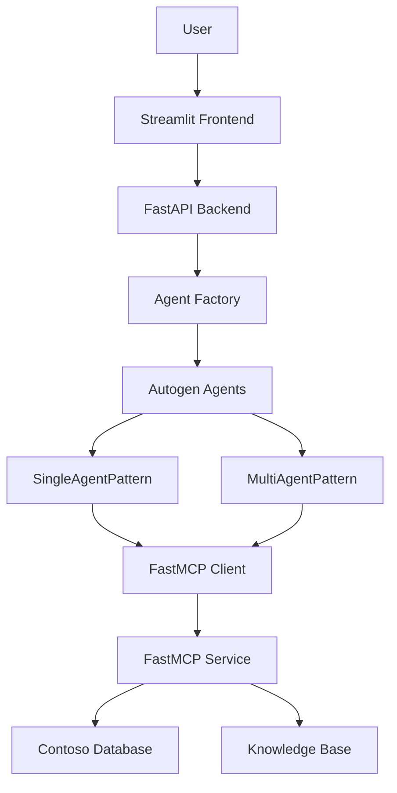
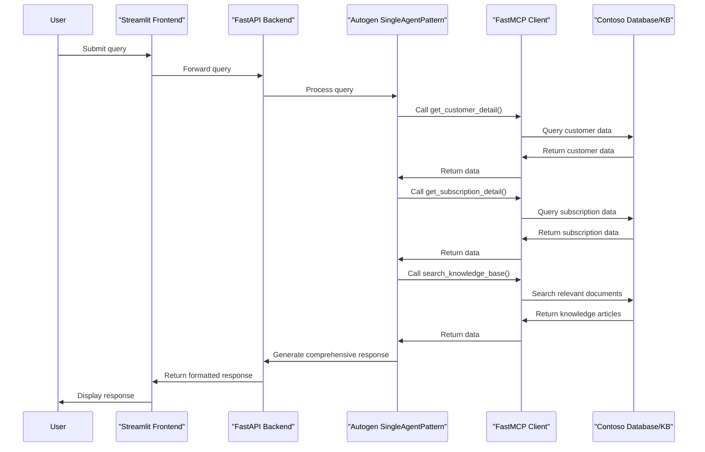
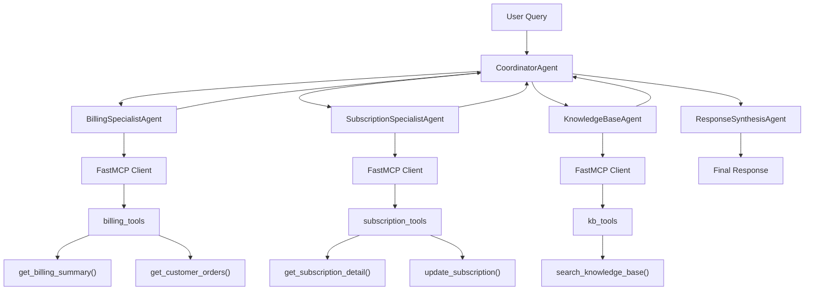
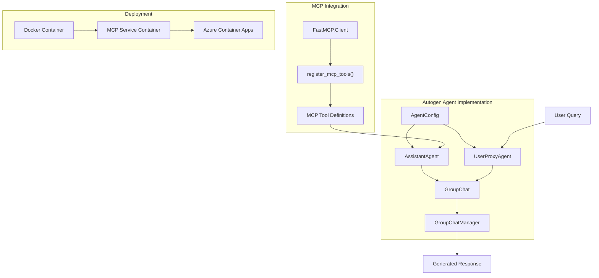

<!-- source: DeepWiki mcp.deepwiki.com · repo microsoft/OpenAIWorkshop · extra page Autogen Agents · fetched 2026-10-26 -->

# Autogen Agents

Relevant source files

The following files were used as context for generating this wiki page:

- [scenarios/contoso_internet/backend_services/Dockerfile.mcp](scenarios/contoso_internet/backend_services/Dockerfile.mcp)
- [scenarios/contoso_internet/backend_services/deploy_azure.sh](scenarios/contoso_internet/backend_services/deploy_azure.sh)
- [scenarios/contoso_internet/backend_services/requirements.txt](scenarios/contoso_internet/backend_services/requirements.txt)
- [scenarios/contoso_internet/backend_services/test_mcp_service.py](scenarios/contoso_internet/backend_services/test_mcp_service.py)

This document provides a technical overview of the Autogen agent implementations within the Contoso Internet scenario of the OpenAI Workshop repository. It covers the architecture, implementation patterns, and integration with the Model Context Protocol (MCP) service. For information about Semantic Kernel-based agent implementations, see [Semantic Kernel Agents](#2.2.2).

## Overview

Autogen agents in this repository leverage the Microsoft Autogen framework to implement AI agents that interact with the Contoso Internet backend services. These agents utilize natural language processing capabilities to understand user queries, determine relevant actions, and generate appropriate responses, all while interfacing with the FastMCP service to access and manipulate Contoso's data.

Sources:
- [scenarios/contoso_internet/backend_services/requirements.txt:8-9]()

## Architecture and Integration

The Autogen agents serve as the intelligence layer connecting the application frontend/backend with the Contoso Internet data services. They rely on the FastMCP protocol to interact with various data sources.

Sources:
- [scenarios/contoso_internet/backend_services/requirements.txt:8-9]()
- [scenarios/contoso_internet/backend_services/test_mcp_service.py:17-20]()

## Agent Implementation Patterns

### Single Agent Pattern

The single agent pattern is a straightforward implementation where a single Autogen agent handles the entire conversation flow.

Sources:
- [scenarios/contoso_internet/backend_services/test_mcp_service.py:52-191]()

### Multi-Agent Pattern

The multi-agent pattern employs multiple specialized Autogen agents that collaborate to solve complex queries, with each agent focusing on different domains or subtasks.

Sources:
- [scenarios/contoso_internet/backend_services/test_mcp_service.py:52-191]()

## MCP Service Integration

Autogen agents in this implementation rely heavily on the FastMCP service to access the Contoso data ecosystem. The integration is facilitated through the FastMCP client, which allows agents to call various tools.

### Available MCP Tools

The following table lists the key tools that Autogen agents can leverage through the MCP service:

| Tool Name | Purpose | Parameters | Return Type |
|-----------|---------|------------|-------------|
| `get_all_customers` | Retrieves list of all customers | None | List[Dict] |
| `get_customer_detail` | Gets detailed info for a customer | `customer_id` | Dict |
| `get_subscription_detail` | Gets subscription information | `subscription_id` | Dict |
| `get_promotions` | Lists available promotions | None | List |
| `get_eligible_promotions` | Gets promotions for a customer | `customer_id` | List |
| `search_knowledge_base` | Searches KB for relevant articles | `query`, `topk` | List |
| `get_security_logs` | Retrieves security logs | `customer_id` | List |
| `get_customer_orders` | Gets customer order history | `customer_id` | List |
| `get_data_usage` | Retrieves data usage metrics | `subscription_id`, `start_date`, `end_date`, `aggregate` | Dict/List |
| `get_billing_summary` | Gets billing summary | `customer_id` | Dict |
| `update_subscription` | Updates subscription properties | `subscription_id`, `update` | Dict |
| `unlock_account` | Unlocks a locked account | `customer_id` | Dict/String |

Sources:
- [scenarios/contoso_internet/backend_services/test_mcp_service.py:53-191]()

## Technical Implementation Details

The Autogen agents are deployed alongside the MCP service in containerized environments, which can be hosted locally via Docker or deployed to Azure Container Apps.

Sources:
- [scenarios/contoso_internet/backend_services/requirements.txt:8-9]()
- [scenarios/contoso_internet/backend_services/deploy_azure.sh:1-48]()
- [scenarios/contoso_internet/backend_services/Dockerfile.mcp:1-22]()

## Dependencies

The Autogen agent implementation relies on the following key dependencies:

- `autogen-ext[mcp]`: Extension package that facilitates integration with the Model Context Protocol
- `autogen-agentchat`: Core package for implementing conversational agents using Autogen
- `fastmcp`: Client library for interacting with FastMCP services

Sources:
- [scenarios/contoso_internet/backend_services/requirements.txt:7-9]()

## Deployment

Autogen agents, along with the MCP service they depend on, can be deployed as Docker containers or to Azure Container Apps. The deployment scripts in the repository automate this process.

The containerization approach ensures consistency across development and production environments while enabling scalability in cloud deployments.

Sources:
- [scenarios/contoso_internet/backend_services/deploy_azure.sh:1-48]()
- [scenarios/contoso_internet/backend_services/Dockerfile.mcp:1-22]()

---

