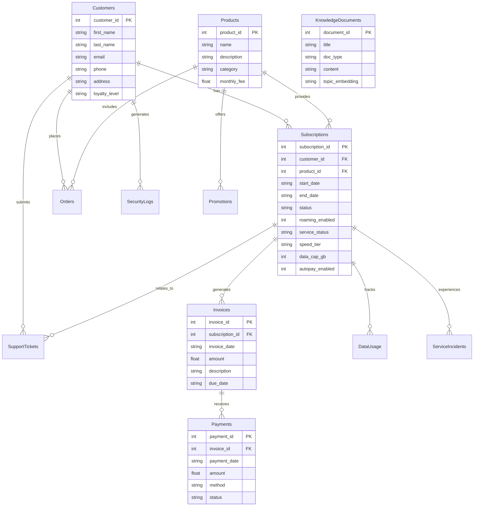
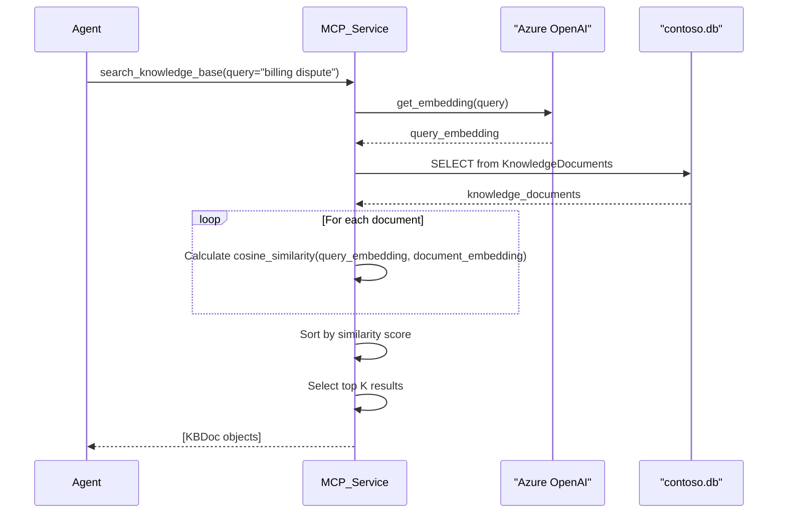
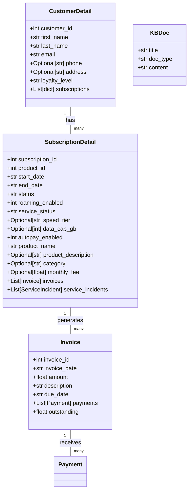

<!-- source: DeepWiki mcp.deepwiki.com · repo microsoft/OpenAIWorkshop · extra page Database Schema and Knowledge Base · fetched 2026-10-26 -->

# Database Schema and Knowledge Base

<details>
<summary>Relevant source files</summary>

The following files were used as context for generating this wiki page:

- [scenarios/contoso_internet/README.md](scenarios/contoso_internet/README.md)
- [scenarios/contoso_internet/backend_services/.env.sample](scenarios/contoso_internet/backend_services/.env.sample)
- [scenarios/contoso_internet/backend_services/README.md](scenarios/contoso_internet/backend_services/README.md)
- [scenarios/contoso_internet/backend_services/data/contoso.db](scenarios/contoso_internet/backend_services/data/contoso.db)
- [scenarios/contoso_internet/backend_services/data/create_db.py](scenarios/contoso_internet/backend_services/data/create_db.py)
- [scenarios/contoso_internet/backend_services/data/customer_scenarios.md](scenarios/contoso_internet/backend_services/data/customer_scenarios.md)
- [scenarios/contoso_internet/backend_services/data/kb.json](scenarios/contoso_internet/backend_services/data/kb.json)
- [scenarios/contoso_internet/backend_services/mcp_service.py](scenarios/contoso_internet/backend_services/mcp_service.py)

</details>


## Purpose and Scope

This document provides a detailed technical overview of the database schema and knowledge base used in the Contoso Internet scenario. It covers the SQLite database structure, table relationships, and the knowledge base implementation used by AI agents to query customer data, process billing information, and provide support through the Model Context Protocol (MCP) service.

For information about the MCP Service API that interacts with this database, see [MCP Service API](#2.1.2).

Sources: [scenarios/contoso_internet/README.md:1-50](), [scenarios/contoso_internet/backend_services/README.md:1-20]()

## Database Overview

The Contoso Internet scenario uses a SQLite database (`contoso.db`) that simulates a telecom company's customer management system. This database contains structured information about customers, subscriptions, billing, and support, as well as a knowledge base of company policies and procedures.

### Database Structure Diagram



Sources: [scenarios/contoso_internet/backend_services/data/create_db.py:62-251](), [scenarios/contoso_internet/backend_services/mcp_service.py:58-175]()

## Table Descriptions

The database consists of 12 tables that represent the core business entities and their relationships:

| Table Name | Description | Primary Purpose |
|------------|-------------|-----------------|
| `Customers` | Customer profiles with personal information | Stores basic customer data and loyalty level |
| `Products` | Service offerings available to customers | Defines the products Contoso offers (mobile, internet, bundles) |
| `Subscriptions` | Active service subscriptions | Links customers to products with specific terms |
| `Invoices` | Billing records for subscriptions | Tracks amounts due for services |
| `Payments` | Payment records against invoices | Records payment history, methods, and status |
| `Promotions` | Special offers and discounts | Stores promotional details and eligibility criteria |
| `SecurityLogs` | Account security events | Tracks login attempts and security incidents |
| `Orders` | Product purchase history | Records product orders and their status |
| `SupportTickets` | Customer service requests | Tracks customer issues and resolution status |
| `DataUsage` | Usage metrics for subscriptions | Records data, voice, and SMS consumption |
| `ServiceIncidents` | Service interruptions | Logs service problems and their resolution |
| `KnowledgeDocuments` | Knowledge base articles | Stores policies, procedures, and troubleshooting guides |

Sources: [scenarios/contoso_internet/backend_services/data/create_db.py:62-251](), [scenarios/contoso_internet/backend_services/mcp_service.py:58-175]()

## Detailed Schema

### Core Customer and Subscription Tables

#### Customers Table
```
CREATE TABLE Customers(
    customer_id   INTEGER PRIMARY KEY AUTOINCREMENT,
    first_name    TEXT NOT NULL,
    last_name     TEXT NOT NULL,
    email         TEXT UNIQUE,
    phone         TEXT,
    address       TEXT,
    loyalty_level TEXT
)
```

The `loyalty_level` can be "Bronze", "Silver", or "Gold", which affects eligibility for promotions.

#### Products Table
```
CREATE TABLE Products(
    product_id   INTEGER PRIMARY KEY AUTOINCREMENT,
    name         TEXT NOT NULL,
    description  TEXT,
    category     TEXT,
    monthly_fee  REAL
)
```

Product categories include "mobile", "internet", "bundle", and "addon".

#### Subscriptions Table
```
CREATE TABLE Subscriptions(
    subscription_id  INTEGER PRIMARY KEY AUTOINCREMENT,
    customer_id      INTEGER NOT NULL,
    product_id       INTEGER NOT NULL,
    start_date       TEXT,
    end_date         TEXT,
    status           TEXT,
    roaming_enabled  INTEGER DEFAULT 0,
    service_status   TEXT,
    speed_tier       TEXT,
    data_cap_gb      INTEGER,
    autopay_enabled  INTEGER DEFAULT 1,
    FOREIGN KEY(customer_id) REFERENCES Customers(customer_id),
    FOREIGN KEY(product_id)  REFERENCES Products(product_id)
)
```

The `service_status` can be "normal", "slow", or "offline", and `speed_tier` options include "50Mbps", "100Mbps", "300Mbps", and "1Gbps".

Sources: [scenarios/contoso_internet/backend_services/data/create_db.py:74-114]()

### Billing and Payments Tables

#### Invoices Table
```
CREATE TABLE Invoices(
    invoice_id      INTEGER PRIMARY KEY AUTOINCREMENT,
    subscription_id INTEGER,
    invoice_date    TEXT,
    amount          REAL,
    description     TEXT,
    due_date        TEXT,
    FOREIGN KEY (subscription_id) REFERENCES Subscriptions(subscription_id)
)
```

#### Payments Table
```
CREATE TABLE Payments(
    payment_id   INTEGER PRIMARY KEY AUTOINCREMENT,
    invoice_id   INTEGER,
    payment_date TEXT,
    amount       REAL,
    method       TEXT,
    status       TEXT,
    FOREIGN KEY (invoice_id) REFERENCES Invoices(invoice_id)
)
```

Payment status can be "successful", "failed", or "pending".

Sources: [scenarios/contoso_internet/backend_services/data/create_db.py:117-140]()

### Marketing and Promotional Tables

#### Promotions Table
```
CREATE TABLE Promotions(
    promotion_id       INTEGER PRIMARY KEY AUTOINCREMENT,
    product_id         INTEGER,
    name               TEXT,
    description        TEXT,
    eligibility_criteria TEXT,
    start_date         TEXT,
    end_date           TEXT,
    discount_percent   INTEGER,
    FOREIGN KEY (product_id) REFERENCES Products(product_id)
)
```

The `eligibility_criteria` field contains conditions like "loyalty_level = 'Gold'" that determine which customers qualify for the promotion.

Sources: [scenarios/contoso_internet/backend_services/data/create_db.py:143-155]()

### Support and Service Tables

#### SupportTickets Table
```
CREATE TABLE SupportTickets(
    ticket_id       INTEGER PRIMARY KEY AUTOINCREMENT,
    customer_id     INTEGER,
    subscription_id INTEGER,
    category        TEXT,
    opened_at       TEXT,
    closed_at       TEXT,
    status          TEXT,
    priority        TEXT,
    subject         TEXT,
    description     TEXT,
    cs_agent        TEXT,
    FOREIGN KEY(customer_id)     REFERENCES Customers(customer_id),
    FOREIGN KEY(subscription_id) REFERENCES Subscriptions(subscription_id)
)
```

#### ServiceIncidents Table
```
CREATE TABLE ServiceIncidents(
    incident_id       INTEGER PRIMARY KEY AUTOINCREMENT,
    subscription_id   INTEGER,
    incident_date     TEXT,
    description       TEXT,
    resolution_status TEXT,
    FOREIGN KEY(subscription_id) REFERENCES Subscriptions(subscription_id)
)
```

Sources: [scenarios/contoso_internet/backend_services/data/create_db.py:184-225]()

### Usage and Security Tables

#### DataUsage Table
```
CREATE TABLE DataUsage(
    usage_id        INTEGER PRIMARY KEY AUTOINCREMENT,
    subscription_id INTEGER,
    usage_date      TEXT,
    data_used_mb    INTEGER,
    voice_minutes   INTEGER,
    sms_count       INTEGER,
    FOREIGN KEY(subscription_id) REFERENCES Subscriptions(subscription_id)
)
```

#### SecurityLogs Table
```
CREATE TABLE SecurityLogs(
    log_id         INTEGER PRIMARY KEY AUTOINCREMENT,
    customer_id    INTEGER,
    event_type     TEXT,
    event_timestamp TEXT,
    description    TEXT,
    FOREIGN KEY (customer_id) REFERENCES Customers(customer_id)
)
```

Event types include "account_locked", "failed_login", and "password_change".

Sources: [scenarios/contoso_internet/backend_services/data/create_db.py:158-182]()), [scenarios/contoso_internet/backend_services/data/create_db.py:202-214]()

## Knowledge Base Structure

### KnowledgeDocuments Table

```
CREATE TABLE KnowledgeDocuments(
    document_id     INTEGER PRIMARY KEY AUTOINCREMENT,
    title           TEXT,
    doc_type        TEXT,
    content         TEXT,
    topic_embedding TEXT
)
```

The `topic_embedding` column stores vector embeddings of the document content as a JSON string, enabling semantic search functionality. These embeddings are generated using Azure OpenAI's embedding model (or zero-vectors if Azure OpenAI is not configured).

Sources: [scenarios/contoso_internet/backend_services/data/create_db.py:228-236](), [scenarios/contoso_internet/backend_services/data/create_db.py:37-53]()

### Knowledge Document Types

Knowledge documents are categorized by `doc_type`:

| Type | Purpose | Example |
|------|---------|---------|
| Policy | Official business rules | "Invoice Adjustment Policy", "Late Payment Fee Policy" |
| Procedure | Step-by-step instructions | "Account Unlock Procedure", "Financial Hardship Payment Plan Procedure" |
| Troubleshooting | Technical problem guidance | "Troubleshooting Slow Internet", "Troubleshooting Call Dropping Issues" |
| FAQ | Frequently asked questions | "International Roaming Options", "Text Messaging Issues" |

Sources: [scenarios/contoso_internet/backend_services/data/kb.json:1-104]()

### Knowledge Base Content Loading

The Knowledge Base documents are initially defined in `kb.json` and loaded into the database during initialization. Each document contains:

- `document_title`: The title of the knowledge document
- `topic`: The main subject of the document
- `doc_type`: The document category
- `content`: The full text content of the document

During database creation, each document's content is processed to generate embeddings using Azure OpenAI (if configured) or a fallback zero-vector if Azure OpenAI is not available.

Sources: [scenarios/contoso_internet/backend_services/data/kb.json:1-104](), [scenarios/contoso_internet/backend_services/data/create_db.py:37-53]()

## Integration with MCP Service

### Database Access Flow

```mermaid
flowchart TD
    "Agent" --> "get_customer_detail tool" --> "get_db() function"
    "Agent" --> "get_subscription_detail tool" --> "get_db() function"
    "Agent" --> "search_knowledge_base tool" --> "get_db() function"
    "get_db() function" --> "contoso.db" 
    "contoso.db" --> "DB Results" --> "Pydantic Models"
    "Pydantic Models" --> "JSON Response" --> "Agent"
    
    subgraph "MCP Service API"
        "get_customer_detail tool"
        "get_subscription_detail tool"
        "search_knowledge_base tool"
        "get_db() function"
    end
    
    subgraph "Database Layer"
        "contoso.db"
        "DB Results"
    end
    
    subgraph "Response Formatting"
        "Pydantic Models"
        "JSON Response"
    end
```

Sources: [scenarios/contoso_internet/backend_services/mcp_service.py:9-16](), [scenarios/contoso_internet/backend_services/mcp_service.py:22-25](), [scenarios/contoso_internet/backend_services/mcp_service.py:206-427]()

### Knowledge Base Search Implementation

The `search_knowledge_base` tool provides semantic search capabilities using the following process:

1. Convert the search query to an embedding vector using Azure OpenAI or fallback to a zero-vector
2. Retrieve all knowledge documents from the database
3. Calculate cosine similarity between the query embedding and each document's embedding
4. Sort documents by similarity score and return the top K results



Sources: [scenarios/contoso_internet/backend_services/mcp_service.py:395-414](), [scenarios/contoso_internet/backend_services/mcp_service.py:38-52]()

## Data Models and Schemas

The database tables are represented as Pydantic models in the MCP service, providing strong typing for API responses:



Sources: [scenarios/contoso_internet/backend_services/mcp_service.py:58-175]()

## Sample Knowledge Base Content

The knowledge base contains company policies, procedures, troubleshooting guides, and FAQs. Examples include:

| Title | Type | Purpose |
|-------|------|---------|
| Invoice Adjustment Policy | Policy | Describes how customers can request and receive adjustments on their billing statements |
| Troubleshooting Slow Internet | Troubleshooting | Steps to diagnose and resolve slow internet performance issues |
| International Roaming Options | FAQ | Explains how travelers can use roaming packages abroad |
| Account Unlock Procedure | Procedure | Verification steps to unlock an account after failed login attempts |
| Data Overage Policy | Policy | Rules for handling data usage that exceeds plan limits |

The knowledge base plays a critical role in enabling AI agents to provide context-specific responses based on company policies and procedures.

Sources: [scenarios/contoso_internet/backend_services/data/kb.json:1-104]()

## Database Initialization and Data Generation

The database is created and populated using the `create_db.py` script, which:

1. Defines table schemas and creates tables with appropriate foreign key relationships
2. Creates indexes for efficient querying
3. Populates reference data (products, promotions)
4. Generates random customer data (250 random customers)
5. Creates 9 deterministic "challenge scenarios" with specific customer data
6. Loads knowledge base documents from `kb.json` and creates embeddings

The script ensures deterministic data generation using fixed random seeds, making the scenarios reproducible.

Sources: [scenarios/contoso_internet/backend_services/data/create_db.py:15-27](), [scenarios/contoso_internet/backend_services/data/create_db.py:257-343]()

## Conclusion

The Contoso Internet database schema and knowledge base form the foundation of the simulated telecommunications company scenario. The SQLite database stores structured customer, subscription, and billing data, while the knowledge base contains company policies and procedures. Together, they enable AI agents to access information, answer questions, and solve customer problems within the simulated business context.

For information about how the MCP service API interacts with this database, see [MCP Service API](#2.1.2), and for information about how agents use this data, see [Agent Patterns and Implementations](#2.2).

---

