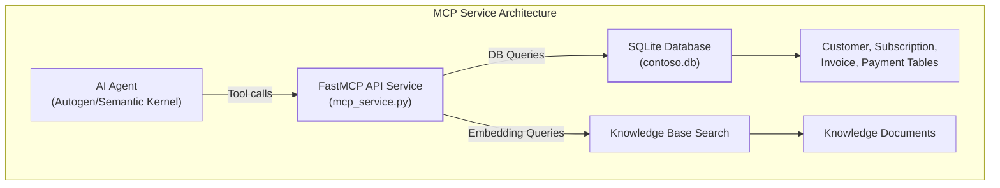
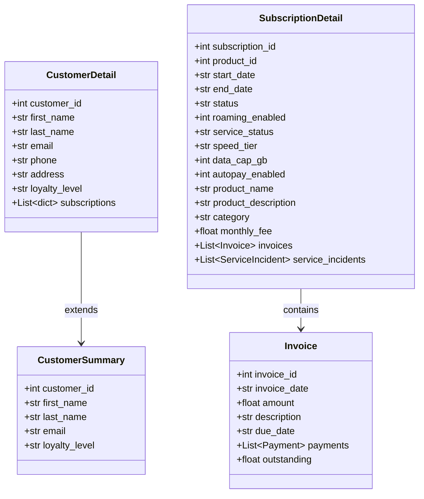
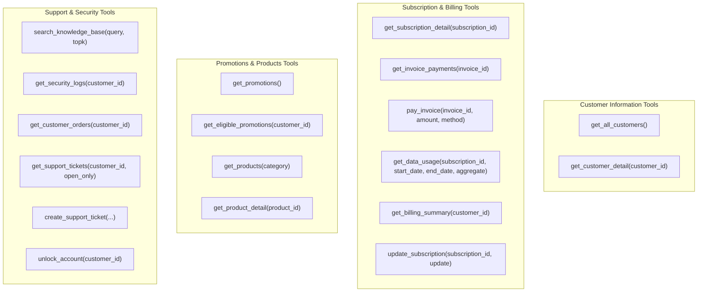
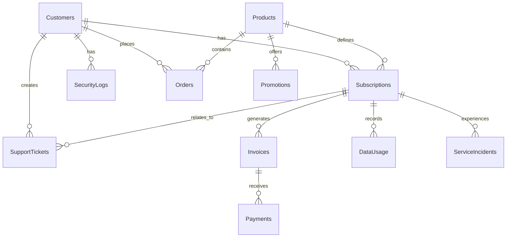
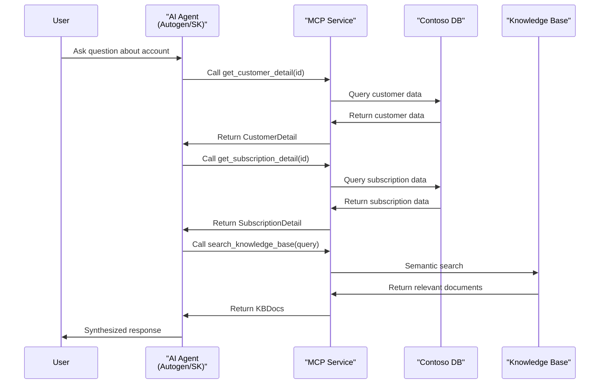

<!-- source: DeepWiki mcp.deepwiki.com · repo microsoft/OpenAIWorkshop · extra page MCP Service API · fetched 2026-10-26 -->

# MCP Service API

<details>
<summary>Relevant source files</summary>

The following files were used as context for generating this wiki page:

- [scenarios/contoso_internet/README.md](scenarios/contoso_internet/README.md)
- [scenarios/contoso_internet/backend_services/.env.sample](scenarios/contoso_internet/backend_services/.env.sample)
- [scenarios/contoso_internet/backend_services/Dockerfile.mcp](scenarios/contoso_internet/backend_services/Dockerfile.mcp)
- [scenarios/contoso_internet/backend_services/README.md](scenarios/contoso_internet/backend_services/README.md)
- [scenarios/contoso_internet/backend_services/data/contoso.db](scenarios/contoso_internet/backend_services/data/contoso.db)
- [scenarios/contoso_internet/backend_services/data/create_db.py](scenarios/contoso_internet/backend_services/data/create_db.py)
- [scenarios/contoso_internet/backend_services/data/customer_scenarios.md](scenarios/contoso_internet/backend_services/data/customer_scenarios.md)
- [scenarios/contoso_internet/backend_services/data/kb.json](scenarios/contoso_internet/backend_services/data/kb.json)
- [scenarios/contoso_internet/backend_services/mcp_service.py](scenarios/contoso_internet/backend_services/mcp_service.py)
- [scenarios/contoso_internet/backend_services/requirements.txt](scenarios/contoso_internet/backend_services/requirements.txt)
- [scenarios/contoso_internet/backend_services/test_mcp_service.py](scenarios/contoso_internet/backend_services/test_mcp_service.py)

</details>


This document details the Model Context Protocol (MCP) Service API that powers the Contoso Internet scenario. The MCP Service provides a structured interface for AI agents to access customer information, subscription details, billing data, and knowledge resources within the Contoso telecommunications business ecosystem.

Sources: [scenarios/contoso_internet/backend_services/README.md:34-44]()

## 1. Overview

The MCP Service API is a FastMCP-based backend that exposes a collection of typed tools designed for consumption by AI agents. It acts as the bridge between agent implementations and the Contoso database, providing a structured and secure way to query and manipulate customer data.

The service follows the Model Context Protocol pattern, which allows AI agents to interact with backend systems through well-defined tools with clear input/output schemas.



**MCP Service Components Diagram**

Sources: [scenarios/contoso_internet/backend_services/mcp_service.py:8-16](), [scenarios/contoso_internet/backend_services/README.md:34-44]()

## 2. Service Initialization

The MCP Service is initialized using the FastMCP framework, which creates a service with defined tools and authentication scopes.

```python
mcp = FastMCP(
    name="Contoso Customer API as Tools",
    instructions=(
        "All customer, billing and knowledge data is accessible ONLY via the declared "
        "tools below. Return values follow the pydantic schemas. Always call the most "
        "specific tool that answers the user's question."
    ),
)
```

The service includes:
- SQLite database connection management
- Optional OpenAI embedding integration for knowledge base searches
- Error handling for both expected and unexpected conditions

Sources: [scenarios/contoso_internet/backend_services/mcp_service.py:8-46]()

## 3. Data Models

The MCP Service defines Pydantic models to structure data and enforce type safety. These models are used for both request parameters and response schemas.



**Core Data Models Diagram**

The service defines a total of 16 Pydantic models, including:
- `CustomerSummary`, `CustomerDetail`: Customer information models
- `SubscriptionDetail`: Detailed subscription information with related invoices and incidents
- `Invoice`, `Payment`: Billing-related models
- `Promotion`: Product promotions and discounts
- `KBDoc`, `KBSearchParams`: Knowledge base search models
- `SecurityLog`, `Order`, `DataUsageRecord`: Additional customer data models
- `SupportTicket`: Customer support information

Sources: [scenarios/contoso_internet/backend_services/mcp_service.py:55-187]()

## 4. API Endpoints (Tools)

The MCP Service exposes 18 tool endpoints for different operations. Each tool has a defined purpose, input schema, and output schema.



**MCP Service Tools Diagram**

### 4.1 Customer Information Tools

| Tool Name | Description | Parameters | Return Type |
|-----------|-------------|------------|-------------|
| `get_all_customers` | Lists all customers with basic info | None | `List[CustomerSummary]` |
| `get_customer_detail` | Gets full customer profile including subscriptions | `customer_id: int` | `CustomerDetail` |

### 4.2 Subscription & Billing Tools

| Tool Name | Description | Parameters | Return Type |
|-----------|-------------|------------|-------------|
| `get_subscription_detail` | Gets detailed subscription info including invoices and service incidents | `subscription_id: int` | `SubscriptionDetail` |
| `get_invoice_payments` | Gets payment list for a specific invoice | `invoice_id: int` | `List[Payment]` |
| `pay_invoice` | Records a payment for a given invoice | `invoice_id: int, amount: float, method: str` | `Dict[str, Any]` |
| `get_data_usage` | Gets daily data usage records for a subscription | `subscription_id: int, start_date: str, end_date: str, aggregate: bool` | `List[DataUsageRecord]` or `Dict[str, Any]` |
| `get_billing_summary` | Gets a summary of what customer owes across all subscriptions | `customer_id: int` | `Dict[str, Any]` |
| `update_subscription` | Updates one or more fields on a subscription | `subscription_id: int, update: SubscriptionUpdateRequest` | `Dict[str, Any]` |

### 4.3 Promotions & Products Tools

| Tool Name | Description | Parameters | Return Type |
|-----------|-------------|------------|-------------|
| `get_promotions` | Lists all active promotions | None | `List[Promotion]` |
| `get_eligible_promotions` | Gets promotions eligible for a specific customer | `customer_id: int` | `List[Promotion]` |
| `get_products` | Lists available products with optional category filter | `category: Optional[str]` | `List[Dict[str, Any]]` |
| `get_product_detail` | Gets detailed info for a specific product | `product_id: int` | `Dict[str, Any]` |

### 4.4 Support & Security Tools

| Tool Name | Description | Parameters | Return Type |
|-----------|-------------|------------|-------------|
| `search_knowledge_base` | Performs semantic search on policy/procedure documents | `query: str, topk: Optional[int]` | `List[KBDoc]` |
| `get_security_logs` | Gets security events for a customer | `customer_id: int` | `List[SecurityLog]` |
| `get_customer_orders` | Gets all orders placed by a customer | `customer_id: int` | `List[Order]` |
| `get_support_tickets` | Gets support tickets for a customer | `customer_id: int, open_only: Optional[bool]` | `List[SupportTicket]` |
| `create_support_ticket` | Creates a new support ticket | Multiple parameters | `SupportTicket` |
| `unlock_account` | Unlocks a customer account | `customer_id: int` | `Dict[str, Any]` |

Sources: [scenarios/contoso_internet/backend_services/mcp_service.py:204-594](), [scenarios/contoso_internet/README.md:27-48]()

## 5. Database Interaction

The MCP Service interacts with a SQLite database (`contoso.db`) that contains customer data, subscriptions, billing information, and more. The database connection is managed through a helper function.

```python
def get_db() -> sqlite3.Connection:
    db = sqlite3.connect(DB_PATH)
    db.row_factory = sqlite3.Row
    return db
```

The SQLite database schema contains tables for:
- Customers
- Products
- Subscriptions
- Invoices
- Payments
- Promotions
- Security Logs
- Orders
- Support Tickets
- Data Usage
- Service Incidents
- Knowledge Documents



**Database Entity Relationship Diagram**

Each tool performs specific SQL queries to retrieve or modify data in the database, providing a controlled interface for AI agents to interact with the underlying data.

Sources: [scenarios/contoso_internet/backend_services/data/create_db.py:62-252](), [scenarios/contoso_internet/backend_services/mcp_service.py:22-25]()

## 6. Knowledge Base Search

The MCP Service includes semantic search functionality for the knowledge base, allowing AI agents to find relevant policy documents, troubleshooting guides, and other information.

```python
@mcp.tool(description="Semantic search on policy / procedure knowledge documents")
def search_knowledge_base(params: KBSearchParams) -> List[KBDoc]:
    query_emb = get_embedding(params.query)
    db = get_db()
    rows = db.execute("SELECT title, doc_type, content, topic_embedding FROM KnowledgeDocuments").fetchall()
    db.close()
    scored = []
    for r in rows:
        try:
            emb = json.loads(r["topic_embedding"])
            sim = cosine_similarity(query_emb, emb)
            scored.append((sim, r))
        except Exception:
            continue
    scored.sort(reverse=True, key=lambda x: x[0])
    best = scored[: params.topk]
    return [
        KBDoc(title=r["title"], doc_type=r["doc_type"], content=r["content"])
        for sim, r in best
    ]
```

The service uses OpenAI embeddings (when available) to perform semantic similarity between the query and knowledge documents. It falls back to a dummy embedding if Azure OpenAI credentials are not configured.

The knowledge base contains documents on various topics:
- Billing policies and procedures
- Troubleshooting guides
- Service policies
- International roaming information
- Account management
- Promotion eligibility
- Return policies

Sources: [scenarios/contoso_internet/backend_services/mcp_service.py:394-414](), [scenarios/contoso_internet/backend_services/data/kb.json:1-105]()

## 7. Integration with AI Agents

The MCP Service is designed to be consumed by AI agents built with frameworks like Autogen and Semantic Kernel. These agents can call the tools exposed by the service to access and manipulate Contoso data.



**Agent Integration Flow Diagram**

The agents can use the tools to:
1. Retrieve customer information
2. Check subscription and billing details
3. Process payments
4. Search the knowledge base for relevant information
5. Update subscriptions or create support tickets
6. Handle security-related tasks

The tool-based approach ensures that agents only access data through well-defined interfaces, enhancing security and improving agent reasoning by providing structured data.

Sources: [scenarios/contoso_internet/README.md:52-139]()

## 8. Deployment and Configuration

The MCP Service can be deployed locally, in Docker containers, or to Azure Container Apps.

### 8.1 Environment Configuration

The service uses environment variables for configuration:

| Variable | Purpose | Example Value |
|----------|---------|---------------|
| `AZURE_OPENAI_ENDPOINT` | Azure OpenAI endpoint | `https://your-resource.openai.azure.com` |
| `AZURE_OPENAI_API_KEY` | API key for embedding/chat | (secret) |
| `AZURE_OPENAI_CHAT_DEPLOYMENT` | Chat deployment name | `gpt-4o` |
| `AZURE_OPENAI_API_VERSION` | API version | `2025-03-01-preview` |
| `AZURE_OPENAI_EMBEDDING_DEPLOYMENT` | Embedding deployment name | `text-embedding-ada-002` |
| `DB_PATH` | SQLite db location | `data/contoso.db` |

### 8.2 Running Locally

To run the service locally:

1. Install dependencies: `pip install -r requirements.txt`
2. Create the `.env` file from `.env.sample`
3. Run the service: `python mcp_service.py`

### 8.3 Docker Deployment

To deploy using Docker:

```bash
docker build -f Dockerfile.mcp -t mcp-backend .
docker run -it -p 8000:8000 --env-file .env mcp-backend
```

### 8.4 Azure Container Apps Deployment

The service includes a deployment script (`deploy_mcp.sh`) for deploying to Azure Container Apps.

Sources: [scenarios/contoso_internet/backend_services/README.md:79-117](), [scenarios/contoso_internet/backend_services/.env.sample:1-8](), [scenarios/contoso_internet/backend_services/Dockerfile.mcp:1-22]()

## 9. Testing

The repository includes a test script (`test_mcp_service.py`) for smoke-testing the MCP Service API. The script tests various tool endpoints, including both read-only and mutating operations.

The test script uses the FastMCP Client to call tools and verify their functionality:

```python
async def test_customer_detail(client: Client, cust_id: int):
    title = f"get_customer_detail({cust_id})"
    try:
        res = await client.call_tool("get_customer_detail", {"customer_id": cust_id})
        data = _to_native(res[0])
        print_result(title, isinstance(data, dict), data)
    except Exception as e:
        print_result(title, False, error=e)
```

The tests cover:
- Customer information retrieval
- Subscription and billing operations
- Promotion and product lookups
- Knowledge base searches
- Security and support functions

Sources: [scenarios/contoso_internet/backend_services/test_mcp_service.py:1-229]()

## 10. Summary

The MCP Service API provides a comprehensive tool-based interface for AI agents to interact with Contoso's customer data and knowledge base. By exposing structured endpoints with clear input/output schemas, it enables agents to perform a wide range of operations while maintaining data integrity and security.

Key capabilities include:
- Customer information retrieval
- Subscription and billing management
- Promotion eligibility checking
- Knowledge base semantic search
- Security log viewing and account unlocking
- Support ticket creation and management

The service is designed to be consumed by AI agents built with frameworks like Autogen and Semantic Kernel, providing them with the tools needed to assist Contoso's customers with their telecommunications service needs.

Sources: [scenarios/contoso_internet/backend_services/README.md:1-147]()

---

