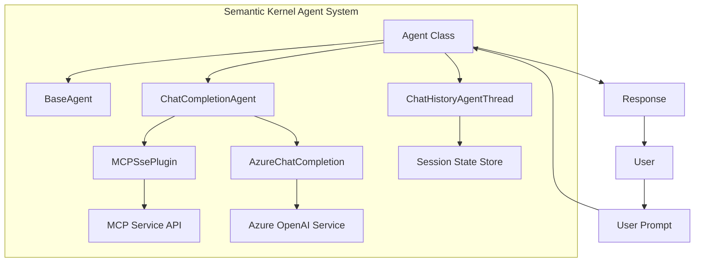
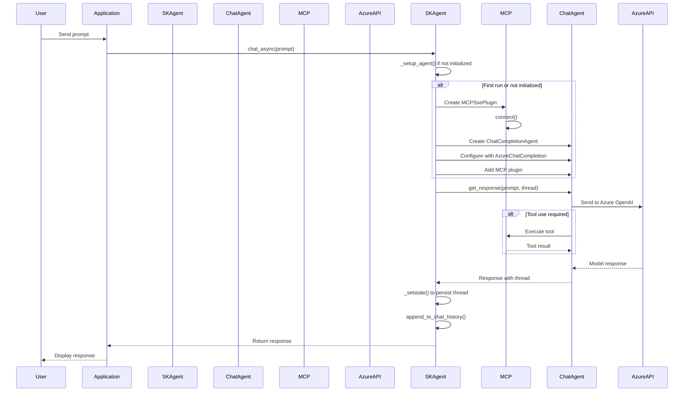
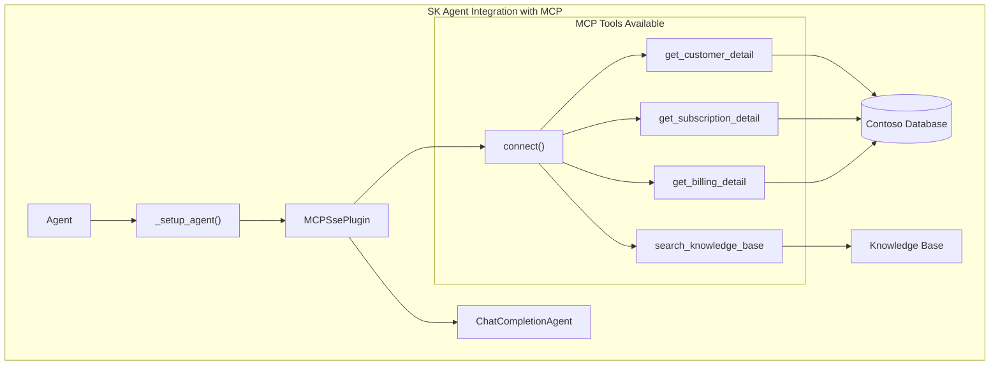
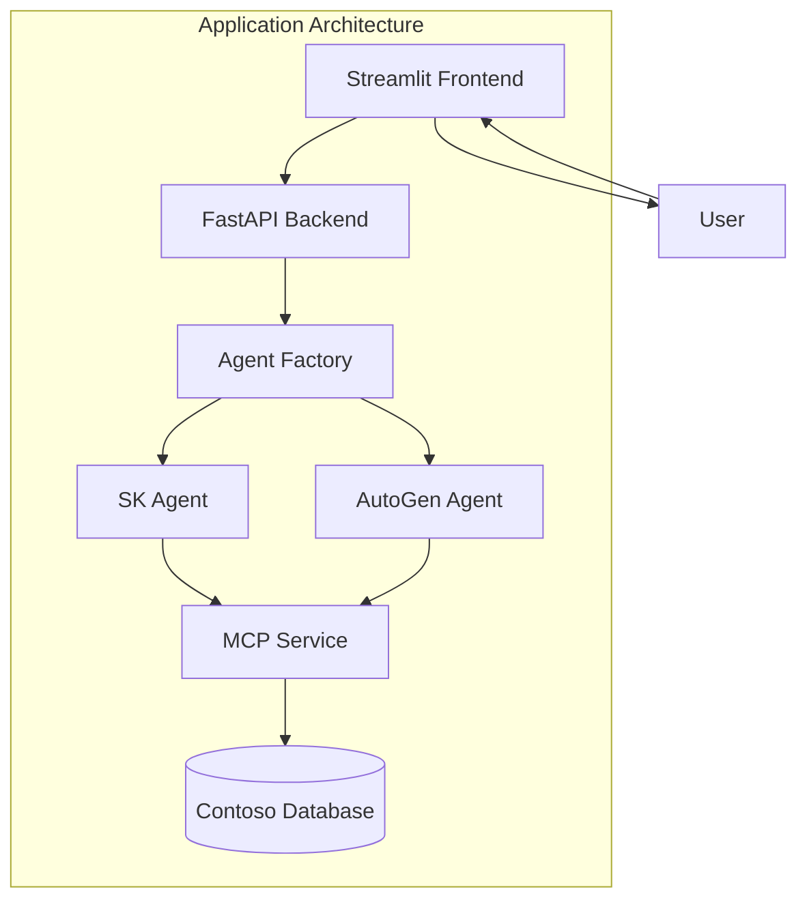

<!-- source: DeepWiki mcp.deepwiki.com · repo microsoft/OpenAIWorkshop · extra page Semantic Kernel Agents · fetched 2026-10-26 -->

# Semantic Kernel Agents

Relevant source files

The following files were used as context for generating this wiki page:

- [scenarios/contoso_internet/agents/semantic_kernel/single_agent/sk_chat_agent.py](scenarios/contoso_internet/agents/semantic_kernel/single_agent/sk_chat_agent.py)
- [scenarios/contoso_internet/applications/README.md](scenarios/contoso_internet/applications/README.md)
- [scenarios/contoso_internet/applications/requirements.txt](scenarios/contoso_internet/applications/requirements.txt)

## Purpose and Scope

This document details the Semantic Kernel (SK) agent implementations within the Contoso Internet scenario of the OpenAI Workshop repository. It covers the architecture, components, and functionality of agents built using the Semantic Kernel framework, focusing on how they integrate with the Model Context Protocol (MCP) to provide intelligent responses to user queries. For information about Autogen-based agent implementations, see [Autogen Agents](#2.2.1).

Sources: [scenarios/contoso_internet/applications/README.md:1-161]()

## Semantic Kernel Agent Architecture

Semantic Kernel agents in this project are designed to process user queries and leverage tools from the MCP service to provide comprehensive responses. These agents are built using Microsoft's Semantic Kernel framework, which provides a programming model for integrating AI models with custom tools and data sources.

**Semantic Kernel Agent Components**

The implementation follows a single-agent pattern that uses Semantic Kernel's Chat Completion API with Azure OpenAI services and leverages MCP tools through the SSE plugin mechanism.

Sources: [scenarios/contoso_internet/agents/semantic_kernel/single_agent/sk_chat_agent.py:3-9](), [scenarios/contoso_internet/agents/semantic_kernel/single_agent/sk_chat_agent.py:16-21]()

## Single-Agent Implementation

The Semantic Kernel agent is implemented in the `Agent` class, which inherits from `BaseAgent` and provides asynchronous methods for agent setup and chat functionality.

### Key Components

1. **Agent Initialization:**
   - The agent is initialized with a state store and session ID
   - The actual setup of Azure OpenAI and MCP connections happens lazily on first use

2. **Agent Setup:**
   - Creates an MCPSsePlugin to connect to the MCP service
   - Initializes a ChatCompletionAgent with Azure OpenAI connection
   - Sets up a conversation thread or restores it from persisted state

3. **Chat Processing:**
   - Accepts user prompts and passes them to the ChatCompletionAgent
   - Manages conversation thread state between interactions
   - Returns formatted responses to the application layer

Sources: [scenarios/contoso_internet/agents/semantic_kernel/single_agent/sk_chat_agent.py:16-82]()

## MCP Integration

The Semantic Kernel agent integrates with the Model Context Protocol (MCP) service through the MCPSsePlugin, which allows the agent to access external tools and data sources.

The MCP integration works as follows:

1. The agent creates an MCPSsePlugin instance with the MCP server URI and necessary headers
2. The plugin connects to the MCP service to load available tools and prompts
3. The plugin is added to the ChatCompletionAgent, making the tools available during chat
4. When the agent encounters queries requiring external data, it can leverage MCP tools to fetch information from the Contoso database or knowledge base

Sources: [scenarios/contoso_internet/agents/semantic_kernel/single_agent/sk_chat_agent.py:28-36](), [scenarios/contoso_internet/agents/semantic_kernel/single_agent/sk_chat_agent.py:47-51]()

## Configuration and Usage

The Semantic Kernel agent is configured through environment variables and is integrated with the application layer through a common interface.

### Environment Variables

The agent requires several environment variables to function correctly:

- `AZURE_OPENAI_ENDPOINT`: The endpoint for Azure OpenAI service
- `AZURE_OPENAI_API_KEY`: API key for authentication
- `AZURE_OPENAI_CHAT_DEPLOYMENT`: The deployment name of the model to use
- `AZURE_OPENAI_API_VERSION`: API version for Azure OpenAI
- `MCP_SERVER_URI`: The URI for the MCP server
- `AGENT_MODULE`: Set to the Semantic Kernel agent module path to enable it

### Integration with Application Layer

The agent is used by the FastAPI backend, which manages chat sessions and routes user queries to the appropriate agent implementation based on the configuration.

The application allows you to switch between different agent implementations by simply changing the `AGENT_MODULE` environment variable, making it easy to compare different approaches.

Sources: [scenarios/contoso_internet/applications/README.md:59-75]()

## State Management

The Semantic Kernel agent implements state management to persist conversation history between user interactions:

1. The agent maintains a `ChatHistoryAgentThread` object to track the conversation
2. When a response is generated, the thread is persisted to the state store
3. When the agent is initialized for an existing session, it attempts to restore the thread from the state store
4. This allows for continuous conversations where the agent maintains context across multiple interactions

Sources: [scenarios/contoso_internet/agents/semantic_kernel/single_agent/sk_chat_agent.py:53-61](), [scenarios/contoso_internet/agents/semantic_kernel/single_agent/sk_chat_agent.py:72-74]()

## Comparison with AutoGen Agents

While both Semantic Kernel and AutoGen provide frameworks for building AI agents, they have different approaches and use cases:

| Feature | Semantic Kernel Agents | AutoGen Agents |
|---------|------------------------|----------------|
| Framework | Microsoft Semantic Kernel | Microsoft AutoGen |
| Agent Structure | Single-agent design with plugins | Supports single-agent and multi-agent architectures |
| Tool Integration | Through MCPSsePlugin | Through function-calling or custom agents |
| State Management | ChatHistoryAgentThread | Conversation history and agent state |
| Programming Model | Kernel-based with plugins | Agent-based with conversational interfaces |
| Use Case | Simpler applications with well-defined tool interactions | Complex multi-agent scenarios requiring collaboration |

The Contoso Internet scenario supports both implementations, allowing developers to choose the most appropriate framework for their specific requirements.

Sources: [scenarios/contoso_internet/applications/README.md:10-12](), [scenarios/contoso_internet/applications/requirements.txt:7-15]()

---

