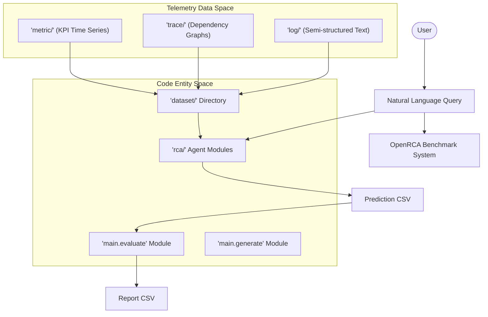
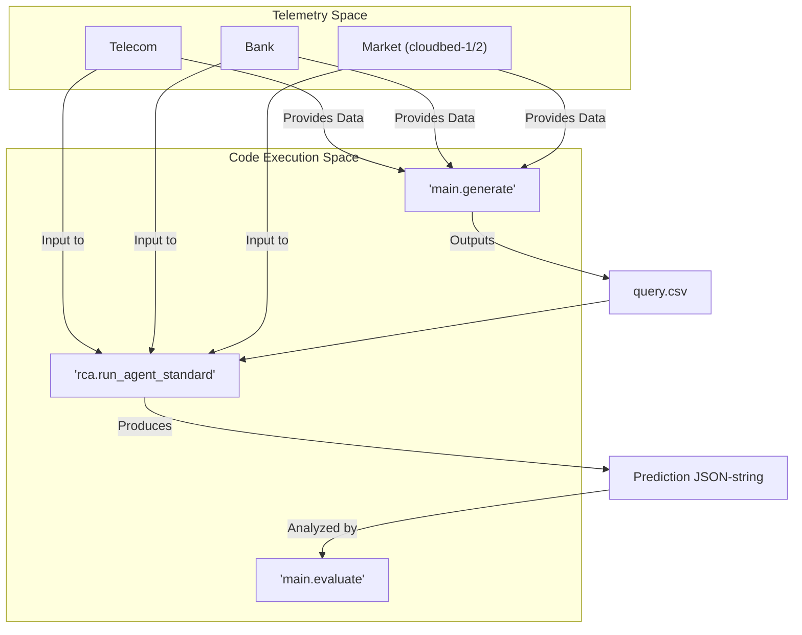

<!-- source: DeepWiki mcp.deepwiki.com · repo microsoft/OpenRCA · page 1 OpenRCA Overview · fetched 2026-10-26 -->

# OpenRCA Overview

Relevant source files

The following files were used as context for generating this wiki page:

- [CODE_OF_CONDUCT.md](CODE_OF_CONDUCT.md)
- [LICENSE](LICENSE)
- [README.md](README.md)
- [SECURITY.md](SECURITY.md)
- [SUPPORT.md](SUPPORT.md)

This document provides a comprehensive overview of OpenRCA, a benchmark designed to assess Large Language Models' (LLMs) root cause analysis capabilities in software operating scenarios. It introduces the purpose, architecture, and core components of the OpenRCA system.

## Purpose of OpenRCA

OpenRCA is a benchmark framework that challenges LLMs to analyze large volumes of telemetry data to identify the root causes of software failures. When given a natural language query about a system issue, models must process and reason over various telemetry data types—including KPI time series, dependency trace graphs, and semi-structured log text—to pinpoint the relevant root cause elements [README.md:9-14]().

*Diagram 1: Bridging Natural Language Space to Code Entity Space*

Sources: [README.md:9-14](), [README.md:40-54](), [README.md:63-66]()

## Core Components

OpenRCA consists of four primary components that work together to create a comprehensive benchmark:

| Component | Description | Key Code Symbols |
|-----------|-------------|-------------------|
| **Dataset** | Telemetry from Telecom, Bank, and Market systems [README.md:56](). | `dataset/`, `query.csv`, `record.csv` |
| **RCA-agent** | Baseline using Python for data retrieval to avoid context limits [README.md:15](). | `rca.run_agent_standard`, `rca/api_config.yaml` |
| **Evaluation** | Scorer for root cause datetime, component, and reason [README.md:71-80](). | `main.evaluate`, `main/evaluate.py` |
| **Task Generation** | Pipeline to create new tasks from telemetry [README.md:136-144](). | `main.generate`, `main/task_specification.json` |

Sources: [README.md:9-17](), [README.md:58-67](), [README.md:136-144]()

## System Architecture

The following diagram illustrates the interaction between the telemetry storage and the execution modules:

*Diagram 2: Data Flow between Telemetry and Code Modules*

Sources: [README.md:40-54](), [README.md:114-122](), [README.md:139-143]()

## RCA-agent Baseline

The `RCA-agent` is a baseline implementation that leverages Python for data retrieval and analysis. This enables the model to focus on reasoning rather than processing raw, extensive telemetry contexts [README.md:15-17]().

For details on the agent's internal loop, see [RCA-agent Architecture](#3).

Sources: [README.md:15-17](), [README.md:122]()

## Dataset Organization

Telemetry data is organized by system and date. The `{SYSTEM}` can be `Telecom`, `Bank`, or `Market`, and data is stored in subdirectories for `log`, `metric`, and `trace` [README.md:44-56]().

- **Telecom**: Features vertical deployment structures (Node, Pod, Container, Service) [README.md:175]().
- **Bank**: Pod-level traces without vertical deployment structures [README.md:176]().
- **Market**: Complex container relationships defined in `metric_container.csv` [README.md:177]().

For detailed schema information, see [Dataset Structure](#2).

Sources: [README.md:40-56](), [README.md:173-177]()

## Evaluation and Task Generation

The evaluation system uses `main.evaluate` to compare model predictions against ground truth in `query.csv` [README.md:63-66](). Predictions must follow a specific JSON-like format identifying the "root cause occurrence datetime", "root cause component", and "root cause reason" [README.md:71-80]().

Users can reconstruct the benchmark or create custom tasks using `main.generate` by providing a `task_specification.json` [README.md:136-144]().

For details, see [Evaluation System](#4) and [Task Generation](#5).

Sources: [README.md:58-80](), [README.md:136-152]()

## Next Steps

- **Installation**: To set up the environment and download telemetry, see [Installation and Setup](#1.1).
- **Project Layout**: To understand the file organization, see [Project Structure](#1.2).
- **Reproduction**: To reproduce results from the paper using `rca/api_config.yaml`, see [Running the Benchmark](#6).

Sources: [README.md:23-38](), [README.md:101-112]()

---

