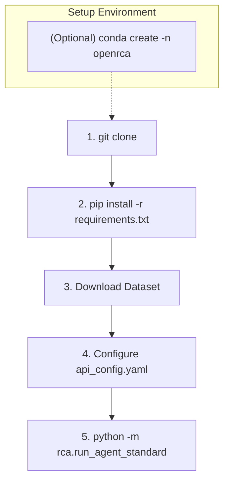
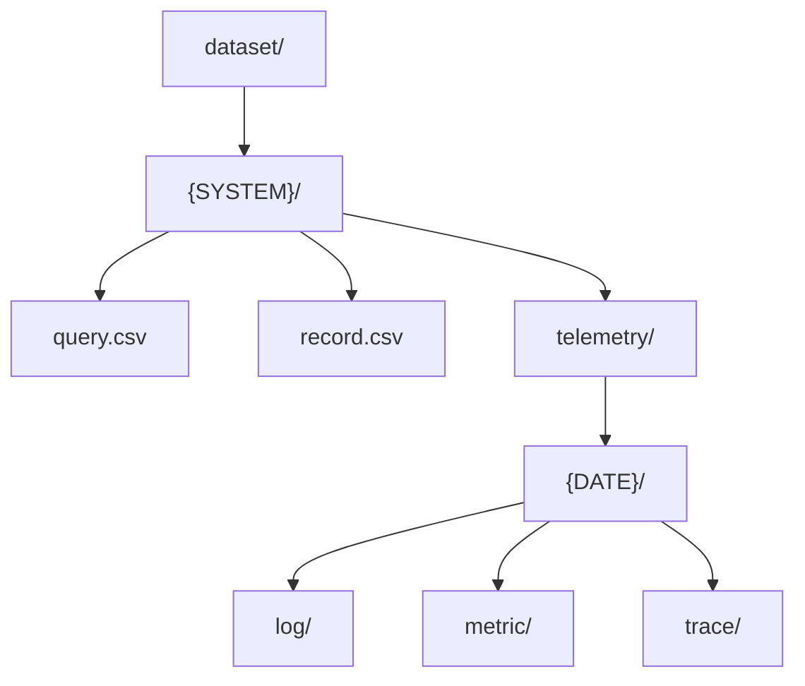
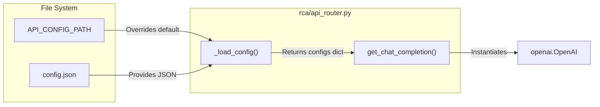

<!-- source: DeepWiki mcp.deepwiki.com · repo microsoft/OpenRCA · page 1.1 Installation and Setup · fetched 2026-10-26 -->

# Installation and Setup

<details>
<summary>Relevant source files</summary>

The following files were used as context for generating this wiki page:

- [.gitignore](.gitignore)
- [README.md](README.md)
- [rca/api_router.py](rca/api_router.py)
- [requirements.txt](requirements.txt)

</details>


This document provides a comprehensive guide for installing and configuring the OpenRCA benchmark. OpenRCA evaluates the root cause analysis capabilities of Large Language Models (LLMs) in software operating scenarios. This page covers hardware requirements, installation steps, dataset setup, and API configuration needed to get started with the benchmark.

## System Requirements

Before proceeding with installation, ensure your system meets the following requirements:

| Requirement | Minimum Specification | Recommended Specification |
|-------------|----------------------|--------------------------|
| Storage     | 80 GB                | 100+ GB                  |
| Memory (RAM)| 32 GB                | 64+ GB                   |
| Python      | 3.10                 | 3.10 or 3.11             |

> ⚠️ OpenRCA includes a large amount of telemetry data, and the RCA-agent requires extensive memory operations. Using a system with less than the recommended specifications may result in performance issues.

Sources: [README.md:21-25]()

## Installation Process

The following diagram illustrates the workflow for setting up the environment and dependencies.

**Environment Setup Workflow**


### 1. Clone Repository

Start by cloning the OpenRCA repository from GitHub and navigating to the project directory:

```bash
git clone https://github.com/microsoft/OpenRCA.git
cd OpenRCA
```

### 2. Create Virtual Environment (Optional)

While optional, it's recommended to use a virtual environment to manage dependencies:

```bash
conda create -n openrca python=3.10
conda activate openrca
```

### 3. Install Dependencies

Install all required packages using pip. The environment relies on several key libraries including `ipython` for the agent's code execution and `openai` for LLM communication.

```bash
pip install -r requirements.txt
```

Key dependencies include:
- `openai==1.54.3`: For LLM interaction [requirements.txt:5]()
- `ipython==8.17.2`: For executing generated analysis code [requirements.txt:2]()
- `pandas==1.5.3`: For telemetry data manipulation [requirements.txt:6]()

Sources: [README.md:26-36](), [requirements.txt:1-11]()

## Dataset Setup

OpenRCA requires telemetry data that must be downloaded separately and placed in the correct directory.

### Downloading the Dataset

1. Download the telemetry data from [Google Drive](https://drive.google.com/drive/folders/1wGiEnu4OkWrjPxfx5ZTROnU37-5UDoPM?usp=drive_link)
2. Extract the downloaded files
3. Place the extracted files in the `dataset/` directory in the root of the OpenRCA repository. Note that `dataset/` is ignored by git to prevent accidental commits of large files [[.gitignore:3]()].

### Dataset Directory Structure

The dataset follows a specific hierarchy required by the data loaders:

**Dataset Hierarchy**


Where:
- `{SYSTEM}` can be `Telecom`, `Bank`, or `Market` [[README.md:56]()]
- For `Market`, there are subdirectories `cloudbed-1` and `cloudbed-2` [[README.md:94-95]()]
- `{DATE}` follows the format `YYYY_MM_DD` [[README.md:56]()]

Sources: [README.md:37-54](), [.gitignore:3]()

## API Configuration

To use RCA-agent or other baselines, you must configure the LLM API settings. The system supports multiple configuration paths.

### Configuration Files

The repository uses two primary configuration files, both of which are ignored by version control to protect credentials [[.gitignore:5-6]()]:
1. `rca/api_config.yaml`: Used by reproduction scripts [[README.md:103]()]
2. `config.json`: Used by the `api_router.py` module [[rca/api_router.py:6]()]

### Setting Up api_config.yaml (Reproduction)

Create `rca/api_config.yaml` for running the standard evaluation scripts:

```yaml
SOURCE:   "OpenAI"
MODEL:    "gpt-4o-2024-05-13"
API_KEY:  "sk-xxxxxxxxxxxxxx"
```

### Setting Up config.json (API Router)

The `rca/api_router.py` script specifically looks for a `config.json` in the root directory by default [[rca/api_router.py:6]()]. It extracts configuration based on a model key (defaulting to `gemini3pro`) [[rca/api_router.py:7]()].

**Code-to-Config Mapping**


Sources: [README.md:103-109](), [rca/api_router.py:6-26](), [.gitignore:5-6]()

## Verifying Installation

After completing the installation, verify the setup by running a baseline.

### Running a Basic Test

Run the following command to test RCA-agent on the Bank dataset:

```bash
python -m rca.run_agent_standard --dataset Bank
```

If successful, the system will:
1. Load configurations from `rca/api_config.yaml` [[README.md:103]()]
2. Initialize the agent and run the reasoning loop.
3. Create a `test/` directory to store results and monitor files [[README.md:132]()].

### Troubleshooting

| Issue | Likely Cause | Resolution |
|-------|--------------|------------|
| `ModuleNotFoundError` | Missing dependencies | Run `pip install -r requirements.txt` [[README.md:35]()] |
| `FileNotFoundError` in `dataset/` | Incorrect structure | Ensure `query.csv` and `telemetry/` are under `dataset/{SYSTEM}/` [[README.md:44-53]()] |
| API Authentication Error | Missing `api_config.yaml` | Create the YAML file in the `rca/` directory [[README.md:103]()] |
| Time Mismatch | Timezone issues | Ensure you are interpreting telemetry in **UTC+8** [[README.md:158]()] |

Sources: [README.md:114-132](), [README.md:154-160]()

---

