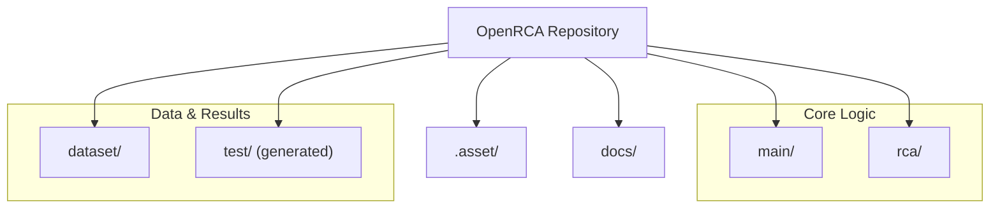
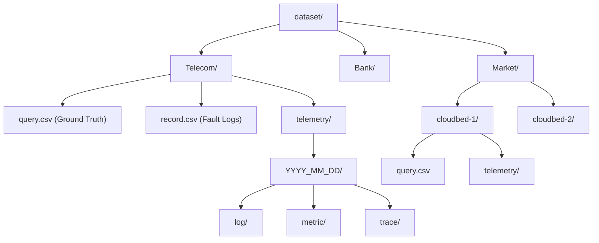
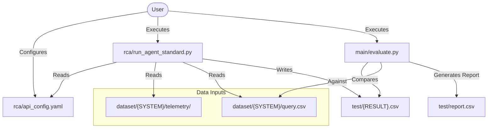
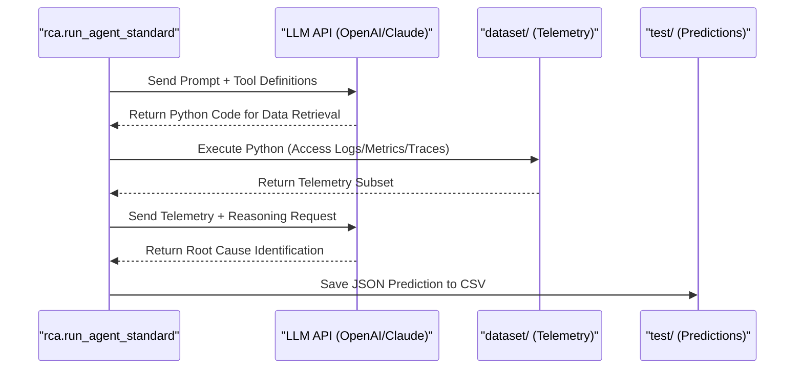

<!-- source: DeepWiki mcp.deepwiki.com · repo microsoft/OpenRCA · page 1.2 Project Structure · fetched 2026-10-26 -->

# Project Structure

<details>
<summary>Relevant source files</summary>

The following files were used as context for generating this wiki page:

- [.asset/openrca.png](.asset/openrca.png)
- [.asset/rcaagent.png](.asset/rcaagent.png)
- [.gitignore](.gitignore)
- [README.md](README.md)
- [dataset/README.md](dataset/README.md)

</details>


This document describes the organization and structure of the OpenRCA repository, detailing the purpose of key directories and files and how they relate to each other. OpenRCA is designed as a benchmark for evaluating Large Language Models (LLMs) in root cause analysis (RCA) tasks across diverse software operating scenarios, including Telecom, Bank, and Market systems [README.md:1-13]().

## Repository Organization

The OpenRCA repository is organized into several top-level directories, each serving a specific purpose in the benchmark system:

```
OpenRCA/
├── .asset/               # Visual assets for documentation and README
├── dataset/              # Telemetry datasets (downloaded separately)
├── docs/                 # Documentation files
├── main/                 # Core evaluation and task generation functionality
├── rca/                  # RCA-agent implementation and baselines
└── test/                 # Generated during execution, contains results and logs
```

The high-level directory structure and its contents are summarized in the diagram below:



Sources: [README.md:40-54](), [.gitignore:1-5]()

## Core Directories

### main/ Directory

This directory contains the core functionality for the OpenRCA benchmark system, focusing on evaluation and task synthesis:

*   `evaluate.py`: Implements the evaluation system that assesses RCA predictions against ground truth queries [README.md:63-67]().
*   `generate.py`: Provides functionality to create new RCA tasks from existing telemetry data using a specification file [README.md:139-144]().
*   `task_specification.json`: Defines the configuration and templates for task generation [README.md:136]().

Sources: [README.md:58-99](), [README.md:135-153]()

### rca/ Directory

The `rca/` directory contains the implementation of the RCA-agent baseline and other baseline approaches. It serves as the primary execution environment for benchmark testing:

*   `run_agent_standard.py`: The main entry point for running the RCA-agent baseline [README.md:115-122]().
*   `run_baseline_balanced.py`: Script to run the balanced baseline approach [README.md:115]().
*   `run_baseline_oracle.py`: Script to run the oracle-based baseline [README.md:115]().
*   `api_config.yaml`: A user-created configuration file for LLM API access (e.g., OpenAI, Claude) [README.md:103-110]().
*   `archive/`: Contains pre-generated prediction results (e.g., `agent-Bank.csv`) for reference or immediate evaluation [README.md:88-91]().

Sources: [README.md:102-132]()

### dataset/ Directory

The `dataset/` directory is empty in the repository by default and must be populated by downloading telemetry data from external sources [dataset/README.md:1-3](). The benchmark supports three system types: `Telecom`, `Bank`, and `Market` [README.md:56]().



Sources: [README.md:37-54](), [README.md:124-130]()

## System Component Interaction

The following diagram bridges the "Natural Language Space" (User Queries) to the "Code Entity Space" by showing how scripts like `evaluate.py` and `run_agent_standard.py` process data:



Sources: [README.md:63-99](), [README.md:103-132]()

## Data Flow in RCA-agent

The RCA-agent baseline uses Python for data retrieval and analysis to avoid processing overly long contexts in the LLM [README.md:15-18]().



Sources: [README.md:15-18](), [README.md:69-81]()

## Key Configuration and Metadata Files

OpenRCA relies on specific file schemas to maintain consistency across different telemetry systems:

| File | Purpose | Location |
|------|---------|----------|
| `api_config.yaml` | Configures `SOURCE`, `MODEL`, and `API_KEY` for LLM interaction [README.md:103-110](). | `rca/` |
| `query.csv` | Ground truth for evaluation; contains natural language queries and expected root causes [README.md:45, 92-96](). | `dataset/{SYSTEM}/` |
| `record.csv` | Historical fault records used by `main.generate` to synthesize new tasks [README.md:46, 141, 146](). | `dataset/{SYSTEM}/` |
| `task_specification.json` | Template for generating new RCA queries from telemetry data [README.md:136](). | `main/` |

### Prediction Format
The `evaluate.py` script expects a specific JSON-like string in the "prediction" column of result CSVs [README.md:69-72]():
```json
{
    "1": {
        "root cause occurrence datetime": "[%Y-%m-%d %H:%M:%S]",
        "root cause component": "[COMPONENT]",
        "root cause reason": "[REASON]"
    }
}
```

Sources: [README.md:69-81](), [README.md:103-110](), [README.md:136-146]()

---

