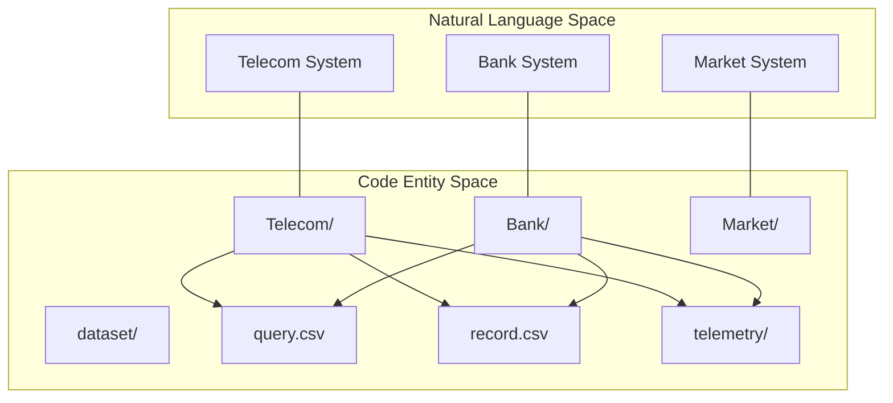
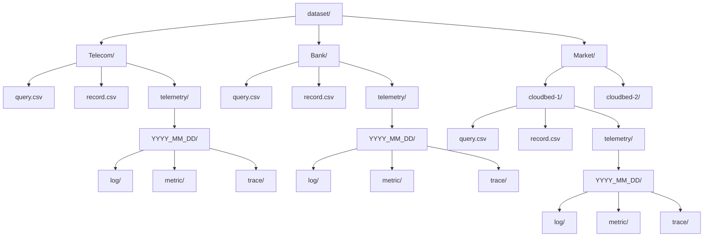
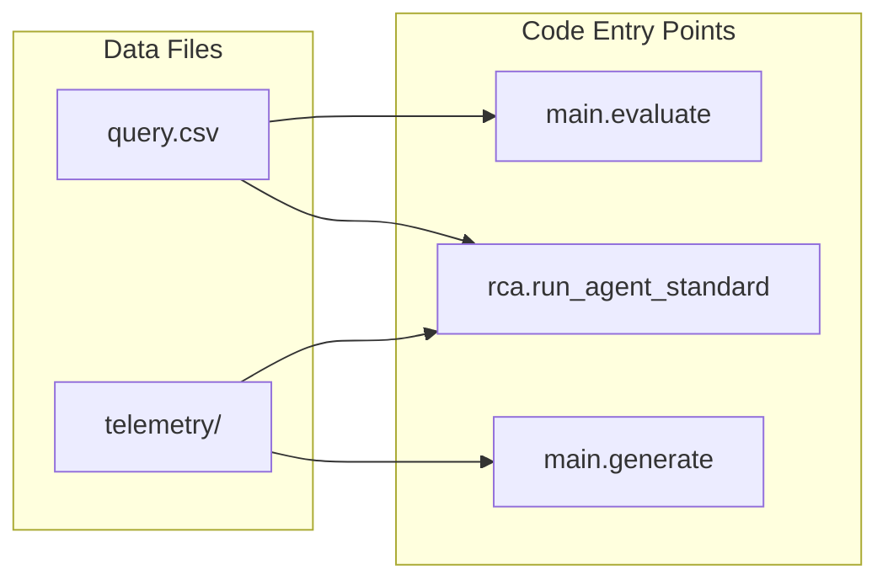

<!-- source: DeepWiki mcp.deepwiki.com · repo microsoft/OpenRCA · page 2 Dataset Structure · fetched 2026-10-26 -->

# Dataset Structure

Relevant source files

The following files were used as context for generating this wiki page:

- [README.md](README.md)
- [dataset/README.md](dataset/README.md)

This document explains the organization and contents of the telemetry datasets in the OpenRCA benchmark system. The dataset is a core component that provides the telemetry data necessary for root cause analysis tasks. For details on how specific data types like metrics and traces are formatted, see [Telemetry Data Types](#2.1).

## Dataset Overview

The OpenRCA dataset contains structured telemetry data from multiple system types, organized to facilitate root cause analysis tasks. The dataset includes KPI time series, dependency trace graphs, and semi-structured logs, providing comprehensive observability data for software systems [README.md:9-10]().

### Natural Language to Code Entity Mapping

The following diagram bridges the gap between the natural language system names used in documentation and the specific directory structures and files used by the code.

Sources: [README.md:42-56]()

## Directory Structure

The dataset follows a consistent hierarchical structure across all system types. Each system has its own directory containing queryable data and telemetry records organized by date [README.md:42-54]().

Sources: [README.md:42-54]()

### System Types

The dataset contains telemetry data from three different system types, each with unique deployment architectures [README.md:174-177]():

| System Type | Description | Structure |
|-------------|-------------|-----------|
| **Telecom** | Telecommunications system | Includes Node, Pod, Container, and Service deployment relationships. |
| **Bank** | Banking system | All components are at the pod level; horizontal pod-level traces only. |
| **Market** | Marketplace system | Contains multiple cloudbed service groups (e.g., `cloudbed-1`, `cloudbed-2`) with vertical mappings like `node-5.adservice-2`. |

Sources: [README.md:56](), [README.md:174-177]()

## Dataset Components

Each system dataset contains three main components [README.md:45-47]():

### query.csv
Contains ground truth data for root cause analysis tasks. It includes the "prediction" field (JSON-like string) used for evaluation, featuring:
- `root cause occurrence datetime`: Format `[%Y-%m-%d %H:%M:%S]`
- `root cause component`: The failing entity (e.g., `COMPONENT`)
- `root cause reason`: Description of the failure (e.g., `REASON`)

Sources: [README.md:69-81]()

### record.csv
Contains historical records of system issues. This file is the primary input for the `main.generate` module to create new RCA tasks. The schema of this file must remain consistent for the task generation pipeline to function correctly [README.md:146-151]().

Sources: [README.md:135-151]()

### telemetry/
Contains the actual observability data organized by date (`YYYY_MM_DD` format). Each date directory contains three subdirectories corresponding to different telemetry data types: `log/`, `metric/`, and `trace/` [README.md:48-51]().

Sources: [README.md:48-51]()

## Data Interaction and Processing

The following diagram maps the high-level data flow to specific code entry points and modules.

Sources: [README.md:63-67](), [README.md:122-130](), [README.md:139-144]()

## Dataset Access and Management

The telemetry dataset is not included in the repository by default and must be downloaded to the `dataset/` directory [README.md:38](). Due to the volume of telemetry, the system requires significant resources:
- **Storage**: At least 80GB [README.md:21]().
- **Memory**: At least 32GB [README.md:21]().
- **Timezone**: All faults and telemetry are recorded in **UTC+8** [README.md:158]().

For more information on the specific telemetry formats, see [Telemetry Data Types](#2.1).

Sources: [README.md:21-38](), [README.md:158]()

---

