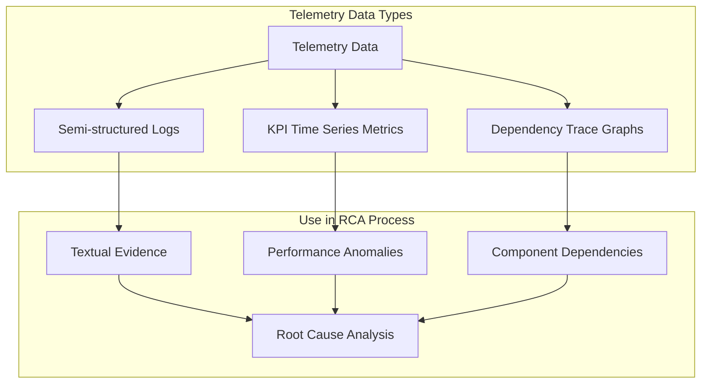
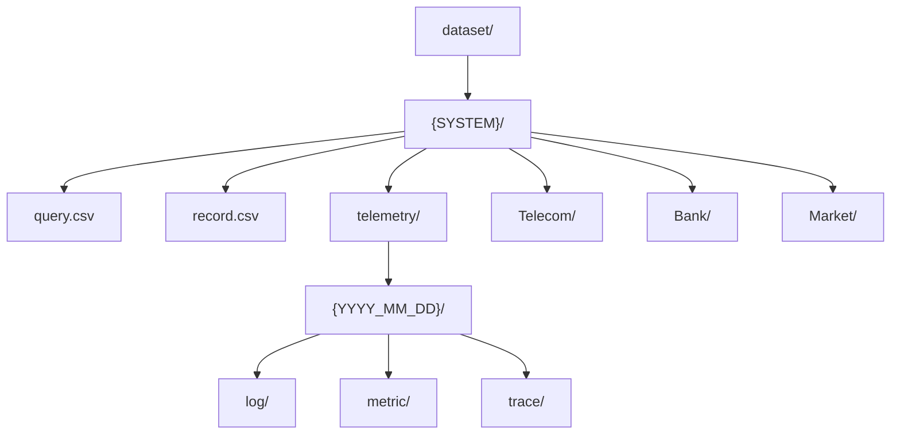
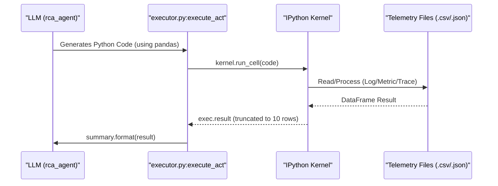

<!-- source: DeepWiki mcp.deepwiki.com · repo microsoft/OpenRCA · page 2.1 Telemetry Data Types · fetched 2026-10-26 -->

# Telemetry Data Types

Relevant source files

The following files were used as context for generating this wiki page:

- [README.md](README.md)
- [dataset/README.md](dataset/README.md)
- [rca/baseline/rca_agent/executor.py](rca/baseline/rca_agent/executor.py)

## Purpose and Scope

This document details the different types of telemetry data used in the OpenRCA benchmark system. It covers the structure, organization, and characteristics of logs, metrics, and traces within the dataset. It further explains how the `RCA-agent` interacts with these data types using a stateful execution environment to perform root cause analysis.

## Telemetry Data Overview

OpenRCA uses three primary types of telemetry data to enable comprehensive root cause analysis. Each type provides different insights into system behavior and is essential for identifying failure patterns and root causes.

*Diagram: Telemetry Data Types and Their Role in RCA*

Sources: [README.md:9-10]()

## Directory Organization

Telemetry data in OpenRCA is organized hierarchically by system, date, and data type. The benchmark requires a specific directory structure for the `main.evaluate` and `main.generate` modules to function correctly.

*Diagram: Telemetry Data Organization in Repository*

Sources: [README.md:42-56]()

The directory structure follows this pattern:
- Each system (`Telecom`, `Bank`, `Market`) has its own directory [README.md:44-46]().
- Each system directory contains `query.csv` (the tasks), `record.csv` (ground truth), and a `telemetry` folder [README.md:45-47]().
- The telemetry folder contains date-specific directories in `YYYY_MM_DD` format [README.md:48-52]().
- Each date directory contains separate folders for `log`, `metric`, and `trace` [README.md:49-51]().

## Detailed Telemetry Data Types

### 1. Semi-structured Logs
Logs are textual records of events occurring within system components. They contain timestamps, severity levels, and descriptive messages. In OpenRCA, these are used to find textual evidence of errors that metrics might miss [README.md:9]().

### 2. KPI Time Series Metrics
Metrics represent quantitative measurements of system performance (CPU, memory, latency). 
- **Timezone**: All telemetry, including metrics, uses the **UTC+8** timezone [README.md:156-158]().
- **Analysis Rule**: The `RCA-agent` is instructed to calculate global thresholds using the entire KPI series before filtering by a specific time duration to avoid bias [rca/baseline/rca_agent/executor.py:46-48]().

### 3. Dependency Trace Graphs
Traces represent execution paths. They are critical for identifying network-related faults which often cannot be identified via KPIs alone [README.md:160-163](). Analysts must examine the latency relationship between parent spans and child spans in these traces.

## Implementation: Data Interaction in Code

The `RCA-agent` interacts with these telemetry types by generating Python code that is executed in an `IPython Kernel`. This allows for efficient handling of large datasets without passing raw telemetry into the LLM context.

*Diagram: Code-Level Interaction with Telemetry Data*

Sources: [rca/baseline/rca_agent/executor.py:50-118](), [README.md:15-17]()

### Key Code Entities for Telemetry Handling

| Entity | File | Role |
|:---|:---|:---|
| `execute_act` | [rca/baseline/rca_agent/executor.py:50]() | Orchestrates the execution of code against telemetry data. |
| `rule` | [rca/baseline/rca_agent/executor.py:36]() | Constraints for the LLM on how to process telemetry (e.g., use pandas, explicit UTC+8). |
| `summary` | [rca/baseline/rca_agent/executor.py:24]() | Template for summarizing telemetry execution results back to the agent. |
| `row_pattern` | [rca/baseline/rca_agent/executor.py:97]() | Regex used to detect and notify the agent if a telemetry DataFrame was truncated. |

## Data Organization by System Type

The telemetry characteristics vary by system architecture:

| System Type | Deployment Structure | Telemetry Nuance |
|-------------|----------------------|---------------------------|
| **Telecom** | Service-oriented | Vertical deployment structure available in external documentation [README.md:175](). |
| **Bank** | Pod-level | Only horizontal pod-level traces; no vertical deployment structure [README.md:176](). |
| **Market** | Node/Pod/Container | Detailed in `metric_container.csv` (e.g., `node-5.adservice-2`) [README.md:177](). |

Sources: [README.md:172-177]()

## Accessing Telemetry via RCA-agent

The `RCA-agent` uses specific rules defined in `executor.py` to ensure data integrity:
1. **Efficiency**: Use `pandas.DataFrame` for tabular data [rca/baseline/rca_agent/executor.py:40]().
2. **Memory Management**: Do not store data as files; only cache as variables in the stateful kernel [rca/baseline/rca_agent/executor.py:43]().
3. **Timezone Handling**: Explicitly use `pytz.timezone('Asia/Shanghai')` to match the dataset's UTC+8 requirement [rca/baseline/rca_agent/executor.py:47-48]().
4. **Context Window**: The executor truncates DataFrame outputs to 10 rows to prevent token overflow, while warning the agent of potential observation bias [rca/baseline/rca_agent/executor.py:101-102]().

Sources: [rca/baseline/rca_agent/executor.py:36-48](), [rca/baseline/rca_agent/executor.py:97-103]()

---

