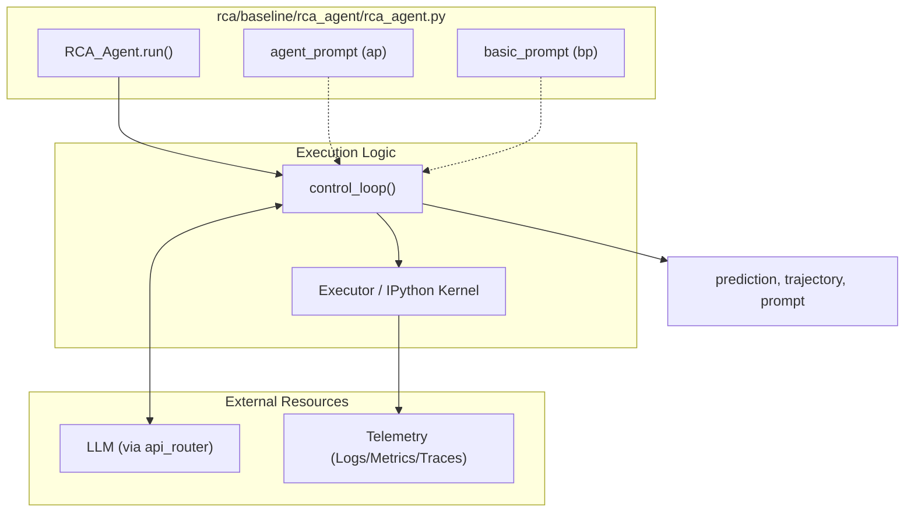

<!-- source: DeepWiki mcp.deepwiki.com · repo microsoft/OpenRCA · page 3 RCA-agent Architecture · fetched 2026-10-26 -->

# RCA-agent Architecture

<details>
<summary>Relevant source files</summary>

The following files were used as context for generating this wiki page:

- [README.md](README.md)
- [rca/baseline/rca_agent/rca_agent.py](rca/baseline/rca_agent/rca_agent.py)
- [rca/run_agent_standard.py](rca/run_agent_standard.py)

</details>


This document provides a comprehensive overview of the RCA-agent architecture, a baseline implementation for root cause analysis (RCA) in the OpenRCA benchmark. RCA-agent is designed to analyze telemetry data efficiently by using Python for data retrieval and processing, allowing the Large Language Model (LLM) to focus on reasoning rather than handling large contexts.

For detailed technical specifications of the internal components, see the following child pages:
- [Controller and Executor](#3.1) — Details the `control_loop` and IPython execution environment.
- [Prompts and Domain Configurations](#3.2) — Explains the `agent_prompt` and domain-specific `basic_prompt` files.
- [Alternative Baselines](#3.3) — Describes DirectLM, CoT-LM, and Oracle KPI baselines.

## 1. Overview and Purpose

The `RCA_Agent` class [rca/baseline/rca_agent/rca_agent.py:3-15]() serves as the primary entry point for the baseline. It implements a ReAct-style agentic workflow where the model can interact with the telemetry environment through code.

The agent is designed to:
1. **Minimize Context Window Pressure**: By using Python for data retrieval, the model avoids processing raw, overly long telemetry contexts [README.md:15-16]().
2. **Handle Multi-Modal Telemetry**: It processes KPI time series (metrics), dependency trace graphs, and semi-structured log text [README.md:9-11]().
3. **Scalable Reasoning**: It uses an iterative `control_loop` to perform step-by-step investigation [rca/baseline/rca_agent/rca_agent.py:12]().

Sources: [README.md:9-17](), [rca/baseline/rca_agent/rca_agent.py:3-15]()

## 2. High-Level Architecture

The architecture follows a **Controller-Executor** pattern. The `RCA_Agent` is initialized with two types of prompts: an `agent_prompt` (defining the agent's identity and tool use) and a `basic_prompt` (providing domain-specific knowledge like system topology) [rca/baseline/rca_agent/rca_agent.py:4-7]().

### RCA-agent Component Interaction



Sources: [rca/baseline/rca_agent/rca_agent.py:1-15](), [rca/run_agent_standard.py:21-28]()

## 3. Core Components

### 3.1 Controller and Executor
The `control_loop` function [rca/baseline/rca_agent/rca_agent.py:12]() manages the interaction between the LLM and the environment. It maintains a `trajectory` of actions taken (Python code) and observations received (code output). The **Executor** runs the generated Python code within an isolated kernel to query the `dataset/{SYSTEM}/telemetry` directories.

For details, see [Controller and Executor](#3.1).

### 3.2 Prompts and Domain Configurations
The agent utilizes a tiered prompting strategy. The `agent_prompt` [rca/run_agent_standard.py:22]() defines the general reasoning framework, while `basic_prompt_{SYSTEM}` files (e.g., `basic_prompt_Telecom.py`) provide specific system architecture details, such as the relationship between Nodes, Pods, and Services [rca/run_agent_standard.py:23-28]().

For details, see [Prompts and Domain Configurations](#3.2).

### 3.3 Alternative Baselines
Beyond the main `RCA_Agent`, the repository includes simpler baselines for comparison:
*   **DirectLM**: Zero-shot root cause prediction.
*   **CoT-LM**: Chain-of-Thought reasoning without tool use.
*   **Oracle KPIs**: A baseline provided with "ground truth" anomalous KPIs to test reasoning isolation.

For details, see [Alternative Baselines](#3.3).

## 4. Operational Workflow

The standard execution flow is managed by `rca/run_agent_standard.py`. It iterates through the `query.csv` file, instantiates the `RCA_Agent`, and captures the reasoning trajectory into Jupyter Notebook (`.ipynb`) files for manual inspection [rca/run_agent_standard.py:91-119]().

### Workflow Sequence

```mermaid
sequenceDiagram
    participant Main as "rca/run_agent_standard.py"
    participant Agent as "RCA_Agent"
    participant Loop as "control_loop"
    participant Kernel as "IPython Executor"
    
    Main->>Agent: run(instruction)
    Agent->>Loop: start loop (max_step, max_turn)
    loop Reasoning Steps
        Loop->>Loop: Construct Prompt (ap + bp + history)
        Loop->>Loop: Call LLM for Python Code
        Loop->>Kernel: Execute generated code
        Kernel->>Loop: Return data/error
    end
    Loop-->>Agent: return prediction
    Agent-->>Main: return result & trajectory
    Main->>Main: Save .ipynb & .json logs
```

Sources: [rca/run_agent_standard.py:91-124](), [rca/baseline/rca_agent/rca_agent.py:9-15]()

## 5. System Requirements

Due to the heavy memory requirements of loading telemetry data into the Python environment for analysis, the following hardware is recommended:
*   **Storage**: 80GB (to accommodate full telemetry datasets) [README.md:21-22]().
*   **Memory**: 32GB RAM (to support dataframes and in-memory analysis) [README.md:21-22]().
*   **Runtime**: Python >= 3.10 [README.md:25]().

Sources: [README.md:21-25]()

---

