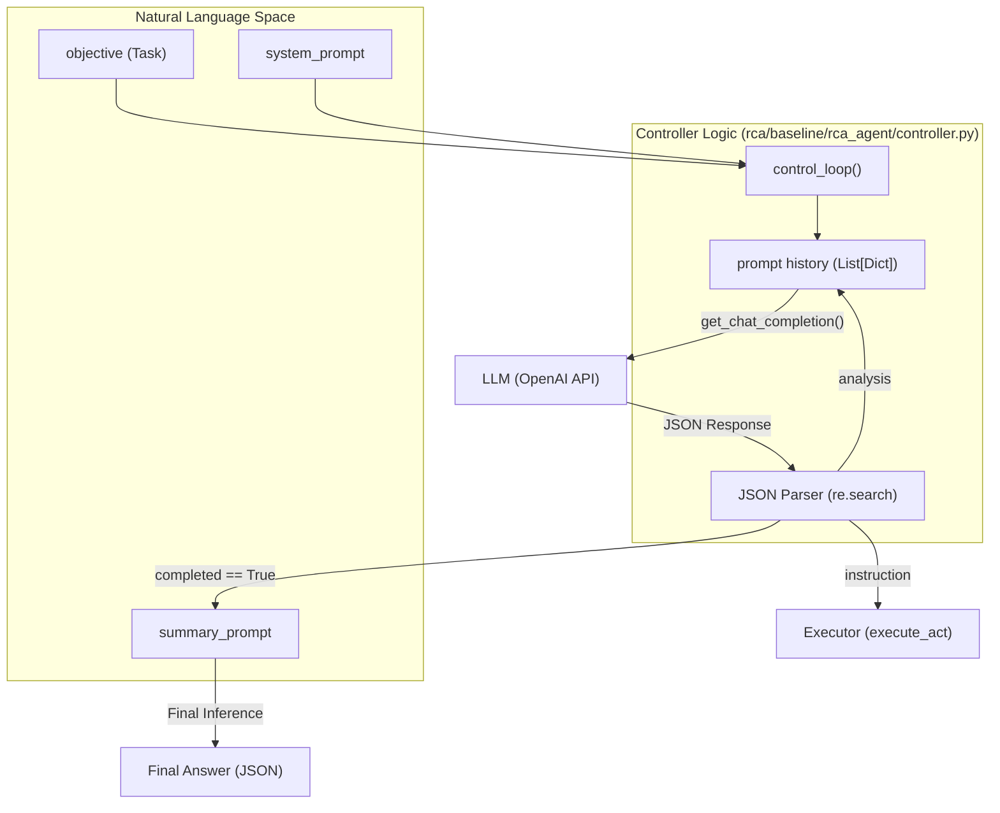

<!-- source: DeepWiki mcp.deepwiki.com · repo microsoft/OpenRCA · page 3.1 Controller and Executor · fetched 2026-10-26 -->

# Controller and Executor

<details>
<summary>Relevant source files</summary>

The following files were used as context for generating this wiki page:

- [rca/api_router.py](rca/api_router.py)
- [rca/baseline/rca_agent/controller.py](rca/baseline/rca_agent/controller.py)
- [rca/baseline/rca_agent/executor.py](rca/baseline/rca_agent/executor.py)

</details>


The RCA-agent operates using a **Controller-Executor** pattern, a specialized implementation of the ReAct (Reasoning and Acting) framework tailored for Root Cause Analysis. In this architecture, a high-level **Controller** manages the reasoning logic and strategic planning, while a low-level **Executor** translates natural language instructions into executable Python code to interact with telemetry data.

## 1. Controller: Reasoning and Orchestration

The Controller is the central orchestrator of the agent. It maintains the global state of the investigation and determines the next logical step in the RCA process. It is implemented primarily via the `control_loop` function in `rca/baseline/rca_agent/controller.py`.

### Key Responsibilities
*   **State Management**: It maintains the `prompt` history (messages sent to the LLM) and the `trajectory` (a record of code executed and results observed) [rca/baseline/rca_agent/controller.py:70-71]().
*   **Reasoning Loop**: It iteratively prompts the LLM to analyze previous results and generate new instructions until the `completed` flag is set to `"True"` [rca/baseline/rca_agent/controller.py:80-102]().
*   **Final Answer Synthesis**: Once the investigation is complete, it uses a specific `summary` prompt to force the LLM to select from valid candidate components and reasons [rca/baseline/rca_agent/controller.py:34-58]().

### Implementation Details
The `control_loop` initializes an `InteractiveShellEmbed` kernel from IPython to provide a stateful environment where variables persist across different steps of the reasoning process [rca/baseline/rca_agent/controller.py:74-78]().

### Data Flow: Natural Language to Reasoning
The following diagram illustrates how the Controller bridges the user's objective (Natural Language Space) into structured reasoning steps.

**Controller Reasoning Flow**

Sources: [rca/baseline/rca_agent/controller.py:60-125](), [rca/api_router.py:28-57]()

---

## 2. Executor: Code Generation and Execution

The Executor acts as the bridge between the Controller's high-level instructions and the raw telemetry files. It is responsible for writing, validating, and running Python code.

### Key Responsibilities
*   **Code Generation**: It takes an `instruction` from the Controller and uses an LLM to generate a Python code block [rca/baseline/rca_agent/executor.py:50-82]().
*   **IPython Interaction**: It executes the code using `kernel.run_cell(code)` and captures the output or errors [rca/baseline/rca_agent/executor.py:88-91]().
*   **Self-Correction**: If the code fails (e.g., syntax error or runtime exception), the Executor catches the traceback and re-prompts the LLM to fix the code [rca/baseline/rca_agent/executor.py:119-126]().
*   **Result Summarization**: After successful execution, it prompts the LLM to provide a "plain English" summary of the technical output to make it easier for the Controller to digest [rca/baseline/rca_agent/executor.py:109-116]().

### Execution Rules
The Executor is bound by strict `RULES OF PYTHON CODE WRITING`, which include:
*   Using `pytz.timezone('Asia/Shanghai')` for all time operations [rca/baseline/rca_agent/executor.py:47]().
*   Avoiding visualization libraries like `matplotlib` or `seaborn` [rca/baseline/rca_agent/executor.py:44]().
*   Calculating global thresholds *before* filtering data to avoid observation bias [rca/baseline/rca_agent/executor.py:46]().

### Data Flow: Code Entity Space
The following diagram shows how the Executor interacts with the IPython kernel and handles data.

**Executor Code Interaction**
```mermaid
graph TD
    subgraph "Controller Instruction"
        INS["instruction (str)"]
    end

    subgraph "Executor Logic (rca/baseline/rca_agent/executor.py)"
        EA["execute_act()"]
        CP["code_pattern (Regex)"]
        SUM["summary_logic"]
    end

    subgraph "Code Entity Space (IPython)"
        KRN["InteractiveShellEmbed"]
        DF["pandas.DataFrame"]
        VAR["Stateful Variables"]
    end

    INS --> EA
    EA --> |"Prompting"| LLM["LLM (Code Gen)"]
    LLM --> |"```python...```"| CP
    CP --> |"code"| KRN
    KRN --> |"run_cell()"| DF
    DF --> VAR
    KRN --> |"exec.result"| SUM
    SUM --> |"Plain English"| RES["result (str)"]
    
    KRN -.-> |"exec.error_in_exec"| EA
```
Sources: [rca/baseline/rca_agent/executor.py:36-48](), [rca/baseline/rca_agent/executor.py:50-126]()

---

## 3. Interaction Protocol

The communication between the Controller and Executor follows a structured JSON-based protocol to ensure reliability.

### Controller to Executor
The Controller sends an `instruction` which is a specific task like: *"Read the logs for the 'auth-service' between 10:00 and 10:05 and check for 5xx errors."* [rca/baseline/rca_agent/controller.py:27-32]().

### Executor to Controller
The Executor returns a tuple containing:
1.  **code**: The Python code that was run.
2.  **result**: A combination of the LLM's plain English summary and the raw IPython output [rca/baseline/rca_agent/executor.py:116-118]().
3.  **status**: A boolean indicating if execution was successful.
4.  **history**: The updated message history for the executor's internal context.

| Component | Class/Function | Primary Input | Primary Output |
| :--- | :--- | :--- | :--- |
| **Controller** | `control_loop` | `objective`, `ap.rules`, `bp.schema` | Final Answer (JSON) |
| **Executor** | `execute_act` | `instruction`, `kernel` | Code, Result String, Status |
| **API Bridge** | `get_chat_completion` | `messages` | LLM String Content |

Sources: [rca/baseline/rca_agent/controller.py:60-125](), [rca/baseline/rca_agent/executor.py:50-136](), [rca/api_router.py:28-57]()

---

