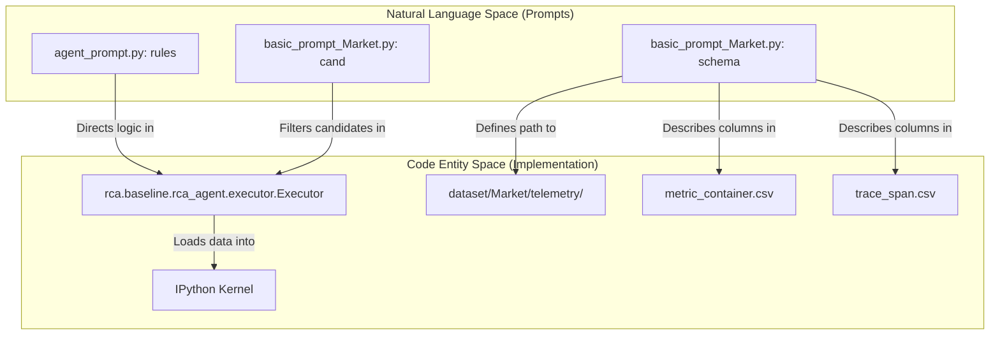
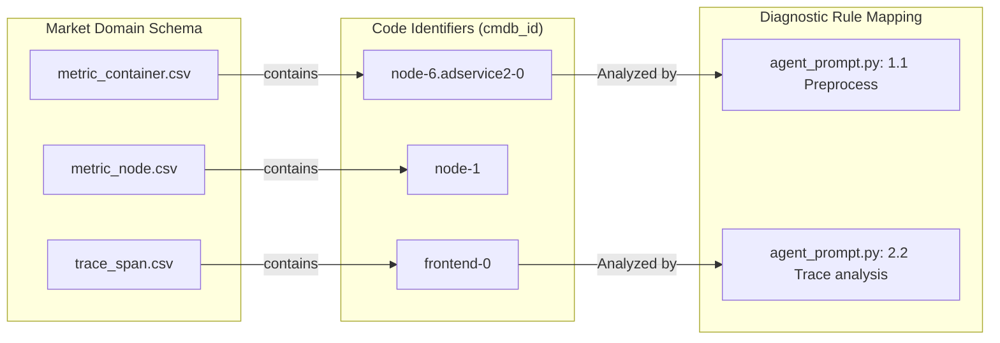

<!-- source: DeepWiki mcp.deepwiki.com · repo microsoft/OpenRCA · page 3.2 Prompts and Domain Configurations · fetched 2026-10-26 -->

# Prompts and Domain Configurations

Relevant source files

The following files were used as context for generating this wiki page:

- [rca/baseline/rca_agent/prompt/agent_prompt.py](rca/baseline/rca_agent/prompt/agent_prompt.py)
- [rca/baseline/rca_agent/prompt/basic_prompt_Bank.py](rca/baseline/rca_agent/prompt/basic_prompt_Bank.py)
- [rca/baseline/rca_agent/prompt/basic_prompt_Market.py](rca/baseline/rca_agent/prompt/basic_prompt_Market.py)
- [rca/baseline/rca_agent/prompt/basic_prompt_Telecom.py](rca/baseline/rca_agent/prompt/basic_prompt_Telecom.py)

The RCA-agent relies on a sophisticated prompt engineering subsystem to guide the Large Language Model (LLM) through the complexities of root cause analysis. This system is divided into two primary layers: a global **Agent-Level Prompt** that defines the logical workflow and diagnostic rules, and **Domain-Specific Basic Prompts** that provide the LLM with the necessary context regarding system architecture, telemetry schemas, and valid failure modes for different industrial domains (Telecom, Bank, and Market).

## Agent-Level Diagnostic Workflow

The agent-level prompt establishes a rigorous four-stage workflow that the LLM must follow to ensure consistency and accuracy in its reasoning. This workflow is designed to mimic the behavior of a site reliability engineer (SRE).

### Diagnostic Stages
1.  **Preprocess**: Aggregate KPIs by `component-KPI` and calculate global thresholds (e.g., P95) across the entire dataset before temporal filtering [rca/baseline/rca_agent/prompt/agent_prompt.py:6-9]().
2.  **Anomaly Detection**: Identify data points exceeding thresholds or significant drops in business KPIs (success rates) [rca/baseline/rca_agent/prompt/agent_prompt.py:10-13]().
3.  **Fault Identification**: Group consecutive anomalies into "faults," filtering out isolated noise and minor fluctuations [rca/baseline/rca_agent/prompt/agent_prompt.py:14-17]().
4.  **Root Cause Localization**: Determine the specific fault that caused the failure by analyzing downstream dependencies in traces and identifying the first point of failure [rca/baseline/rca_agent/prompt/agent_prompt.py:18-24]().

### Operational Constraints
The prompt enforces strict rules to prevent common LLM hallucinations and technical errors:
*   **Threshold Calculation**: Thresholds must be calculated using the entire daily KPI series, not just the window of the failure [rca/baseline/rca_agent/prompt/agent_prompt.py:36-39]().
*   **Data Modality Order**: Analysis must proceed from Metrics -> Traces -> Logs [rca/baseline/rca_agent/prompt/agent_prompt.py:25-29]().
*   **Tool Usage**: The LLM is forbidden from using visualization libraries (`matplotlib`) or local file system storage, forcing it to rely on the IPython kernel state [rca/baseline/rca_agent/prompt/agent_prompt.py:37-38]().

**Sources:** [rca/baseline/rca_agent/prompt/agent_prompt.py:1-43]()

## Domain Configurations

Each supported domain (Telecom, Bank, Market) has a dedicated configuration file that defines the environment the agent is operating in. These files include the directory structure, data schema, and a list of possible root cause candidates.

### 1. Bank System
The Bank system represents a traditional financial platform with components like Apache, Tomcat, MySQL, and Redis.

| Feature | Description |
| :--- | :--- |
| **Components** | `apache01-02`, `Tomcat01-04`, `MG01-02`, `IG01-02`, `Mysql01-02`, `Redis01-02` [rca/baseline/rca_agent/prompt/basic_prompt_Bank.py:14-27]() |
| **Metric KPIs** | `rr` (response rate), `sr` (success rate), `cnt`, `mrt` (mean response time) [rca/baseline/rca_agent/prompt/basic_prompt_Bank.py:46-48]() |
| **Fault Types** | JVM OOM, High CPU/Memory, Network Latency/Loss, Disk I/O [rca/baseline/rca_agent/prompt/basic_prompt_Bank.py:3-10]() |

**Sources:** [rca/baseline/rca_agent/prompt/basic_prompt_Bank.py:1-91]()

### 2. Market (E-commerce) System
The Market system is a complex microservices environment (e.g., Online Boutique) deployed across multiple "cloudbeds" (clusters). It introduces hierarchical levels: Node, Pod (Container), and Service.

| Level | Identification (cmdb_id) | Example |
| :--- | :--- | :--- |
| **Node** | `<node>-x` | `node-1` [rca/baseline/rca_agent/prompt/basic_prompt_Market.py:184]() |
| **Pod** | `<node>-x.<service>-x` | `node-1.adservice-0` [rca/baseline/rca_agent/prompt/basic_prompt_Market.py:183]() |
| **Service** | `<service>-grpc` | `adservice-grpc` [rca/baseline/rca_agent/prompt/basic_prompt_Market.py:185]() |

**Sources:** [rca/baseline/rca_agent/prompt/basic_prompt_Market.py:1-191]()

### 3. Telecom System
The Telecom system focuses on a database-heavy architecture with specific identifiers for middleware and containers.

| Feature | Detail |
| :--- | :--- |
| **Metric Files** | `metric_app`, `metric_container`, `metric_middleware`, `metric_node`, `metric_service` [rca/baseline/rca_agent/prompt/basic_prompt_Telecom.py:75-110]() |
| **Trace Types** | `JDBC`, `LOCAL`, `RemoteProcess`, `FlyRemote`, `OSB` [rca/baseline/rca_agent/prompt/basic_prompt_Telecom.py:117-122]() |
| **Fault Types** | CPU fault, Network delay/loss, DB connection limit, DB close [rca/baseline/rca_agent/prompt/basic_prompt_Telecom.py:3-7]() |

**Sources:** [rca/baseline/rca_agent/prompt/basic_prompt_Telecom.py:1-139]()

## Technical Data Flow

The following diagram illustrates how the natural language prompts translate into code-level entities during the agent's execution.

### Diagram: Prompt to Code Entity Mapping

**Sources:** [rca/baseline/rca_agent/prompt/agent_prompt.py:1-43](), [rca/baseline/rca_agent/prompt/basic_prompt_Market.py:85-158]()

### Diagram: Domain Data Structure and Identifiers
This diagram shows how specific `cmdb_id` formats defined in the prompts map to the underlying CSV data structures.

**Sources:** [rca/baseline/rca_agent/prompt/agent_prompt.py:5-29](), [rca/baseline/rca_agent/prompt/basic_prompt_Market.py:99-141]()

---

