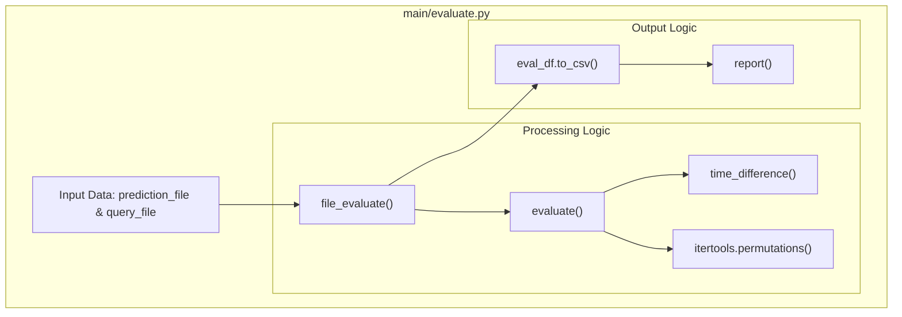

<!-- source: DeepWiki mcp.deepwiki.com · repo microsoft/OpenRCA · page 4 Evaluation System · fetched 2026-10-26 -->

# Evaluation System

<details>
<summary>Relevant source files</summary>

The following files were used as context for generating this wiki page:

- [README.md](README.md)
- [main/evaluate.py](main/evaluate.py)

</details>


The Evaluation System in OpenRCA provides a methodology for assessing the accuracy of root cause analysis (RCA) predictions made by Large Language Models (LLMs) against the ground truth. It serves as the scoring backbone of the benchmark, allowing for standardized comparison of different RCA approaches. For specific details about scoring criteria, see [Scoring Mechanism](#4.1).

## Overview

The Evaluation System compares predictions to ground truth data, calculates accuracy scores, and generates comprehensive reports. It supports evaluation of both individual predictions and batch processing of prediction files.

### Evaluation Workflow Logic

The diagram below maps the evaluation process to the code entities responsible for processing predictions.


Sources: [main/evaluate.py:9-101](), [main/evaluate.py:104-150](), [main/evaluate.py:152-187]()

## Prediction Format

The evaluation system expects predictions in a specific JSON-like format. Each prediction should contain information about one or more root causes, with each cause represented as a JSON object containing specific keys. The system uses regex patterns defined in `evaluate()` to extract these fields [main/evaluate.py:19-24]().

1. `root cause occurrence datetime`: The timestamp of the fault.
2. `root cause component`: The specific system entity affected.
3. `root cause reason`: The description of the failure.

```json
{
    "1": {
        "root cause occurrence datetime": "2024-05-13 14:00:00",
        "root cause component": "adservice",
        "root cause reason": "CPU saturation"
    }
}
```

This format allows for representing multiple root causes in chronological order, which is particularly important for complex failure scenarios [README.md:72-81]().

Sources: [README.md:72-81](), [main/evaluate.py:19-37]()

## Core Evaluation Functions

The evaluation logic is encapsulated in `main/evaluate.py` and consists of three primary functions that bridge the gap between LLM natural language output and structured performance metrics.

### 1. `evaluate(prediction, scoring_points)`
This function handles the core logic of comparing a single prediction string against the `scoring_points` string from the query dataset [main/evaluate.py:9-15](). It extracts components, reasons, and timestamps using regex and calculates a score based on the matching results [main/evaluate.py:43-52]().

### 2. `file_evaluate(prediction_file, query_file, report_file)`
A batch processing wrapper that iterates through a prediction CSV and its corresponding ground truth `query.csv` [main/evaluate.py:104-115](). It aligns rows (optionally using `row_id`) and concatenates results into an `eval_df` [main/evaluate.py:118-141]().

### 3. `report(report_file)`
This function performs the final statistical aggregation [main/evaluate.py:152-157](). It categorizes results by difficulty and prints a formatted table showing Total, Correct, and Accuracy percentages for "easy", "middle", and "hard" tasks [main/evaluate.py:160-186]().

Sources: [main/evaluate.py:9-101](), [main/evaluate.py:104-150](), [main/evaluate.py:152-187]()

## Task Difficulty Classification

The Evaluation System classifies tasks based on the `task_index` found in the `query.csv` file. The difficulty mapping is defined within the `report` function [main/evaluate.py:179]().

| Difficulty Level | Task Indices | Logic in `report()` |
|------------------|--------------|-----------------|
| **Easy**         | 1-3          | `int(x.split('_')[1]) <= 3` |
| **Middle**       | 4-6          | `int(x.split('_')[1]) <= 6` |
| **Hard**         | 7            | `int(x.split('_')[1]) == 7` |

Sources: [main/evaluate.py:178-180]()

## Execution and Output

The evaluation system is invoked via the `main.evaluate` module [README.md:63-67]().

### Command Line Interface
```bash
python -m main.evaluate \
    -p [prediction csv files] \
    -q [groundtruth csv files] \
    -r [report csv file to save]
```

### Evaluation Output Data Model
The resulting `report_file` (CSV) contains the following schema produced during the evaluation loop [main/evaluate.py:121]():

| Field | Description |
| :--- | :--- |
| `query` | The original natural language instruction [main/evaluate.py:133]() |
| `answer` | The raw prediction string from the LLM [main/evaluate.py:134]() |
| `groundtruth` | The expected `scoring_points` [main/evaluate.py:135]() |
| `passed` | List of criteria successfully met [main/evaluate.py:136]() |
| `failed` | List of criteria missed [main/evaluate.py:137]() |
| `score` | Numerical score (0.0 to 1.0) [main/evaluate.py:138]() |
| `task_index` | Identifier used for difficulty classification [main/evaluate.py:139]() |

Sources: [README.md:63-67](), [main/evaluate.py:121-141](), [main/evaluate.py:190-216]()

## Implementation Details

The evaluation algorithm handles several complex cases:

1. **Permutation Matching**: For multi-fault scenarios, `itertools.permutations` is used to find the best possible match between predicted results and ground truth points to ensure the highest possible score is awarded [main/evaluate.py:76-95]().
2. **Temporal Tolerance**: The `time_difference` helper function allows a 60-second window for "root cause occurrence datetime" matches, recognizing that sampling frequencies may not align perfectly with fault injection times [main/evaluate.py:54-68]().
3. **Regex Extraction**: The system uses strict patterns (e.g., `predict_pattern`) to parse the LLM's JSON-like response, ensuring that minor formatting deviations do not break the evaluation [main/evaluate.py:19-24]().

For a deeper dive into how scores are computed and how the permutation matching works, see **[Scoring Mechanism](#4.1)**.

Sources: [main/evaluate.py:19-24](), [main/evaluate.py:54-68](), [main/evaluate.py:76-95]()

---

