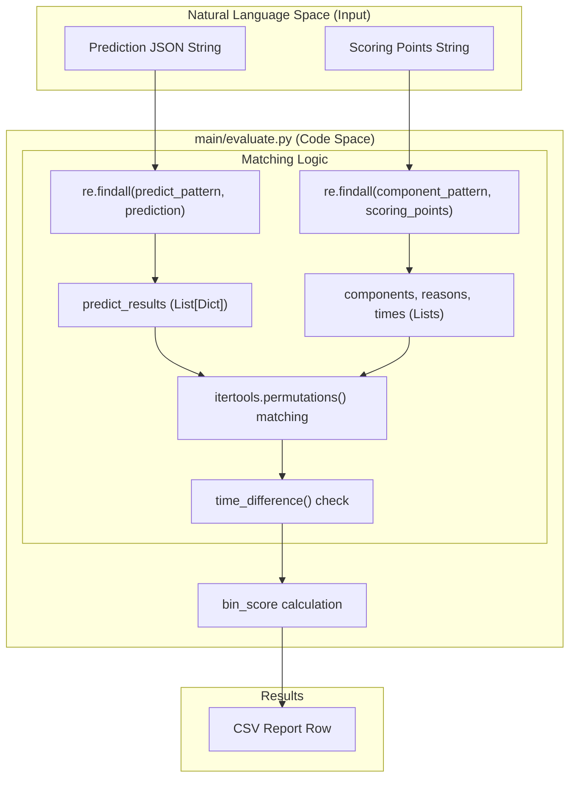
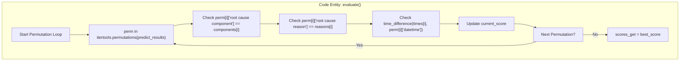

<!-- source: DeepWiki mcp.deepwiki.com · repo microsoft/OpenRCA · page 4.1 Scoring Mechanism · fetched 2026-10-26 -->

# Scoring Mechanism

<details>
<summary>Relevant source files</summary>

The following files were used as context for generating this wiki page:

- [main/evaluate.py](main/evaluate.py)
- [rca/archive/agent-Bank.csv](rca/archive/agent-Bank.csv)
- [rca/archive/agent-Market-cloudbed-1.csv](rca/archive/agent-Market-cloudbed-1.csv)
- [rca/archive/agent-Market-cloudbed-2.csv](rca/archive/agent-Market-cloudbed-2.csv)
- [rca/archive/agent-Telecom.csv](rca/archive/agent-Telecom.csv)

</details>


This page documents the scoring mechanism used in the OpenRCA benchmark to evaluate the accuracy of root cause analysis predictions. The scoring system provides a standardized method for assessing how well an RCA solution identifies the correct root causes of issues in telemetry data.

## Overview of the Scoring Process

The OpenRCA benchmark evaluates predictions by comparing them against ground truth data. Each prediction is scored based on three key elements:

1. **Root cause occurrence datetime**
2. **Root cause component**
3. **Root cause reason**

The scoring system is designed to be robust, handling both single and multiple root cause scenarios, while providing a normalized score that represents the overall accuracy of predictions.

### Natural Language Space to Code Space Mapping: Evaluation Flow
This diagram illustrates how the natural language predictions and scoring points are processed by the evaluation logic in `main/evaluate.py`.


Sources: [main/evaluate.py:9-101]()

## Prediction Format and Extraction

The system expects predictions in a JSON-like format. The `evaluate` function in `main/evaluate.py` uses a specific regex pattern `predict_pattern` to extract information even if the LLM output includes conversational filler.

### Expected Prediction Format
[main/evaluate.py:19-24]()
```json
{
  "root cause occurrence datetime": "YYYY-MM-DD HH:MM:SS",
  "root cause component": "ComponentName",
  "root cause reason": "Description of the root cause"
}
```

Multiple root causes can be specified as multiple JSON objects in the prediction string. The extraction logic iterates through all matches found by `re.findall` and stores them in `predict_results`.

Sources: [main/evaluate.py:19-37]()

## Ground Truth Extraction

Ground truth data is provided in the `scoring_points` field of the query file. The system extracts this information using three distinct regular expressions:
1. `component_pattern`: `r"The (?:\d+-th|only) predicted root cause component is ([^\n]+)"` [main/evaluate.py:43-43]()
2. `reason_pattern`: `r"The (?:\d+-th|only) predicted root cause reason is ([^\n]+)"` [main/evaluate.py:44-44]()
3. `time_pattern`: `r"The (?:\d+-th|only) root cause occurrence time is within 1 minutes (i.e., <=1min) of ([^\n]+)"` [main/evaluate.py:45-45]()

The length of the ground truth is determined by the maximum number of components, reasons, or times found, defined as `scoringpoints_length`.

Sources: [main/evaluate.py:43-51]()

## Matching and Scoring Algorithm

The core logic in `evaluate(prediction, scoring_points)` handles the comparison.

### Time Difference Calculation
The function `time_difference(time1_str, time2_str)` converts string timestamps into `datetime` objects using the format `%Y-%m-%d %H:%M:%S`. A prediction is considered correct if the absolute difference is $\le 60$ seconds.

Sources: [main/evaluate.py:54-68]()

### Permutation-Based Matching
To handle cases where an LLM predicts multiple root causes in a different order than the ground truth, the algorithm uses `itertools.permutations(predict_results)`. It iterates through every possible alignment between the predicted list and the ground truth list to find the `best_score`.


Sources: [main/evaluate.py:74-95]()

## Score Calculation

The final score is a normalized value:
`final_score = scores_get / socres_num` [main/evaluate.py:99-99]()

Where `socres_num` is the total number of individual criteria (sum of components, reasons, and times expected). The result is rounded to two decimal places (`bin_score`).

Sources: [main/evaluate.py:98-101]()

## Task Difficulty Levels

The OpenRCA benchmark classifies tasks into three difficulty levels based on the `task_index` found in the query files:

| Difficulty Level | Task Indices | Description |
|------------------|--------------|-------------|
| **Easy** | `task_1` to `task_3` | Basic RCA scenarios (e.g., identify time only) |
| **Middle** | `task_4` to `task_6` | Moderate complexity (e.g., component + reason) |
| **Hard** | `task_7` | Complex scenarios (e.g., all three elements + multiple failures) |

The `report(report_file)` function dynamically assigns these labels by splitting the `task_index` string (e.g., `task_1` becomes `1`).

Sources: [main/evaluate.py:160-180](), [rca/archive/agent-Bank.csv:2-12]()

## Evaluation Report Generation

The `file_evaluate` function processes entire CSV files, aligning predictions with queries via `row_id` if available. It produces an output CSV containing:
- `passed`: Criteria that matched.
- `failed`: Criteria that did not match.
- `score`: The normalized `bin_score`.

The `report` function then aggregates these into a final summary:
1. **Strict Score**: Count of samples where `score == 1.0`.
2. **Partial Score**: Sum of all `bin_score` values.
3. **Accuracy**: `Strict Score / Total Samples`.

Sources: [main/evaluate.py:104-141](), [main/evaluate.py:182-187]()

## Command-Line Interface

The evaluation system is invoked via `main/evaluate.py`. It requires paired lists of prediction and query files.

```bash
python main/evaluate.py -p <pred_1.csv> -q <query_1.csv> -r <final_report.csv>
```

The script uses `argparse` to handle multiple file inputs and then triggers `file_evaluate` followed by `report`.

Sources: [main/evaluate.py:190-216]()

---

