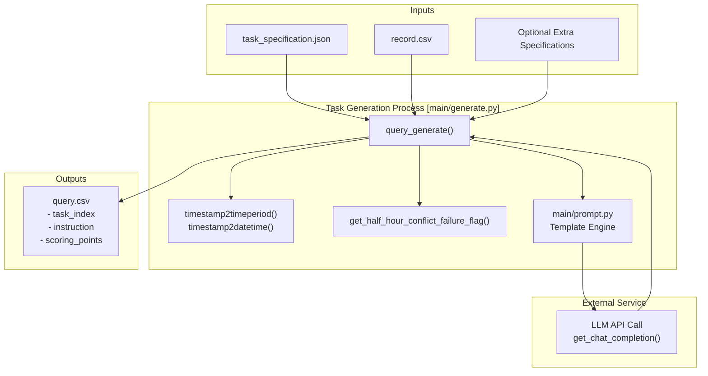
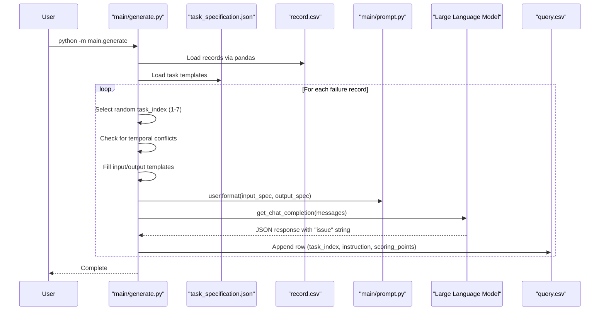
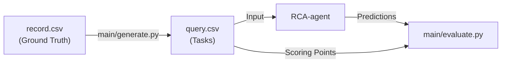

<!-- source: DeepWiki mcp.deepwiki.com · repo microsoft/OpenRCA · page 5 Task Generation · fetched 2026-10-26 -->

# Task Generation

<details>
<summary>Relevant source files</summary>

The following files were used as context for generating this wiki page:

- [README.md](README.md)
- [main/generate.py](main/generate.py)
- [main/prompt.py](main/prompt.py)
- [main/task_specification.json](main/task_specification.json)

</details>


The Task Generation system in OpenRCA provides a mechanism to create root cause analysis (RCA) tasks from telemetry data. This system allows users to generate standardized queries that can be used to evaluate an LLM's ability to analyze software failures from telemetry data. For information about evaluating generated tasks, see [Evaluation System](#4).

## Purpose and Scope

The Task Generation system serves several key purposes:

1. Creating standardized RCA tasks with varying complexity levels.
2. Generating natural language queries from structured task specifications using LLMs.
3. Supporting both the included OpenRCA datasets and custom telemetry data.
4. Providing a foundation for reproducible RCA evaluations by linking telemetry records to specific queries.

Sources: [README.md:136-146](), [main/generate.py:62-163]()

## Task Generation Architecture

The Task Generation system consists of several components that work together to transform telemetry data into structured RCA tasks with natural language queries.



**Task Generation System Components Diagram**

Sources: [main/generate.py:62-163](), [main/generate.py:18-45](), [README.md:136-146]()

## Task Specification Format

Task specifications define the structure and evaluation criteria for RCA tasks. These specifications are stored in a JSON file and include templates for various task types. For a detailed breakdown of these specifications, see [Task Specifications](#5.1).

### Task Specification Structure

Each task specification in `main/task_specification.json` includes:

1.  **Input fields**: Information provided to the LLM (e.g., time range, number of failures).
2.  **Output fields**: Information the LLM needs to determine (e.g., root cause time, component, reason).
3.  **Scoring points**: Criteria used to evaluate the LLM's response, which are formatted into the final query file.

```mermaid
classDiagram
    class TaskSpecification {
        task_1 to task_7
    }

    class TaskTemplate {
        input[] : str
        output[] : str
        scoring_points[] : str
    }

    TaskSpecification --> TaskTemplate : contains

    class InputField {
        "time range: {time_period}"
        "number of failures: {num}"
    }

    class OutputField {
        "root cause occurrence time: {datetime}"
        "root cause component: {component}"
        "root cause reason: {reason}"
    }

    class ScoringPoint {
        "The {idx} predicted root cause component is {component}"
    }

    TaskTemplate --> InputField : defines
    TaskTemplate --> OutputField : defines
    TaskTemplate --> ScoringPoint : defines
```

**Task Specification Structure Diagram**

Sources: [main/task_specification.json:1-96]()

## Generation Process Flow

The task generation process takes telemetry records and task specifications as input and generates natural language queries. It handles complex scenarios such as "multi-response" tasks where multiple failures occur within the same 30-minute window.



**Task Generation Process Flow Diagram**

Sources: [main/generate.py:62-163](), [main/prompt.py:66-73](), [main/generate.py:155-161]()

### Key Generation Logic

*   **Temporal Resolution**: The system converts specific failure timestamps into 30-minute windows using `timestamp2timeperiod` [main/generate.py:18-25]().
*   **Conflict Handling**: `get_half_hour_conflict_failure_flag` identifies if multiple failures share a window, triggering the `get_multi_response_dict` logic to bundle them into a single task [main/generate.py:32-60]().
*   **Scoring Point Generation**: Scoring points are dynamically generated based on whether the task is a single failure ("only") or part of a sequence ("1-th", "2-th", etc.) [main/generate.py:85-108]().

## Natural Language Query Generation

The system uses a "game" metaphor in its system prompt to encourage the LLM to generate realistic, expert-level DevOps issues.

### Prompt System
*   **System Prompt**: Instructs the LLM to act as an assistant generating realistic DevOps failure reports while avoiding revealing the solution or including non-specified values [main/prompt.py:1-64]().
*   **User Prompt**: Provides the structured `known` and `query` blocks for the LLM to transform into prose [main/prompt.py:66-73]().

Sources: [main/prompt.py:1-73]()

## Using the Task Generation System

The Task Generation system is executed via `main/generate.py`. For detailed instructions on creating your own tasks, see [Creating Custom Tasks](#6.2).

### Command-line Interface

| Parameter | Description |
|-----------|-------------|
| `-d` | Use default OpenRCA settings (True/False) [main/generate.py:151-152]() |
| `-s` | Path to specification JSON [main/generate.py:140]() |
| `-r` | Input record CSV file [main/generate.py:141]() |
| `-q` | Output query CSV file path [main/generate.py:142]() |
| `-t` | Timezone of telemetry data [main/generate.py:143]() |

Sources: [main/generate.py:136-144](), [README.md:136-152]()

## Integration with OpenRCA

Task Generation acts as the bridge between raw failure records and the benchmark evaluation.



Sources: [README.md:134-152](), [README.md:58-67]()

---

