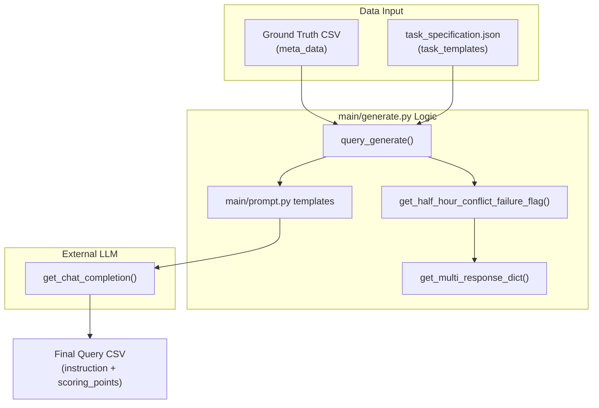
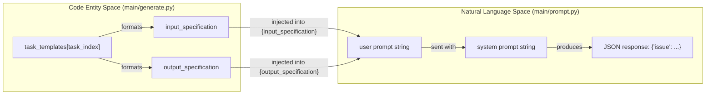

<!-- source: DeepWiki mcp.deepwiki.com · repo microsoft/OpenRCA · page 5.1 Task Specifications · fetched 2026-10-26 -->

# Task Specifications

<details>
<summary>Relevant source files</summary>

The following files were used as context for generating this wiki page:

- [main/generate.py](main/generate.py)
- [main/prompt.py](main/prompt.py)
- [main/task_specification.json](main/task_specification.json)

</details>


## Purpose and Scope

This document details the structure and format of task specifications used in the OpenRCA benchmark system. Task specifications serve as templates for generating root cause analysis (RCA) queries from telemetry data. These specifications define the input information provided to the RCA agent, the expected output format, and the criteria for evaluating predictions. The pipeline bridges the gap between raw telemetry records and natural language problem descriptions suitable for LLM-based agents.

## Task Specification Structure

Task specifications in OpenRCA follow a standardized JSON format that enables systematic generation of diverse RCA tasks. Each task type is defined as a separate entry in the specification file located at `main/task_specification.json`.

```mermaid
classDiagram
    class "TaskSpecification" {
        +task_1: TaskTemplate
        +task_2: TaskTemplate
        +task_3: TaskTemplate
        +task_4: TaskTemplate
        +task_5: TaskTemplate
        +task_6: TaskTemplate
        +task_7: TaskTemplate
    }
    
    class "TaskTemplate" {
        +input: List~string~
        +output: List~string~
        +scoring_points: List~string~
    }
    
    "TaskSpecification" *-- "TaskTemplate" : "defines templates for"
```

Sources: [main/task_specification.json:1-96]()

Each task template contains three key components:

1.  **Input Fields**: Define the information provided to the RCA agent, such as time range and number of failures.
2.  **Output Fields**: Define what information the RCA agent needs to determine (the targets).
3.  **Scoring Points**: Define the natural language criteria for evaluating the predictions during the scoring phase.

### Input Fields

Input fields are formatted as string templates with placeholders populated during query generation. Standard input fields include:

*   **Time range**: Specified as a 30-minute period (`{time_period}`).
*   **Number of failures**: Specified as a count (`{num}`).
*   **System identifier (optional)**: Added as an extra specification via command-line arguments.

Example input specification from `task_7`:
```json
"input": [
    "time range: {time_period}",
    "number of failures: {num}"
]
```

Sources: [main/task_specification.json:81-84](), [main/generate.py:110-120]()

### Output Fields

Output fields define the target information for the RCA agent. During generation, these are set to `**UNKNOWN**` in the prompt sent to the LLM to signify the goal. The possible output fields are:

*   Root cause occurrence time: `{datetime}`
*   Root cause component: `{component}`
*   Root cause reason: `{reason}`

Sources: [main/task_specification.json:85-89](), [main/generate.py:122-132]()

### Scoring Points

Scoring points define the criteria for evaluating predictions against ground truth. These templates use specific placeholders:

*   `{idx}`: Identifier for the prediction (e.g., "only" for single failures, or "1-th", "2-th" for concurrent failures).
*   `{datetime}`: Ground truth root cause occurrence time.
*   `{component}`: Ground truth root cause component.
*   `{reason}`: Ground truth root cause reason.

Example scoring points for `task_7`:
```json
"scoring_points": [
    "The {idx} root cause occurrence time is within 1 minutes (i.e., <=1min) of {datetime}",
    "The {idx} predicted root cause component is {component}",
    "The {idx} predicted root cause reason is {reason}"
]
```

Sources: [main/task_specification.json:90-94](), [main/generate.py:84-108]()

## Query Generation Pipeline

The generation process in `main/generate.py` transforms ground truth telemetry records into natural language "issues".



Sources: [main/generate.py:62-162](), [main/prompt.py:1-74]()

### Data Flow and Key Functions

1.  **Conflict Detection**: The function `get_half_hour_conflict_failure_flag` identifies if multiple failures occurred within the same 1800-second (30-minute) window. [main/generate.py:32-45]()
2.  **Multi-Response Handling**: If conflicts exist, `get_multi_response_dict` aggregates all ground truth entries for that window to generate complex scoring points. [main/generate.py:47-60]()
3.  **Template Filling**: The script selects a random `task_index` from the specification and populates the `input_specification` and `output_specification`. [main/generate.py:80-132]()
4.  **Issue Generation**: The `system` and `user` prompts from `main/prompt.py` are used to call `get_chat_completion`. The LLM is instructed to act as a DevOps expert and generate a realistic "issue" description without revealing specific telemetry values or solutions. [main/prompt.py:1-64](), [main/generate.py:134-150]()

## Task Types

OpenRCA defines seven distinct task types, ranging from simple identification to full analysis.

| Task ID | Focus | Target Output Fields |
| :--- | :--- | :--- |
| **task_1** | Timing | Occurrence time |
| **task_2** | Logic | Root cause reason |
| **task_3** | Topology | Root cause component |
| **task_4** | Time + Reason | Occurrence time, Reason |
| **task_5** | Time + Component | Occurrence time, Component |
| **task_6** | Component + Reason | Component, Reason |
| **task_7** | Full RCA | Occurrence time, Component, Reason |

Sources: [main/task_specification.json:2-95]()

## LLM Issue Generation Pipeline

The transformation from structured specifications to natural language is governed by `main/prompt.py`.

### System Prompt Roles
The system prompt defines strict rules for the LLM:
*   **Realistic Persona**: Must sound like a genuine engineer's report. [main/prompt.py:1-3]()
*   **No Spoilers**: Must not tell the user how to solve the issue (e.g., "look at CPU logs"). [main/prompt.py:60]()
*   **No Hallucinations**: Must not include specific values (like "80% CPU") not present in the specification. [main/prompt.py:62]()

### Mapping Code Entities to Prompt Space



Sources: [main/generate.py:134-150](), [main/prompt.py:1-74]()

## Command-Line Execution

To generate new tasks using these specifications, the `main/generate.py` script is executed with the following parameters:

*   `-s`: Path to the `task_specification.json`.
*   `-r`: List of ground truth CSV files.
*   `-q`: Destination path for the generated query CSV.
*   `-e`: Optional extra specifications (e.g., system names like "cloudbed-1").
*   `-t`: Timezone configuration for timestamp conversion (e.g., `pytz.timezone('Asia/Shanghai')`).

Sources: [main/generate.py:174-226]()

---

