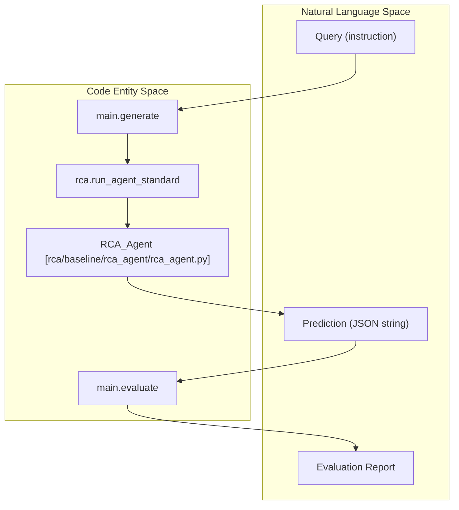
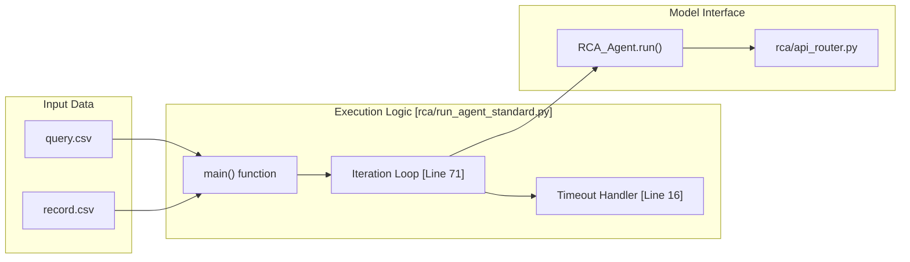

<!-- source: DeepWiki mcp.deepwiki.com · repo microsoft/OpenRCA · page 6 Running the Benchmark · fetched 2026-10-26 -->

# Running the Benchmark

<details>
<summary>Relevant source files</summary>

The following files were used as context for generating this wiki page:

- [README.md](README.md)
- [rca/run_agent_standard.py](rca/run_agent_standard.py)
- [rca/test.sh](rca/test.sh)

</details>


This page provides detailed instructions on how to run the OpenRCA benchmark and reproduce the results from the paper. It covers the setup process, execution of baseline models, and the evaluation of results.

For specific details on configuring the agentic baseline, see [Using RCA-agent](#6.1). For instructions on extending the benchmark with new data, see [Creating Custom Tasks](#6.2).

## System Requirements

Before running the benchmark, ensure your system meets the minimum requirements to handle large telemetry volumes and memory-intensive operations:

- **Python**: Version 3.10 or higher.
- **Storage**: At least 80GB of free space (for datasets and logs).
- **Memory**: At least 32GB of RAM.
- **Network**: Internet connection for LLM API access.

Sources: [README.md:20-25]()

## Benchmark Workflow Overview

The benchmark process transitions from raw telemetry data to structured root cause predictions through a sequence of data loading, model inference, and automated scoring.



Sources: [README.md:59-67](), [README.md:136-144](), [rca/run_agent_standard.py:21-21](), [rca/run_agent_standard.py:104-105]()

## Setting Up the Environment

### Installation

Clone the repository and install the required dependencies:

```bash
git clone https://github.com/microsoft/OpenRCA.git
cd OpenRCA
pip install -r requirements.txt
```

### Dataset Setup

The telemetry data is hosted externally and must be placed in the `dataset/` directory.

1. Download data from the provided [Google Drive](https://drive.google.com/drive/folders/1wGiEnu4OkWrjPxfx5ZTROnU37-5UDoPM?usp=drive_link) link.
2. Ensure the directory structure matches the expected schema:

```text
dataset/
└── {SYSTEM}/          # e.g., Telecom, Bank, Market
    ├── query.csv      # Natural language tasks
    ├── record.csv     # Ground truth records
    └── telemetry/     # Raw logs, metrics, and traces
```

Sources: [README.md:31-56]()

### Configure API Settings

The benchmark uses a centralized configuration for LLM access via `rca/api_config.yaml`. Update this file with your provider details:

```yaml
SOURCE:   "OpenAI"
MODEL:    "gpt-4o-2024-05-13"
API_KEY:  "sk-xxxxxxxxxxxxxx"
```

Sources: [README.md:103-109](), [rca/run_agent_standard.py:8-8]()

## Code Structure and Execution Flow

The following diagram bridges the high-level benchmark concepts to the specific code entities that handle data and logic.



Sources: [rca/run_agent_standard.py:16-17](), [rca/run_agent_standard.py:71-71](), [rca/run_agent_standard.py:105-108](), [rca/api_router.py:1-10]()

## Running the Benchmark

### Reproducing Paper Results

Reproduction is handled by specialized scripts in the `rca/` directory. Use the `-m` flag to run them as modules.

```bash
python -m rca.{TEST_SCRIPT} --dataset {DATASET_NAME}
```

**Test Scripts:**
- `run_agent_standard`: Executes the `RCA_Agent` baseline.
- `run_baseline_balanced`: Executes the balanced baseline.
- `run_baseline_oracle`: Executes the oracle KPI baseline.

**Datasets:**
- `Telecom`
- `Bank`
- `Market/cloudbed-1`
- `Market/cloudbed-2`

Example for the Bank dataset:
`python -m rca.run_agent_standard --dataset Bank`

Sources: [README.md:113-130](), [rca/run_agent_standard.py:19-29]()

## Evaluating Benchmark Results

Once predictions are generated, use the `main.evaluate` module to compute scores against ground truth.

```bash
python -m main.evaluate \
    -p [prediction csv files] \
    -q [groundtruth query csv files] \
    -r [report csv file to save]
```

### Prediction Format

The evaluation script expects a CSV where the `prediction` column contains a JSON string mapping failure indices to their root cause details.

```json
{
    "1": {
        "root cause occurrence datetime": "2024-01-01 12:00:00",
        "root cause component": "auth-service",
        "root cause reason": "Memory leak in JVM"
    }
}
```

Sources: [README.md:59-81](), [rca/run_agent_standard.py:138-151]()

## Understanding Benchmark Results

The evaluation system scores predictions based on their alignment with the `scoring_points` defined in the query files.

| Metric Category | Source | Description |
| :--- | :--- | :--- |
| **Easy** | `task_id <= 3` | Basic identification of obvious faults. |
| **Middle** | `task_id <= 6` | Requires multi-hop reasoning across telemetry. |
| **Hard** | `task_id <= 7` | Complex scenarios with overlapping faults. |

The `evaluate` function in `main/evaluate.py` returns `passed_criteria`, `failed_criteria`, and a numerical `score`.

Sources: [rca/run_agent_standard.py:84-89](), [rca/run_agent_standard.py:138-144]()

## Troubleshooting

- **Timezone Mismatch**: All faults are recorded in **UTC+8**. Ensure your analysis accounts for this to avoid timestamp offsets.
- **Sampling Frequency**: Telemetry is sampled at fixed intervals. If a ground-truth timestamp doesn't have a direct data point, check the nearest sampled interval.
- **Timeout Errors**: The benchmark uses `signal.SIGALRM` to prevent agents from looping indefinitely. You can adjust the `timeout` argument in the run scripts if needed.

Sources: [README.md:156-167](), [rca/run_agent_standard.py:16-17](), [rca/run_agent_standard.py:102-102]()

---

