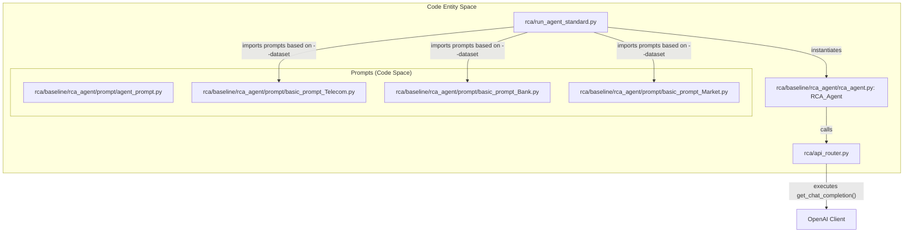
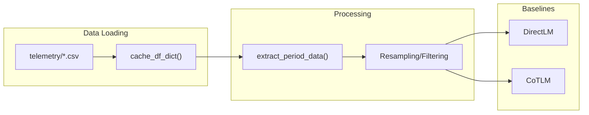

<!-- source: DeepWiki mcp.deepwiki.com · repo microsoft/OpenRCA · page 6.1 Using RCA-agent · fetched 2026-10-26 -->

# Using RCA-agent

<details>
<summary>Relevant source files</summary>

The following files were used as context for generating this wiki page:

- [rca/api_router.py](rca/api_router.py)
- [rca/run_agent_standard.py](rca/run_agent_standard.py)
- [rca/run_sampling_balanced.py](rca/run_sampling_balanced.py)
- [rca/run_sampling_oracle.py](rca/run_sampling_oracle.py)
- [rca/test.sh](rca/test.sh)

</details>


This document provides comprehensive instructions for utilizing the RCA-agent baseline implementation within the OpenRCA benchmark framework. RCA-agent serves as a reference baseline that demonstrates how to efficiently process telemetry data to perform root cause analysis of software failures with the help of large language models.

## Overview of RCA-agent

RCA-agent represents a baseline approach for root cause analysis in software systems. Instead of feeding all telemetry data directly to an LLM, RCA-agent uses a Controller-Executor pattern where it generates and executes Python code for data retrieval and analysis, allowing it to handle extensive telemetry data efficiently while focusing the LLM's capabilities on reasoning.

### Code Entity Mapping: Agent Logic to Execution

The following diagram bridges the natural language reasoning space to the specific code entities responsible for execution and data routing.



Sources: [rca/run_agent_standard.py:21-29](), [rca/run_agent_standard.py:104-108](), [rca/api_router.py:28-37]()

## Prerequisites

Before using RCA-agent, ensure you have:

1. Installed the OpenRCA repository and its dependencies.
2. Downloaded the telemetry datasets and placed them in `dataset/`.
3. Set up API credentials for the LLM.

### API Configuration

API settings are managed by `rca/api_router.py`. By default, it looks for a `config.json` file in the project root or a path specified by the `API_CONFIG_PATH` environment variable [rca/api_router.py:6-12]().

The configuration should follow this structure:
```json
{
    "gemini3pro": {
        "model": "gpt-4o",
        "api_key": "YOUR_API_KEY",
        "base_url": "https://api.openai.com/v1",
        "temperature": 0.0
    }
}
```
Sources: [rca/api_router.py:17-24]()

## Running RCA-agent

RCA-agent is primarily executed via `rca/run_agent_standard.py`. This script handles the loop of reading instructions from `query.csv`, running the agent, and saving trajectories [rca/run_agent_standard.py:71-110]().

### Command-Line Arguments

| Argument | Type | Default | Description |
|----------|------|---------|-------------|
| `--dataset` | `str` | `Market/cloudbed-1` | Target dataset (Telecom, Bank, Market/cloudbed-1, Market/cloudbed-2) [rca/run_agent_standard.py:172]() |
| `--sample_num` | `int` | `1` | Number of times to sample for each instruction [rca/run_agent_standard.py:173]() |
| `--start_idx` | `int` | `0` | Starting index of the instruction row [rca/run_agent_standard.py:73]() |
| `--end_idx` | `int` | `N/A` | Ending index of the instruction row [rca/run_agent_standard.py:75]() |
| `--controller_max_step` | `int` | `N/A` | Maximum steps per run [rca/run_agent_standard.py:107]() |
| `--timeout` | `int` | `N/A` | Execution timeout in seconds [rca/run_agent_standard.py:102]() |

### Dataset-Specific Execution

**For Telecom:**
```bash
python -m rca.run_agent_standard --dataset Telecom
```

**For Market Cloudbed-1:**
```bash
python -m rca.run_agent_standard --dataset Market/cloudbed-1
```

Sources: [rca/run_agent_standard.py:23-28]()

## Output Artifacts

The execution of `run_agent_standard.py` generates several artifacts to help with debugging and evaluation:

1.  **Evaluation CSV**: Located at `test/result/{dataset}/agent-{tag}-{model}.csv`. It stores predictions, ground truth, and scores [rca/run_agent_standard.py:32-52]().
2.  **Trajectories**: Jupyter notebooks (`.ipynb`) located in `{obs_path}/{uid}/trajectory/`. These contain the Python code generated by the LLM and the resulting output [rca/run_agent_standard.py:94-118]().
3.  **Prompts**: JSON files in `{obs_path}/{uid}/prompt/` containing the exact message history sent to the API [rca/run_agent_standard.py:95-122]().
4.  **Logs**: Detailed execution logs in `{obs_path}/{uid}/history/` [rca/run_agent_standard.py:96-99]().

Sources: [rca/run_agent_standard.py:41-46]()

## Sampling Variants

Beyond the standard agent, OpenRCA provides specialized sampling scripts for baseline comparison. These scripts typically use `DirectLM` or `CoTLM` instead of the full `RCA_Agent` loop [rca/run_sampling_balanced.py:11-12]().

### Balanced Sampling (`run_sampling_balanced.py`)
This script implements a "balanced" data extraction strategy. It extracts telemetry data (logs, metrics, traces) around a target timestamp using a specific `sample_interval` [rca/run_sampling_balanced.py:116-120](). It limits the number of KPIs to a predefined length `selected_kpi_len` to ensure the prompt remains within context limits [rca/run_sampling_balanced.py:123-125]().

### Oracle Sampling (`run_sampling_oracle.py`)
The oracle variant uses `selected_kpi_dict` (e.g., `kpi_Telecom`) to prioritize specific "ground truth" KPIs that are known to be relevant to the failure, simulating an environment where the most important signals are already identified [rca/run_sampling_oracle.py:22-23]().

### Data Flow for Sampling Scripts



Sources: [rca/run_sampling_balanced.py:22-113](), [rca/run_sampling_oracle.py:110-140]()

## Evaluating Results

Once predictions are generated and saved to CSV files, use the evaluation module to calculate scores.

```bash
python -m main.evaluate \
    -p rca/archive/agent-Bank.csv \
    -q dataset/Bank/query.csv \
    -r test/results_report.csv
```

The `evaluate` function from `main.evaluate` compares the agent's `prediction` against `scoring_points` to determine `passed_criteria`, `failed_criteria`, and the final numerical `score` [rca/run_agent_standard.py:138-144]().

Sources: [rca/test.sh:1-13](), [rca/run_agent_standard.py:7-8]()

---

