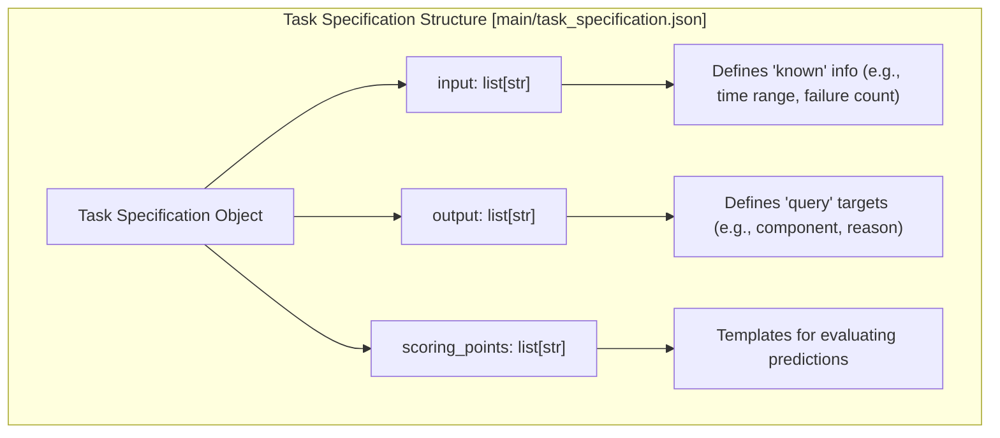
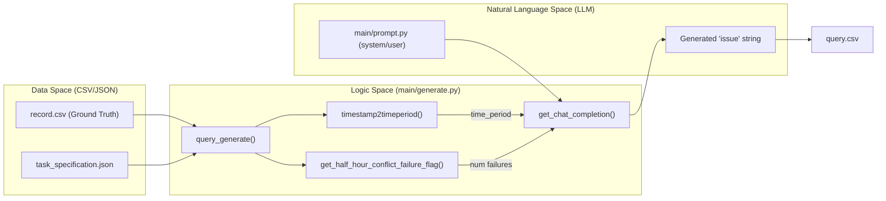
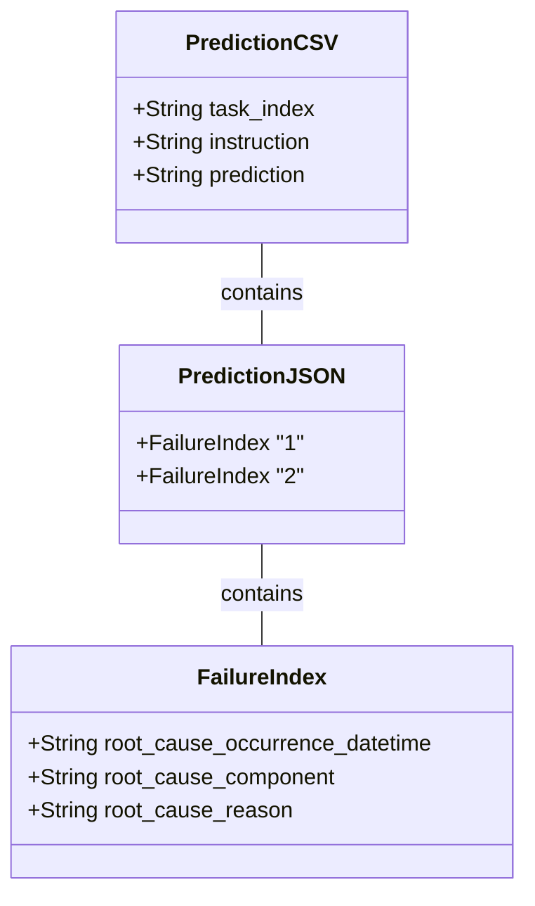

<!-- source: DeepWiki mcp.deepwiki.com · repo microsoft/OpenRCA · page 6.2 Creating Custom Tasks · fetched 2026-10-26 -->

# Creating Custom Tasks

<details>
<summary>Relevant source files</summary>

The following files were used as context for generating this wiki page:

- [README.md](README.md)
- [dataset/README.md](dataset/README.md)
- [main/generate.py](main/generate.py)
- [main/prompt.py](main/prompt.py)
- [main/task_specification.json](main/task_specification.json)

</details>


This page provides guidance on how to create and evaluate custom root cause analysis (RCA) tasks using the OpenRCA framework. You'll learn how to generate new tasks either from the provided OpenRCA telemetry data or from your own private telemetry data using the `main.generate` workflow.

## Understanding Task Specifications

Before creating custom tasks, it's important to understand how tasks are structured in OpenRCA. Task specifications define the template for the input information provided to the model, the expected output format, and the scoring criteria.

### Task Specification Format

Task specifications are defined in a JSON file, typically `main/task_specification.json`. This file serves as the blueprint for the `query_generate` function.



Sources: [main/task_specification.json:1-96](), [main/generate.py:65-66]()

### Available Task Types

The default specification includes seven task types of varying difficulty, ranging from predicting a single attribute (time, reason, or component) to predicting all three.

| Task ID | Output Fields Required | Scoring Logic Template |
|---------|-----------------------|----------------------|
| `task_1` | `datetime` | Within 1 minute of ground truth |
| `task_2` | `reason` | Exact string match for reason |
| `task_3` | `component` | Exact string match for component |
| `task_7` | `datetime`, `component`, `reason` | All three criteria must be met |

Sources: [main/task_specification.json:1-96]()

## The Task Generation Workflow

The generation system uses a combination of structured data processing and LLM-based natural language synthesis to create realistic "Issues".

### Natural Language Space to Code Entity Space

The following diagram illustrates how the `main.generate.py` script bridges the gap between raw telemetry records and the final natural language query.



Sources: [main/generate.py:9-15](), [main/generate.py:62-163](), [main/prompt.py:1-74]()

### Implementation Details

1.  **Conflict Detection**: The function `get_half_hour_conflict_failure_flag` identifies if multiple failures occur within the same 30-minute window. If so, it triggers a multi-response task generation logic. [main/generate.py:32-45]()
2.  **Prompt Construction**: The script constructs an `input_specification` and `output_specification` block using templates from the JSON spec. These are then injected into the LLM prompt defined in `main/prompt.py`. [main/generate.py:110-138]()
3.  **LLM Synthesis**: The `get_chat_completion` function (imported from `scripts.utils`) sends the formatted prompt to the LLM to generate a "realistic" DevOps issue description. [main/generate.py:144-150]()

## Creating Custom Tasks with Private Data

To plug in your own datasets, you must ensure your telemetry and record files follow the OpenRCA directory and schema requirements.

### Data Requirements

Your private data should be organized as follows:
- A `record.csv` containing `timestamp`, `datetime`, `component`, and `reason`. [README.md:146-146](), [main/generate.py:75-78]()
- Telemetry files (logs, metrics, traces) stored in a date-based directory structure. [README.md:40-54]()

### Running the Generator

Execute the generation script with your specific paths:

```bash
python -m main.generate \
    -s [your_specification.json] \
    -r [path/to/your/record.csv] \
    -q [path/to/save/query.csv] \
    -t [timezone, e.g., Asia/Shanghai]
```

Sources: [main/generate.py:173-181](), [README.md:139-144]()

### Parameters

| Flag | Description | Code Reference |
| :--- | :--- | :--- |
| `-s` | Path to the task specification config. | [main/generate.py:178]() |
| `-r` | List of record files to generate queries from. | [main/generate.py:179]() |
| `-q` | List of query files to save the output. | [main/generate.py:180]() |
| `-t` | Timezone of the telemetry (critical for `timestamp2datetime`). | [main/generate.py:18-30]() |
| `-d` | Boolean to use default OpenRCA settings for regeneration. | [main/generate.py:177]() |

## Evaluation and Scoring

Once tasks are generated and an agent has produced predictions, use the `main.evaluate` module to score them.

### Scoring Point Template

The `scoring_points` field in the generated `query.csv` is derived from the templates in the task specification. For example, a `task_7` scoring point will look like:
`"The only root cause occurrence time is within 1 minutes (i.e., <=1min) of 2022-03-21 11:45:00"`

Sources: [main/task_specification.json:90-94](), [main/generate.py:100-108]()

### Running Evaluation

```bash
python -m main.evaluate \
    -p [prediction.csv] \
    -q [generated_query.csv] \
    -r [output_report.csv]
```

Sources: [README.md:60-67]()

### Prediction Schema

The prediction file must contain a `prediction` field with a JSON string mapping failure indices to their root cause attributes.



Sources: [README.md:69-81]()

## Summary

By modifying `main/task_specification.json` and using `main/generate.py`, users can:
1.  Define new types of RCA challenges.
2.  Generate natural language problem statements using LLMs via `main/prompt.py`.
3.  Evaluate model performance on private telemetry data using the standard OpenRCA scoring pipeline.

---

