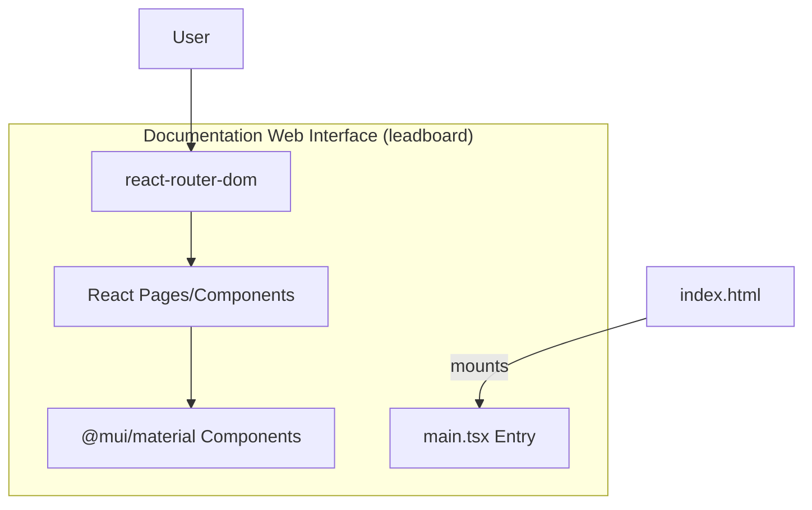
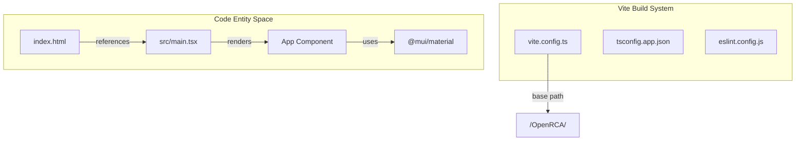
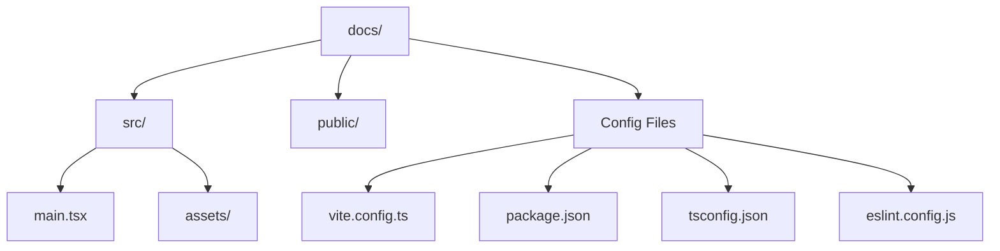

<!-- source: DeepWiki mcp.deepwiki.com · repo microsoft/OpenRCA · page 7 Documentation Web Interface · fetched 2026-10-26 -->

# Documentation Web Interface

Relevant source files

The following files were used as context for generating this wiki page:

- [docs/.gitignore](docs/.gitignore)
- [docs/eslint.config.js](docs/eslint.config.js)
- [docs/index.html](docs/index.html)
- [docs/package-lock.json](docs/package-lock.json)
- [docs/package.json](docs/package.json)
- [docs/tsconfig.app.json](docs/tsconfig.app.json)
- [docs/tsconfig.json](docs/tsconfig.json)
- [docs/tsconfig.node.json](docs/tsconfig.node.json)
- [docs/vite.config.ts](docs/vite.config.ts)

This page covers the web-based documentation interface included in the OpenRCA repository. The Documentation Web Interface provides a modern, interactive way to explore OpenRCA documentation, benchmark results, and related resources. This interface is built using React and Material UI with TypeScript, using Vite as the build tool.

For information about the visual assets and data models used in the interface, see [Visual Components](#7.1).

## Overview

The Documentation Web Interface serves as the presentation layer for OpenRCA's documentation and benchmark results. It provides an intuitive navigation system and responsive design for accessing information about the OpenRCA benchmark, datasets, evaluation methodologies, and results.

The application entry point is defined in `docs/index.html`, which mounts the React application to a `div` with `id="root"` and loads the main TypeScript entry script.

Sources: [docs/package.json:2-22](), [docs/index.html:10-11]()

## Technology Stack

The Documentation Web Interface (internally named `leadboard`) is built with the following technologies:

| Component | Technology | Purpose |
|-----------|------------|---------|
| Frontend Framework | React 18 | Component-based UI development [docs/package.json:20]() |
| Routing | React Router | Navigation between different views [docs/package.json:22]() |
| UI Components | Material UI (MUI) | Pre-built UI elements and icons [docs/package.json:18-19]() |
| Styling | Emotion | CSS-in-JS styling solution for MUI [docs/package.json:16-17]() |
| Development | TypeScript | Type-safe JavaScript development [docs/package.json:34]() |
| Build Tool | Vite | Fast, modern frontend build tool [docs/package.json:35]() |
| Deployment | gh-pages | Publishing the static site to GitHub [docs/package.json:33]() |

Sources: [docs/package.json:15-35]()

## Application Architecture

The application is structured as a Single Page Application (SPA). The build configuration is managed by Vite, with a base path set to `/OpenRCA/` to support GitHub Pages hosting.

Sources: [docs/vite.config.ts:5-8](), [docs/index.html:11](), [docs/tsconfig.app.json:1-26]()

## Development Workflow

### Prerequisites

- Node.js (Latest LTS)
- npm (Package manager)

### Workflow Commands

The following scripts are defined in the project configuration:

| Command | Description |
|---------|-------------|
| `npm run dev` | Starts the Vite development server [docs/package.json:8]() |
| `npm run build` | Compiles TypeScript and builds production assets [docs/package.json:9]() |
| `npm run lint` | Runs ESLint for code quality checks [docs/package.json:10]() |
| `npm run deploy` | Builds and pushes the `dist` folder to GitHub Pages [docs/package.json:13]() |

Sources: [docs/package.json:7-14]()

## Project Structure

The documentation web interface follows a standard React application structure, strictly separated from the core Python RCA logic in the parent repository.

Sources: [docs/package.json:1-37](), [docs/vite.config.ts:1-9](), [docs/tsconfig.json:1-8]()

## Deployment

The interface is deployed as a static site. The configuration in `vite.config.ts` ensures that all asset paths are relative to the `/OpenRCA/` subdirectory, which is standard for repository-based GitHub Pages.

The deployment pipeline is:
1. **Linting**: Ensuring code quality via `eslint.config.js`.
2. **Building**: Running `tsc` for type checking followed by `vite build`.
3. **Publishing**: Using the `gh-pages` utility to push the `dist` directory to the hosting branch.

Sources: [docs/package.json:7-14](), [docs/vite.config.ts:6](), [docs/eslint.config.js:1-29]()

## Conclusion

The Documentation Web Interface provides a modern, responsive way to interact with OpenRCA documentation and benchmark results. It leverages the React ecosystem and Material UI to provide a high-quality user experience for researchers and developers.

For details on the specific components and data models used for the leaderboard and visual assets, see [Visual Components](#7.1).

Sources: [docs/package.json:1-37](), [docs/index.html:1-14]()

---

