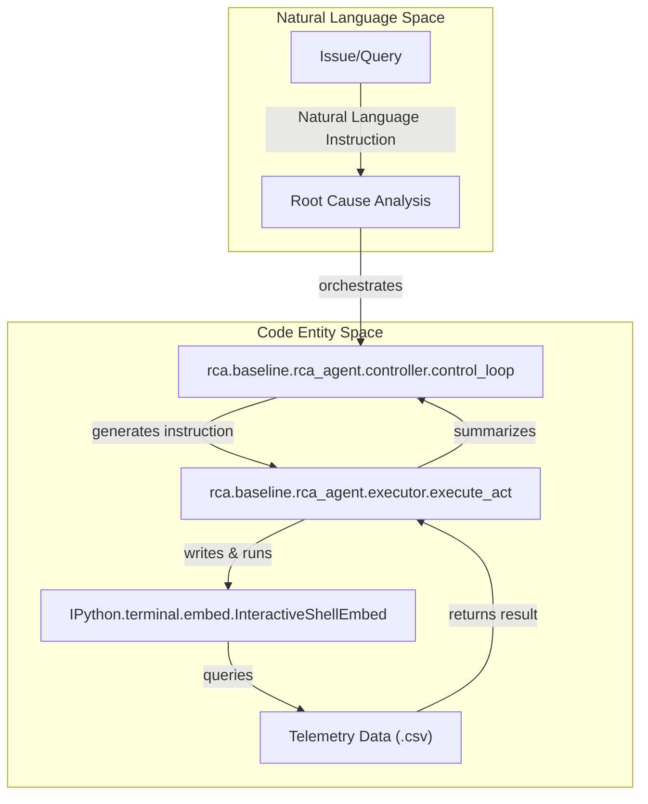
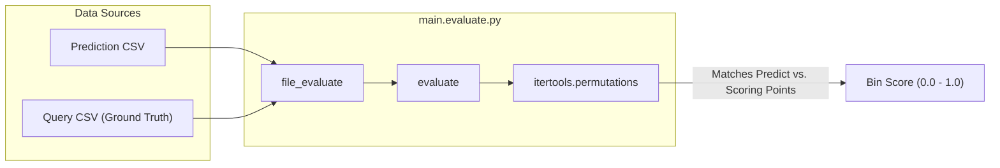
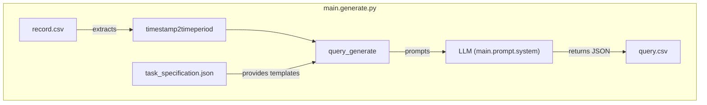

<!-- source: DeepWiki mcp.deepwiki.com · repo microsoft/OpenRCA · page 8 Glossary · fetched 2026-10-26 -->

# Glossary

Relevant source files

The following files were used as context for generating this wiki page:

- [README.md](README.md)
- [main/evaluate.py](main/evaluate.py)
- [main/generate.py](main/generate.py)
- [main/prompt.py](main/prompt.py)
- [main/task_specification.json](main/task_specification.json)
- [rca/api_router.py](rca/api_router.py)
- [rca/baseline/rca_agent/controller.py](rca/baseline/rca_agent/controller.py)
- [rca/baseline/rca_agent/executor.py](rca/baseline/rca_agent/executor.py)
- [rca/run_agent_standard.py](rca/run_agent_standard.py)

This glossary defines technical terms, architectural patterns, and domain-specific concepts used throughout the OpenRCA codebase. It serves as a reference for onboarding engineers to understand the mapping between natural language problem descriptions and their programmatic implementations.

## 1. Core Architecture Terms

### RCA-Agent
The baseline autonomous agent designed to perform root cause analysis. It employs a **Controller-Executor** pattern to interact with telemetry data without loading massive datasets into the LLM context window [README.md:15-17]().

### Controller
The reasoning engine of the RCA-Agent. It manages the high-level `control_loop`, analyzing previous tool outputs and generating instructions for the next step [rca/baseline/rca_agent/controller.py:9-32]().
*   **Key Function**: `control_loop` [rca/baseline/rca_agent/controller.py:60-114]().

### Executor
The component responsible for code generation and execution. It receives instructions from the Controller, writes Python code, and runs it within a stateful kernel [rca/baseline/rca_agent/executor.py:8-18]().
*   **Key Function**: `execute_act` [rca/baseline/rca_agent/executor.py:50-118]().

### InteractiveShellEmbed (IPython Kernel)
The stateful environment where the Executor runs generated Python code. Because it is stateful, variables defined in "Step 1" persist and can be used in "Step 10" [rca/baseline/rca_agent/executor.py:36-40]().

### System-to-Code Entity Mapping
The following diagram illustrates how natural language concepts from the DevOps domain are mapped to specific classes and functions in the OpenRCA implementation.

**DevOps RCA Implementation Flow**

Sources: [rca/baseline/rca_agent/controller.py:60-114](), [rca/baseline/rca_agent/executor.py:50-118](), [rca/baseline/rca_agent/executor.py:88-91]()

---

## 2. Dataset & Evaluation Terms

### Scoring Points
A structured string format used to define the criteria for a correct answer. It includes placeholders for the component, reason, and a 1-minute tolerance window for timestamps [main/task_specification.json:10-12]().
*   **Key Function**: `evaluate()` parses these strings using regex to calculate scores [main/evaluate.py:43-52]().

### Task Index
A classification for the difficulty and type of RCA task.
*   **Easy (Task 1-3)**: Single-element identification (Time, Reason, or Component) [main/evaluate.py:179-182]().
*   **Middle (Task 4-6)**: Two-element identification [main/evaluate.py:179-183]().
*   **Hard (Task 7)**: Full identification (Time + Reason + Component) [main/evaluate.py:179-184]().

### Record vs. Query
*   **Record (`record.csv`)**: The raw ground-truth data containing the actual failure events [README.md:46]().
*   **Query (`query.csv`)**: The LLM-generated natural language issue based on a record, used as input for the agent [README.md:45]().

**Data Evaluation Logic**

Sources: [main/evaluate.py:104-121](), [main/evaluate.py:74-95]()

---

## 3. Domain Concepts

| Term | Definition | Code Pointer |
| :--- | :--- | :--- |
| **UTC+8** | The standard timezone for all telemetry and fault records in OpenRCA. | [README.md:156-158](), [rca/baseline/rca_agent/executor.py:47]() |
| **Cloudbed** | A specific service group deployment within the **Market** dataset (e.g., `cloudbed-1`, `cloudbed-2`). | [README.md:125-130]() |
| **Permutation Matching** | An algorithm used during evaluation to handle cases with multiple failures by finding the best alignment between predicted failures and ground truth failures. | [main/evaluate.py:74-95]() |
| **Self-Correction** | The process where the Executor catches a Python `Exception` and sends the error message back to the LLM to revise the code. | [rca/baseline/rca_agent/executor.py:119-126]() |
| **Global Threshold** | A rule-based constraint requiring the agent to calculate baselines using the entire KPI series before filtering for specific failure windows. | [rca/baseline/rca_agent/executor.py:46]() |

---

## 4. API & Configuration

### API Router
A centralized utility for interacting with LLM providers (OpenAI, etc.). It handles rate limiting (429 errors) and model configuration [rca/api_router.py:28-57]().

### Task Specification
A JSON template (`task_specification.json`) that defines how `record.csv` fields are mapped into "Known" and "Query" sections for generating natural language instructions [main/task_specification.json:1-96]().

**Task Generation Pipeline**

Sources: [main/generate.py:62-100](), [main/generate.py:134-149](), [main/prompt.py:1-18]()