# Page: OpenRCA Overview

# OpenRCA Overview

<details>
<summary>Relevant source files</summary>

The following files were used as context for generating this wiki page:

- [CODE_OF_CONDUCT.md](CODE_OF_CONDUCT.md)
- [LICENSE](LICENSE)
- [README.md](README.md)
- [SECURITY.md](SECURITY.md)
- [SUPPORT.md](SUPPORT.md)

</details>


This document provides a comprehensive overview of OpenRCA, a benchmark designed to assess Large Language Models' (LLMs) root cause analysis capabilities in software operating scenarios. It introduces the purpose, architecture, and core components of the OpenRCA system.

## Purpose of OpenRCA

OpenRCA is a benchmark framework that challenges LLMs to analyze large volumes of telemetry data to identify the root causes of software failures. When given a natural language query about a system issue, models must process and reason over various telemetry data types—including KPI time series, dependency trace graphs, and semi-structured log text—to pinpoint the relevant root cause elements [README.md:9-14]().

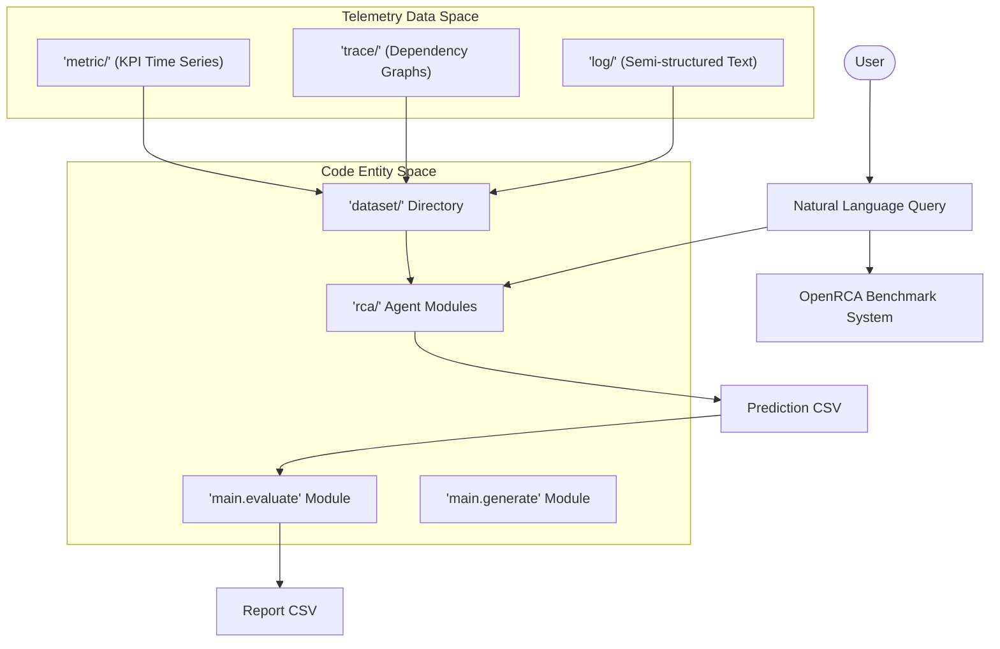

*Diagram 1: Bridging Natural Language Space to Code Entity Space*

Sources: [README.md:9-14](), [README.md:40-54](), [README.md:63-66]()

## Core Components

OpenRCA consists of four primary components that work together to create a comprehensive benchmark:

| Component | Description | Key Code Symbols |
|-----------|-------------|-------------------|
| **Dataset** | Telemetry from Telecom, Bank, and Market systems [README.md:56](). | `dataset/`, `query.csv`, `record.csv` |
| **RCA-agent** | Baseline using Python for data retrieval to avoid context limits [README.md:15](). | `rca.run_agent_standard`, `rca/api_config.yaml` |
| **Evaluation** | Scorer for root cause datetime, component, and reason [README.md:71-80](). | `main.evaluate`, `main/evaluate.py` |
| **Task Generation** | Pipeline to create new tasks from telemetry [README.md:136-144](). | `main.generate`, `main/task_specification.json` |

Sources: [README.md:9-17](), [README.md:58-67](), [README.md:136-144]()

## System Architecture

The following diagram illustrates the interaction between the telemetry storage and the execution modules:

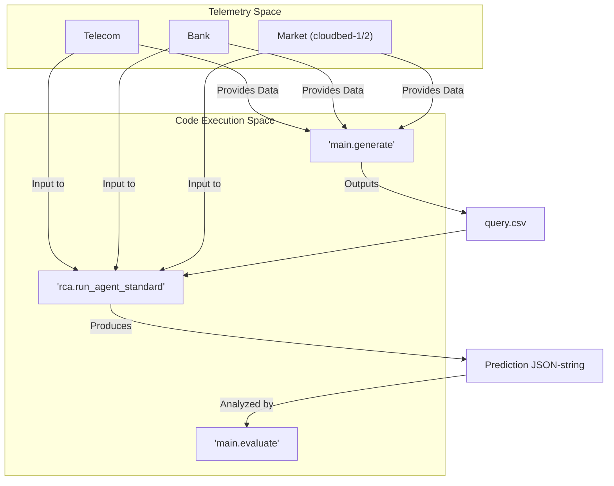

*Diagram 2: Data Flow between Telemetry and Code Modules*

Sources: [README.md:40-54](), [README.md:114-122](), [README.md:139-143]()

## RCA-agent Baseline

The `RCA-agent` is a baseline implementation that leverages Python for data retrieval and analysis. This enables the model to focus on reasoning rather than processing raw, extensive telemetry contexts [README.md:15-17]().

For details on the agent's internal loop, see [RCA-agent Architecture](#3).

Sources: [README.md:15-17](), [README.md:122]()

## Dataset Organization

Telemetry data is organized by system and date. The `{SYSTEM}` can be `Telecom`, `Bank`, or `Market`, and data is stored in subdirectories for `log`, `metric`, and `trace` [README.md:44-56]().

- **Telecom**: Features vertical deployment structures (Node, Pod, Container, Service) [README.md:175]().
- **Bank**: Pod-level traces without vertical deployment structures [README.md:176]().
- **Market**: Complex container relationships defined in `metric_container.csv` [README.md:177]().

For detailed schema information, see [Dataset Structure](#2).

Sources: [README.md:40-56](), [README.md:173-177]()

## Evaluation and Task Generation

The evaluation system uses `main.evaluate` to compare model predictions against ground truth in `query.csv` [README.md:63-66](). Predictions must follow a specific JSON-like format identifying the "root cause occurrence datetime", "root cause component", and "root cause reason" [README.md:71-80]().

Users can reconstruct the benchmark or create custom tasks using `main.generate` by providing a `task_specification.json` [README.md:136-144]().

For details, see [Evaluation System](#4) and [Task Generation](#5).

Sources: [README.md:58-80](), [README.md:136-152]()

## Next Steps

- **Installation**: To set up the environment and download telemetry, see [Installation and Setup](#1.1).
- **Project Layout**: To understand the file organization, see [Project Structure](#1.2).
- **Reproduction**: To reproduce results from the paper using `rca/api_config.yaml`, see [Running the Benchmark](#6).

Sources: [README.md:23-38](), [README.md:101-112]()

---

# Page: Installation and Setup

# Installation and Setup

<details>
<summary>Relevant source files</summary>

The following files were used as context for generating this wiki page:

- [.gitignore](.gitignore)
- [README.md](README.md)
- [rca/api_router.py](rca/api_router.py)
- [requirements.txt](requirements.txt)

</details>


This document provides a comprehensive guide for installing and configuring the OpenRCA benchmark. OpenRCA evaluates the root cause analysis capabilities of Large Language Models (LLMs) in software operating scenarios. This page covers hardware requirements, installation steps, dataset setup, and API configuration needed to get started with the benchmark.

## System Requirements

Before proceeding with installation, ensure your system meets the following requirements:

| Requirement | Minimum Specification | Recommended Specification |
|-------------|----------------------|--------------------------|
| Storage     | 80 GB                | 100+ GB                  |
| Memory (RAM)| 32 GB                | 64+ GB                   |
| Python      | 3.10                 | 3.10 or 3.11             |

> ⚠️ OpenRCA includes a large amount of telemetry data, and the RCA-agent requires extensive memory operations. Using a system with less than the recommended specifications may result in performance issues.

Sources: [README.md:21-25]()

## Installation Process

The following diagram illustrates the workflow for setting up the environment and dependencies.

**Environment Setup Workflow**
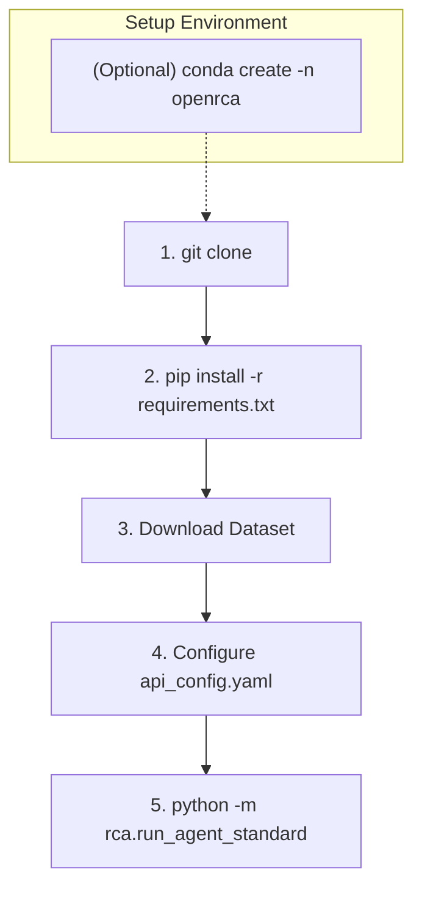

### 1. Clone Repository

Start by cloning the OpenRCA repository from GitHub and navigating to the project directory:

```bash
git clone https://github.com/microsoft/OpenRCA.git
cd OpenRCA
```

### 2. Create Virtual Environment (Optional)

While optional, it's recommended to use a virtual environment to manage dependencies:

```bash
conda create -n openrca python=3.10
conda activate openrca
```

### 3. Install Dependencies

Install all required packages using pip. The environment relies on several key libraries including `ipython` for the agent's code execution and `openai` for LLM communication.

```bash
pip install -r requirements.txt
```

Key dependencies include:
- `openai==1.54.3`: For LLM interaction [requirements.txt:5]()
- `ipython==8.17.2`: For executing generated analysis code [requirements.txt:2]()
- `pandas==1.5.3`: For telemetry data manipulation [requirements.txt:6]()

Sources: [README.md:26-36](), [requirements.txt:1-11]()

## Dataset Setup

OpenRCA requires telemetry data that must be downloaded separately and placed in the correct directory.

### Downloading the Dataset

1. Download the telemetry data from [Google Drive](https://drive.google.com/drive/folders/1wGiEnu4OkWrjPxfx5ZTROnU37-5UDoPM?usp=drive_link)
2. Extract the downloaded files
3. Place the extracted files in the `dataset/` directory in the root of the OpenRCA repository. Note that `dataset/` is ignored by git to prevent accidental commits of large files [[.gitignore:3]()].

### Dataset Directory Structure

The dataset follows a specific hierarchy required by the data loaders:

**Dataset Hierarchy**
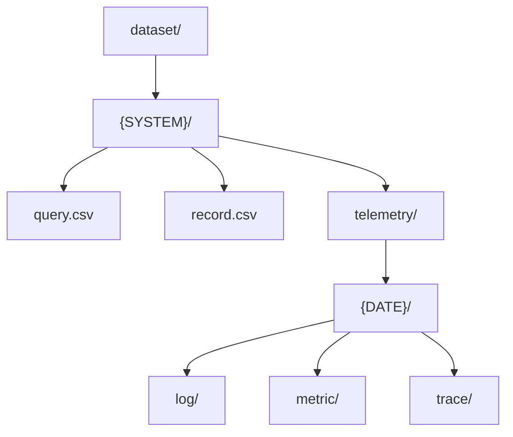

Where:
- `{SYSTEM}` can be `Telecom`, `Bank`, or `Market` [[README.md:56]()]
- For `Market`, there are subdirectories `cloudbed-1` and `cloudbed-2` [[README.md:94-95]()]
- `{DATE}` follows the format `YYYY_MM_DD` [[README.md:56]()]

Sources: [README.md:37-54](), [.gitignore:3]()

## API Configuration

To use RCA-agent or other baselines, you must configure the LLM API settings. The system supports multiple configuration paths.

### Configuration Files

The repository uses two primary configuration files, both of which are ignored by version control to protect credentials [[.gitignore:5-6]()]:
1. `rca/api_config.yaml`: Used by reproduction scripts [[README.md:103]()]
2. `config.json`: Used by the `api_router.py` module [[rca/api_router.py:6]()]

### Setting Up api_config.yaml (Reproduction)

Create `rca/api_config.yaml` for running the standard evaluation scripts:

```yaml
SOURCE:   "OpenAI"
MODEL:    "gpt-4o-2024-05-13"
API_KEY:  "sk-xxxxxxxxxxxxxx"
```

### Setting Up config.json (API Router)

The `rca/api_router.py` script specifically looks for a `config.json` in the root directory by default [[rca/api_router.py:6]()]. It extracts configuration based on a model key (defaulting to `gemini3pro`) [[rca/api_router.py:7]()].

**Code-to-Config Mapping**
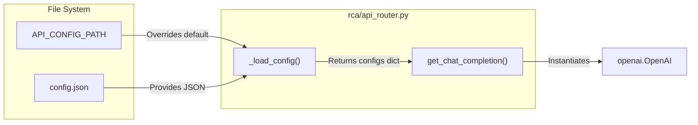

Sources: [README.md:103-109](), [rca/api_router.py:6-26](), [.gitignore:5-6]()

## Verifying Installation

After completing the installation, verify the setup by running a baseline.

### Running a Basic Test

Run the following command to test RCA-agent on the Bank dataset:

```bash
python -m rca.run_agent_standard --dataset Bank
```

If successful, the system will:
1. Load configurations from `rca/api_config.yaml` [[README.md:103]()]
2. Initialize the agent and run the reasoning loop.
3. Create a `test/` directory to store results and monitor files [[README.md:132]()].

### Troubleshooting

| Issue | Likely Cause | Resolution |
|-------|--------------|------------|
| `ModuleNotFoundError` | Missing dependencies | Run `pip install -r requirements.txt` [[README.md:35]()] |
| `FileNotFoundError` in `dataset/` | Incorrect structure | Ensure `query.csv` and `telemetry/` are under `dataset/{SYSTEM}/` [[README.md:44-53]()] |
| API Authentication Error | Missing `api_config.yaml` | Create the YAML file in the `rca/` directory [[README.md:103]()] |
| Time Mismatch | Timezone issues | Ensure you are interpreting telemetry in **UTC+8** [[README.md:158]()] |

Sources: [README.md:114-132](), [README.md:154-160]()

---

# Page: Project Structure

# Project Structure

<details>
<summary>Relevant source files</summary>

The following files were used as context for generating this wiki page:

- [.asset/openrca.png](.asset/openrca.png)
- [.asset/rcaagent.png](.asset/rcaagent.png)
- [.gitignore](.gitignore)
- [README.md](README.md)
- [dataset/README.md](dataset/README.md)

</details>


This document describes the organization and structure of the OpenRCA repository, detailing the purpose of key directories and files and how they relate to each other. OpenRCA is designed as a benchmark for evaluating Large Language Models (LLMs) in root cause analysis (RCA) tasks across diverse software operating scenarios, including Telecom, Bank, and Market systems [README.md:1-13]().

## Repository Organization

The OpenRCA repository is organized into several top-level directories, each serving a specific purpose in the benchmark system:

```
OpenRCA/
├── .asset/               # Visual assets for documentation and README
├── dataset/              # Telemetry datasets (downloaded separately)
├── docs/                 # Documentation files
├── main/                 # Core evaluation and task generation functionality
├── rca/                  # RCA-agent implementation and baselines
└── test/                 # Generated during execution, contains results and logs
```

The high-level directory structure and its contents are summarized in the diagram below:

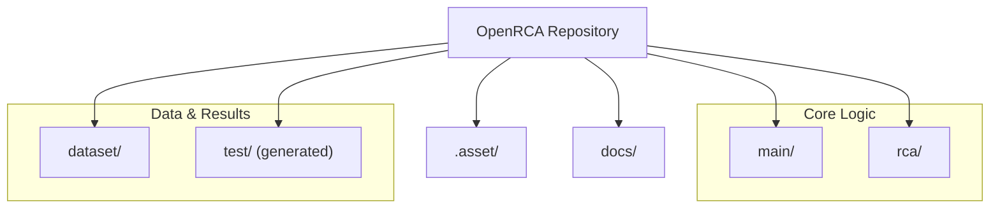

Sources: [README.md:40-54](), [.gitignore:1-5]()

## Core Directories

### main/ Directory

This directory contains the core functionality for the OpenRCA benchmark system, focusing on evaluation and task synthesis:

*   `evaluate.py`: Implements the evaluation system that assesses RCA predictions against ground truth queries [README.md:63-67]().
*   `generate.py`: Provides functionality to create new RCA tasks from existing telemetry data using a specification file [README.md:139-144]().
*   `task_specification.json`: Defines the configuration and templates for task generation [README.md:136]().

Sources: [README.md:58-99](), [README.md:135-153]()

### rca/ Directory

The `rca/` directory contains the implementation of the RCA-agent baseline and other baseline approaches. It serves as the primary execution environment for benchmark testing:

*   `run_agent_standard.py`: The main entry point for running the RCA-agent baseline [README.md:115-122]().
*   `run_baseline_balanced.py`: Script to run the balanced baseline approach [README.md:115]().
*   `run_baseline_oracle.py`: Script to run the oracle-based baseline [README.md:115]().
*   `api_config.yaml`: A user-created configuration file for LLM API access (e.g., OpenAI, Claude) [README.md:103-110]().
*   `archive/`: Contains pre-generated prediction results (e.g., `agent-Bank.csv`) for reference or immediate evaluation [README.md:88-91]().

Sources: [README.md:102-132]()

### dataset/ Directory

The `dataset/` directory is empty in the repository by default and must be populated by downloading telemetry data from external sources [dataset/README.md:1-3](). The benchmark supports three system types: `Telecom`, `Bank`, and `Market` [README.md:56]().

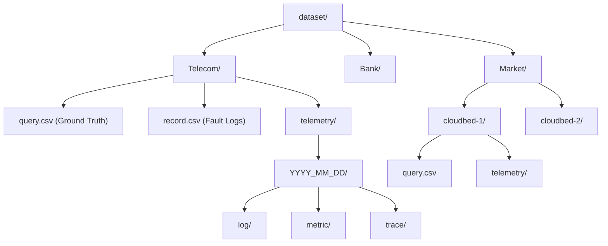

Sources: [README.md:37-54](), [README.md:124-130]()

## System Component Interaction

The following diagram bridges the "Natural Language Space" (User Queries) to the "Code Entity Space" by showing how scripts like `evaluate.py` and `run_agent_standard.py` process data:

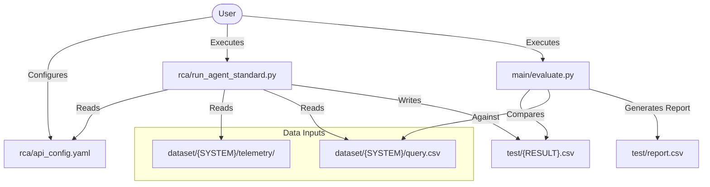

Sources: [README.md:63-99](), [README.md:103-132]()

## Data Flow in RCA-agent

The RCA-agent baseline uses Python for data retrieval and analysis to avoid processing overly long contexts in the LLM [README.md:15-18]().

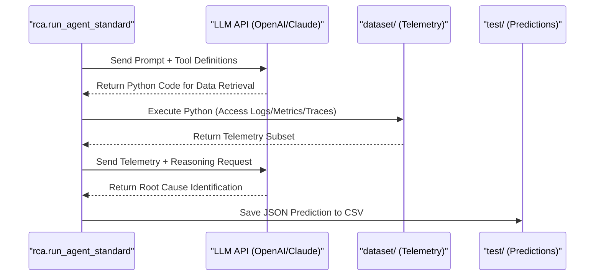

Sources: [README.md:15-18](), [README.md:69-81]()

## Key Configuration and Metadata Files

OpenRCA relies on specific file schemas to maintain consistency across different telemetry systems:

| File | Purpose | Location |
|------|---------|----------|
| `api_config.yaml` | Configures `SOURCE`, `MODEL`, and `API_KEY` for LLM interaction [README.md:103-110](). | `rca/` |
| `query.csv` | Ground truth for evaluation; contains natural language queries and expected root causes [README.md:45, 92-96](). | `dataset/{SYSTEM}/` |
| `record.csv` | Historical fault records used by `main.generate` to synthesize new tasks [README.md:46, 141, 146](). | `dataset/{SYSTEM}/` |
| `task_specification.json` | Template for generating new RCA queries from telemetry data [README.md:136](). | `main/` |

### Prediction Format
The `evaluate.py` script expects a specific JSON-like string in the "prediction" column of result CSVs [README.md:69-72]():
```json
{
    "1": {
        "root cause occurrence datetime": "[%Y-%m-%d %H:%M:%S]",
        "root cause component": "[COMPONENT]",
        "root cause reason": "[REASON]"
    }
}
```

Sources: [README.md:69-81](), [README.md:103-110](), [README.md:136-146]()

---

# Page: Dataset Structure

# Dataset Structure

<details>
<summary>Relevant source files</summary>

The following files were used as context for generating this wiki page:

- [README.md](README.md)
- [dataset/README.md](dataset/README.md)

</details>


This document explains the organization and contents of the telemetry datasets in the OpenRCA benchmark system. The dataset is a core component that provides the telemetry data necessary for root cause analysis tasks. For details on how specific data types like metrics and traces are formatted, see [Telemetry Data Types](#2.1).

## Dataset Overview

The OpenRCA dataset contains structured telemetry data from multiple system types, organized to facilitate root cause analysis tasks. The dataset includes KPI time series, dependency trace graphs, and semi-structured logs, providing comprehensive observability data for software systems [README.md:9-10]().

### Natural Language to Code Entity Mapping

The following diagram bridges the gap between the natural language system names used in documentation and the specific directory structures and files used by the code.

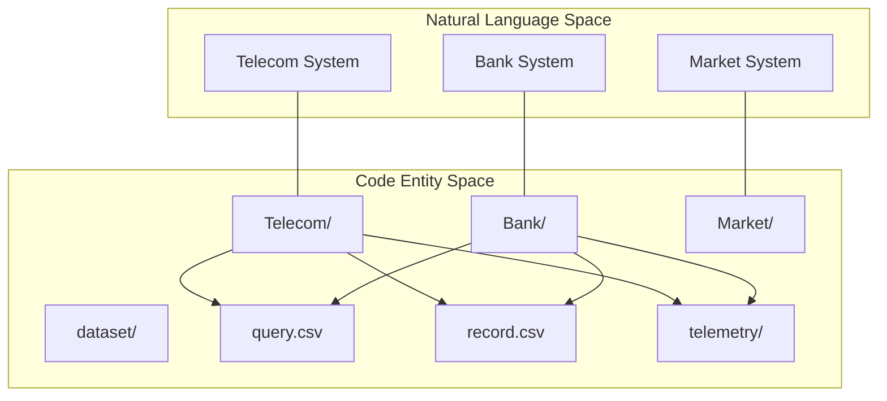
Sources: [README.md:42-56]()

## Directory Structure

The dataset follows a consistent hierarchical structure across all system types. Each system has its own directory containing queryable data and telemetry records organized by date [README.md:42-54]().

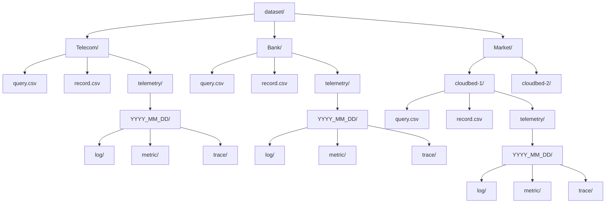
Sources: [README.md:42-54]()

### System Types

The dataset contains telemetry data from three different system types, each with unique deployment architectures [README.md:174-177]():

| System Type | Description | Structure |
|-------------|-------------|-----------|
| **Telecom** | Telecommunications system | Includes Node, Pod, Container, and Service deployment relationships. |
| **Bank** | Banking system | All components are at the pod level; horizontal pod-level traces only. |
| **Market** | Marketplace system | Contains multiple cloudbed service groups (e.g., `cloudbed-1`, `cloudbed-2`) with vertical mappings like `node-5.adservice-2`. |

Sources: [README.md:56](), [README.md:174-177]()

## Dataset Components

Each system dataset contains three main components [README.md:45-47]():

### query.csv
Contains ground truth data for root cause analysis tasks. It includes the "prediction" field (JSON-like string) used for evaluation, featuring:
- `root cause occurrence datetime`: Format `[%Y-%m-%d %H:%M:%S]`
- `root cause component`: The failing entity (e.g., `COMPONENT`)
- `root cause reason`: Description of the failure (e.g., `REASON`)

Sources: [README.md:69-81]()

### record.csv
Contains historical records of system issues. This file is the primary input for the `main.generate` module to create new RCA tasks. The schema of this file must remain consistent for the task generation pipeline to function correctly [README.md:146-151]().

Sources: [README.md:135-151]()

### telemetry/
Contains the actual observability data organized by date (`YYYY_MM_DD` format). Each date directory contains three subdirectories corresponding to different telemetry data types: `log/`, `metric/`, and `trace/` [README.md:48-51]().

Sources: [README.md:48-51]()

## Data Interaction and Processing

The following diagram maps the high-level data flow to specific code entry points and modules.

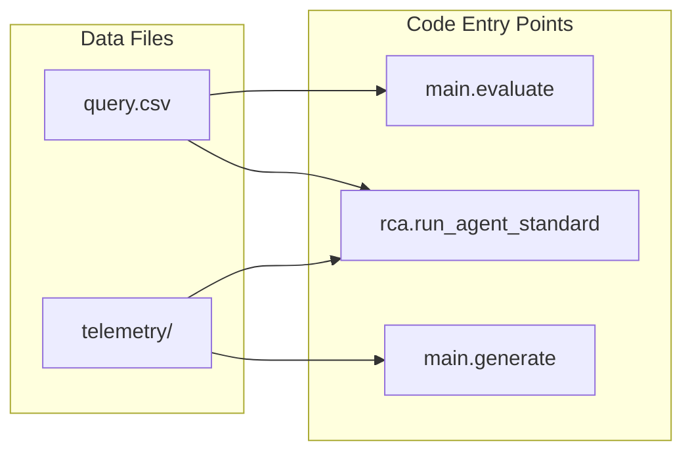
Sources: [README.md:63-67](), [README.md:122-130](), [README.md:139-144]()

## Dataset Access and Management

The telemetry dataset is not included in the repository by default and must be downloaded to the `dataset/` directory [README.md:38](). Due to the volume of telemetry, the system requires significant resources:
- **Storage**: At least 80GB [README.md:21]().
- **Memory**: At least 32GB [README.md:21]().
- **Timezone**: All faults and telemetry are recorded in **UTC+8** [README.md:158]().

For more information on the specific telemetry formats, see [Telemetry Data Types](#2.1).

Sources: [README.md:21-38](), [README.md:158]()

---

# Page: Telemetry Data Types

# Telemetry Data Types

<details>
<summary>Relevant source files</summary>

The following files were used as context for generating this wiki page:

- [README.md](README.md)
- [dataset/README.md](dataset/README.md)
- [rca/baseline/rca_agent/executor.py](rca/baseline/rca_agent/executor.py)

</details>


## Purpose and Scope

This document details the different types of telemetry data used in the OpenRCA benchmark system. It covers the structure, organization, and characteristics of logs, metrics, and traces within the dataset. It further explains how the `RCA-agent` interacts with these data types using a stateful execution environment to perform root cause analysis.

## Telemetry Data Overview

OpenRCA uses three primary types of telemetry data to enable comprehensive root cause analysis. Each type provides different insights into system behavior and is essential for identifying failure patterns and root causes.

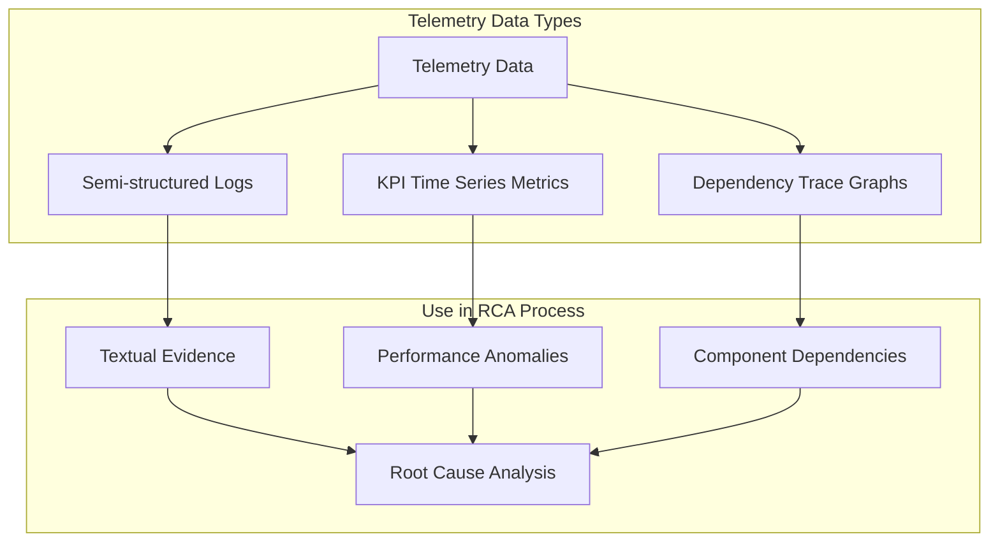

*Diagram: Telemetry Data Types and Their Role in RCA*

Sources: [README.md:9-10]()

## Directory Organization

Telemetry data in OpenRCA is organized hierarchically by system, date, and data type. The benchmark requires a specific directory structure for the `main.evaluate` and `main.generate` modules to function correctly.

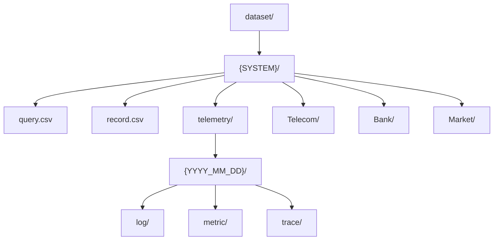

*Diagram: Telemetry Data Organization in Repository*

Sources: [README.md:42-56]()

The directory structure follows this pattern:
- Each system (`Telecom`, `Bank`, `Market`) has its own directory [README.md:44-46]().
- Each system directory contains `query.csv` (the tasks), `record.csv` (ground truth), and a `telemetry` folder [README.md:45-47]().
- The telemetry folder contains date-specific directories in `YYYY_MM_DD` format [README.md:48-52]().
- Each date directory contains separate folders for `log`, `metric`, and `trace` [README.md:49-51]().

## Detailed Telemetry Data Types

### 1. Semi-structured Logs
Logs are textual records of events occurring within system components. They contain timestamps, severity levels, and descriptive messages. In OpenRCA, these are used to find textual evidence of errors that metrics might miss [README.md:9]().

### 2. KPI Time Series Metrics
Metrics represent quantitative measurements of system performance (CPU, memory, latency). 
- **Timezone**: All telemetry, including metrics, uses the **UTC+8** timezone [README.md:156-158]().
- **Analysis Rule**: The `RCA-agent` is instructed to calculate global thresholds using the entire KPI series before filtering by a specific time duration to avoid bias [rca/baseline/rca_agent/executor.py:46-48]().

### 3. Dependency Trace Graphs
Traces represent execution paths. They are critical for identifying network-related faults which often cannot be identified via KPIs alone [README.md:160-163](). Analysts must examine the latency relationship between parent spans and child spans in these traces.

## Implementation: Data Interaction in Code

The `RCA-agent` interacts with these telemetry types by generating Python code that is executed in an `IPython Kernel`. This allows for efficient handling of large datasets without passing raw telemetry into the LLM context.

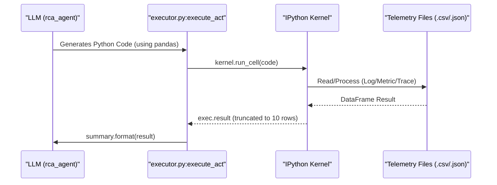

*Diagram: Code-Level Interaction with Telemetry Data*

Sources: [rca/baseline/rca_agent/executor.py:50-118](), [README.md:15-17]()

### Key Code Entities for Telemetry Handling

| Entity | File | Role |
|:---|:---|:---|
| `execute_act` | [rca/baseline/rca_agent/executor.py:50]() | Orchestrates the execution of code against telemetry data. |
| `rule` | [rca/baseline/rca_agent/executor.py:36]() | Constraints for the LLM on how to process telemetry (e.g., use pandas, explicit UTC+8). |
| `summary` | [rca/baseline/rca_agent/executor.py:24]() | Template for summarizing telemetry execution results back to the agent. |
| `row_pattern` | [rca/baseline/rca_agent/executor.py:97]() | Regex used to detect and notify the agent if a telemetry DataFrame was truncated. |

## Data Organization by System Type

The telemetry characteristics vary by system architecture:

| System Type | Deployment Structure | Telemetry Nuance |
|-------------|----------------------|---------------------------|
| **Telecom** | Service-oriented | Vertical deployment structure available in external documentation [README.md:175](). |
| **Bank** | Pod-level | Only horizontal pod-level traces; no vertical deployment structure [README.md:176](). |
| **Market** | Node/Pod/Container | Detailed in `metric_container.csv` (e.g., `node-5.adservice-2`) [README.md:177](). |

Sources: [README.md:172-177]()

## Accessing Telemetry via RCA-agent

The `RCA-agent` uses specific rules defined in `executor.py` to ensure data integrity:
1. **Efficiency**: Use `pandas.DataFrame` for tabular data [rca/baseline/rca_agent/executor.py:40]().
2. **Memory Management**: Do not store data as files; only cache as variables in the stateful kernel [rca/baseline/rca_agent/executor.py:43]().
3. **Timezone Handling**: Explicitly use `pytz.timezone('Asia/Shanghai')` to match the dataset's UTC+8 requirement [rca/baseline/rca_agent/executor.py:47-48]().
4. **Context Window**: The executor truncates DataFrame outputs to 10 rows to prevent token overflow, while warning the agent of potential observation bias [rca/baseline/rca_agent/executor.py:101-102]().

Sources: [rca/baseline/rca_agent/executor.py:36-48](), [rca/baseline/rca_agent/executor.py:97-103]()

---

# Page: RCA-agent Architecture

# RCA-agent Architecture

<details>
<summary>Relevant source files</summary>

The following files were used as context for generating this wiki page:

- [README.md](README.md)
- [rca/baseline/rca_agent/rca_agent.py](rca/baseline/rca_agent/rca_agent.py)
- [rca/run_agent_standard.py](rca/run_agent_standard.py)

</details>


This document provides a comprehensive overview of the RCA-agent architecture, a baseline implementation for root cause analysis (RCA) in the OpenRCA benchmark. RCA-agent is designed to analyze telemetry data efficiently by using Python for data retrieval and processing, allowing the Large Language Model (LLM) to focus on reasoning rather than handling large contexts.

For detailed technical specifications of the internal components, see the following child pages:
- [Controller and Executor](#3.1) — Details the `control_loop` and IPython execution environment.
- [Prompts and Domain Configurations](#3.2) — Explains the `agent_prompt` and domain-specific `basic_prompt` files.
- [Alternative Baselines](#3.3) — Describes DirectLM, CoT-LM, and Oracle KPI baselines.

## 1. Overview and Purpose

The `RCA_Agent` class [rca/baseline/rca_agent/rca_agent.py:3-15]() serves as the primary entry point for the baseline. It implements a ReAct-style agentic workflow where the model can interact with the telemetry environment through code.

The agent is designed to:
1. **Minimize Context Window Pressure**: By using Python for data retrieval, the model avoids processing raw, overly long telemetry contexts [README.md:15-16]().
2. **Handle Multi-Modal Telemetry**: It processes KPI time series (metrics), dependency trace graphs, and semi-structured log text [README.md:9-11]().
3. **Scalable Reasoning**: It uses an iterative `control_loop` to perform step-by-step investigation [rca/baseline/rca_agent/rca_agent.py:12]().

Sources: [README.md:9-17](), [rca/baseline/rca_agent/rca_agent.py:3-15]()

## 2. High-Level Architecture

The architecture follows a **Controller-Executor** pattern. The `RCA_Agent` is initialized with two types of prompts: an `agent_prompt` (defining the agent's identity and tool use) and a `basic_prompt` (providing domain-specific knowledge like system topology) [rca/baseline/rca_agent/rca_agent.py:4-7]().

### RCA-agent Component Interaction

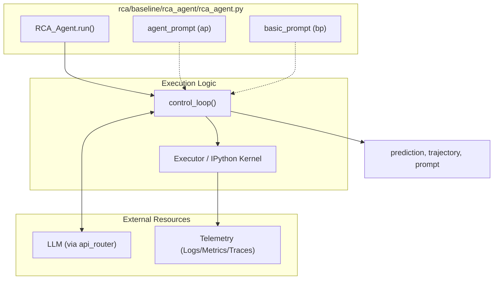

Sources: [rca/baseline/rca_agent/rca_agent.py:1-15](), [rca/run_agent_standard.py:21-28]()

## 3. Core Components

### 3.1 Controller and Executor
The `control_loop` function [rca/baseline/rca_agent/rca_agent.py:12]() manages the interaction between the LLM and the environment. It maintains a `trajectory` of actions taken (Python code) and observations received (code output). The **Executor** runs the generated Python code within an isolated kernel to query the `dataset/{SYSTEM}/telemetry` directories.

For details, see [Controller and Executor](#3.1).

### 3.2 Prompts and Domain Configurations
The agent utilizes a tiered prompting strategy. The `agent_prompt` [rca/run_agent_standard.py:22]() defines the general reasoning framework, while `basic_prompt_{SYSTEM}` files (e.g., `basic_prompt_Telecom.py`) provide specific system architecture details, such as the relationship between Nodes, Pods, and Services [rca/run_agent_standard.py:23-28]().

For details, see [Prompts and Domain Configurations](#3.2).

### 3.3 Alternative Baselines
Beyond the main `RCA_Agent`, the repository includes simpler baselines for comparison:
*   **DirectLM**: Zero-shot root cause prediction.
*   **CoT-LM**: Chain-of-Thought reasoning without tool use.
*   **Oracle KPIs**: A baseline provided with "ground truth" anomalous KPIs to test reasoning isolation.

For details, see [Alternative Baselines](#3.3).

## 4. Operational Workflow

The standard execution flow is managed by `rca/run_agent_standard.py`. It iterates through the `query.csv` file, instantiates the `RCA_Agent`, and captures the reasoning trajectory into Jupyter Notebook (`.ipynb`) files for manual inspection [rca/run_agent_standard.py:91-119]().

### Workflow Sequence

```mermaid
sequenceDiagram
    participant Main as "rca/run_agent_standard.py"
    participant Agent as "RCA_Agent"
    participant Loop as "control_loop"
    participant Kernel as "IPython Executor"
    
    Main->>Agent: run(instruction)
    Agent->>Loop: start loop (max_step, max_turn)
    loop Reasoning Steps
        Loop->>Loop: Construct Prompt (ap + bp + history)
        Loop->>Loop: Call LLM for Python Code
        Loop->>Kernel: Execute generated code
        Kernel->>Loop: Return data/error
    end
    Loop-->>Agent: return prediction
    Agent-->>Main: return result & trajectory
    Main->>Main: Save .ipynb & .json logs
```

Sources: [rca/run_agent_standard.py:91-124](), [rca/baseline/rca_agent/rca_agent.py:9-15]()

## 5. System Requirements

Due to the heavy memory requirements of loading telemetry data into the Python environment for analysis, the following hardware is recommended:
*   **Storage**: 80GB (to accommodate full telemetry datasets) [README.md:21-22]().
*   **Memory**: 32GB RAM (to support dataframes and in-memory analysis) [README.md:21-22]().
*   **Runtime**: Python >= 3.10 [README.md:25]().

Sources: [README.md:21-25]()

---

# Page: Controller and Executor

# Controller and Executor

<details>
<summary>Relevant source files</summary>

The following files were used as context for generating this wiki page:

- [rca/api_router.py](rca/api_router.py)
- [rca/baseline/rca_agent/controller.py](rca/baseline/rca_agent/controller.py)
- [rca/baseline/rca_agent/executor.py](rca/baseline/rca_agent/executor.py)

</details>


The RCA-agent operates using a **Controller-Executor** pattern, a specialized implementation of the ReAct (Reasoning and Acting) framework tailored for Root Cause Analysis. In this architecture, a high-level **Controller** manages the reasoning logic and strategic planning, while a low-level **Executor** translates natural language instructions into executable Python code to interact with telemetry data.

## 1. Controller: Reasoning and Orchestration

The Controller is the central orchestrator of the agent. It maintains the global state of the investigation and determines the next logical step in the RCA process. It is implemented primarily via the `control_loop` function in `rca/baseline/rca_agent/controller.py`.

### Key Responsibilities
*   **State Management**: It maintains the `prompt` history (messages sent to the LLM) and the `trajectory` (a record of code executed and results observed) [rca/baseline/rca_agent/controller.py:70-71]().
*   **Reasoning Loop**: It iteratively prompts the LLM to analyze previous results and generate new instructions until the `completed` flag is set to `"True"` [rca/baseline/rca_agent/controller.py:80-102]().
*   **Final Answer Synthesis**: Once the investigation is complete, it uses a specific `summary` prompt to force the LLM to select from valid candidate components and reasons [rca/baseline/rca_agent/controller.py:34-58]().

### Implementation Details
The `control_loop` initializes an `InteractiveShellEmbed` kernel from IPython to provide a stateful environment where variables persist across different steps of the reasoning process [rca/baseline/rca_agent/controller.py:74-78]().

### Data Flow: Natural Language to Reasoning
The following diagram illustrates how the Controller bridges the user's objective (Natural Language Space) into structured reasoning steps.

**Controller Reasoning Flow**
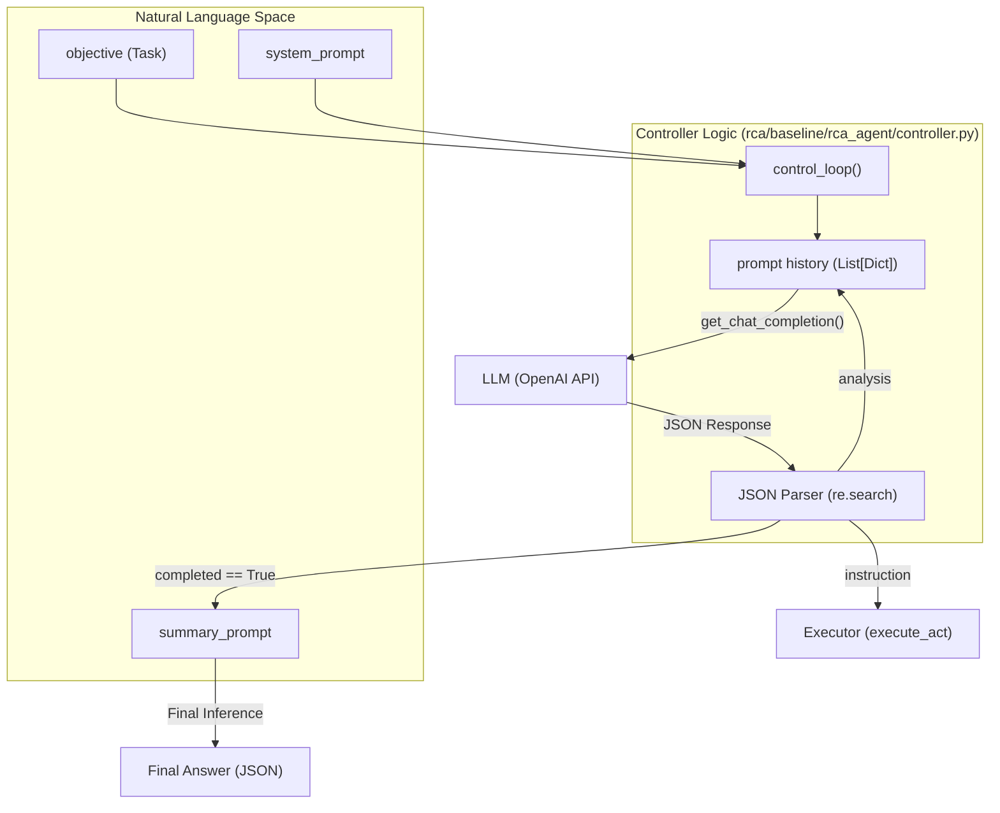
Sources: [rca/baseline/rca_agent/controller.py:60-125](), [rca/api_router.py:28-57]()

---

## 2. Executor: Code Generation and Execution

The Executor acts as the bridge between the Controller's high-level instructions and the raw telemetry files. It is responsible for writing, validating, and running Python code.

### Key Responsibilities
*   **Code Generation**: It takes an `instruction` from the Controller and uses an LLM to generate a Python code block [rca/baseline/rca_agent/executor.py:50-82]().
*   **IPython Interaction**: It executes the code using `kernel.run_cell(code)` and captures the output or errors [rca/baseline/rca_agent/executor.py:88-91]().
*   **Self-Correction**: If the code fails (e.g., syntax error or runtime exception), the Executor catches the traceback and re-prompts the LLM to fix the code [rca/baseline/rca_agent/executor.py:119-126]().
*   **Result Summarization**: After successful execution, it prompts the LLM to provide a "plain English" summary of the technical output to make it easier for the Controller to digest [rca/baseline/rca_agent/executor.py:109-116]().

### Execution Rules
The Executor is bound by strict `RULES OF PYTHON CODE WRITING`, which include:
*   Using `pytz.timezone('Asia/Shanghai')` for all time operations [rca/baseline/rca_agent/executor.py:47]().
*   Avoiding visualization libraries like `matplotlib` or `seaborn` [rca/baseline/rca_agent/executor.py:44]().
*   Calculating global thresholds *before* filtering data to avoid observation bias [rca/baseline/rca_agent/executor.py:46]().

### Data Flow: Code Entity Space
The following diagram shows how the Executor interacts with the IPython kernel and handles data.

**Executor Code Interaction**
```mermaid
graph TD
    subgraph "Controller Instruction"
        INS["instruction (str)"]
    end

    subgraph "Executor Logic (rca/baseline/rca_agent/executor.py)"
        EA["execute_act()"]
        CP["code_pattern (Regex)"]
        SUM["summary_logic"]
    end

    subgraph "Code Entity Space (IPython)"
        KRN["InteractiveShellEmbed"]
        DF["pandas.DataFrame"]
        VAR["Stateful Variables"]
    end

    INS --> EA
    EA --> |"Prompting"| LLM["LLM (Code Gen)"]
    LLM --> |"```python...```"| CP
    CP --> |"code"| KRN
    KRN --> |"run_cell()"| DF
    DF --> VAR
    KRN --> |"exec.result"| SUM
    SUM --> |"Plain English"| RES["result (str)"]
    
    KRN -.-> |"exec.error_in_exec"| EA
```
Sources: [rca/baseline/rca_agent/executor.py:36-48](), [rca/baseline/rca_agent/executor.py:50-126]()

---

## 3. Interaction Protocol

The communication between the Controller and Executor follows a structured JSON-based protocol to ensure reliability.

### Controller to Executor
The Controller sends an `instruction` which is a specific task like: *"Read the logs for the 'auth-service' between 10:00 and 10:05 and check for 5xx errors."* [rca/baseline/rca_agent/controller.py:27-32]().

### Executor to Controller
The Executor returns a tuple containing:
1.  **code**: The Python code that was run.
2.  **result**: A combination of the LLM's plain English summary and the raw IPython output [rca/baseline/rca_agent/executor.py:116-118]().
3.  **status**: A boolean indicating if execution was successful.
4.  **history**: The updated message history for the executor's internal context.

| Component | Class/Function | Primary Input | Primary Output |
| :--- | :--- | :--- | :--- |
| **Controller** | `control_loop` | `objective`, `ap.rules`, `bp.schema` | Final Answer (JSON) |
| **Executor** | `execute_act` | `instruction`, `kernel` | Code, Result String, Status |
| **API Bridge** | `get_chat_completion` | `messages` | LLM String Content |

Sources: [rca/baseline/rca_agent/controller.py:60-125](), [rca/baseline/rca_agent/executor.py:50-136](), [rca/api_router.py:28-57]()

---

# Page: Prompts and Domain Configurations

# Prompts and Domain Configurations

<details>
<summary>Relevant source files</summary>

The following files were used as context for generating this wiki page:

- [rca/baseline/rca_agent/prompt/agent_prompt.py](rca/baseline/rca_agent/prompt/agent_prompt.py)
- [rca/baseline/rca_agent/prompt/basic_prompt_Bank.py](rca/baseline/rca_agent/prompt/basic_prompt_Bank.py)
- [rca/baseline/rca_agent/prompt/basic_prompt_Market.py](rca/baseline/rca_agent/prompt/basic_prompt_Market.py)
- [rca/baseline/rca_agent/prompt/basic_prompt_Telecom.py](rca/baseline/rca_agent/prompt/basic_prompt_Telecom.py)

</details>


The RCA-agent relies on a sophisticated prompt engineering subsystem to guide the Large Language Model (LLM) through the complexities of root cause analysis. This system is divided into two primary layers: a global **Agent-Level Prompt** that defines the logical workflow and diagnostic rules, and **Domain-Specific Basic Prompts** that provide the LLM with the necessary context regarding system architecture, telemetry schemas, and valid failure modes for different industrial domains (Telecom, Bank, and Market).

## Agent-Level Diagnostic Workflow

The agent-level prompt establishes a rigorous four-stage workflow that the LLM must follow to ensure consistency and accuracy in its reasoning. This workflow is designed to mimic the behavior of a site reliability engineer (SRE).

### Diagnostic Stages
1.  **Preprocess**: Aggregate KPIs by `component-KPI` and calculate global thresholds (e.g., P95) across the entire dataset before temporal filtering [rca/baseline/rca_agent/prompt/agent_prompt.py:6-9]().
2.  **Anomaly Detection**: Identify data points exceeding thresholds or significant drops in business KPIs (success rates) [rca/baseline/rca_agent/prompt/agent_prompt.py:10-13]().
3.  **Fault Identification**: Group consecutive anomalies into "faults," filtering out isolated noise and minor fluctuations [rca/baseline/rca_agent/prompt/agent_prompt.py:14-17]().
4.  **Root Cause Localization**: Determine the specific fault that caused the failure by analyzing downstream dependencies in traces and identifying the first point of failure [rca/baseline/rca_agent/prompt/agent_prompt.py:18-24]().

### Operational Constraints
The prompt enforces strict rules to prevent common LLM hallucinations and technical errors:
*   **Threshold Calculation**: Thresholds must be calculated using the entire daily KPI series, not just the window of the failure [rca/baseline/rca_agent/prompt/agent_prompt.py:36-39]().
*   **Data Modality Order**: Analysis must proceed from Metrics -> Traces -> Logs [rca/baseline/rca_agent/prompt/agent_prompt.py:25-29]().
*   **Tool Usage**: The LLM is forbidden from using visualization libraries (`matplotlib`) or local file system storage, forcing it to rely on the IPython kernel state [rca/baseline/rca_agent/prompt/agent_prompt.py:37-38]().

**Sources:** [rca/baseline/rca_agent/prompt/agent_prompt.py:1-43]()

## Domain Configurations

Each supported domain (Telecom, Bank, Market) has a dedicated configuration file that defines the environment the agent is operating in. These files include the directory structure, data schema, and a list of possible root cause candidates.

### 1. Bank System
The Bank system represents a traditional financial platform with components like Apache, Tomcat, MySQL, and Redis.

| Feature | Description |
| :--- | :--- |
| **Components** | `apache01-02`, `Tomcat01-04`, `MG01-02`, `IG01-02`, `Mysql01-02`, `Redis01-02` [rca/baseline/rca_agent/prompt/basic_prompt_Bank.py:14-27]() |
| **Metric KPIs** | `rr` (response rate), `sr` (success rate), `cnt`, `mrt` (mean response time) [rca/baseline/rca_agent/prompt/basic_prompt_Bank.py:46-48]() |
| **Fault Types** | JVM OOM, High CPU/Memory, Network Latency/Loss, Disk I/O [rca/baseline/rca_agent/prompt/basic_prompt_Bank.py:3-10]() |

**Sources:** [rca/baseline/rca_agent/prompt/basic_prompt_Bank.py:1-91]()

### 2. Market (E-commerce) System
The Market system is a complex microservices environment (e.g., Online Boutique) deployed across multiple "cloudbeds" (clusters). It introduces hierarchical levels: Node, Pod (Container), and Service.

| Level | Identification (cmdb_id) | Example |
| :--- | :--- | :--- |
| **Node** | `<node>-x` | `node-1` [rca/baseline/rca_agent/prompt/basic_prompt_Market.py:184]() |
| **Pod** | `<node>-x.<service>-x` | `node-1.adservice-0` [rca/baseline/rca_agent/prompt/basic_prompt_Market.py:183]() |
| **Service** | `<service>-grpc` | `adservice-grpc` [rca/baseline/rca_agent/prompt/basic_prompt_Market.py:185]() |

**Sources:** [rca/baseline/rca_agent/prompt/basic_prompt_Market.py:1-191]()

### 3. Telecom System
The Telecom system focuses on a database-heavy architecture with specific identifiers for middleware and containers.

| Feature | Detail |
| :--- | :--- |
| **Metric Files** | `metric_app`, `metric_container`, `metric_middleware`, `metric_node`, `metric_service` [rca/baseline/rca_agent/prompt/basic_prompt_Telecom.py:75-110]() |
| **Trace Types** | `JDBC`, `LOCAL`, `RemoteProcess`, `FlyRemote`, `OSB` [rca/baseline/rca_agent/prompt/basic_prompt_Telecom.py:117-122]() |
| **Fault Types** | CPU fault, Network delay/loss, DB connection limit, DB close [rca/baseline/rca_agent/prompt/basic_prompt_Telecom.py:3-7]() |

**Sources:** [rca/baseline/rca_agent/prompt/basic_prompt_Telecom.py:1-139]()

## Technical Data Flow

The following diagram illustrates how the natural language prompts translate into code-level entities during the agent's execution.

### Diagram: Prompt to Code Entity Mapping
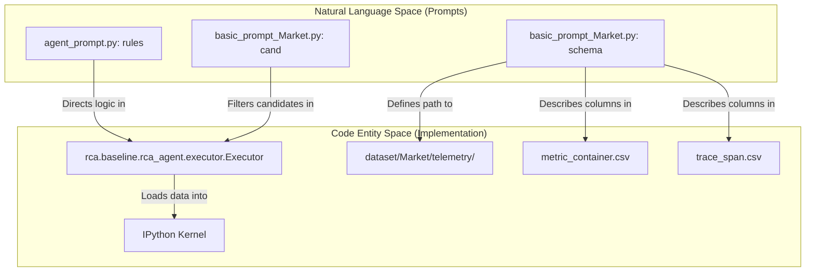
**Sources:** [rca/baseline/rca_agent/prompt/agent_prompt.py:1-43](), [rca/baseline/rca_agent/prompt/basic_prompt_Market.py:85-158]()

### Diagram: Domain Data Structure and Identifiers
This diagram shows how specific `cmdb_id` formats defined in the prompts map to the underlying CSV data structures.

```mermaid
graph LR
    subgraph "Market Domain Schema"
        M1["metric_container.csv"]
        M2["metric_node.csv"]
        M3["trace_span.csv"]
    end

    subgraph "Code Identifiers (cmdb_id)"
        ID1["node-6.adservice2-0"]
        ID2["node-1"]
        ID3["frontend-0"]
    end

    M1 -- "contains" --> ID1
    M2 -- "contains" --> ID2
    M3 -- "contains" --> ID3

    subgraph "Diagnostic Rule Mapping"
        R1["agent_prompt.py: 1.1 Preprocess"]
        R2["agent_prompt.py: 2.2 Trace analysis"]
    end

    ID1 -- "Analyzed by" --> R1
    ID3 -- "Analyzed by" --> R2
```
**Sources:** [rca/baseline/rca_agent/prompt/agent_prompt.py:5-29](), [rca/baseline/rca_agent/prompt/basic_prompt_Market.py:99-141]()

---

# Page: Alternative Baselines

# Alternative Baselines

<details>
<summary>Relevant source files</summary>

The following files were used as context for generating this wiki page:

- [rca/baseline/cot_lm.py](rca/baseline/cot_lm.py)
- [rca/baseline/direct_lm.py](rca/baseline/direct_lm.py)
- [rca/baseline/oracle_kpis.py](rca/baseline/oracle_kpis.py)

</details>


While the **RCA-agent** uses an iterative "Reasoning-Action" loop with a Python interpreter, OpenRCA also provides alternative baseline implementations: **DirectLM** and **CoT-LM**. These baselines serve as comparative benchmarks to evaluate the necessity of agentic workflows and tool-use in root cause analysis. Additionally, the **Oracle KPIs** configuration defines the critical telemetry metrics for different system domains.

## 1. DirectLM Baseline

The `DirectLM` baseline represents a zero-shot approach where the LLM is provided with the entire telemetry dataset and the issue statement in a single prompt. It is required to output the root cause analysis directly in a structured JSON format without any intermediate steps or tool execution.

### Implementation and Data Flow
The implementation in `rca/baseline/direct_lm.py` follows a linear flow:
1. **Data Assembly**: It iterates through `period_data`, appending telemetry strings (logs, metrics, traces) into a single context block `[rca/baseline/direct_lm.py:49-53]()`.
2. **Prompt Construction**: It combines the system schema (`info`), the assembled data, and the `objective` (the RCA question) `[rca/baseline/direct_lm.py:54-58]()`.
3. **Inference**: It calls `get_chat_completion` and attempts to parse the response as JSON `[rca/baseline/direct_lm.py:64-68]()`.

### Trade-offs
*   **Pros**: Low latency and reduced API costs as it requires only one LLM call.
*   **Cons**: Highly susceptible to "lost in the middle" phenomena and context window limits. It cannot perform data filtering or aggregation, often leading to `context_length_exceeded` errors on large datasets `[rca/baseline/direct_lm.py:71-73]()`.

**Sources:** `rca/baseline/direct_lm.py`

---

## 2. CoT-LM (Chain-of-Thought) Baseline

The `CoTLM` baseline improves upon `DirectLM` by instructing the LLM to perform "step-by-step" reasoning before providing the final answer. This leverages the Chain-of-Thought prompting technique to improve the model's logical deduction over complex telemetry.

### Implementation and Data Flow
The `CoTLM` class in `rca/baseline/cot_lm.py` is architecturally similar to `DirectLM` but uses a different `user` prompt template:
*   **Reasoning Instruction**: The prompt explicitly asks the model to "first conduct a comprehensive analysis on the given telemetry data step-by-step" `[rca/baseline/cot_lm.py:18]()`.
*   **JSON Summarization**: After the reasoning steps, the model must provide the final findings in a specific JSON format containing the `root cause occurrence datetime`, `root cause component`, and `root cause reason` `[rca/baseline/cot_lm.py:21-32]()`.

### Data Space Bridge: Direct/CoT-LM Execution
The following diagram illustrates how these baselines bridge the gap between the Natural Language objective and the telemetry data stored in the code.

**Baseline Execution Flow**
```mermaid
graph TD
    subgraph "Natural Language Space"
        A["instruction / objective"]
        B["system prompt (Direct/CoT)"]
    end

    subgraph "Code Entity Space (rca/baseline/)"
        C["DirectLM.run()"]
        D["CoTLM.run()"]
        E["period_data (Dict)"]
        F["get_chat_completion()"]
    end

    A --> C
    A --> D
    E -- "Iterate and Format" --> C
    E -- "Iterate and Format" --> D
    C -- "messages" --> F
    D -- "messages + 'step-by-step'" --> F
    F -- "JSON String" --> G["RCA Result"]
```
**Sources:** `rca/baseline/direct_lm.py`, `rca/baseline/cot_lm.py`

---

## 3. Oracle KPIs

The `Oracle KPIs` are not an execution baseline but a domain-specific configuration file (`rca/baseline/oracle_kpis.py`) that defines which metrics are most relevant for identifying root causes in each system type (Telecom, Bank, Market). This serves as a reference for filtering noise in more advanced agents.

### KPI Definitions by Domain
The file categorizes metrics into standard operational pillars: CPU, Memory, I/O, Network, and Domain-specific (e.g., JVM for Bank, DB for Telecom).

| System | Key Metrics (Code Identifiers) | Source |
| :--- | :--- | :--- |
| **Telecom** | `Proc_Used_Pct`, `tnsping_result_time`, `Disk_io_util` | `[rca/baseline/oracle_kpis.py:1-16]()` |
| **Bank** | `JVM_CPULoad`, `MEMUsedMemPerc`, `DSKReadWrite`, `TCP-CLOSE-WAIT` | `[rca/baseline/oracle_kpis.py:23-60]()` |
| **Market** | `container_cpu_usage_seconds`, `system.io.r_s`, `frontend-http` | `[rca/baseline/oracle_kpis.py:67-97]()` |

### Code Mapping: KPI Categories
The following diagram shows how the `oracle_kpis.py` file structures the "Ground Truth" of what an agent should look for.

**KPI Schema Structure**
```mermaid
classDiagram
    class kpi_Telecom {
        +db: List[str]
        +cpu: List[str]
        +mem: List[str]
        +io: List[str]
        +net: List[str]
    }
    class kpi_Bank {
        +jvm: List[str]
        +cpu: List[str]
        +mem: List[str]
        +io: List[str]
        +net: List[str]
    }
    class kpi_Market {
        +process: List[str]
        +cpu: List[str]
        +mem: List[str]
        +io: List[str]
        +net: List[str]
    }
    
    kpi_Telecom --|> oracle_kpis_py : defined in
    kpi_Bank --|> oracle_kpis_py : defined in
    kpi_Market --|> oracle_kpis_py : defined in
```
**Sources:** `rca/baseline/oracle_kpis.py`

---

## 4. Summary of Baseline Differences

The alternative baselines provide a spectrum of complexity for evaluating LLM performance on OpenRCA:

| Feature | DirectLM | CoT-LM | RCA-agent |
| :--- | :--- | :--- | :--- |
| **Approach** | Single-shot JSON | Chain-of-Thought | Iterative Tool-use |
| **Logic** | Implicit | Explicit Step-by-Step | Python Execution |
| **Context Handling** | Poor (Truncation likely) | Poor (Truncation likely) | Good (Dynamic Filtering) |
| **Implementation** | `direct_lm.py` | `cot_lm.py` | `rca_agent/` |

**Sources:** `rca/baseline/direct_lm.py`, `rca/baseline/cot_lm.py`

---

# Page: Evaluation System

# Evaluation System

<details>
<summary>Relevant source files</summary>

The following files were used as context for generating this wiki page:

- [README.md](README.md)
- [main/evaluate.py](main/evaluate.py)

</details>


The Evaluation System in OpenRCA provides a methodology for assessing the accuracy of root cause analysis (RCA) predictions made by Large Language Models (LLMs) against the ground truth. It serves as the scoring backbone of the benchmark, allowing for standardized comparison of different RCA approaches. For specific details about scoring criteria, see [Scoring Mechanism](#4.1).

## Overview

The Evaluation System compares predictions to ground truth data, calculates accuracy scores, and generates comprehensive reports. It supports evaluation of both individual predictions and batch processing of prediction files.

### Evaluation Workflow Logic

The diagram below maps the evaluation process to the code entities responsible for processing predictions.

```mermaid
flowchart TB
    subgraph "main/evaluate.py"
        Input["Input Data: prediction_file & query_file"]
        
        subgraph "Processing Logic"
            direction TB
            FileEval["file_evaluate()"]
            SingleEval["evaluate()"]
            TimeDiff["time_difference()"]
            Permute["itertools.permutations()"]
        end
        
        subgraph "Output Logic"
            ReportGen["report()"]
            CSV["eval_df.to_csv()"]
        end
        
        Input --> FileEval
        FileEval --> SingleEval
        SingleEval --> TimeDiff
        SingleEval --> Permute
        FileEval --> CSV
        CSV --> ReportGen
    end
```
Sources: [main/evaluate.py:9-101](), [main/evaluate.py:104-150](), [main/evaluate.py:152-187]()

## Prediction Format

The evaluation system expects predictions in a specific JSON-like format. Each prediction should contain information about one or more root causes, with each cause represented as a JSON object containing specific keys. The system uses regex patterns defined in `evaluate()` to extract these fields [main/evaluate.py:19-24]().

1. `root cause occurrence datetime`: The timestamp of the fault.
2. `root cause component`: The specific system entity affected.
3. `root cause reason`: The description of the failure.

```json
{
    "1": {
        "root cause occurrence datetime": "2024-05-13 14:00:00",
        "root cause component": "adservice",
        "root cause reason": "CPU saturation"
    }
}
```

This format allows for representing multiple root causes in chronological order, which is particularly important for complex failure scenarios [README.md:72-81]().

Sources: [README.md:72-81](), [main/evaluate.py:19-37]()

## Core Evaluation Functions

The evaluation logic is encapsulated in `main/evaluate.py` and consists of three primary functions that bridge the gap between LLM natural language output and structured performance metrics.

### 1. `evaluate(prediction, scoring_points)`
This function handles the core logic of comparing a single prediction string against the `scoring_points` string from the query dataset [main/evaluate.py:9-15](). It extracts components, reasons, and timestamps using regex and calculates a score based on the matching results [main/evaluate.py:43-52]().

### 2. `file_evaluate(prediction_file, query_file, report_file)`
A batch processing wrapper that iterates through a prediction CSV and its corresponding ground truth `query.csv` [main/evaluate.py:104-115](). It aligns rows (optionally using `row_id`) and concatenates results into an `eval_df` [main/evaluate.py:118-141]().

### 3. `report(report_file)`
This function performs the final statistical aggregation [main/evaluate.py:152-157](). It categorizes results by difficulty and prints a formatted table showing Total, Correct, and Accuracy percentages for "easy", "middle", and "hard" tasks [main/evaluate.py:160-186]().

Sources: [main/evaluate.py:9-101](), [main/evaluate.py:104-150](), [main/evaluate.py:152-187]()

## Task Difficulty Classification

The Evaluation System classifies tasks based on the `task_index` found in the `query.csv` file. The difficulty mapping is defined within the `report` function [main/evaluate.py:179]().

| Difficulty Level | Task Indices | Logic in `report()` |
|------------------|--------------|-----------------|
| **Easy**         | 1-3          | `int(x.split('_')[1]) <= 3` |
| **Middle**       | 4-6          | `int(x.split('_')[1]) <= 6` |
| **Hard**         | 7            | `int(x.split('_')[1]) == 7` |

Sources: [main/evaluate.py:178-180]()

## Execution and Output

The evaluation system is invoked via the `main.evaluate` module [README.md:63-67]().

### Command Line Interface
```bash
python -m main.evaluate \
    -p [prediction csv files] \
    -q [groundtruth csv files] \
    -r [report csv file to save]
```

### Evaluation Output Data Model
The resulting `report_file` (CSV) contains the following schema produced during the evaluation loop [main/evaluate.py:121]():

| Field | Description |
| :--- | :--- |
| `query` | The original natural language instruction [main/evaluate.py:133]() |
| `answer` | The raw prediction string from the LLM [main/evaluate.py:134]() |
| `groundtruth` | The expected `scoring_points` [main/evaluate.py:135]() |
| `passed` | List of criteria successfully met [main/evaluate.py:136]() |
| `failed` | List of criteria missed [main/evaluate.py:137]() |
| `score` | Numerical score (0.0 to 1.0) [main/evaluate.py:138]() |
| `task_index` | Identifier used for difficulty classification [main/evaluate.py:139]() |

Sources: [README.md:63-67](), [main/evaluate.py:121-141](), [main/evaluate.py:190-216]()

## Implementation Details

The evaluation algorithm handles several complex cases:

1. **Permutation Matching**: For multi-fault scenarios, `itertools.permutations` is used to find the best possible match between predicted results and ground truth points to ensure the highest possible score is awarded [main/evaluate.py:76-95]().
2. **Temporal Tolerance**: The `time_difference` helper function allows a 60-second window for "root cause occurrence datetime" matches, recognizing that sampling frequencies may not align perfectly with fault injection times [main/evaluate.py:54-68]().
3. **Regex Extraction**: The system uses strict patterns (e.g., `predict_pattern`) to parse the LLM's JSON-like response, ensuring that minor formatting deviations do not break the evaluation [main/evaluate.py:19-24]().

For a deeper dive into how scores are computed and how the permutation matching works, see **[Scoring Mechanism](#4.1)**.

Sources: [main/evaluate.py:19-24](), [main/evaluate.py:54-68](), [main/evaluate.py:76-95]()

---

# Page: Scoring Mechanism

# Scoring Mechanism

<details>
<summary>Relevant source files</summary>

The following files were used as context for generating this wiki page:

- [main/evaluate.py](main/evaluate.py)
- [rca/archive/agent-Bank.csv](rca/archive/agent-Bank.csv)
- [rca/archive/agent-Market-cloudbed-1.csv](rca/archive/agent-Market-cloudbed-1.csv)
- [rca/archive/agent-Market-cloudbed-2.csv](rca/archive/agent-Market-cloudbed-2.csv)
- [rca/archive/agent-Telecom.csv](rca/archive/agent-Telecom.csv)

</details>


This page documents the scoring mechanism used in the OpenRCA benchmark to evaluate the accuracy of root cause analysis predictions. The scoring system provides a standardized method for assessing how well an RCA solution identifies the correct root causes of issues in telemetry data.

## Overview of the Scoring Process

The OpenRCA benchmark evaluates predictions by comparing them against ground truth data. Each prediction is scored based on three key elements:

1. **Root cause occurrence datetime**
2. **Root cause component**
3. **Root cause reason**

The scoring system is designed to be robust, handling both single and multiple root cause scenarios, while providing a normalized score that represents the overall accuracy of predictions.

### Natural Language Space to Code Space Mapping: Evaluation Flow
This diagram illustrates how the natural language predictions and scoring points are processed by the evaluation logic in `main/evaluate.py`.

```mermaid
flowchart TD
    subgraph "Natural Language Space (Input)"
        P["Prediction JSON String"]
        G["Scoring Points String"]
    end
    
    subgraph "main/evaluate.py (Code Space)"
        direction TB
        P --> PE["re.findall(predict_pattern, prediction)"]
        G --> GE["re.findall(component_pattern, scoring_points)"]
        
        subgraph "Matching Logic"
            PE --> PR["predict_results (List[Dict])"]
            GE --> GT["components, reasons, times (Lists)"]
            PR & GT --> PM["itertools.permutations() matching"]
            PM --> TD["time_difference() check"]
        end
        
        TD --> SC["bin_score calculation"]
    end
    
    subgraph "Results"
        SC --> FS["CSV Report Row"]
    end
```
Sources: [main/evaluate.py:9-101]()

## Prediction Format and Extraction

The system expects predictions in a JSON-like format. The `evaluate` function in `main/evaluate.py` uses a specific regex pattern `predict_pattern` to extract information even if the LLM output includes conversational filler.

### Expected Prediction Format
[main/evaluate.py:19-24]()
```json
{
  "root cause occurrence datetime": "YYYY-MM-DD HH:MM:SS",
  "root cause component": "ComponentName",
  "root cause reason": "Description of the root cause"
}
```

Multiple root causes can be specified as multiple JSON objects in the prediction string. The extraction logic iterates through all matches found by `re.findall` and stores them in `predict_results`.

Sources: [main/evaluate.py:19-37]()

## Ground Truth Extraction

Ground truth data is provided in the `scoring_points` field of the query file. The system extracts this information using three distinct regular expressions:
1. `component_pattern`: `r"The (?:\d+-th|only) predicted root cause component is ([^\n]+)"` [main/evaluate.py:43-43]()
2. `reason_pattern`: `r"The (?:\d+-th|only) predicted root cause reason is ([^\n]+)"` [main/evaluate.py:44-44]()
3. `time_pattern`: `r"The (?:\d+-th|only) root cause occurrence time is within 1 minutes (i.e., <=1min) of ([^\n]+)"` [main/evaluate.py:45-45]()

The length of the ground truth is determined by the maximum number of components, reasons, or times found, defined as `scoringpoints_length`.

Sources: [main/evaluate.py:43-51]()

## Matching and Scoring Algorithm

The core logic in `evaluate(prediction, scoring_points)` handles the comparison.

### Time Difference Calculation
The function `time_difference(time1_str, time2_str)` converts string timestamps into `datetime` objects using the format `%Y-%m-%d %H:%M:%S`. A prediction is considered correct if the absolute difference is $\le 60$ seconds.

Sources: [main/evaluate.py:54-68]()

### Permutation-Based Matching
To handle cases where an LLM predicts multiple root causes in a different order than the ground truth, the algorithm uses `itertools.permutations(predict_results)`. It iterates through every possible alignment between the predicted list and the ground truth list to find the `best_score`.

```mermaid
flowchart TD
    subgraph "Code Entity: evaluate()"
        START["Start Permutation Loop"] --> PERM["perm in itertools.permutations(predict_results)"]
        PERM --> COMP["Check perm[i]['root cause component'] == components[i]"]
        COMP --> REAS["Check perm[i]['root cause reason'] == reasons[i]"]
        REAS --> TIME["Check time_difference(times[i], perm[i]['datetime'])"]
        TIME --> SCORE["Update current_score"]
        SCORE --> NEXT["Next Permutation?"]
        NEXT -- Yes --> PERM
        NEXT -- No --> BEST["scores_get = best_score"]
    end
```
Sources: [main/evaluate.py:74-95]()

## Score Calculation

The final score is a normalized value:
`final_score = scores_get / socres_num` [main/evaluate.py:99-99]()

Where `socres_num` is the total number of individual criteria (sum of components, reasons, and times expected). The result is rounded to two decimal places (`bin_score`).

Sources: [main/evaluate.py:98-101]()

## Task Difficulty Levels

The OpenRCA benchmark classifies tasks into three difficulty levels based on the `task_index` found in the query files:

| Difficulty Level | Task Indices | Description |
|------------------|--------------|-------------|
| **Easy** | `task_1` to `task_3` | Basic RCA scenarios (e.g., identify time only) |
| **Middle** | `task_4` to `task_6` | Moderate complexity (e.g., component + reason) |
| **Hard** | `task_7` | Complex scenarios (e.g., all three elements + multiple failures) |

The `report(report_file)` function dynamically assigns these labels by splitting the `task_index` string (e.g., `task_1` becomes `1`).

Sources: [main/evaluate.py:160-180](), [rca/archive/agent-Bank.csv:2-12]()

## Evaluation Report Generation

The `file_evaluate` function processes entire CSV files, aligning predictions with queries via `row_id` if available. It produces an output CSV containing:
- `passed`: Criteria that matched.
- `failed`: Criteria that did not match.
- `score`: The normalized `bin_score`.

The `report` function then aggregates these into a final summary:
1. **Strict Score**: Count of samples where `score == 1.0`.
2. **Partial Score**: Sum of all `bin_score` values.
3. **Accuracy**: `Strict Score / Total Samples`.

Sources: [main/evaluate.py:104-141](), [main/evaluate.py:182-187]()

## Command-Line Interface

The evaluation system is invoked via `main/evaluate.py`. It requires paired lists of prediction and query files.

```bash
python main/evaluate.py -p <pred_1.csv> -q <query_1.csv> -r <final_report.csv>
```

The script uses `argparse` to handle multiple file inputs and then triggers `file_evaluate` followed by `report`.

Sources: [main/evaluate.py:190-216]()

---

# Page: Task Generation

# Task Generation

<details>
<summary>Relevant source files</summary>

The following files were used as context for generating this wiki page:

- [README.md](README.md)
- [main/generate.py](main/generate.py)
- [main/prompt.py](main/prompt.py)
- [main/task_specification.json](main/task_specification.json)

</details>


The Task Generation system in OpenRCA provides a mechanism to create root cause analysis (RCA) tasks from telemetry data. This system allows users to generate standardized queries that can be used to evaluate an LLM's ability to analyze software failures from telemetry data. For information about evaluating generated tasks, see [Evaluation System](#4).

## Purpose and Scope

The Task Generation system serves several key purposes:

1. Creating standardized RCA tasks with varying complexity levels.
2. Generating natural language queries from structured task specifications using LLMs.
3. Supporting both the included OpenRCA datasets and custom telemetry data.
4. Providing a foundation for reproducible RCA evaluations by linking telemetry records to specific queries.

Sources: [README.md:136-146](), [main/generate.py:62-163]()

## Task Generation Architecture

The Task Generation system consists of several components that work together to transform telemetry data into structured RCA tasks with natural language queries.

```mermaid
flowchart TD
    subgraph "Inputs"
        TaskSpec["task_specification.json"]
        RecordFile["record.csv"]
        ExtraSpec["Optional Extra Specifications"]
    end

    subgraph "Task Generation Process [main/generate.py]"
        Generator["query_generate()"]
        TimeHandler["timestamp2timeperiod()\ntimestamp2datetime()"]
        ConflictResolver["get_half_hour_conflict_failure_flag()"]
        PromptSystem["main/prompt.py\nTemplate Engine"]
    end

    subgraph "External Service"
        LLMCall["LLM API Call\nget_chat_completion()"]
    end

    subgraph "Outputs"
        QueryCSV["query.csv\n- task_index\n- instruction\n- scoring_points"]
    end

    TaskSpec --> Generator
    RecordFile --> Generator
    ExtraSpec --> Generator
    
    Generator --> TimeHandler
    Generator --> ConflictResolver
    Generator --> PromptSystem
    PromptSystem --> LLMCall
    LLMCall --> Generator
    Generator --> QueryCSV
```

**Task Generation System Components Diagram**

Sources: [main/generate.py:62-163](), [main/generate.py:18-45](), [README.md:136-146]()

## Task Specification Format

Task specifications define the structure and evaluation criteria for RCA tasks. These specifications are stored in a JSON file and include templates for various task types. For a detailed breakdown of these specifications, see [Task Specifications](#5.1).

### Task Specification Structure

Each task specification in `main/task_specification.json` includes:

1.  **Input fields**: Information provided to the LLM (e.g., time range, number of failures).
2.  **Output fields**: Information the LLM needs to determine (e.g., root cause time, component, reason).
3.  **Scoring points**: Criteria used to evaluate the LLM's response, which are formatted into the final query file.

```mermaid
classDiagram
    class TaskSpecification {
        task_1 to task_7
    }

    class TaskTemplate {
        input[] : str
        output[] : str
        scoring_points[] : str
    }

    TaskSpecification --> TaskTemplate : contains

    class InputField {
        "time range: {time_period}"
        "number of failures: {num}"
    }

    class OutputField {
        "root cause occurrence time: {datetime}"
        "root cause component: {component}"
        "root cause reason: {reason}"
    }

    class ScoringPoint {
        "The {idx} predicted root cause component is {component}"
    }

    TaskTemplate --> InputField : defines
    TaskTemplate --> OutputField : defines
    TaskTemplate --> ScoringPoint : defines
```

**Task Specification Structure Diagram**

Sources: [main/task_specification.json:1-96]()

## Generation Process Flow

The task generation process takes telemetry records and task specifications as input and generates natural language queries. It handles complex scenarios such as "multi-response" tasks where multiple failures occur within the same 30-minute window.

```mermaid
sequenceDiagram
    participant User
    participant Generator as "main/generate.py"
    participant TaskSpec as "task_specification.json"
    participant Records as "record.csv"
    participant Prompt as "main/prompt.py"
    participant LLM as "Large Language Model"
    participant QueryFile as "query.csv"

    User->>Generator: python -m main.generate
    Generator->>Records: Load records via pandas
    Generator->>TaskSpec: Load task templates
    
    loop For each failure record
        Generator->>Generator: Select random task_index (1-7)
        Generator->>Generator: Check for temporal conflicts
        Generator->>Generator: Fill input/output templates
        Generator->>Prompt: user.format(input_spec, output_spec)
        Generator->>LLM: get_chat_completion(messages)
        LLM-->>Generator: JSON response with "issue" string
        Generator->>QueryFile: Append row (task_index, instruction, scoring_points)
    end
    Generator-->>User: Complete
```

**Task Generation Process Flow Diagram**

Sources: [main/generate.py:62-163](), [main/prompt.py:66-73](), [main/generate.py:155-161]()

### Key Generation Logic

*   **Temporal Resolution**: The system converts specific failure timestamps into 30-minute windows using `timestamp2timeperiod` [main/generate.py:18-25]().
*   **Conflict Handling**: `get_half_hour_conflict_failure_flag` identifies if multiple failures share a window, triggering the `get_multi_response_dict` logic to bundle them into a single task [main/generate.py:32-60]().
*   **Scoring Point Generation**: Scoring points are dynamically generated based on whether the task is a single failure ("only") or part of a sequence ("1-th", "2-th", etc.) [main/generate.py:85-108]().

## Natural Language Query Generation

The system uses a "game" metaphor in its system prompt to encourage the LLM to generate realistic, expert-level DevOps issues.

### Prompt System
*   **System Prompt**: Instructs the LLM to act as an assistant generating realistic DevOps failure reports while avoiding revealing the solution or including non-specified values [main/prompt.py:1-64]().
*   **User Prompt**: Provides the structured `known` and `query` blocks for the LLM to transform into prose [main/prompt.py:66-73]().

Sources: [main/prompt.py:1-73]()

## Using the Task Generation System

The Task Generation system is executed via `main/generate.py`. For detailed instructions on creating your own tasks, see [Creating Custom Tasks](#6.2).

### Command-line Interface

| Parameter | Description |
|-----------|-------------|
| `-d` | Use default OpenRCA settings (True/False) [main/generate.py:151-152]() |
| `-s` | Path to specification JSON [main/generate.py:140]() |
| `-r` | Input record CSV file [main/generate.py:141]() |
| `-q` | Output query CSV file path [main/generate.py:142]() |
| `-t` | Timezone of telemetry data [main/generate.py:143]() |

Sources: [main/generate.py:136-144](), [README.md:136-152]()

## Integration with OpenRCA

Task Generation acts as the bridge between raw failure records and the benchmark evaluation.

```mermaid
flowchart LR
    Records["record.csv\n(Ground Truth)"] -- "main/generate.py" --> Queries["query.csv\n(Tasks)"]
    Queries -- "Input" --> Agent["RCA-agent"]
    Agent -- "Predictions" --> Eval["main/evaluate.py"]
    Queries -- "Scoring Points" --> Eval
```

Sources: [README.md:134-152](), [README.md:58-67]()

---

# Page: Task Specifications

# Task Specifications

<details>
<summary>Relevant source files</summary>

The following files were used as context for generating this wiki page:

- [main/generate.py](main/generate.py)
- [main/prompt.py](main/prompt.py)
- [main/task_specification.json](main/task_specification.json)

</details>


## Purpose and Scope

This document details the structure and format of task specifications used in the OpenRCA benchmark system. Task specifications serve as templates for generating root cause analysis (RCA) queries from telemetry data. These specifications define the input information provided to the RCA agent, the expected output format, and the criteria for evaluating predictions. The pipeline bridges the gap between raw telemetry records and natural language problem descriptions suitable for LLM-based agents.

## Task Specification Structure

Task specifications in OpenRCA follow a standardized JSON format that enables systematic generation of diverse RCA tasks. Each task type is defined as a separate entry in the specification file located at `main/task_specification.json`.

```mermaid
classDiagram
    class "TaskSpecification" {
        +task_1: TaskTemplate
        +task_2: TaskTemplate
        +task_3: TaskTemplate
        +task_4: TaskTemplate
        +task_5: TaskTemplate
        +task_6: TaskTemplate
        +task_7: TaskTemplate
    }
    
    class "TaskTemplate" {
        +input: List~string~
        +output: List~string~
        +scoring_points: List~string~
    }
    
    "TaskSpecification" *-- "TaskTemplate" : "defines templates for"
```

Sources: [main/task_specification.json:1-96]()

Each task template contains three key components:

1.  **Input Fields**: Define the information provided to the RCA agent, such as time range and number of failures.
2.  **Output Fields**: Define what information the RCA agent needs to determine (the targets).
3.  **Scoring Points**: Define the natural language criteria for evaluating the predictions during the scoring phase.

### Input Fields

Input fields are formatted as string templates with placeholders populated during query generation. Standard input fields include:

*   **Time range**: Specified as a 30-minute period (`{time_period}`).
*   **Number of failures**: Specified as a count (`{num}`).
*   **System identifier (optional)**: Added as an extra specification via command-line arguments.

Example input specification from `task_7`:
```json
"input": [
    "time range: {time_period}",
    "number of failures: {num}"
]
```

Sources: [main/task_specification.json:81-84](), [main/generate.py:110-120]()

### Output Fields

Output fields define the target information for the RCA agent. During generation, these are set to `**UNKNOWN**` in the prompt sent to the LLM to signify the goal. The possible output fields are:

*   Root cause occurrence time: `{datetime}`
*   Root cause component: `{component}`
*   Root cause reason: `{reason}`

Sources: [main/task_specification.json:85-89](), [main/generate.py:122-132]()

### Scoring Points

Scoring points define the criteria for evaluating predictions against ground truth. These templates use specific placeholders:

*   `{idx}`: Identifier for the prediction (e.g., "only" for single failures, or "1-th", "2-th" for concurrent failures).
*   `{datetime}`: Ground truth root cause occurrence time.
*   `{component}`: Ground truth root cause component.
*   `{reason}`: Ground truth root cause reason.

Example scoring points for `task_7`:
```json
"scoring_points": [
    "The {idx} root cause occurrence time is within 1 minutes (i.e., <=1min) of {datetime}",
    "The {idx} predicted root cause component is {component}",
    "The {idx} predicted root cause reason is {reason}"
]
```

Sources: [main/task_specification.json:90-94](), [main/generate.py:84-108]()

## Query Generation Pipeline

The generation process in `main/generate.py` transforms ground truth telemetry records into natural language "issues".

```mermaid
flowchart TD
    subgraph "Data Input"
        GT["Ground Truth CSV\n(meta_data)"]
        Spec["task_specification.json\n(task_templates)"]
    end

    subgraph "main/generate.py Logic"
        Process["query_generate()"]
        Conflict["get_half_hour_conflict_failure_flag()"]
        Multi["get_multi_response_dict()"]
        Prompt["main/prompt.py templates"]
    end

    subgraph "External LLM"
        OpenAI["get_chat_completion()"]
    end

    GT --> Process
    Spec --> Process
    Process --> Conflict
    Conflict --> Multi
    Process --> Prompt
    Prompt --> OpenAI
    OpenAI --> Final["Final Query CSV\n(instruction + scoring_points)"]
```

Sources: [main/generate.py:62-162](), [main/prompt.py:1-74]()

### Data Flow and Key Functions

1.  **Conflict Detection**: The function `get_half_hour_conflict_failure_flag` identifies if multiple failures occurred within the same 1800-second (30-minute) window. [main/generate.py:32-45]()
2.  **Multi-Response Handling**: If conflicts exist, `get_multi_response_dict` aggregates all ground truth entries for that window to generate complex scoring points. [main/generate.py:47-60]()
3.  **Template Filling**: The script selects a random `task_index` from the specification and populates the `input_specification` and `output_specification`. [main/generate.py:80-132]()
4.  **Issue Generation**: The `system` and `user` prompts from `main/prompt.py` are used to call `get_chat_completion`. The LLM is instructed to act as a DevOps expert and generate a realistic "issue" description without revealing specific telemetry values or solutions. [main/prompt.py:1-64](), [main/generate.py:134-150]()

## Task Types

OpenRCA defines seven distinct task types, ranging from simple identification to full analysis.

| Task ID | Focus | Target Output Fields |
| :--- | :--- | :--- |
| **task_1** | Timing | Occurrence time |
| **task_2** | Logic | Root cause reason |
| **task_3** | Topology | Root cause component |
| **task_4** | Time + Reason | Occurrence time, Reason |
| **task_5** | Time + Component | Occurrence time, Component |
| **task_6** | Component + Reason | Component, Reason |
| **task_7** | Full RCA | Occurrence time, Component, Reason |

Sources: [main/task_specification.json:2-95]()

## LLM Issue Generation Pipeline

The transformation from structured specifications to natural language is governed by `main/prompt.py`.

### System Prompt Roles
The system prompt defines strict rules for the LLM:
*   **Realistic Persona**: Must sound like a genuine engineer's report. [main/prompt.py:1-3]()
*   **No Spoilers**: Must not tell the user how to solve the issue (e.g., "look at CPU logs"). [main/prompt.py:60]()
*   **No Hallucinations**: Must not include specific values (like "80% CPU") not present in the specification. [main/prompt.py:62]()

### Mapping Code Entities to Prompt Space

```mermaid
flowchart LR
    subgraph "Code Entity Space (main/generate.py)"
        T["task_templates[task_index]"]
        IS["input_specification"]
        OS["output_specification"]
    end

    subgraph "Natural Language Space (main/prompt.py)"
        SYS["system prompt string"]
        USER["user prompt string"]
        JSON["JSON response: {'issue': ...}"]
    end

    T -- "formats" --> IS
    T -- "formats" --> OS
    IS -- "injected into {input_specification}" --> USER
    OS -- "injected into {output_specification}" --> USER
    USER -- "sent with" --> SYS
    SYS -- "produces" --> JSON
```

Sources: [main/generate.py:134-150](), [main/prompt.py:1-74]()

## Command-Line Execution

To generate new tasks using these specifications, the `main/generate.py` script is executed with the following parameters:

*   `-s`: Path to the `task_specification.json`.
*   `-r`: List of ground truth CSV files.
*   `-q`: Destination path for the generated query CSV.
*   `-e`: Optional extra specifications (e.g., system names like "cloudbed-1").
*   `-t`: Timezone configuration for timestamp conversion (e.g., `pytz.timezone('Asia/Shanghai')`).

Sources: [main/generate.py:174-226]()

---

# Page: Running the Benchmark

# Running the Benchmark

<details>
<summary>Relevant source files</summary>

The following files were used as context for generating this wiki page:

- [README.md](README.md)
- [rca/run_agent_standard.py](rca/run_agent_standard.py)
- [rca/test.sh](rca/test.sh)

</details>


This page provides detailed instructions on how to run the OpenRCA benchmark and reproduce the results from the paper. It covers the setup process, execution of baseline models, and the evaluation of results.

For specific details on configuring the agentic baseline, see [Using RCA-agent](#6.1). For instructions on extending the benchmark with new data, see [Creating Custom Tasks](#6.2).

## System Requirements

Before running the benchmark, ensure your system meets the minimum requirements to handle large telemetry volumes and memory-intensive operations:

- **Python**: Version 3.10 or higher.
- **Storage**: At least 80GB of free space (for datasets and logs).
- **Memory**: At least 32GB of RAM.
- **Network**: Internet connection for LLM API access.

Sources: [README.md:20-25]()

## Benchmark Workflow Overview

The benchmark process transitions from raw telemetry data to structured root cause predictions through a sequence of data loading, model inference, and automated scoring.

```mermaid
flowchart TD
    subgraph "Natural Language Space"
        Query["Query (instruction)"]
        PredJSON["Prediction (JSON string)"]
        Report["Evaluation Report"]
    end

    subgraph "Code Entity Space"
        MainGen["main.generate"]
        RunAgent["rca.run_agent_standard"]
        EvalMod["main.evaluate"]
        AgentClass["RCA_Agent [rca/baseline/rca_agent/rca_agent.py]"]
    end

    Query --> MainGen
    MainGen --> RunAgent
    RunAgent --> AgentClass
    AgentClass --> PredJSON
    PredJSON --> EvalMod
    EvalMod --> Report
```

Sources: [README.md:59-67](), [README.md:136-144](), [rca/run_agent_standard.py:21-21](), [rca/run_agent_standard.py:104-105]()

## Setting Up the Environment

### Installation

Clone the repository and install the required dependencies:

```bash
git clone https://github.com/microsoft/OpenRCA.git
cd OpenRCA
pip install -r requirements.txt
```

### Dataset Setup

The telemetry data is hosted externally and must be placed in the `dataset/` directory.

1. Download data from the provided [Google Drive](https://drive.google.com/drive/folders/1wGiEnu4OkWrjPxfx5ZTROnU37-5UDoPM?usp=drive_link) link.
2. Ensure the directory structure matches the expected schema:

```text
dataset/
└── {SYSTEM}/          # e.g., Telecom, Bank, Market
    ├── query.csv      # Natural language tasks
    ├── record.csv     # Ground truth records
    └── telemetry/     # Raw logs, metrics, and traces
```

Sources: [README.md:31-56]()

### Configure API Settings

The benchmark uses a centralized configuration for LLM access via `rca/api_config.yaml`. Update this file with your provider details:

```yaml
SOURCE:   "OpenAI"
MODEL:    "gpt-4o-2024-05-13"
API_KEY:  "sk-xxxxxxxxxxxxxx"
```

Sources: [README.md:103-109](), [rca/run_agent_standard.py:8-8]()

## Code Structure and Execution Flow

The following diagram bridges the high-level benchmark concepts to the specific code entities that handle data and logic.

```mermaid
flowchart LR
    subgraph "Input Data"
        Q["query.csv"]
        R["record.csv"]
    end

    subgraph "Execution Logic [rca/run_agent_standard.py]"
        Main["main() function"]
        Loop["Iteration Loop [Line 71]"]
        Signal["Timeout Handler [Line 16]"]
    end

    subgraph "Model Interface"
        Router["rca/api_router.py"]
        Agent["RCA_Agent.run()"]
    end

    Q --> Main
    R --> Main
    Main --> Loop
    Loop --> Agent
    Agent --> Router
    Loop --> Signal
```

Sources: [rca/run_agent_standard.py:16-17](), [rca/run_agent_standard.py:71-71](), [rca/run_agent_standard.py:105-108](), [rca/api_router.py:1-10]()

## Running the Benchmark

### Reproducing Paper Results

Reproduction is handled by specialized scripts in the `rca/` directory. Use the `-m` flag to run them as modules.

```bash
python -m rca.{TEST_SCRIPT} --dataset {DATASET_NAME}
```

**Test Scripts:**
- `run_agent_standard`: Executes the `RCA_Agent` baseline.
- `run_baseline_balanced`: Executes the balanced baseline.
- `run_baseline_oracle`: Executes the oracle KPI baseline.

**Datasets:**
- `Telecom`
- `Bank`
- `Market/cloudbed-1`
- `Market/cloudbed-2`

Example for the Bank dataset:
`python -m rca.run_agent_standard --dataset Bank`

Sources: [README.md:113-130](), [rca/run_agent_standard.py:19-29]()

## Evaluating Benchmark Results

Once predictions are generated, use the `main.evaluate` module to compute scores against ground truth.

```bash
python -m main.evaluate \
    -p [prediction csv files] \
    -q [groundtruth query csv files] \
    -r [report csv file to save]
```

### Prediction Format

The evaluation script expects a CSV where the `prediction` column contains a JSON string mapping failure indices to their root cause details.

```json
{
    "1": {
        "root cause occurrence datetime": "2024-01-01 12:00:00",
        "root cause component": "auth-service",
        "root cause reason": "Memory leak in JVM"
    }
}
```

Sources: [README.md:59-81](), [rca/run_agent_standard.py:138-151]()

## Understanding Benchmark Results

The evaluation system scores predictions based on their alignment with the `scoring_points` defined in the query files.

| Metric Category | Source | Description |
| :--- | :--- | :--- |
| **Easy** | `task_id <= 3` | Basic identification of obvious faults. |
| **Middle** | `task_id <= 6` | Requires multi-hop reasoning across telemetry. |
| **Hard** | `task_id <= 7` | Complex scenarios with overlapping faults. |

The `evaluate` function in `main/evaluate.py` returns `passed_criteria`, `failed_criteria`, and a numerical `score`.

Sources: [rca/run_agent_standard.py:84-89](), [rca/run_agent_standard.py:138-144]()

## Troubleshooting

- **Timezone Mismatch**: All faults are recorded in **UTC+8**. Ensure your analysis accounts for this to avoid timestamp offsets.
- **Sampling Frequency**: Telemetry is sampled at fixed intervals. If a ground-truth timestamp doesn't have a direct data point, check the nearest sampled interval.
- **Timeout Errors**: The benchmark uses `signal.SIGALRM` to prevent agents from looping indefinitely. You can adjust the `timeout` argument in the run scripts if needed.

Sources: [README.md:156-167](), [rca/run_agent_standard.py:16-17](), [rca/run_agent_standard.py:102-102]()

---

# Page: Using RCA-agent

# Using RCA-agent

<details>
<summary>Relevant source files</summary>

The following files were used as context for generating this wiki page:

- [rca/api_router.py](rca/api_router.py)
- [rca/run_agent_standard.py](rca/run_agent_standard.py)
- [rca/run_sampling_balanced.py](rca/run_sampling_balanced.py)
- [rca/run_sampling_oracle.py](rca/run_sampling_oracle.py)
- [rca/test.sh](rca/test.sh)

</details>


This document provides comprehensive instructions for utilizing the RCA-agent baseline implementation within the OpenRCA benchmark framework. RCA-agent serves as a reference baseline that demonstrates how to efficiently process telemetry data to perform root cause analysis of software failures with the help of large language models.

## Overview of RCA-agent

RCA-agent represents a baseline approach for root cause analysis in software systems. Instead of feeding all telemetry data directly to an LLM, RCA-agent uses a Controller-Executor pattern where it generates and executes Python code for data retrieval and analysis, allowing it to handle extensive telemetry data efficiently while focusing the LLM's capabilities on reasoning.

### Code Entity Mapping: Agent Logic to Execution

The following diagram bridges the natural language reasoning space to the specific code entities responsible for execution and data routing.

```mermaid
flowchart TD
    subgraph "Code Entity Space"
        Router["rca/api_router.py"]
        AgentClass["rca/baseline/rca_agent/rca_agent.py: RCA_Agent"]
        StandardRunner["rca/run_agent_standard.py"]
        
        subgraph "Prompts (Code Space)"
            AP["rca/baseline/rca_agent/prompt/agent_prompt.py"]
            BPT["rca/baseline/rca_agent/prompt/basic_prompt_Telecom.py"]
            BPB["rca/baseline/rca_agent/prompt/basic_prompt_Bank.py"]
            BPM["rca/baseline/rca_agent/prompt/basic_prompt_Market.py"]
        end
    end

    StandardRunner -->|"instantiates"| AgentClass
    StandardRunner -->|"imports prompts based on --dataset"| BPT
    StandardRunner -->|"imports prompts based on --dataset"| BPB
    StandardRunner -->|"imports prompts based on --dataset"| BPM
    
    AgentClass -->|"calls"| Router
    Router -->|"executes get_chat_completion()"| OpenAIAPI["OpenAI Client"]
```

Sources: [rca/run_agent_standard.py:21-29](), [rca/run_agent_standard.py:104-108](), [rca/api_router.py:28-37]()

## Prerequisites

Before using RCA-agent, ensure you have:

1. Installed the OpenRCA repository and its dependencies.
2. Downloaded the telemetry datasets and placed them in `dataset/`.
3. Set up API credentials for the LLM.

### API Configuration

API settings are managed by `rca/api_router.py`. By default, it looks for a `config.json` file in the project root or a path specified by the `API_CONFIG_PATH` environment variable [rca/api_router.py:6-12]().

The configuration should follow this structure:
```json
{
    "gemini3pro": {
        "model": "gpt-4o",
        "api_key": "YOUR_API_KEY",
        "base_url": "https://api.openai.com/v1",
        "temperature": 0.0
    }
}
```
Sources: [rca/api_router.py:17-24]()

## Running RCA-agent

RCA-agent is primarily executed via `rca/run_agent_standard.py`. This script handles the loop of reading instructions from `query.csv`, running the agent, and saving trajectories [rca/run_agent_standard.py:71-110]().

### Command-Line Arguments

| Argument | Type | Default | Description |
|----------|------|---------|-------------|
| `--dataset` | `str` | `Market/cloudbed-1` | Target dataset (Telecom, Bank, Market/cloudbed-1, Market/cloudbed-2) [rca/run_agent_standard.py:172]() |
| `--sample_num` | `int` | `1` | Number of times to sample for each instruction [rca/run_agent_standard.py:173]() |
| `--start_idx` | `int` | `0` | Starting index of the instruction row [rca/run_agent_standard.py:73]() |
| `--end_idx` | `int` | `N/A` | Ending index of the instruction row [rca/run_agent_standard.py:75]() |
| `--controller_max_step` | `int` | `N/A` | Maximum steps per run [rca/run_agent_standard.py:107]() |
| `--timeout` | `int` | `N/A` | Execution timeout in seconds [rca/run_agent_standard.py:102]() |

### Dataset-Specific Execution

**For Telecom:**
```bash
python -m rca.run_agent_standard --dataset Telecom
```

**For Market Cloudbed-1:**
```bash
python -m rca.run_agent_standard --dataset Market/cloudbed-1
```

Sources: [rca/run_agent_standard.py:23-28]()

## Output Artifacts

The execution of `run_agent_standard.py` generates several artifacts to help with debugging and evaluation:

1.  **Evaluation CSV**: Located at `test/result/{dataset}/agent-{tag}-{model}.csv`. It stores predictions, ground truth, and scores [rca/run_agent_standard.py:32-52]().
2.  **Trajectories**: Jupyter notebooks (`.ipynb`) located in `{obs_path}/{uid}/trajectory/`. These contain the Python code generated by the LLM and the resulting output [rca/run_agent_standard.py:94-118]().
3.  **Prompts**: JSON files in `{obs_path}/{uid}/prompt/` containing the exact message history sent to the API [rca/run_agent_standard.py:95-122]().
4.  **Logs**: Detailed execution logs in `{obs_path}/{uid}/history/` [rca/run_agent_standard.py:96-99]().

Sources: [rca/run_agent_standard.py:41-46]()

## Sampling Variants

Beyond the standard agent, OpenRCA provides specialized sampling scripts for baseline comparison. These scripts typically use `DirectLM` or `CoTLM` instead of the full `RCA_Agent` loop [rca/run_sampling_balanced.py:11-12]().

### Balanced Sampling (`run_sampling_balanced.py`)
This script implements a "balanced" data extraction strategy. It extracts telemetry data (logs, metrics, traces) around a target timestamp using a specific `sample_interval` [rca/run_sampling_balanced.py:116-120](). It limits the number of KPIs to a predefined length `selected_kpi_len` to ensure the prompt remains within context limits [rca/run_sampling_balanced.py:123-125]().

### Oracle Sampling (`run_sampling_oracle.py`)
The oracle variant uses `selected_kpi_dict` (e.g., `kpi_Telecom`) to prioritize specific "ground truth" KPIs that are known to be relevant to the failure, simulating an environment where the most important signals are already identified [rca/run_sampling_oracle.py:22-23]().

### Data Flow for Sampling Scripts

```mermaid
flowchart LR
    subgraph "Data Loading"
        Cache["cache_df_dict()"]
        CSV["telemetry/*.csv"]
    end

    subgraph "Processing"
        Extract["extract_period_data()"]
        Resample["Resampling/Filtering"]
    end

    subgraph "Baselines"
        Direct["DirectLM"]
        CoT["CoTLM"]
    end

    CSV --> Cache
    Cache --> Extract
    Extract --> Resample
    Resample --> Direct
    Resample --> CoT
```

Sources: [rca/run_sampling_balanced.py:22-113](), [rca/run_sampling_oracle.py:110-140]()

## Evaluating Results

Once predictions are generated and saved to CSV files, use the evaluation module to calculate scores.

```bash
python -m main.evaluate \
    -p rca/archive/agent-Bank.csv \
    -q dataset/Bank/query.csv \
    -r test/results_report.csv
```

The `evaluate` function from `main.evaluate` compares the agent's `prediction` against `scoring_points` to determine `passed_criteria`, `failed_criteria`, and the final numerical `score` [rca/run_agent_standard.py:138-144]().

Sources: [rca/test.sh:1-13](), [rca/run_agent_standard.py:7-8]()

---

# Page: Creating Custom Tasks

# Creating Custom Tasks

<details>
<summary>Relevant source files</summary>

The following files were used as context for generating this wiki page:

- [README.md](README.md)
- [dataset/README.md](dataset/README.md)
- [main/generate.py](main/generate.py)
- [main/prompt.py](main/prompt.py)
- [main/task_specification.json](main/task_specification.json)

</details>


This page provides guidance on how to create and evaluate custom root cause analysis (RCA) tasks using the OpenRCA framework. You'll learn how to generate new tasks either from the provided OpenRCA telemetry data or from your own private telemetry data using the `main.generate` workflow.

## Understanding Task Specifications

Before creating custom tasks, it's important to understand how tasks are structured in OpenRCA. Task specifications define the template for the input information provided to the model, the expected output format, and the scoring criteria.

### Task Specification Format

Task specifications are defined in a JSON file, typically `main/task_specification.json`. This file serves as the blueprint for the `query_generate` function.

```mermaid
flowchart TD
    subgraph "Task Specification Structure [main/task_specification.json]"
        TS["Task Specification Object"]
        TS --> I["input: list[str]"]
        TS --> O["output: list[str]"]
        TS --> S["scoring_points: list[str]"]
        
        I --> I_Desc["Defines 'known' info (e.g., time range, failure count)"]
        O --> O_Desc["Defines 'query' targets (e.g., component, reason)"]
        S --> S_Desc["Templates for evaluating predictions"]
    end
```

Sources: [main/task_specification.json:1-96](), [main/generate.py:65-66]()

### Available Task Types

The default specification includes seven task types of varying difficulty, ranging from predicting a single attribute (time, reason, or component) to predicting all three.

| Task ID | Output Fields Required | Scoring Logic Template |
|---------|-----------------------|----------------------|
| `task_1` | `datetime` | Within 1 minute of ground truth |
| `task_2` | `reason` | Exact string match for reason |
| `task_3` | `component` | Exact string match for component |
| `task_7` | `datetime`, `component`, `reason` | All three criteria must be met |

Sources: [main/task_specification.json:1-96]()

## The Task Generation Workflow

The generation system uses a combination of structured data processing and LLM-based natural language synthesis to create realistic "Issues".

### Natural Language Space to Code Entity Space

The following diagram illustrates how the `main.generate.py` script bridges the gap between raw telemetry records and the final natural language query.

```mermaid
flowchart LR
    subgraph "Data Space (CSV/JSON)"
        REC["record.csv (Ground Truth)"]
        SPEC["task_specification.json"]
    end

    subgraph "Logic Space (main/generate.py)"
        QG["query_generate()"]
        T2P["timestamp2timeperiod()"]
        MDF["get_half_hour_conflict_failure_flag()"]
        COMP["get_chat_completion()"]
    end

    subgraph "Natural Language Space (LLM)"
        PR["main/prompt.py (system/user)"]
        ISSUE["Generated 'issue' string"]
    end

    REC --> QG
    SPEC --> QG
    QG --> T2P
    QG --> MDF
    T2P -- "time_period" --> COMP
    MDF -- "num failures" --> COMP
    PR --> COMP
    COMP --> ISSUE
    ISSUE --> Q_CSV["query.csv"]
```

Sources: [main/generate.py:9-15](), [main/generate.py:62-163](), [main/prompt.py:1-74]()

### Implementation Details

1.  **Conflict Detection**: The function `get_half_hour_conflict_failure_flag` identifies if multiple failures occur within the same 30-minute window. If so, it triggers a multi-response task generation logic. [main/generate.py:32-45]()
2.  **Prompt Construction**: The script constructs an `input_specification` and `output_specification` block using templates from the JSON spec. These are then injected into the LLM prompt defined in `main/prompt.py`. [main/generate.py:110-138]()
3.  **LLM Synthesis**: The `get_chat_completion` function (imported from `scripts.utils`) sends the formatted prompt to the LLM to generate a "realistic" DevOps issue description. [main/generate.py:144-150]()

## Creating Custom Tasks with Private Data

To plug in your own datasets, you must ensure your telemetry and record files follow the OpenRCA directory and schema requirements.

### Data Requirements

Your private data should be organized as follows:
- A `record.csv` containing `timestamp`, `datetime`, `component`, and `reason`. [README.md:146-146](), [main/generate.py:75-78]()
- Telemetry files (logs, metrics, traces) stored in a date-based directory structure. [README.md:40-54]()

### Running the Generator

Execute the generation script with your specific paths:

```bash
python -m main.generate \
    -s [your_specification.json] \
    -r [path/to/your/record.csv] \
    -q [path/to/save/query.csv] \
    -t [timezone, e.g., Asia/Shanghai]
```

Sources: [main/generate.py:173-181](), [README.md:139-144]()

### Parameters

| Flag | Description | Code Reference |
| :--- | :--- | :--- |
| `-s` | Path to the task specification config. | [main/generate.py:178]() |
| `-r` | List of record files to generate queries from. | [main/generate.py:179]() |
| `-q` | List of query files to save the output. | [main/generate.py:180]() |
| `-t` | Timezone of the telemetry (critical for `timestamp2datetime`). | [main/generate.py:18-30]() |
| `-d` | Boolean to use default OpenRCA settings for regeneration. | [main/generate.py:177]() |

## Evaluation and Scoring

Once tasks are generated and an agent has produced predictions, use the `main.evaluate` module to score them.

### Scoring Point Template

The `scoring_points` field in the generated `query.csv` is derived from the templates in the task specification. For example, a `task_7` scoring point will look like:
`"The only root cause occurrence time is within 1 minutes (i.e., <=1min) of 2022-03-21 11:45:00"`

Sources: [main/task_specification.json:90-94](), [main/generate.py:100-108]()

### Running Evaluation

```bash
python -m main.evaluate \
    -p [prediction.csv] \
    -q [generated_query.csv] \
    -r [output_report.csv]
```

Sources: [README.md:60-67]()

### Prediction Schema

The prediction file must contain a `prediction` field with a JSON string mapping failure indices to their root cause attributes.

```mermaid
classDiagram
    class PredictionCSV {
        +String task_index
        +String instruction
        +String prediction
    }
    class PredictionJSON {
        +FailureIndex "1"
        +FailureIndex "2"
    }
    class FailureIndex {
        +String root_cause_occurrence_datetime
        +String root_cause_component
        +String root_cause_reason
    }
    PredictionCSV -- PredictionJSON : contains
    PredictionJSON -- FailureIndex : contains
```

Sources: [README.md:69-81]()

## Summary

By modifying `main/task_specification.json` and using `main/generate.py`, users can:
1.  Define new types of RCA challenges.
2.  Generate natural language problem statements using LLMs via `main/prompt.py`.
3.  Evaluate model performance on private telemetry data using the standard OpenRCA scoring pipeline.

---

# Page: Documentation Web Interface

# Documentation Web Interface

<details>
<summary>Relevant source files</summary>

The following files were used as context for generating this wiki page:

- [docs/.gitignore](docs/.gitignore)
- [docs/eslint.config.js](docs/eslint.config.js)
- [docs/index.html](docs/index.html)
- [docs/package-lock.json](docs/package-lock.json)
- [docs/package.json](docs/package.json)
- [docs/tsconfig.app.json](docs/tsconfig.app.json)
- [docs/tsconfig.json](docs/tsconfig.json)
- [docs/tsconfig.node.json](docs/tsconfig.node.json)
- [docs/vite.config.ts](docs/vite.config.ts)

</details>


This page covers the web-based documentation interface included in the OpenRCA repository. The Documentation Web Interface provides a modern, interactive way to explore OpenRCA documentation, benchmark results, and related resources. This interface is built using React and Material UI with TypeScript, using Vite as the build tool.

For information about the visual assets and data models used in the interface, see [Visual Components](#7.1).

## Overview

The Documentation Web Interface serves as the presentation layer for OpenRCA's documentation and benchmark results. It provides an intuitive navigation system and responsive design for accessing information about the OpenRCA benchmark, datasets, evaluation methodologies, and results.

The application entry point is defined in `docs/index.html`, which mounts the React application to a `div` with `id="root"` and loads the main TypeScript entry script.

```mermaid
flowchart TD
    User["User"]
    
    subgraph "Documentation Web Interface (leadboard)"
        Router["react-router-dom"]
        Pages["React Pages/Components"]
        UIComponents["@mui/material Components"]
        Main["main.tsx Entry"]
    end
    
    Index["index.html"] -- "mounts" --> Main
    User --> Router
    Router --> Pages
    Pages --> UIComponents
```

Sources: [docs/package.json:2-22](), [docs/index.html:10-11]()

## Technology Stack

The Documentation Web Interface (internally named `leadboard`) is built with the following technologies:

| Component | Technology | Purpose |
|-----------|------------|---------|
| Frontend Framework | React 18 | Component-based UI development [docs/package.json:20]() |
| Routing | React Router | Navigation between different views [docs/package.json:22]() |
| UI Components | Material UI (MUI) | Pre-built UI elements and icons [docs/package.json:18-19]() |
| Styling | Emotion | CSS-in-JS styling solution for MUI [docs/package.json:16-17]() |
| Development | TypeScript | Type-safe JavaScript development [docs/package.json:34]() |
| Build Tool | Vite | Fast, modern frontend build tool [docs/package.json:35]() |
| Deployment | gh-pages | Publishing the static site to GitHub [docs/package.json:33]() |

Sources: [docs/package.json:15-35]()

## Application Architecture

The application is structured as a Single Page Application (SPA). The build configuration is managed by Vite, with a base path set to `/OpenRCA/` to support GitHub Pages hosting.

```mermaid
graph TD
    subgraph "Vite Build System"
        ViteConfig["vite.config.ts"]
        TSConfig["tsconfig.app.json"]
        ESLint["eslint.config.js"]
    end

    subgraph "Code Entity Space"
        Index["index.html"]
        Main["src/main.tsx"]
        App["App Component"]
        MUI["@mui/material"]
    end
    
    Index -- "references" --> Main
    Main -- "renders" --> App
    App -- "uses" --> MUI
    ViteConfig -- "base path" --> GHPages["/OpenRCA/"]
```

Sources: [docs/vite.config.ts:5-8](), [docs/index.html:11](), [docs/tsconfig.app.json:1-26]()

## Development Workflow

### Prerequisites

- Node.js (Latest LTS)
- npm (Package manager)

### Workflow Commands

The following scripts are defined in the project configuration:

| Command | Description |
|---------|-------------|
| `npm run dev` | Starts the Vite development server [docs/package.json:8]() |
| `npm run build` | Compiles TypeScript and builds production assets [docs/package.json:9]() |
| `npm run lint` | Runs ESLint for code quality checks [docs/package.json:10]() |
| `npm run deploy` | Builds and pushes the `dist` folder to GitHub Pages [docs/package.json:13]() |

Sources: [docs/package.json:7-14]()

## Project Structure

The documentation web interface follows a standard React application structure, strictly separated from the core Python RCA logic in the parent repository.

```mermaid
graph TD
    Root["docs/"] --> Src["src/"]
    Root --> Public["public/"]
    Root --> Config["Config Files"]
    
    Src --> Main["main.tsx"]
    Src --> Assets["assets/"]
    
    Config --> Vite["vite.config.ts"]
    Config --> Package["package.json"]
    Config --> TS["tsconfig.json"]
    Config --> Lint["eslint.config.js"]
```

Sources: [docs/package.json:1-37](), [docs/vite.config.ts:1-9](), [docs/tsconfig.json:1-8]()

## Deployment

The interface is deployed as a static site. The configuration in `vite.config.ts` ensures that all asset paths are relative to the `/OpenRCA/` subdirectory, which is standard for repository-based GitHub Pages.

The deployment pipeline is:
1. **Linting**: Ensuring code quality via `eslint.config.js`.
2. **Building**: Running `tsc` for type checking followed by `vite build`.
3. **Publishing**: Using the `gh-pages` utility to push the `dist` directory to the hosting branch.

Sources: [docs/package.json:7-14](), [docs/vite.config.ts:6](), [docs/eslint.config.js:1-29]()

## Conclusion

The Documentation Web Interface provides a modern, responsive way to interact with OpenRCA documentation and benchmark results. It leverages the React ecosystem and Material UI to provide a high-quality user experience for researchers and developers.

For details on the specific components and data models used for the leaderboard and visual assets, see [Visual Components](#7.1).

Sources: [docs/package.json:1-37](), [docs/index.html:1-14]()

---

# Page: Visual Components

# Visual Components

<details>
<summary>Relevant source files</summary>

The following files were used as context for generating this wiki page:

- [docs/public/cuhksz.png](docs/public/cuhksz.png)
- [docs/public/microsoft.jpg](docs/public/microsoft.jpg)
- [docs/public/ms_logo.svg](docs/public/ms_logo.svg)
- [docs/public/overview.pdf](docs/public/overview.pdf)
- [docs/public/overview.png](docs/public/overview.png)
- [docs/public/overview.svg](docs/public/overview.svg)
- [docs/public/thu.jpg](docs/public/thu.jpg)
- [docs/public/vite.svg](docs/public/vite.svg)
- [docs/src/App.tsx](docs/src/App.tsx)
- [docs/src/components/Layout.tsx](docs/src/components/Layout.tsx)
- [docs/src/data/modelData.ts](docs/src/data/modelData.ts)
- [docs/src/index.css](docs/src/index.css)
- [docs/src/main.tsx](docs/src/main.tsx)
- [docs/src/pages/Home.tsx](docs/src/pages/Home.tsx)

</details>


## Purpose and Scope
This document details the visual assets and React component architecture used in the OpenRCA documentation interface. It covers the frontend structure, the leaderboard data model, and static branding assets. The interface is built using React, Vite, and Material UI (MUI) to present benchmark results and project information.

## Frontend Architecture

The documentation interface is a Single Page Application (SPA) structured with a layout-page pattern. The application state and routing are managed at the top level, while specific data visualizations like the leaderboard are driven by a centralized data model.

### Component Hierarchy

```mermaid
graph TD
    App["App.tsx"] --> Theme["ThemeProvider (MUI)"]
    Theme --> Router["BrowserRouter"]
    Router --> Layout["Layout.tsx"]
    Layout --> Navbar["AppBar / Toolbar"]
    Layout --> Content["Main Box"]
    Content --> Home["Home.tsx"]
    Home --> Leaderboard["Leaderboard Table"]
    Home --> NewsSection["News Component"]
```

Sources: [docs/src/App.tsx:17-30](), [docs/src/components/Layout.tsx:8-34](), [docs/src/pages/Home.tsx]()

### Key React Entities

| Entity | File Path | Role |
| :--- | :--- | :--- |
| `App` | [docs/src/App.tsx:17]() | Root component; defines the MUI `createTheme` and `Router` configuration. |
| `Layout` | [docs/src/components/Layout.tsx:8]() | Functional component providing the `AppBar` navigation and main content container. |
| `Home` | [docs/src/pages/Home.tsx]() | Primary landing page containing the benchmark leaderboard and news updates. |
| `theme` | [docs/src/App.tsx:6-15]() | MUI theme object defining the "Inter" font family and primary color palette (`#1976d2`). |

Sources: [docs/src/App.tsx:6-15](), [docs/src/components/Layout.tsx:1-34]()

## Data Model and Mapping

The visual interface relies on a structured data model to render the benchmark leaderboard. This model maps raw model performance metrics to visual indicators like colors and organization logos.

### Leaderboard Data Structure

The `Data` interface defines the schema for model performance entries:

```mermaid
classDiagram
    class Data {
        +string name
        +string model
        +string org
        +string correct
        +string partial
        +string date
    }
    class ModelVisuals {
        +string color
        +string backgroundColor
    }
    Data -- ModelVisuals : uses modelColorMap
```

Sources: [docs/src/data/modelData.ts:1-8]()

### Visual Mapping Tables

The UI uses mapping objects to ensure consistent branding for different LLM providers and models.

**Organization Logo Mapping (`orgLogoMap`)**
| Organization | Asset Path |
| :--- | :--- |
| Microsoft | `/OpenRCA/ms_logo.svg` |
| Google | `/OpenRCA/google_logo.svg` |
| OpenAI | `/OpenRCA/openai_logo.svg` |
| Anthropic | `/OpenRCA/anthropic_logo.svg` |
| Meta | `/OpenRCA/meta_logo.svg` |

Sources: [docs/src/data/modelData.ts:21-27]()

**Model Color Mapping (`modelColorMap`)**
| Model Family | Primary Color | Background Color |
| :--- | :--- | :--- |
| Claude 3.5 Sonnet | `#1a237e` | `#e8eaf6` |
| GPT-4o | `#004d40` | `#e0f2f1` |
| Llama 3.1 Instruct | `#e65100` | `#ffe0b2` |

Sources: [docs/src/data/modelData.ts:11-18]()

## Static Assets

Visual components are stored in the `docs/public/` directory and are served as static assets.

### Logo and Branding Assets
The repository includes several formats for institutional and project branding:

- **Vector Graphics**: `ms_logo.svg` [docs/public/ms_logo.svg:1]() and `vite.svg` [docs/public/vite.svg:1]() are used for UI icons and the navigation bar due to their scalability.
- **Raster Images**: `cuhksz.png` [docs/public/cuhksz.png:1]() and `thu.jpg` [docs/public/thu.jpg:1]() provide high-resolution attribution for collaborating institutions.
- **Branding**: `microsoft.jpg` [docs/public/microsoft.jpg:1]() serves as a fallback for the Microsoft corporate identity.

### Documentation Visuals
- **Overview Diagrams**: `overview.png` [docs/public/overview.png:1]() and `overview.svg` [docs/public/overview.svg:1]() provide visual representations of the OpenRCA benchmark pipeline.
- **Reference PDF**: `overview.pdf` [docs/public/overview.pdf:1]() is available for offline viewing of the system architecture.

Sources: [docs/public/ms_logo.svg:1](), [docs/public/overview.svg:1](), [docs/public/overview.pdf:1](), [docs/public/cuhksz.png:1]()

## Implementation Data Flow

The following diagram illustrates how the `modelData.ts` entities are consumed by the React components to render the visual interface.

```mermaid
sequenceDiagram
    participant Data as "modelData.ts"
    participant Home as "Home.tsx"
    participant MUI as "Material UI Components"
    participant Assets as "Static Assets (public/)"

    Data->>Home: Exports modelData (Array of Data)
    Data->>Home: Exports orgLogoMap
    Home->>MUI: Maps over modelData to create TableRows
    Home->>Assets: References orgLogoMap[org] for  src
    MUI->>Home: Applies modelColorMap styles to Chips
    Home-->>Home: Renders Final Leaderboard
```

Sources: [docs/src/data/modelData.ts:36-64](), [docs/src/pages/Home.tsx](), [docs/src/components/Layout.tsx:11-28]()

## Styling and Layout

The interface utilizes a combination of Material UI's CSS-in-JS and global CSS.

- **Global Styles**: `docs/src/index.css` defines the "Inter" font stack and basic reset styles [docs/src/index.css:1-14]().
- **Navigation**: The `Layout` component uses the MUI `AppBar` with a white background and no shadow to create a clean, modern header [docs/src/components/Layout.tsx:11]().
- **Typography**: The theme enforces a specific font family across all MUI components to match the project's branding [docs/src/App.tsx:7-9]().

Sources: [docs/src/index.css:1-20](), [docs/src/App.tsx:6-15](), [docs/src/components/Layout.tsx:11-13]()

---

# Page: Glossary

# Glossary

<details>
<summary>Relevant source files</summary>

The following files were used as context for generating this wiki page:

- [README.md](README.md)
- [main/evaluate.py](main/evaluate.py)
- [main/generate.py](main/generate.py)
- [main/prompt.py](main/prompt.py)
- [main/task_specification.json](main/task_specification.json)
- [rca/api_router.py](rca/api_router.py)
- [rca/baseline/rca_agent/controller.py](rca/baseline/rca_agent/controller.py)
- [rca/baseline/rca_agent/executor.py](rca/baseline/rca_agent/executor.py)
- [rca/run_agent_standard.py](rca/run_agent_standard.py)

</details>


This glossary defines technical terms, architectural patterns, and domain-specific concepts used throughout the OpenRCA codebase. It serves as a reference for onboarding engineers to understand the mapping between natural language problem descriptions and their programmatic implementations.

## 1. Core Architecture Terms

### RCA-Agent
The baseline autonomous agent designed to perform root cause analysis. It employs a **Controller-Executor** pattern to interact with telemetry data without loading massive datasets into the LLM context window [README.md:15-17]().

### Controller
The reasoning engine of the RCA-Agent. It manages the high-level `control_loop`, analyzing previous tool outputs and generating instructions for the next step [rca/baseline/rca_agent/controller.py:9-32]().
*   **Key Function**: `control_loop` [rca/baseline/rca_agent/controller.py:60-114]().

### Executor
The component responsible for code generation and execution. It receives instructions from the Controller, writes Python code, and runs it within a stateful kernel [rca/baseline/rca_agent/executor.py:8-18]().
*   **Key Function**: `execute_act` [rca/baseline/rca_agent/executor.py:50-118]().

### InteractiveShellEmbed (IPython Kernel)
The stateful environment where the Executor runs generated Python code. Because it is stateful, variables defined in "Step 1" persist and can be used in "Step 10" [rca/baseline/rca_agent/executor.py:36-40]().

### System-to-Code Entity Mapping
The following diagram illustrates how natural language concepts from the DevOps domain are mapped to specific classes and functions in the OpenRCA implementation.

**DevOps RCA Implementation Flow**
```mermaid
graph TD
    subgraph "Natural Language Space"
        A["Issue/Query"] -- "Natural Language Instruction" --> B["Root Cause Analysis"]
    end

    subgraph "Code Entity Space"
        B -- "orchestrates" --> C["rca.baseline.rca_agent.controller.control_loop"]
        C -- "generates instruction" --> D["rca.baseline.rca_agent.executor.execute_act"]
        D -- "writes & runs" --> E["IPython.terminal.embed.InteractiveShellEmbed"]
        E -- "queries" --> F["Telemetry Data (.csv)"]
        F -- "returns result" --> D
        D -- "summarizes" --> C
    end
```
Sources: [rca/baseline/rca_agent/controller.py:60-114](), [rca/baseline/rca_agent/executor.py:50-118](), [rca/baseline/rca_agent/executor.py:88-91]()

---

## 2. Dataset & Evaluation Terms

### Scoring Points
A structured string format used to define the criteria for a correct answer. It includes placeholders for the component, reason, and a 1-minute tolerance window for timestamps [main/task_specification.json:10-12]().
*   **Key Function**: `evaluate()` parses these strings using regex to calculate scores [main/evaluate.py:43-52]().

### Task Index
A classification for the difficulty and type of RCA task.
*   **Easy (Task 1-3)**: Single-element identification (Time, Reason, or Component) [main/evaluate.py:179-182]().
*   **Middle (Task 4-6)**: Two-element identification [main/evaluate.py:179-183]().
*   **Hard (Task 7)**: Full identification (Time + Reason + Component) [main/evaluate.py:179-184]().

### Record vs. Query
*   **Record (`record.csv`)**: The raw ground-truth data containing the actual failure events [README.md:46]().
*   **Query (`query.csv`)**: The LLM-generated natural language issue based on a record, used as input for the agent [README.md:45]().

**Data Evaluation Logic**
```mermaid
graph LR
    subgraph "Data Sources"
        P["Prediction CSV"]
        Q["Query CSV (Ground Truth)"]
    end

    subgraph "main.evaluate.py"
        FE["file_evaluate"]
        EV["evaluate"]
        PM["itertools.permutations"]
    end

    P --> FE
    Q --> FE
    FE --> EV
    EV --> PM
    PM -- "Matches Predict vs. Scoring Points" --> SC["Bin Score (0.0 - 1.0)"]
```
Sources: [main/evaluate.py:104-121](), [main/evaluate.py:74-95]()

---

## 3. Domain Concepts

| Term | Definition | Code Pointer |
| :--- | :--- | :--- |
| **UTC+8** | The standard timezone for all telemetry and fault records in OpenRCA. | [README.md:156-158](), [rca/baseline/rca_agent/executor.py:47]() |
| **Cloudbed** | A specific service group deployment within the **Market** dataset (e.g., `cloudbed-1`, `cloudbed-2`). | [README.md:125-130]() |
| **Permutation Matching** | An algorithm used during evaluation to handle cases with multiple failures by finding the best alignment between predicted failures and ground truth failures. | [main/evaluate.py:74-95]() |
| **Self-Correction** | The process where the Executor catches a Python `Exception` and sends the error message back to the LLM to revise the code. | [rca/baseline/rca_agent/executor.py:119-126]() |
| **Global Threshold** | A rule-based constraint requiring the agent to calculate baselines using the entire KPI series before filtering for specific failure windows. | [rca/baseline/rca_agent/executor.py:46]() |

---

## 4. API & Configuration

### API Router
A centralized utility for interacting with LLM providers (OpenAI, etc.). It handles rate limiting (429 errors) and model configuration [rca/api_router.py:28-57]().

### Task Specification
A JSON template (`task_specification.json`) that defines how `record.csv` fields are mapped into "Known" and "Query" sections for generating natural language instructions [main/task_specification.json:1-96]().

**Task Generation Pipeline**
```mermaid
graph TD
    subgraph "main.generate.py"
        A["record.csv"] -- "extracts" --> B["timestamp2timeperiod"]
        B --> C["query_generate"]
        D["task_specification.json"] -- "provides templates" --> C
        C -- "prompts" --> E["LLM (main.prompt.system)"]
        E -- "returns JSON" --> F["query.csv"]
    end
```
Sources: [main/generate.py:62-100](), [main/generate.py:134-149](), [main/prompt.py:1-18]()