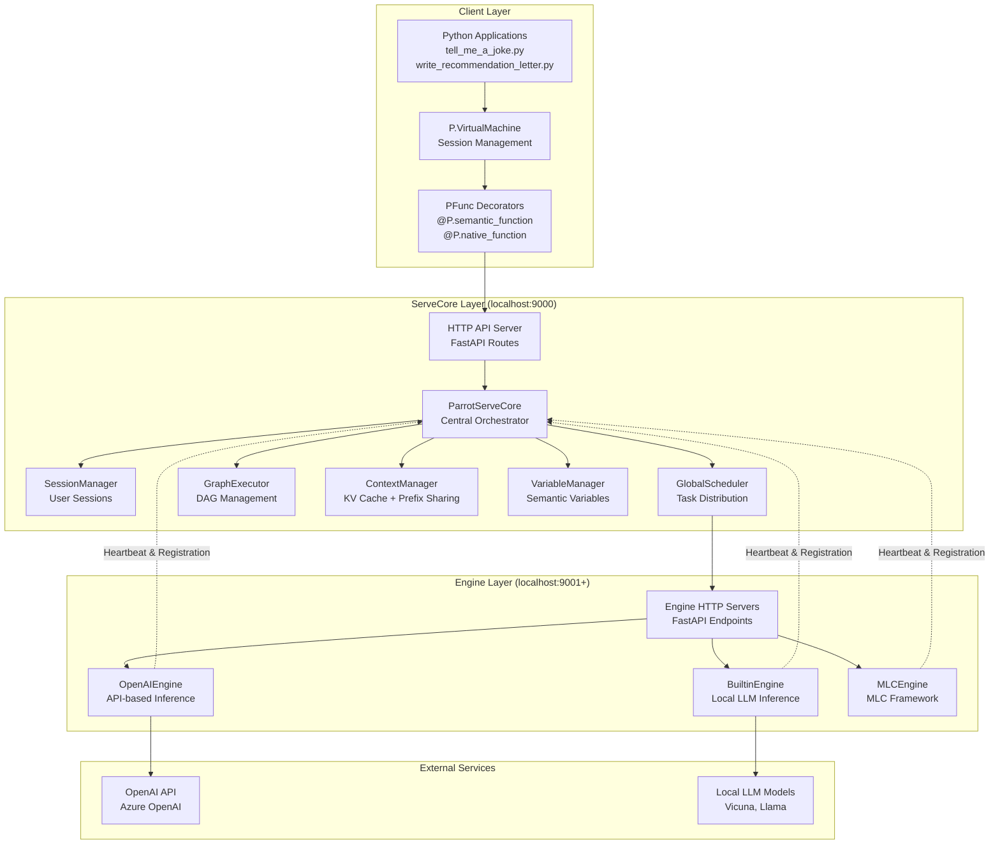
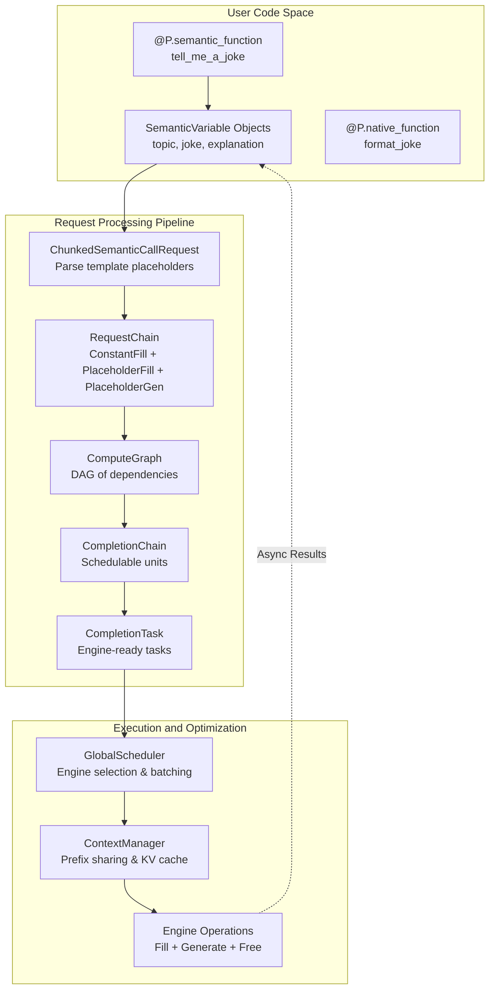
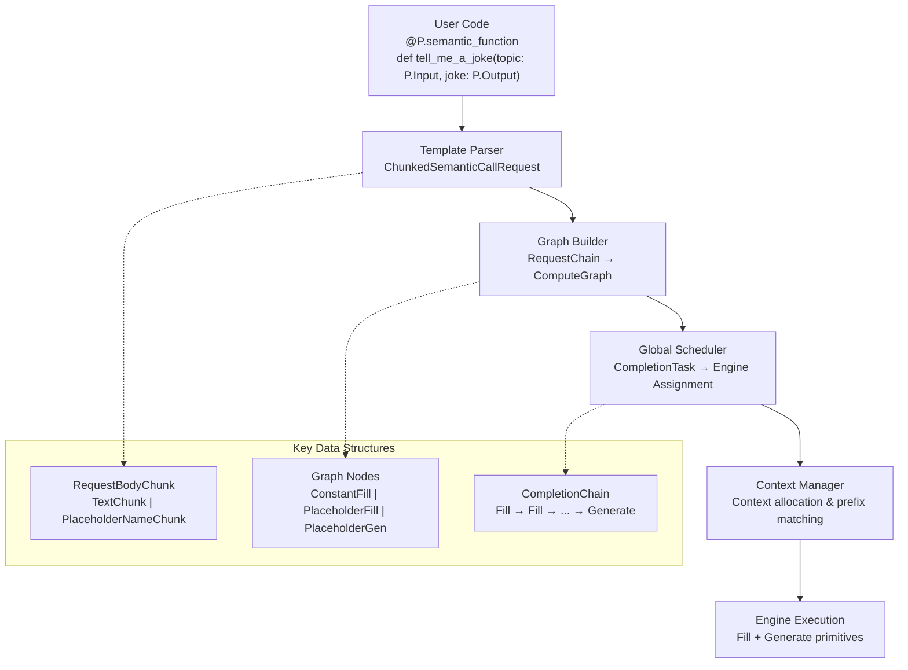

<!-- source: DeepWiki mcp.deepwiki.com · repo microsoft/ParrotServe · page 1 Overview · fetched 2026-10-26 -->

# Overview

<details>
<summary>Relevant source files</summary>

The following files were used as context for generating this wiki page:

- [.env-dev](.env-dev)
- [.gitignore](.gitignore)
- [CONTRIBUTING.md](CONTRIBUTING.md)
- [README.md](README.md)
- [TRANSPARENCY.md](TRANSPARENCY.md)
- [benchmark/bench_kernel.py](benchmark/bench_kernel.py)
- [docs/README.md](docs/README.md)
- [docs/get_started/launch_server.md](docs/get_started/launch_server.md)
- [docs/sys_design/serve_layer/graph.md](docs/sys_design/serve_layer/graph.md)
- [docs/user_docs/parrot_apis.md](docs/user_docs/parrot_apis.md)
- [docs/user_docs/pfunc.md](docs/user_docs/pfunc.md)
- [docs/version_drafts/v3.md](docs/version_drafts/v3.md)
- [requirements.txt](requirements.txt)
- [setup.py](setup.py)

</details>


This document provides a high-level introduction to ParrotServe, a distributed LLM serving system designed specifically for LLM-based applications. It covers the system's purpose, key innovations, and architectural components.

For detailed API specifications, see [Public APIs](#6.1). For programming interface documentation, see [PFunc API](#3.1). For system architecture details, see [Architecture](#2).

## Purpose and Scope

ParrotServe is a distributed, multi-tenant serving system that optimizes the end-to-end performance of LLM-based applications through a novel **Semantic Variable** abstraction. Unlike traditional LLM serving systems that treat each request independently, ParrotServe exposes application-level information such as computation graphs and prompt structures, enabling sophisticated optimizations including:

- Automatic parallelization and batching of dependent LLM requests
- Performance objective deduction and DAG-aware scheduling  
- Context-aware scheduling with shared prompt prefix optimization
- Asynchronous communication between dependent requests

The system provides a Python-friendly programming interface called **PFunc** that allows developers to define LLM applications using decorators and semantic variables, while the backend automatically discovers dependencies and optimizes execution.

Sources: [README.md:1-37](), [TRANSPARENCY.md:3-11]()

## System Architecture Overview

ParrotServe implements a three-layer distributed architecture that separates concerns between client programming, central orchestration, and LLM inference execution.

### High-Level Architecture



Sources: [README.md:7-11](), [docs/get_started/launch_server.md:6-14]()

## Key Innovation: Semantic Variables

The core innovation of ParrotServe is the **Semantic Variable** abstraction, which exposes application-level dependencies between LLM requests that traditional serving systems cannot capture.

### Semantic Variable System Components



Sources: [docs/user_docs/pfunc.md:8-48](), [docs/sys_design/serve_layer/graph.md:34-80]()

## Core Components and Responsibilities

### ParrotServeCore Layer

| Component | Class/Module | Primary Responsibility |
|-----------|--------------|----------------------|
| HTTP API Server | `parrot.serve.http_server` | FastAPI-based REST endpoints for client requests |
| Session Manager | `SessionManager` | User session lifecycle and isolation |
| Graph Executor | `GraphExecutor` | Compute graph construction and execution |
| Global Scheduler | `GlobalScheduler` | Task distribution and engine selection |
| Context Manager | `ContextManager` | KV cache management and prefix sharing |
| Variable Manager | `VariableManager` | Semantic variable storage and binding |

### Engine Layer  

| Engine Type | Class | Purpose |
|-------------|-------|---------|
| Builtin Engine | `BuiltinEngine` | Local LLM inference with optimized attention |
| OpenAI Engine | `OpenAIEngine` | API-based inference via OpenAI/Azure |
| MLC Engine | `MLCEngine` | MLC framework integration |
| Native Engine | `NativeEngine` | Python function execution |

Sources: [docs/get_started/launch_server.md:64-141](), [docs/version_drafts/v3.md:22-133]()

## Request Processing Flow

ParrotServe transforms user-defined semantic functions into optimized execution plans through a multi-stage pipeline:

### Request Transformation Pipeline



Sources: [docs/sys_design/serve_layer/graph.md:6-19](), [docs/user_docs/parrot_apis.md:50-98]()

## Programming Interface Example

ParrotServe provides a Python-friendly interface that abstracts away the complexity of distributed LLM serving:

```python
from parrot import P

@P.semantic_function()
def tell_me_a_joke(topic: P.Input, joke: P.Output):
    """Tell me a joke about {{topic}}: {{joke}}."""

@P.native_function()
def format_joke(joke: P.Input, formatted_joke: P.Output):
    ret = "Here is the joke for you\n---\n" + joke
    formatted_joke.set(ret)

def main():
    joke = tell_me_a_joke(topic="chicken")
    formatted = format_joke(joke)
    result = formatted.get()
    print(result)
```

The system automatically:
- Discovers dependencies between `tell_me_a_joke` and `format_joke` through the shared `joke` variable
- Optimizes execution by batching compatible requests
- Manages KV cache sharing for common prefixes
- Provides asynchronous result retrieval via `SemanticVariable.get()`

Sources: [README.md:14-31](), [docs/user_docs/pfunc.md:16-48]()

## Deployment and Configuration

ParrotServe operates as a distributed system where `ServeCore` manages multiple `Engine` instances through HTTP-based communication and heartbeat monitoring. Engines register themselves automatically and can be added or removed dynamically without system restart.

The system supports heterogeneous engine types including local LLM inference, cloud API access, and custom Python function execution, providing flexibility for different deployment scenarios and cost optimization strategies.

Sources: [docs/get_started/launch_server.md:9-56](), [requirements.txt:1-27]()

---

