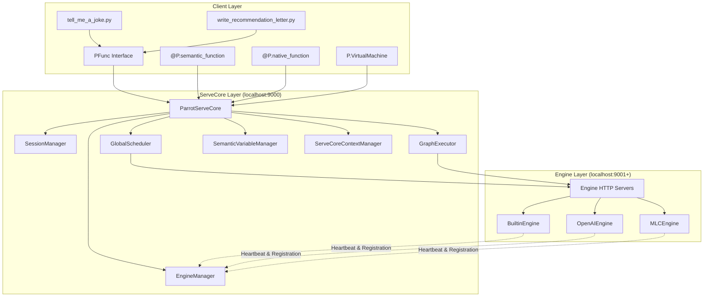
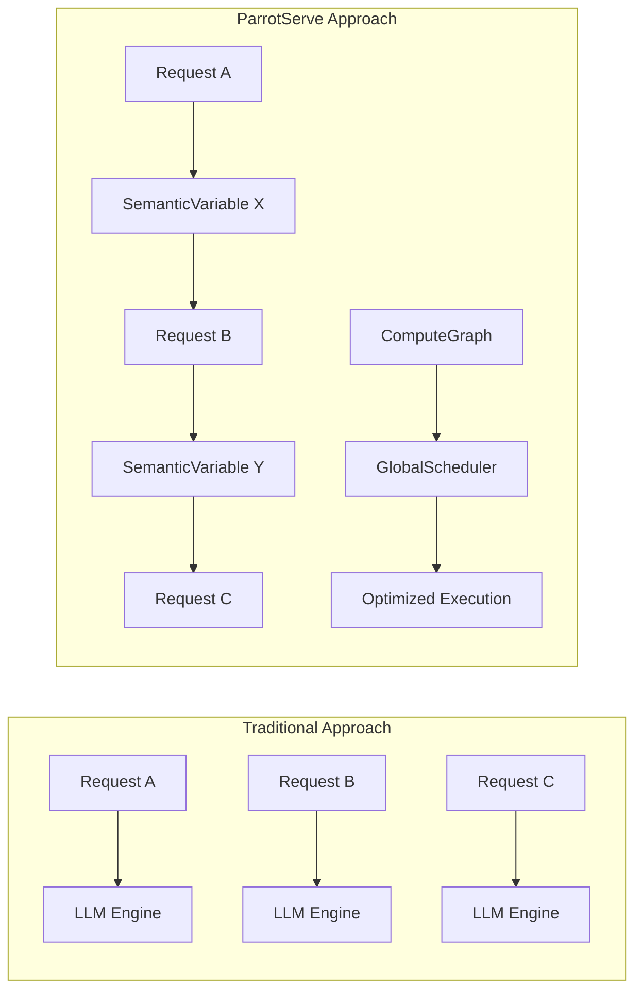
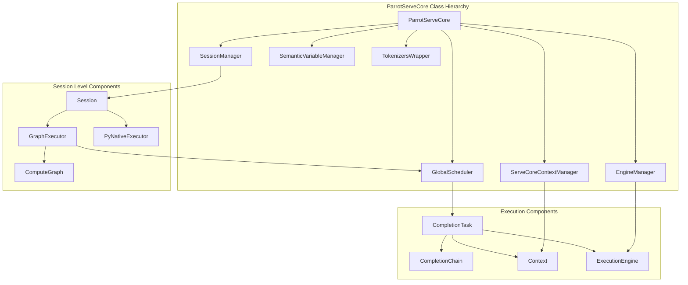

<!-- source: DeepWiki mcp.deepwiki.com · repo microsoft/ParrotServe · page 2 Architecture · fetched 2026-10-26 -->

# Architecture

Relevant source files

The following files were used as context for generating this wiki page:

- [.env-dev](.env-dev)
- [.gitignore](.gitignore)
- [CONTRIBUTING.md](CONTRIBUTING.md)
- [README.md](README.md)
- [TRANSPARENCY.md](TRANSPARENCY.md)
- [benchmark/bench_kernel.py](benchmark/bench_kernel.py)
- [docs/README.md](docs/README.md)
- [docs/get_started/launch_server.md](docs/get_started/launch_server.md)
- [docs/sys_design/serve_layer/graph.md](docs/sys_design/serve_layer/graph.md)
- [docs/user_docs/parrot_apis.md](docs/user_docs/parrot_apis.md)
- [docs/user_docs/pfunc.md](docs/user_docs/pfunc.md)
- [docs/version_drafts/v3.md](docs/version_drafts/v3.md)
- [parrot/serve/backend_repr/engine.py](parrot/serve/backend_repr/engine.py)
- [parrot/serve/context_manager.py](parrot/serve/context_manager.py)
- [parrot/serve/core.py](parrot/serve/core.py)
- [parrot/serve/engine_manager.py](parrot/serve/engine_manager.py)
- [parrot/serve/scheduler/__init__.py](parrot/serve/scheduler/__init__.py)
- [parrot/serve/scheduler/completion_task.py](parrot/serve/scheduler/completion_task.py)
- [parrot/serve/scheduler/global_scheduler.py](parrot/serve/scheduler/global_scheduler.py)
- [parrot/serve/session/graph_executor.py](parrot/serve/session/graph_executor.py)
- [parrot/serve/session/session.py](parrot/serve/session/session.py)
- [parrot/serve/session_manager.py](parrot/serve/session_manager.py)
- [parrot/serve/variable_manager.py](parrot/serve/variable_manager.py)
- [requirements.txt](requirements.txt)
- [setup.py](setup.py)

This document provides a high-level overview of ParrotServe's system architecture, explaining the three-layer distributed design and core principles that enable efficient serving of LLM-based applications with semantic variable abstraction.

For detailed information about specific components, see [Core Components](#2.1), [Semantic Variables](#2.2), and [Request Processing Pipeline](#2.3).

## Three-Layer System Design

ParrotServe implements a distributed three-layer architecture that separates concerns between client programming interfaces, central orchestration, and LLM inference execution.

### System Architecture Overview

**Sources:** [README.md:7-37](), [parrot/serve/core.py:34-50](), [parrot/serve/session/graph_executor.py:32-36]()

### Layer Responsibilities

| Layer | Primary Responsibility | Key Components |
|-------|----------------------|----------------|
| **Client Layer** | User-facing programming interfaces and application logic | PFunc decorators, VirtualMachine, example applications |
| **ServeCore Layer** | Central orchestration, session management, scheduling | ParrotServeCore, GlobalScheduler, GraphExecutor |
| **Engine Layer** | LLM inference execution with different backends | BuiltinEngine, OpenAIEngine, MLCEngine |

**Sources:** [parrot/serve/core.py:34-50](), [docs/get_started/launch_server.md:7-14]()

## Core Design Principles

### Semantic Variable Abstraction

The central innovation of ParrotServe is the **Semantic Variable** abstraction that provides application-level visibility into LLM computation graphs. This enables automatic optimization without requiring users to manually specify dependencies.

**Sources:** [README.md:7-11](), [parrot/serve/variable_manager.py:121-136]()

### Distributed Engine Management

ParrotServe supports heterogeneous LLM backends through a plugin architecture where engines register themselves with the ServeCore and communicate via HTTP with heartbeat monitoring.

### Context-Aware Resource Sharing

The system implements sophisticated context management with prefix caching and reference counting to enable efficient memory usage across sessions while maintaining isolation.

**Sources:** [parrot/serve/context_manager.py:77-85](), [parrot/serve/engine_manager.py:27-33]()

## Component Interaction Flow

### Core Component Architecture

**Sources:** [parrot/serve/core.py:52-88](), [parrot/serve/session/session.py:43-84](), [parrot/serve/scheduler/completion_task.py:27-52]()

### Request Processing Pipeline

The system processes requests through a well-defined pipeline that transforms user input into optimized execution tasks:

1. **Request Submission** - Client submits semantic function calls via HTTP API
2. **Graph Construction** - Parse request into `ChunkedSemanticCallRequest` and convert to `RequestChain`
3. **Variable Assignment** - Create and bind `SemanticVariable` instances to request placeholders
4. **Task Creation** - Generate `CompletionTask` objects for scheduling
5. **Context Assignment** - Allocate `Context` objects with prefix caching optimization
6. **Primitive Execution** - Execute `Fill` and `Generate` operations on target engines

**Sources:** [parrot/serve/session/graph_executor.py:61-98](), [docs/sys_design/serve_layer/graph.md:6-19]()

## Key Implementation Classes

### ServeCore Management

- **`ParrotServeCore`** [parrot/serve/core.py:34]() - Central orchestrator managing all system components
- **`SessionManager`** [parrot/serve/session_manager.py:22]() - Handles session lifecycle and isolation  
- **`EngineManager`** [parrot/serve/engine_manager.py:27]() - Manages engine registration and health monitoring

### Request Processing

- **`GraphExecutor`** [parrot/serve/session/graph_executor.py:32]() - Executes computation graphs within sessions
- **`GlobalScheduler`** [parrot/serve/scheduler/global_scheduler.py:32]() - Schedules tasks across available engines
- **`CompletionTask`** [parrot/serve/scheduler/completion_task.py:27]() - Represents schedulable units of work

### Resource Management

- **`ServeCoreContextManager`** [parrot/serve/context_manager.py:77]() - Manages KV cache contexts with sharing optimization
- **`SemanticVariableManager`** [parrot/serve/variable_manager.py:121]() - Handles semantic variable lifecycle and namespacing
- **`ExecutionEngine`** [parrot/serve/backend_repr/engine.py:44]() - Represents backend LLM inference engines

**Sources:** [parrot/serve/core.py:52-88](), [parrot/serve/scheduler/global_scheduler.py:32-44](), [parrot/serve/context_manager.py:77-111]()

## Communication Protocols

The system uses HTTP-based communication between layers with JSON payloads for requests and responses. Engine registration and heartbeat mechanisms enable dynamic cluster management without requiring static configuration.

**Sources:** [parrot/serve/core.py:99-132](), [docs/user_docs/parrot_apis.md:1-6](), [docs/get_started/launch_server.md:9-14]()

---

