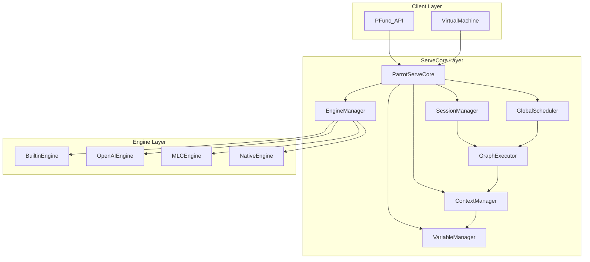
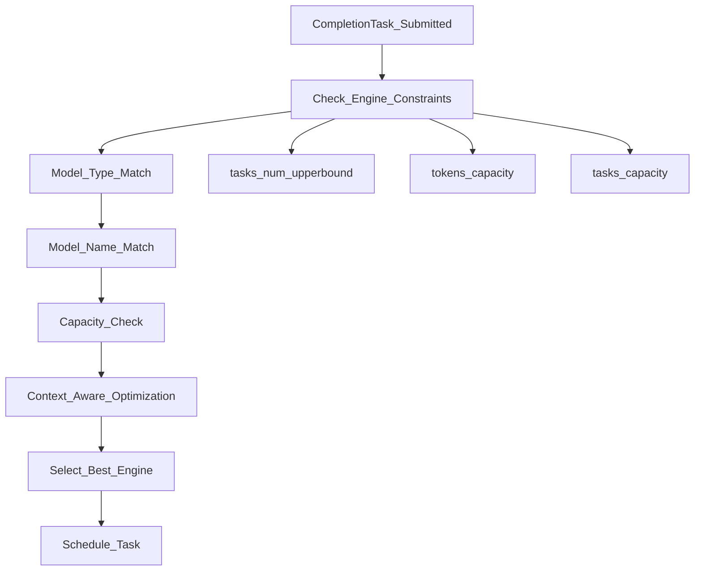
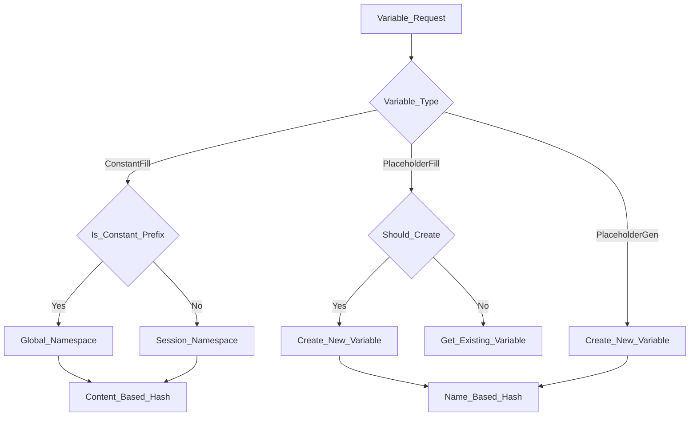
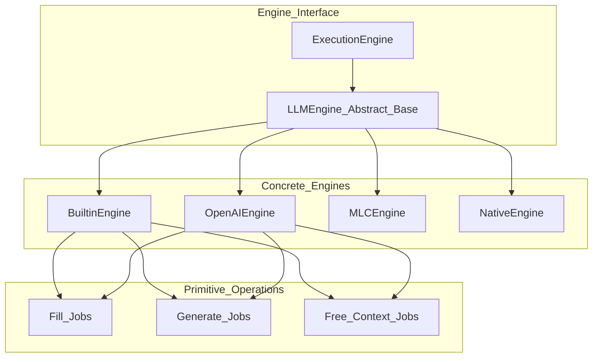
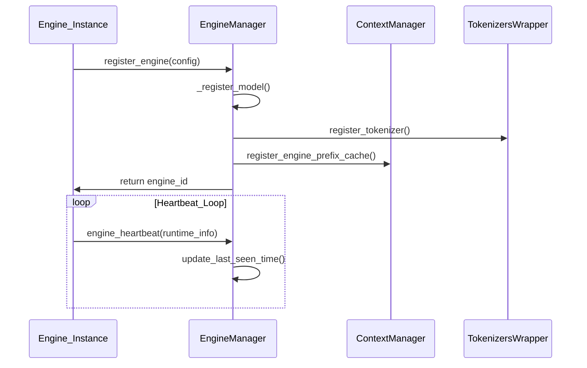
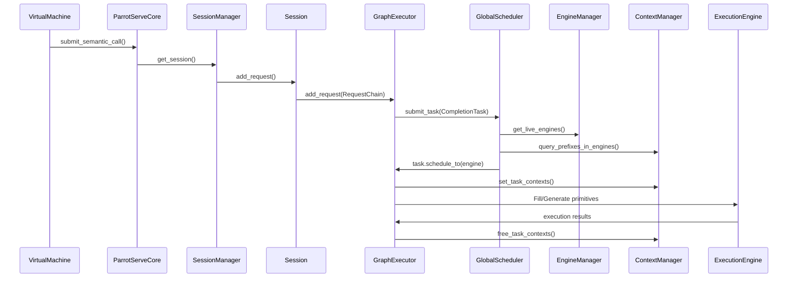

<!-- source: DeepWiki mcp.deepwiki.com · repo microsoft/ParrotServe · page 2.1 Core Components · fetched 2026-10-26 -->

# Core Components

<details>
<summary>Relevant source files</summary>

The following files were used as context for generating this wiki page:

- [.env-dev](.env-dev)
- [.gitignore](.gitignore)
- [CONTRIBUTING.md](CONTRIBUTING.md)
- [README.md](README.md)
- [TRANSPARENCY.md](TRANSPARENCY.md)
- [benchmark/bench_kernel.py](benchmark/bench_kernel.py)
- [docs/README.md](docs/README.md)
- [docs/get_started/launch_server.md](docs/get_started/launch_server.md)
- [docs/sys_design/serve_layer/graph.md](docs/sys_design/serve_layer/graph.md)
- [docs/user_docs/parrot_apis.md](docs/user_docs/parrot_apis.md)
- [docs/user_docs/pfunc.md](docs/user_docs/pfunc.md)
- [docs/version_drafts/v3.md](docs/version_drafts/v3.md)
- [parrot/serve/backend_repr/engine.py](parrot/serve/backend_repr/engine.py)
- [parrot/serve/context_manager.py](parrot/serve/context_manager.py)
- [parrot/serve/core.py](parrot/serve/core.py)
- [parrot/serve/engine_manager.py](parrot/serve/engine_manager.py)
- [parrot/serve/scheduler/__init__.py](parrot/serve/scheduler/__init__.py)
- [parrot/serve/scheduler/completion_task.py](parrot/serve/scheduler/completion_task.py)
- [parrot/serve/scheduler/global_scheduler.py](parrot/serve/scheduler/global_scheduler.py)
- [parrot/serve/session/graph_executor.py](parrot/serve/session/graph_executor.py)
- [parrot/serve/session/session.py](parrot/serve/session/session.py)
- [parrot/serve/session_manager.py](parrot/serve/session_manager.py)
- [parrot/serve/variable_manager.py](parrot/serve/variable_manager.py)
- [requirements.txt](requirements.txt)
- [setup.py](setup.py)

</details>


This document provides a detailed explanation of ParrotServe's core components within the ServeCore and Engine layers, and their specific responsibilities in the distributed architecture. This covers the central orchestration layer and the execution backends that handle LLM inference.

For information about the client programming interface, see [Client Programming Interface](#3). For details on request processing flow, see [Request Processing Pipeline](#2.3).

## System Architecture Overview

ParrotServe follows a three-layer distributed architecture where the ServeCore acts as the central orchestrator between client applications and distributed engine instances.

**Core Component Layers**



Sources: [parrot/serve/core.py:34-89](), [README.md:7-11]()

## ServeCore Layer Components

The ServeCore layer contains the central orchestration logic and manages all global system state. The main entry point is the `ParrotServeCore` class.

### ParrotServeCore

The `ParrotServeCore` class serves as the central manager that coordinates all system components and handles incoming API requests.

**Key Responsibilities:**
- API endpoint handling for session management, semantic calls, and variable operations
- Component initialization and lifecycle management
- Request routing to appropriate sessions
- Engine registration and heartbeat management

**Core Component Integration**

```mermaid
graph TD
    subgraph "ParrotServeCore_Components"
        A[ParrotServeCore]
        B[SessionManager]
        C[GlobalScheduler]
        D[EngineManager]
        E[ContextManager]
        F[VariableManager]
        G[TokenizersWrapper]
        H[TaskCreator]
    end
    
    A --> B
    A --> C
    A --> D
    A --> E
    A --> F
    A --> G
    A --> H
    
    B --> "session_mgr"
    C --> "global_scheduler"
    D --> "engine_mgr"
    E --> "context_mgr"
    F --> "var_mgr"
    G --> "tokenizers_wrapper"
    H --> "task_creator"
```

Sources: [parrot/serve/core.py:52-89]()

### SessionManager

The `SessionManager` handles user session lifecycle, authentication, and session-scoped resource management.

**Key Components:**
- Session creation and destruction
- Session timeout management
- Session status monitoring (`RUNNING`, `DEAD`, `BAD`)

| Method | Purpose |
|--------|---------|
| `register_session()` | Creates new session with unique ID |
| `remove_session(session_id)` | Cleans up session resources |
| `check_session_status(session_id)` | Validates session availability |
| `session_access_update(session_id)` | Updates last access time |

Sources: [parrot/serve/session_manager.py:22-156]()

### GlobalScheduler

The `GlobalScheduler` implements sophisticated task scheduling algorithms across available engines with support for various optimization strategies.

**Scheduling Features:**
- Application-level FIFO ordering (`app_fifo`)
- Graph-based task grouping (`graph_group`) 
- Context-aware scheduling (`ctx_aware`)
- Engine capacity and constraint checking

**Engine Selection Process**



Sources: [parrot/serve/scheduler/global_scheduler.py:32-255]()

### ContextManager (ServeCoreContextManager)

The `ServeCoreContextManager` manages KV cache contexts across sessions and engines, implementing sophisticated caching and sharing strategies.

**Core Features:**
- Context creation, forking, and reference counting
- Prefix caching with content-based hashing
- Cross-session context sharing for constant prefixes
- Engine-specific prefix cache management

**Context Lifecycle Management:**

| Component | Purpose |
|-----------|---------|
| `PrefixCache` | Maps prefix hashes to context IDs |
| `_context_ref_counter` | Tracks context usage across tasks |
| `constant_prefix_contexts` | Manages global constant prefix contexts |
| `session_contexts` | Session-scoped context tracking |

Sources: [parrot/serve/context_manager.py:77-379]()

### SemanticVariableManager

The `SemanticVariableManager` implements the core Semantic Variable abstraction with namespace management and content-based deduplication.

**Variable Namespaces:**
- **Constant Prefix Namespace**: Global variables shared across sessions
- **Session Namespaces**: Session-local variable spaces
- **Content-based Hashing**: Automatic deduplication of identical content

**Variable Creation Strategies:**



Sources: [parrot/serve/variable_manager.py:121-398]()

## Engine Layer Components

The Engine layer provides pluggable LLM inference backends through a common `ExecutionEngine` interface.

### ExecutionEngine Architecture

All engines implement the same interface for primitive operations while supporting different backend implementations.

**Engine Types and Their Backends**



Sources: [parrot/serve/backend_repr/engine.py:44-212]()

### Engine Management

The `EngineManager` handles engine registration, health monitoring, and lifecycle management.

**Engine Lifecycle:**

| State | Description | Trigger |
|-------|-------------|---------|
| `RUNNING` | Engine is operational and accepting tasks | Normal operation |
| `DEAD` | Engine heartbeat expired | Timeout exceed `engine_heartbeat_timeout` |
| `BAD` | Engine encountered exception | Exception raised during execution |

**Engine Registration Process:**



Sources: [parrot/serve/engine_manager.py:27-194]()

### Engine Runtime Information

Each engine maintains both real-time and serve-layer runtime information for scheduling decisions.

**Runtime Information Types:**

| Info Type | Source | Purpose |
|-----------|--------|---------|
| `EngineRuntimeInfo` | Engine heartbeat | Real-time metrics (cache_mem, num_cached_tokens) |
| `ServeLayerRuntimeInfo` | ServeCore tracking | Scheduling state (num_tasks, tokens_num, task_upperbounds) |

Sources: [parrot/serve/backend_repr/engine.py:33-76]()

## Component Interaction Flow

The following diagram shows how core components interact during a typical request processing cycle:

**Request Processing Component Interaction**



Sources: [parrot/serve/core.py:198-226](), [parrot/serve/session/graph_executor.py:61-116](), [parrot/serve/scheduler/global_scheduler.py:162-180]()

---

