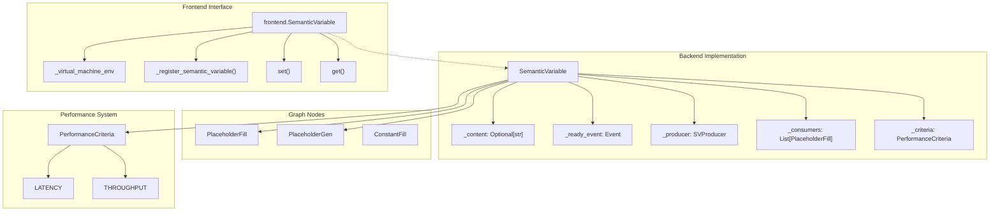
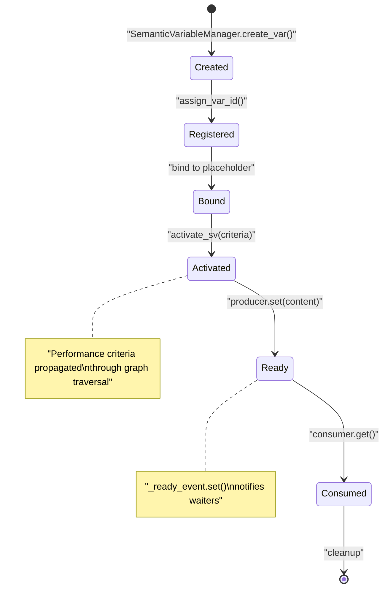
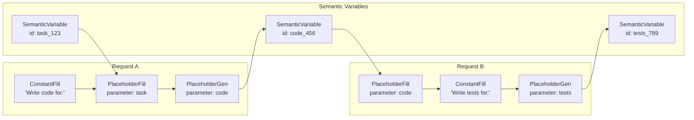

<!-- source: DeepWiki mcp.deepwiki.com · repo microsoft/ParrotServe · page 2.2 Semantic Variables · fetched 2026-10-26 -->

# Semantic Variables

<details>
<summary>Relevant source files</summary>

The following files were used as context for generating this wiki page:

- [.env-dev](.env-dev)
- [.gitignore](.gitignore)
- [CONTRIBUTING.md](CONTRIBUTING.md)
- [README.md](README.md)
- [TRANSPARENCY.md](TRANSPARENCY.md)
- [benchmark/bench_kernel.py](benchmark/bench_kernel.py)
- [docs/README.md](docs/README.md)
- [docs/get_started/launch_server.md](docs/get_started/launch_server.md)
- [docs/sys_design/serve_layer/graph.md](docs/sys_design/serve_layer/graph.md)
- [docs/user_docs/parrot_apis.md](docs/user_docs/parrot_apis.md)
- [docs/user_docs/pfunc.md](docs/user_docs/pfunc.md)
- [docs/version_drafts/v3.md](docs/version_drafts/v3.md)
- [parrot/__init__.py](parrot/__init__.py)
- [parrot/constants.py](parrot/constants.py)
- [parrot/engine/config.py](parrot/engine/config.py)
- [parrot/frontend/pfunc/semantic_variable.py](parrot/frontend/pfunc/semantic_variable.py)
- [parrot/protocol/public/apis.py](parrot/protocol/public/apis.py)
- [parrot/serve/backend_repr/model.py](parrot/serve/backend_repr/model.py)
- [parrot/serve/config.py](parrot/serve/config.py)
- [parrot/serve/graph/__init__.py](parrot/serve/graph/__init__.py)
- [parrot/serve/graph/graph.py](parrot/serve/graph/graph.py)
- [parrot/serve/graph/graph_traverse.py](parrot/serve/graph/graph_traverse.py)
- [parrot/serve/graph/semantic_variable.py](parrot/serve/graph/semantic_variable.py)
- [parrot/serve/graph/visualize_utils.py](parrot/serve/graph/visualize_utils.py)
- [parrot/serve/http_server.py](parrot/serve/http_server.py)
- [parrot/serve/scheduler/task_creator.py](parrot/serve/scheduler/task_creator.py)
- [parrot/testing/fake_core_server.py](parrot/testing/fake_core_server.py)
- [requirements.txt](requirements.txt)
- [setup.py](setup.py)
- [tests/serve/test_scheduler.py](tests/serve/test_scheduler.py)
- [tests/test_protocol.py](tests/test_protocol.py)

</details>


This document covers the Semantic Variable abstraction, which is the core innovation in ParrotServe that enables application-level optimization of LLM requests. Semantic Variables provide a programming model for structured prompts and enable automatic dependency analysis, parallelization, and context sharing across LLM requests.

For information about the overall system architecture, see [Architecture](#2). For details about request processing and graph execution, see [Request Processing Pipeline](#2.3).

## Core Concept and Definition

A Semantic Variable represents a semantically meaningful portion of an LLM prompt that can be shared across multiple requests. Unlike traditional LLM serving systems that treat each request independently, ParrotServe uses Semantic Variables to expose the internal structure of prompts and dependencies between requests.

### Semantic Variable Types

Semantic Variables can represent different types of prompt content:

- **System prompts or prefixes** - Reusable instruction text
- **User inputs** - Parameters passed to LLM functions  
- **Output locations** - Where generated content should be stored
- **Communication ports** - Data flow between LLM agents
- **Few-shot examples** - Demonstration content

The core `SemanticVariable` class implements an asynchronous programming model similar to Python's `Future` or JavaScript's `Promise`, allowing requests to depend on outputs from other requests.

**Semantic Variable Core Architecture**


Sources: [parrot/serve/graph/semantic_variable.py:14-142](), [parrot/frontend/pfunc/semantic_variable.py:15-142](), [parrot/serve/graph/node.py](), [parrot/serve/graph/perf_criteria.py]()

## Implementation Architecture

### Backend SemanticVariable Class

The backend `SemanticVariable` class provides the core functionality for content storage, event handling, and graph relationships:

| Property | Type | Purpose |
|----------|------|---------|
| `name` | `str` | Human-readable identifier |
| `id` | `str` | Unique system identifier |
| `_content` | `Optional[str]` | Stored text content |
| `_ready_event` | `Event` | Asynchronous readiness signaling |
| `_producer` | `Optional[SVProducer]` | Node that generates content |
| `_consumers` | `List[PlaceholderFill]` | Nodes that consume content |
| `_criteria` | `PerformanceCriteria` | Optimization objective |

Key methods include:
- `set(content: str)` - Store content and signal readiness
- `get() -> str` - Retrieve content (blocking)
- `wait_ready()` - Asynchronous wait for content
- `activate(criteria, depth)` - Enable optimization with performance criteria

### Frontend SemanticVariable Class

The frontend provides a user-facing API that communicates with the backend through the `VirtualMachine` environment:

```python
# Example usage from frontend
var = P.variable(name="topic", content="AI")
result = semantic_function(topic=var)
content = result.get()  # Blocks until ready
```

Sources: [parrot/serve/graph/semantic_variable.py:36-142](), [parrot/frontend/pfunc/semantic_variable.py:24-142]()

## Variable Lifecycle and State Management

### Registration and Creation

Semantic Variables follow a specific lifecycle managed by the `SemanticVariableManager`:

**Variable Lifecycle Flow**


### Variable Scoping

The system supports different variable scopes managed by `SemanticVariableManager`:

- **Session-local variables** - Private to a user session
- **Global constant prefix variables** - Shared across sessions with timeout
- **Inter-session temporary variables** - Short-lived shared results

Sources: [parrot/serve/variable_manager.py](), [parrot/serve/graph/semantic_variable.py:70-92]()

## Graph Integration and Dependencies

### Producer-Consumer Relationships

Semantic Variables create dependencies between graph nodes through producer-consumer relationships:

- **Producers**: `PlaceholderGen` nodes or `NativeFuncNode` instances that generate content
- **Consumers**: `PlaceholderFill` nodes that use the content in prompts

**Graph Node Relationships**


### Graph Traversal and Activation

The `activate_sv()` function performs backward graph traversal to propagate performance criteria and determine execution order:

1. Start from target semantic variable
2. Traverse backward through producers
3. Recursively activate dependencies  
4. Assign performance criteria and depth
5. Group related chains for optimization

Sources: [parrot/serve/graph/graph_traverse.py:90-100](), [parrot/serve/graph/graph.py:321-432](), [parrot/serve/graph/node.py]()

## Performance Criteria and Optimization

### Performance Objectives

Semantic Variables can be activated with different performance criteria that influence scheduling:

- **`LATENCY`** - Optimize for low end-to-end latency
- **`THROUGHPUT`** - Optimize for high request throughput

The `TaskCreator` translates these criteria into concrete scheduling annotations:

```python
# From TaskCreator._lower_criteria()
if criteria == PerformanceCriteria.LATENCY:
    return ScheduleAnnotation(
        tasks_num_upperbound=4,
        tokens_num_upperbound=4096,
    )
elif criteria == PerformanceCriteria.THROUGHPUT:
    return ScheduleAnnotation(
        tasks_num_upperbound=99999,
        tokens_num_upperbound=9999999999999,
    )
```

### Context Sharing and Prefix Optimization

Semantic Variables enable context sharing optimizations:

- **Prefix caching** - Reuse KV cache for common prompt prefixes
- **Content-based deduplication** - Hash identical variable content
- **Reference counting** - Efficient memory management for shared contexts

Sources: [parrot/serve/scheduler/task_creator.py:25-39](), [parrot/serve/graph/perf_criteria.py](), [parrot/serve/context_manager.py]()

## Frontend Programming Interface

### PFunc Integration

The frontend integrates with the PFunc programming model through decorators and type annotations:

```python
@P.semantic_function()
def generate_code(task: P.Input, code: P.Output):
    """Write Python code for: {{task}}
    
    {{code}}"""

# Usage creates semantic variables automatically  
code_var = generate_code(task="sort a list")
result = code_var.get(criteria=P.LATENCY)
```

### API Operations

The frontend provides RESTful APIs for semantic variable operations:

| Endpoint | Method | Purpose |
|----------|--------|---------|
| `/v1/semantic_var` | POST | Register new variable |
| `/v1/semantic_var/{var_id}` | POST | Set variable content |
| `/v1/semantic_var/{var_id}` | GET | Get variable content |
| `/v1/semantic_var` | GET | List session variables |

### Asynchronous Operations

Both synchronous and asynchronous access patterns are supported:

```python
# Synchronous blocking
content = var.get(criteria=P.LATENCY)

# Asynchronous non-blocking  
content = await var.aget(criteria=P.LATENCY)
```

Sources: [parrot/frontend/pfunc/semantic_variable.py:119-142](), [parrot/protocol/public/apis.py:205-310](), [parrot/serve/http_server.py:119-142]()

---

