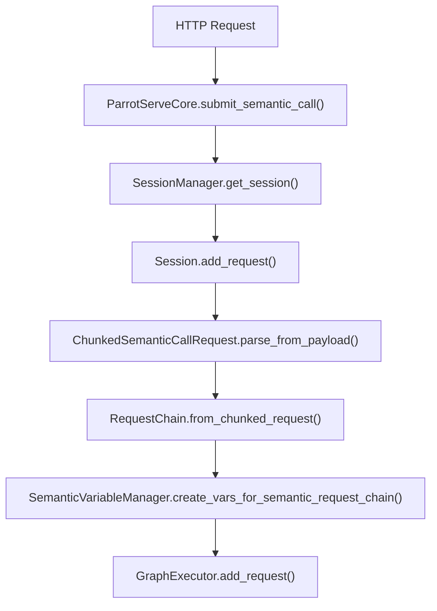
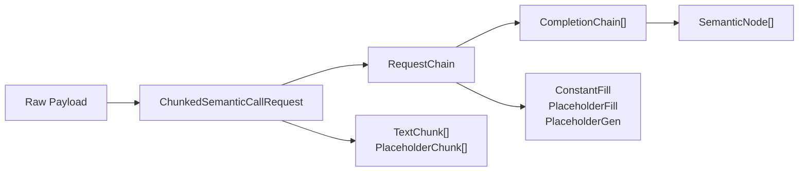
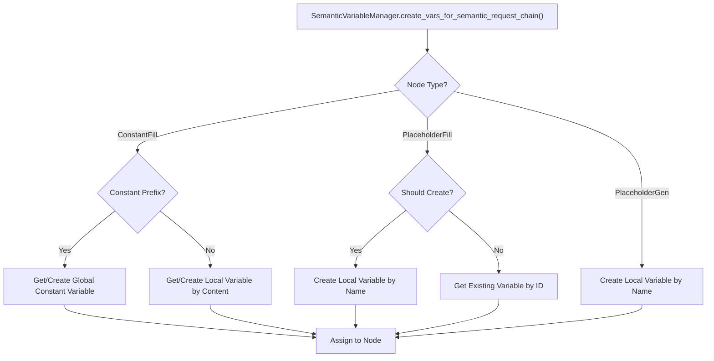
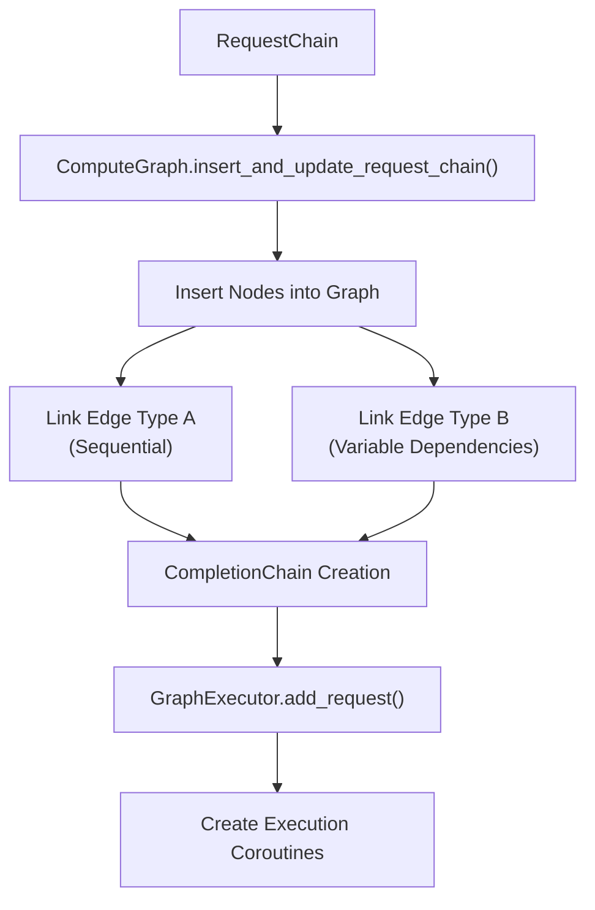
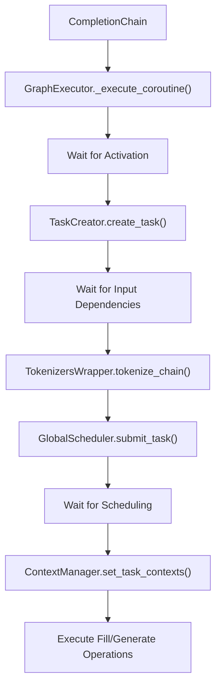
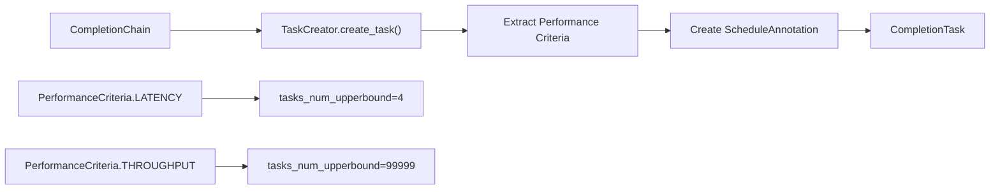
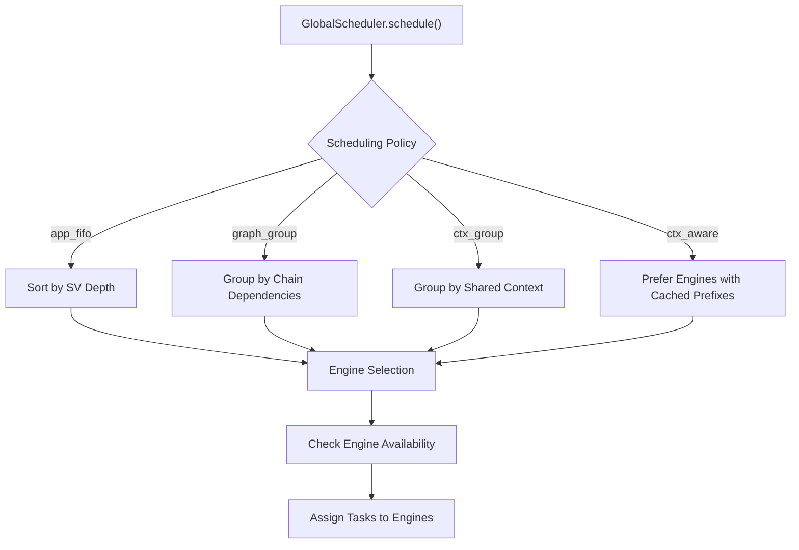
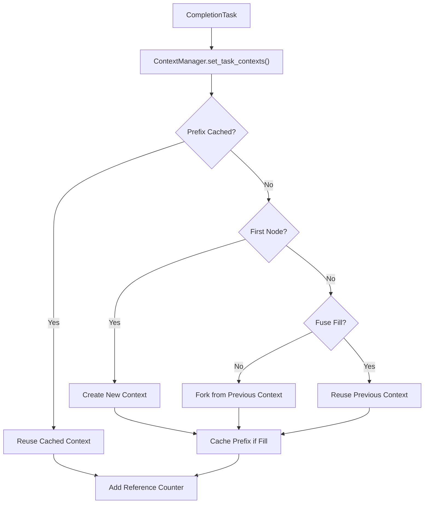
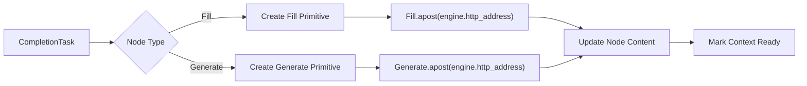

<!-- source: DeepWiki mcp.deepwiki.com · repo microsoft/ParrotServe · page 2.3 Request Processing Pipeline · fetched 2026-10-26 -->

# Request Processing Pipeline

Relevant source files

The following files were used as context for generating this wiki page:

- [parrot/protocol/public/apis.py](parrot/protocol/public/apis.py)
- [parrot/serve/backend_repr/engine.py](parrot/serve/backend_repr/engine.py)
- [parrot/serve/context_manager.py](parrot/serve/context_manager.py)
- [parrot/serve/core.py](parrot/serve/core.py)
- [parrot/serve/engine_manager.py](parrot/serve/engine_manager.py)
- [parrot/serve/graph/__init__.py](parrot/serve/graph/__init__.py)
- [parrot/serve/graph/graph.py](parrot/serve/graph/graph.py)
- [parrot/serve/graph/graph_traverse.py](parrot/serve/graph/graph_traverse.py)
- [parrot/serve/graph/semantic_variable.py](parrot/serve/graph/semantic_variable.py)
- [parrot/serve/graph/visualize_utils.py](parrot/serve/graph/visualize_utils.py)
- [parrot/serve/scheduler/__init__.py](parrot/serve/scheduler/__init__.py)
- [parrot/serve/scheduler/completion_task.py](parrot/serve/scheduler/completion_task.py)
- [parrot/serve/scheduler/global_scheduler.py](parrot/serve/scheduler/global_scheduler.py)
- [parrot/serve/scheduler/task_creator.py](parrot/serve/scheduler/task_creator.py)
- [parrot/serve/session/graph_executor.py](parrot/serve/session/graph_executor.py)
- [parrot/serve/session/session.py](parrot/serve/session/session.py)
- [parrot/serve/session_manager.py](parrot/serve/session_manager.py)
- [parrot/serve/variable_manager.py](parrot/serve/variable_manager.py)
- [parrot/testing/fake_core_server.py](parrot/testing/fake_core_server.py)
- [tests/serve/test_scheduler.py](tests/serve/test_scheduler.py)
- [tests/test_protocol.py](tests/test_protocol.py)

This document describes how user requests flow through ParrotServe from initial submission to final execution. It covers the transformation of requests into executable tasks, semantic variable management, graph construction, and the scheduling pipeline.

For information about the semantic variable abstraction that enables this pipeline, see [Semantic Variables](#2.2). For details about specific execution engines, see [Engine Layer](#5).

## Overview

The request processing pipeline transforms user-submitted semantic function calls into optimized execution tasks. The pipeline consists of several key stages:

1. **Request Parsing** - HTTP requests are parsed into structured `ChunkedSemanticCallRequest` objects
2. **Graph Construction** - Requests are converted into `RequestChain` objects and inserted into the `ComputeGraph`
3. **Variable Assignment** - Semantic variables are created and assigned to request nodes
4. **Task Creation** - `CompletionChain` objects are converted into schedulable `CompletionTask` objects
5. **Scheduling** - Tasks are assigned to execution engines by the `GlobalScheduler`
6. **Execution** - Tasks are executed through primitive operations (Fill/Generate) on engines

## Request Submission and Parsing

### HTTP Request Processing

The pipeline begins when clients submit requests through the public HTTP API. The `ParrotServeCore` class handles incoming requests:

The `submit_semantic_call` method in `ParrotServeCore` validates the session and delegates request processing to the appropriate `Session` object. Each session maintains its own `ComputeGraph` and execution context.

Sources: [parrot/serve/core.py:198-226](), [parrot/serve/session/session.py:170-190]()

### Request Structure Transformation

Incoming requests are parsed into `ChunkedSemanticCallRequest` objects, which represent the template structure with placeholders:

The transformation process converts template strings with placeholders into structured node sequences. Each `{{placeholder}}` becomes either a `PlaceholderFill` (input) or `PlaceholderGen` (output) node based on the parameter configuration.

Sources: [parrot/serve/graph/graph.py:254-305](), [parrot/serve/graph/call_request.py]()

## Semantic Variable Management

### Variable Creation and Assignment

The `SemanticVariableManager` creates and assigns semantic variables to request nodes based on content and scope:

The variable manager implements a two-tier system:
- **Constant Prefix Variables**: Global scope, content-based hashing, timeout-based expiration
- **Local Variables**: Session scope, either content-based or name-based allocation

Sources: [parrot/serve/variable_manager.py:282-356]()

### Variable Namespaces

Variables are organized in hierarchical namespaces to enable sharing and isolation:

| Namespace Type | Scope | Hashing Strategy | Use Case |
|---|---|---|---|
| Constant Prefix | Global | Content-based | Shared system prompts |
| Session Local | Per-session | Content or name-based | User inputs/outputs |

Sources: [parrot/serve/variable_manager.py:121-151]()

## Graph Construction and Execution

### Compute Graph Integration

`RequestChain` objects are inserted into the session's `ComputeGraph`, creating execution dependencies:

The graph maintains two types of edges:
- **Edge Type A**: Sequential execution within request chains
- **Edge Type B**: Cross-request dependencies through semantic variables

Sources: [parrot/serve/graph/graph.py:360-394](), [parrot/serve/session/graph_executor.py:103-116]()

### Execution Coroutine Creation

For each `CompletionChain`, the `GraphExecutor` creates an asynchronous execution coroutine:

Each coroutine handles the complete lifecycle of a completion chain from dependency resolution to execution.

Sources: [parrot/serve/session/graph_executor.py:61-98]()

## Task Creation and Scheduling

### Task Object Creation

The `TaskCreator` converts `CompletionChain` objects into schedulable `CompletionTask` objects:

Tasks include scheduling annotations that guide the `GlobalScheduler` in engine selection and resource allocation.

Sources: [parrot/serve/scheduler/task_creator.py:41-72]()

### Global Scheduling

The `GlobalScheduler` implements various scheduling policies to optimize task placement:

The scheduler considers multiple factors: model compatibility, capacity constraints, task limits, and context cache availability.

Sources: [parrot/serve/scheduler/global_scheduler.py:182-254]()

## Context Management and Execution

### Context Assignment

The `ServeCoreContextManager` assigns execution contexts to scheduled tasks, implementing prefix caching optimization:

Context management enables efficient memory usage through prefix sharing and reference counting.

Sources: [parrot/serve/context_manager.py:206-266]()

### Primitive Execution

The `GraphExecutor.execute()` method runs the actual computation by sending primitive operations to engines:

Fill operations handle prompt prefill, while Generate operations produce new tokens. The executor handles both token-based and text-based model types.

Sources: [parrot/serve/session/graph_executor.py:117-254]()

## Performance Optimization Features

### Prefix Caching

The system implements sophisticated prefix caching through the `PrefixCache` class:

| Cache Type | Scope | Key | Benefit |
|---|---|---|---|
| Intra-session | Single session | Variable ID sequence | Avoid redundant prefill |
| Inter-session | Global | Content hash | Share common prompts |
| Constant prefix | Global with timeout | Content hash | System prompt reuse |

### Request Batching

The scheduler supports multiple grouping strategies:

- **Graph Grouping**: Tasks with shared dependencies
- **Context Grouping**: Tasks with identical prefixes  
- **Application FIFO**: Depth-based priority ordering

### Asynchronous Execution

The pipeline leverages Python's asyncio for concurrent processing:
- Multiple completion chains execute in parallel
- Dependency resolution blocks only affected chains
- Engine communication uses async HTTP clients

Sources: [parrot/serve/context_manager.py:23-76](), [parrot/serve/scheduler/global_scheduler.py:196-229]()

## Error Handling and Recovery

The system implements comprehensive error handling throughout the pipeline:

- **Session-level**: Bad sessions are marked and swept
- **Task-level**: Failed tasks update engine status
- **Engine-level**: Dead engines are removed from scheduling
- **Variable-level**: Exception propagation through dependency chains

Engine failures trigger automatic failover through the `EngineManager`, while session exceptions are isolated to prevent system-wide failures.

Sources: [parrot/serve/session/graph_executor.py:82-87](), [parrot/serve/engine_manager.py:96-106]()

---

