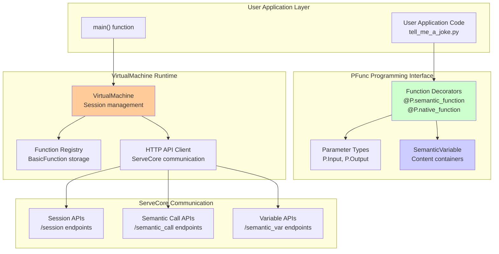
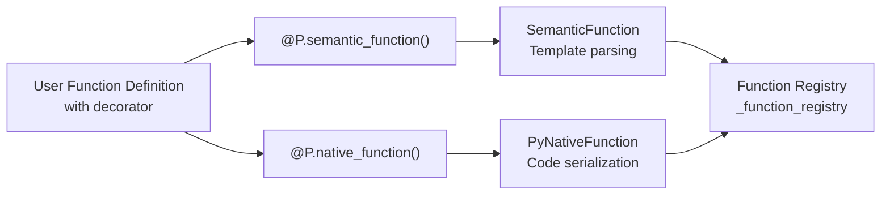
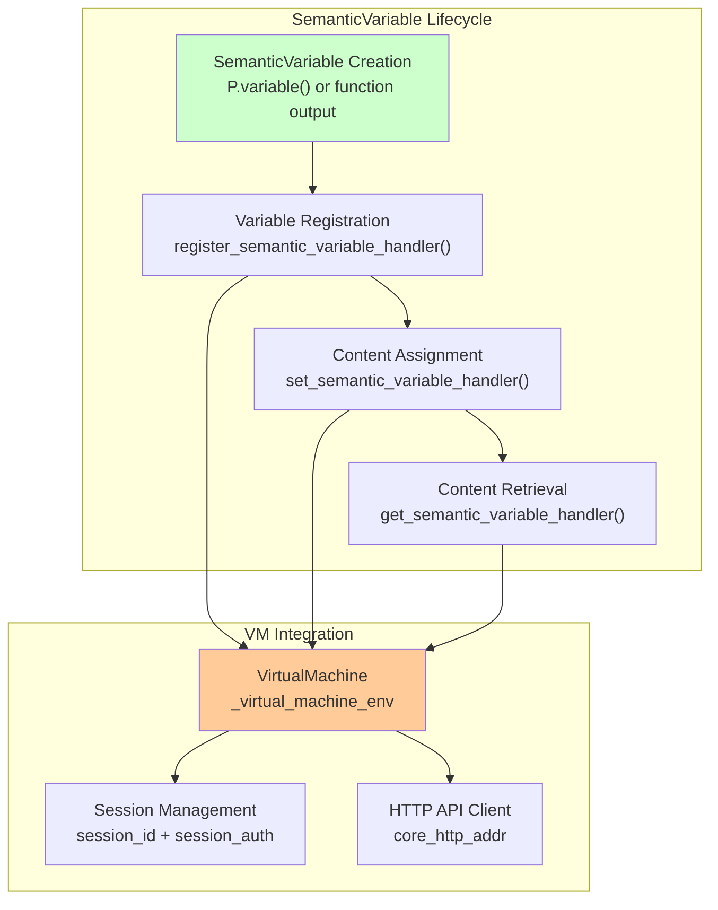
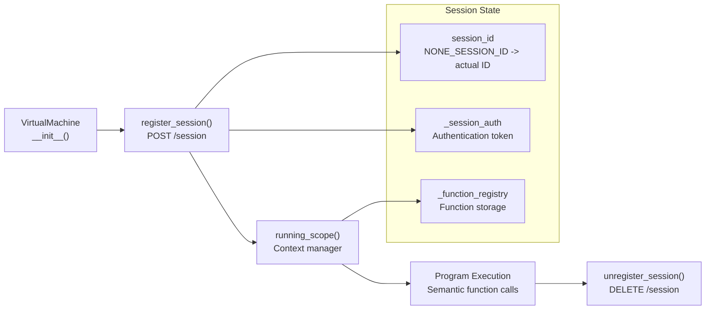
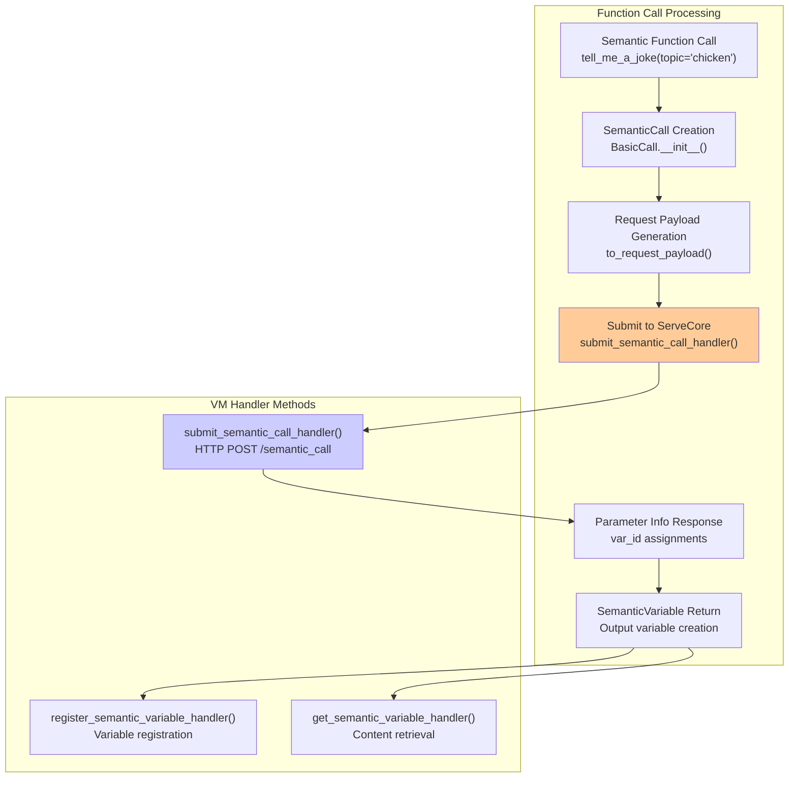

<!-- source: DeepWiki mcp.deepwiki.com · repo microsoft/ParrotServe · page 3 Client Programming Interface · fetched 2026-10-26 -->

# Client Programming Interface

<details>
<summary>Relevant source files</summary>

The following files were used as context for generating this wiki page:

- [.env-dev](.env-dev)
- [.gitignore](.gitignore)
- [CONTRIBUTING.md](CONTRIBUTING.md)
- [README.md](README.md)
- [TRANSPARENCY.md](TRANSPARENCY.md)
- [benchmark/bench_kernel.py](benchmark/bench_kernel.py)
- [docs/README.md](docs/README.md)
- [docs/get_started/launch_server.md](docs/get_started/launch_server.md)
- [docs/sys_design/serve_layer/graph.md](docs/sys_design/serve_layer/graph.md)
- [docs/user_docs/parrot_apis.md](docs/user_docs/parrot_apis.md)
- [docs/user_docs/pfunc.md](docs/user_docs/pfunc.md)
- [docs/version_drafts/v3.md](docs/version_drafts/v3.md)
- [parrot/engine/engine_creator.py](parrot/engine/engine_creator.py)
- [parrot/frontend/pfunc/function.py](parrot/frontend/pfunc/function.py)
- [parrot/frontend/pfunc/interface.py](parrot/frontend/pfunc/interface.py)
- [parrot/frontend/pfunc/vm.py](parrot/frontend/pfunc/vm.py)
- [parrot/testing/localhost_server_daemon.py](parrot/testing/localhost_server_daemon.py)
- [requirements.txt](requirements.txt)
- [setup.py](setup.py)
- [tests/engine/builtin/test_llama.py](tests/engine/builtin/test_llama.py)
- [tests/engine/builtin/test_sampler.py](tests/engine/builtin/test_sampler.py)
- [tests/engine/test_engine.py](tests/engine/test_engine.py)
- [tests/engine/test_http_server.py](tests/engine/test_http_server.py)

</details>


## Purpose and Scope

The Client Programming Interface provides user-facing programming abstractions for developing LLM-based applications with ParrotServe. This interface enables developers to write semantic programs using Python decorators and semantic variables that automatically leverage ParrotServe's optimization capabilities including request parallelization, batching, and context sharing.

For detailed information about individual API components, see [PFunc API](#3.1). For VirtualMachine session management, see [VirtualMachine](#3.2). For complete application examples, see [Example Applications](#3.3). For server-side request processing, see [Request Processing Pipeline](#2.3).

## Client Interface Architecture

The client programming interface consists of three main layers that abstract the underlying distributed serving system:



Sources: [parrot/frontend/pfunc/vm.py:49-481](), [parrot/frontend/pfunc/interface.py:1-165](), [parrot/frontend/pfunc/function.py:34-633]()

## Core Programming Components

### Function Decorators

The programming interface provides two primary decorators for defining LLM functions:

| Decorator | Purpose | Function Type |
|-----------|---------|---------------|
| `@P.semantic_function()` | Define LLM prompt templates with placeholders | `SemanticFunction` |
| `@P.native_function()` | Define Python computation functions | `PyNativeFunction` |



Sources: [parrot/frontend/pfunc/interface.py:38-147](), [parrot/frontend/pfunc/function.py:225-383](), [parrot/frontend/pfunc/function.py:461-633]()

### Parameter Type System

Function parameters are annotated with semantic types that determine their role in the computation graph:

| Parameter Type | Class | Description |
|----------------|-------|-------------|
| `P.Input` | `ParamType.INPUT_LOC` | Input semantic variable locations |
| `P.Output` | `ParamType.OUTPUT_LOC` | Output semantic variable locations |
| Python objects | `ParamType.INPUT_PYOBJ` | Direct Python object parameters |

Sources: [parrot/frontend/pfunc/interface.py:23-36](), [parrot/frontend/pfunc/function_body.py:15-37]()

### SemanticVariable Container

`SemanticVariable` objects serve as content containers that enable data flow dependencies between function calls:



Sources: [parrot/frontend/pfunc/semantic_variable.py:1-200](), [parrot/frontend/pfunc/vm.py:85-169]()

## VirtualMachine Session Management

The `VirtualMachine` class provides the runtime environment for executing semantic programs by managing sessions and coordinating with ServeCore:

### Session Lifecycle



Sources: [parrot/frontend/pfunc/vm.py:277-308](), [parrot/frontend/pfunc/vm.py:387-456]()

### Function Call Processing

When a semantic function is called, the VirtualMachine processes the request through multiple stages:



Sources: [parrot/frontend/pfunc/function.py:301-383](), [parrot/frontend/pfunc/vm.py:183-274]()

## HTTP API Communication

The client interface communicates with ServeCore through RESTful HTTP APIs using structured request/response patterns:

### API Endpoint Mapping

| Client Operation | HTTP Endpoint | VM Handler Method |
|------------------|---------------|-------------------|
| Session registration | `POST /session` | `register_session()` |
| Session removal | `DELETE /session` | `unregister_session()` |
| Semantic function call | `POST /semantic_call` | `submit_semantic_call_handler()` |
| Native function call | `POST /py_native_call` | `submit_py_native_call_handler()` |
| Variable registration | `POST /semantic_var` | `register_semantic_variable_handler()` |
| Variable content get | `GET /semantic_var/{var_id}` | `get_semantic_variable_handler()` |
| Variable content set | `POST /semantic_var/{var_id}` | `set_semantic_variable_handler()` |

Sources: [parrot/frontend/pfunc/vm.py:183-274](), [parrot/protocol/public/apis.py:1-200](), [docs/user_docs/parrot_apis.md:1-259]()

## Basic Usage Pattern

The typical client programming pattern follows this structure:

```python
from parrot import P

# Define semantic functions using decorators
@P.semantic_function()
def function_name(param1: P.Input, param2: P.Output):
    """Template with {{param1}} placeholder: {{param2}}"""

# Create VirtualMachine and run program
vm = VirtualMachine(core_http_addr="http://localhost:9000")
def main():
    result = function_name(topic="example")
    content = result.get()  # Retrieve generated content

# Execute under VM context
vm.run(main)
```

This pattern automatically handles session management, function registration, variable creation, and request submission to the distributed serving system.

Sources: [README.md:14-31](), [parrot/frontend/pfunc/vm.py:420-456](), [docs/user_docs/pfunc.md:16-38]()

---

